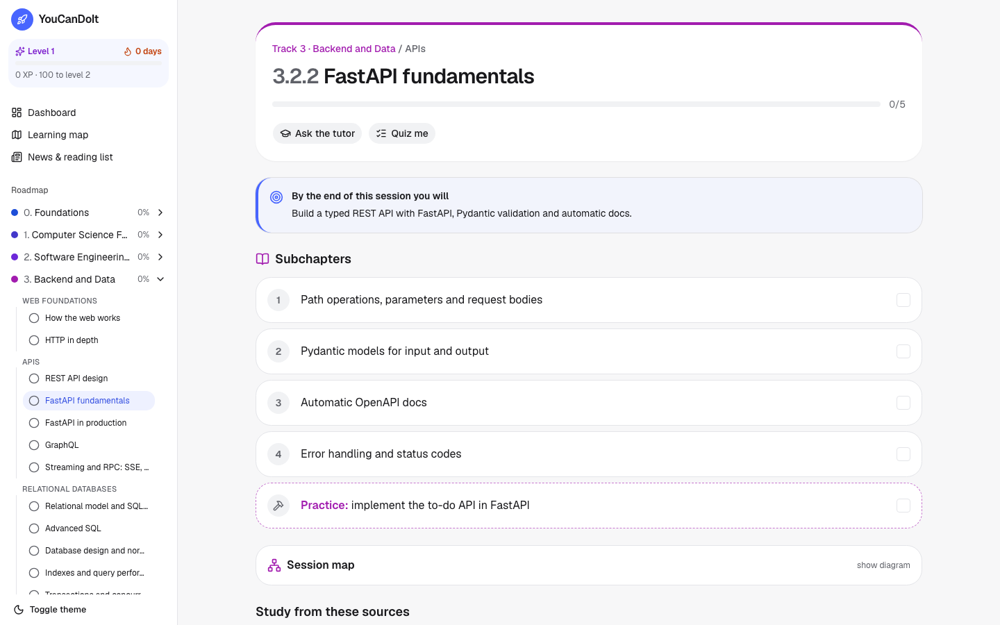
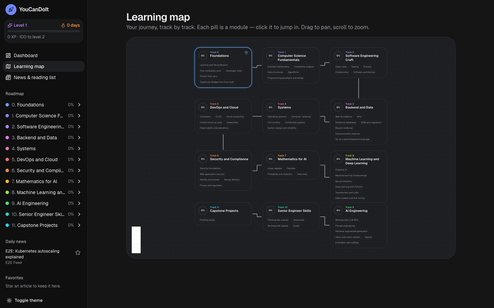
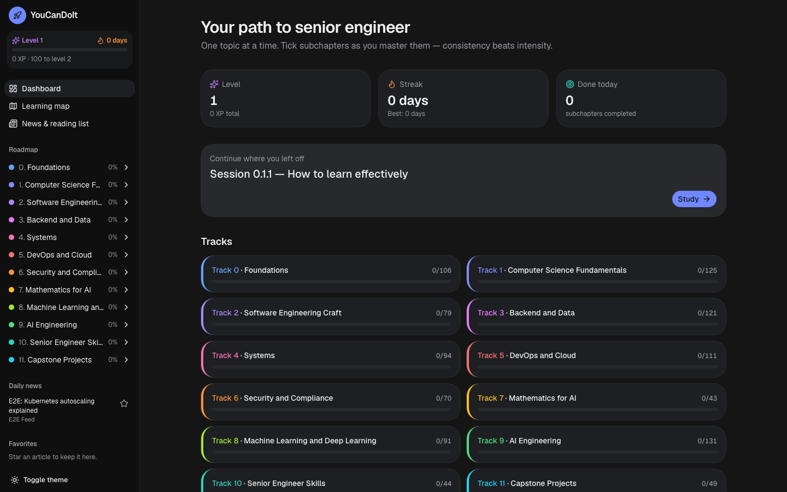
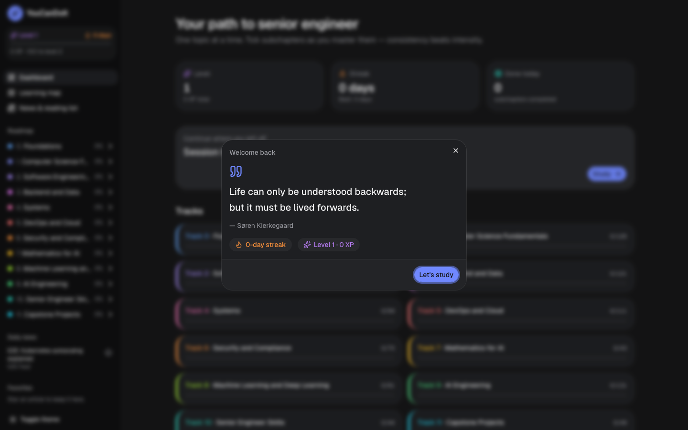
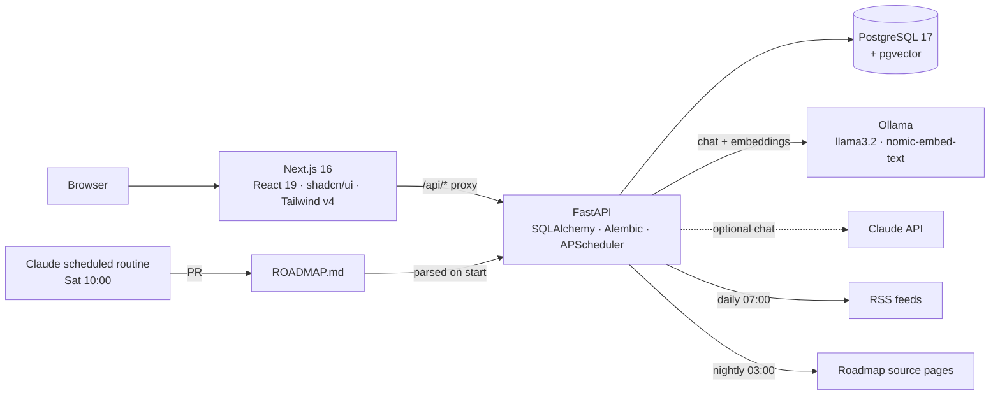

# YouCanDoIt

A personal, gamified learning platform to go from **junior front-end developer to senior software
engineer with AI and DevOps expertise** — built as a real full-stack, AI-integrated, Dockerised
product.

- **The roadmap** — [`ROADMAP.md`](ROADMAP.md): 12 tracks, 227 sessions, 1,064 subchapters, from
  "how computers work" to multi-agent systems and staff-level skills. Built from university
  curricula, 21 senior job postings and verified official documentation ([`research/`](research)).
- **The app** — tracks your progress through that roadmap with XP, levels, streaks and badges, an
  interactive map, a daily tech-news feed with favorites, and a **RAG-powered AI tutor** that
  answers from the roadmap's own sources and cites them.
- **Kept up to date** — a scheduled Claude routine reviews the sources every Saturday at 10:00
  (Europe/Rome) and opens a pull request with roadmap updates.

| Session view | Learning map |
|---|---|
|  |  |
| **Dashboard** | **Welcome quote** |
|  |  |

## Quick start

Requirements: Docker. Everything else runs in containers and is free.

```sh
docker compose up -d --build
open http://localhost:3000
```

The first start downloads two Ollama models (~2.3 GB: `llama3.2:3b` for chat, `nomic-embed-text`
for embeddings) and then indexes the roadmap's source pages in the background. The app is usable
immediately; the tutor's citations improve as indexing completes.

**On a Mac, run Ollama natively for speed** (Docker on macOS has no GPU access):

```sh
brew install ollama && ollama serve &
ollama pull llama3.2:3b && ollama pull nomic-embed-text
echo "OLLAMA_URL=http://host.docker.internal:11434" >> .env
docker compose up -d api
```

**Optional: Claude for chat.** Set `ANTHROPIC_API_KEY` in `.env` (see [`.env.example`](.env.example)).
Chat, summaries and quizzes switch to Claude; embeddings stay on Ollama (free, local).

## Features

| Feature | How it works |
|---|---|
| Roadmap tracker | Left sidebar: tracks → modules → sessions with completion state. Parsed from `ROADMAP.md` on every start; progress survives roadmap edits (stable IDs). |
| Session view | Outcomes callout, numbered subchapters with checkboxes, "Practice" tasks, a Mermaid mind map, and source cards. Colour-coded per track. |
| Gamification | XP per subchapter + bonuses per session/track, levels, daily streak, badges, toasts on level-up. All derived from completions — nothing to drift. |
| Welcome quote | 131 curated quotes (philosophers, scientists, engineers), once per browser session. |
| Learning map | React Flow map: tracks on a serpentine path, modules as pills, "you are here" marker. |
| Daily news | 17 RSS/Atom feeds (GitHub, Anthropic, OpenAI, Hugging Face, InfoQ, CNCF, Martin Fowler…) fetched at 07:00, deduped, kept 30 days; favorites kept forever. |
| AI tutor (RAG) | Question → embed → pgvector cosine search over the session's indexed sources → grounded answer with numbered citations. |
| Ask your reading list | Same RAG pipeline over articles; favorites are re-indexed with their full text. |
| Quiz me | AI-generated multiple-choice quiz per session (retrieval practice), validated server-side. |
| Article summaries | One click, cached. |

## Architecture



```
apps/api/      FastAPI service: routes/, rag.py, llm.py, news.py, gamification.py, roadmap_parser.py
apps/web/      Next.js app: app/ (pages + /api proxy), components/, lib/ (typed client), e2e/
content/       quotes.json, feeds.yaml, coverage.yaml, lessons/ (future)
research/      curricula, job requirements, e-learning platforms, UI notes, official docs
Resources/     the learner's original material + downloaded syllabi
scripts/       e2e.sh, e2e-seed.sh
```

**Design decisions**

- **`ROADMAP.md` is the single source of truth.** Humans and the weekly Claude routine edit
  Markdown; the API parses it with a strict, validated format. No second copy to drift.
- **Derived gamification.** XP, level, streak and badges are pure functions of the completion
  table (`gamification.py`), so they can never disagree with the checkboxes.
- **Provider abstraction.** `LLMProvider` protocol with Ollama, Anthropic and a deterministic fake
  (for CI). Embeddings are always local.
- **pgvector over a dedicated vector DB.** One database for app data and vectors; HNSW index.
  Porting `rag.py` to Qdrant is a planned capstone exercise (Track 9).
- **Self-healing indexing.** Startup waits for embeddings to be available; unindexed articles and
  changed source pages (content hash) are picked up on the next run.
- **Typed end to end.** Pydantic models → OpenAPI → `openapi-typescript` → `lib/api-types.ts`.

**Stack alternatives considered**

| Option | Why not chosen |
|---|---|
| Full TypeScript monorepo (Next.js + NestJS + Prisma) | One language is simpler, but the roadmap needs Python practice (FastAPI, ORM, RAG). |
| SvelteKit + FastAPI | Less boilerplate, smaller job market than React. |
| PostgreSQL + Qdrant | Two stores to keep in sync for a single-user app; kept as a learning exercise instead. |
| SQLite + sqlite-vec | Zero setup but less representative of production. |

## Development

```sh
# API tests (pytest, needs the db container)
docker compose run --rm -v "$PWD/apps/api:/app" api pytest -q

# Web: lint, types, build
cd apps/web && npm ci && npm run lint && npm run typecheck && npx next build

# End-to-end (Playwright, isolated e2e database + fake LLM)
./scripts/e2e.sh
docker compose up -d api   # afterwards: switch the API back to your real database

# Regenerate API types after changing the backend
cd apps/web && npm run gen:api

# Admin commands
docker compose exec api python -m app.cli refresh-news
docker compose exec api python -m app.cli index-sources
```

CI (GitHub Actions) runs lint, pytest, type-check, build and the Playwright suite on every push.

## Deployment

- **Local (primary):** `docker compose up`.
- **Free cloud (optional):** web on Vercel Hobby, API on Render free, database on Neon free (has
  pgvector). Ollama can't run on free tiers, so set `ANTHROPIC_API_KEY` for chat and point
  `OLLAMA_URL` at a machine you control for embeddings. Add auth first — the app is single-user.

## Roadmap of the app itself

See [`toDo.md`](toDo.md).
