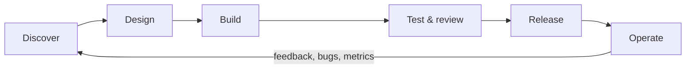
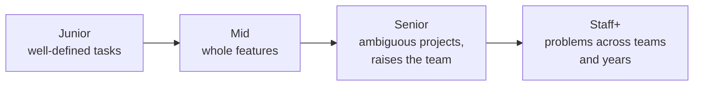

"Software engineer" sounds like one job, but from the inside it is many: writing code, yes, but
also clarifying fuzzy requirements, reviewing other people's work, keeping systems alive at 3 a.m.
and explaining trade-offs to people who don't write code. This session gives you a map of the
profession, so you know what you are training for and can measure the gap between where you are
and the senior role you want.

## The software development lifecycle (SDLC)

Think of building software like renovating a house while people still live in it. You have to
decide what to change, draw plans, do the work, check it is safe, move people back in and then keep
fixing leaks for years. The **software development lifecycle (SDLC)** is the name for that whole
journey, from idea to retirement.

Most descriptions split it into the same handful of phases:

1. **Discovery and requirements.** What problem are we solving, for whom, and how will we know it
   worked? The output is a short spec, a ticket or a product brief.
2. **Design.** How will we build it? Data model, API shape, which services change, what the UI
   looks like. For larger work this becomes a written design document that others review.
3. **Implementation.** Writing the code, together with its tests.
4. **Testing and review.** Automated tests in CI, a teammate's code review, sometimes manual QA.
5. **Release.** Merging and deploying, often behind a feature flag so it can be switched off.
6. **Operation and maintenance.** Monitoring, fixing bugs, answering support questions and
   eventually deleting the feature when nobody needs it.

The arrow from "Operate" back to "Discover" is the important part. Older **waterfall** projects ran
the phases once, in order, over months. Modern teams run the loop in small slices, often many times
a week: that's the core idea behind **agile** and **continuous delivery**. A feature is not one big
pass through the cycle; it is dozens of small passes, each one shipping something real.

> [!NOTE]
> The phases don't disappear in agile teams; they just get smaller. A one-day change still has a
> requirement (the ticket), a design (a comment in the PR), code, a review and a deploy.

> [!WARNING]
> Juniors often think the job *is* phase 3. In reality, a large share of an engineer's time goes
> into the phases around it: understanding the problem, reviewing, debugging production issues.
> If you only practise writing new code, you practise only part of the job.

## Roles in a product team: engineering, product, design, SRE, data

A product team is like a film crew: the director, the camera operator and the sound engineer all
work on the same film, but each owns a different question. Knowing who owns what tells you who to
ask and what they need from you.

| Role | The question they own | What they need from engineers |
|---|---|---|
| **Engineering** (backend, frontend, full-stack, mobile) | *How* do we build it, and will it keep working? | — (this is you) |
| **Product management** (PM) | *What* should we build and *why*, in what order? | Honest estimates, trade-offs, early warnings about risk |
| **Design** (UX/UI, research) | How should it *feel* and work for the user? | Feedback on feasibility, faithful implementation, edge cases they missed |
| **SRE / platform / DevOps** | Will it stay *up*, fast and safe in production? | Observable code (logs, metrics), sensible resource use, runbooks |
| **Data** (analysts, data engineers, ML engineers) | What do the *numbers* say, and can we trust them? | Clean events, documented schemas, no silent changes to tables |

**SRE** stands for *Site Reliability Engineering*: a discipline that treats operations as a
software problem, with goals such as "99.9% of requests succeed" and automation instead of manual
fixes. In small companies there may be no separate SRE team, and every engineer carries part of
that responsibility.

> [!EXAMPLE]
> A PM asks for "export to CSV" on the reports page. Design sketches a button and a progress
> state. Backend engineering notices large reports could take minutes, and proposes a background
> job plus an email link. SRE asks how much memory a big export uses. Data asks that each export
> sends an analytics event. One "small" feature, five perspectives, and the engineer is the one
> who connects them.

The skill that makes you valuable across these roles is **translation**: turning a vague product
wish into a technical plan, and turning a technical constraint ("this query scans 40 million rows")
into a product consequence ("the page will take 20 seconds unless we pre-compute it").

## The engineering career ladder: junior → mid → senior → staff

Most tech companies publish a **career ladder**: a list of levels with the expectations for each.
Titles and numbers differ, but the shape is remarkably consistent. The key change from level to
level is not "writes more code" but **scope**: how big a problem you can own without someone else
breaking it down for you.

- **Junior.** Completes well-defined tasks with guidance. Learns the codebase, the tools and the
  team's way of working. Asks good questions. Success is *growing fast*.
- **Mid-level.** Delivers whole features independently, from ticket to production. Writes tests
  without being reminded, reviews peers' code, handles routine incidents.
- **Senior.** Takes an *ambiguous* problem ("checkout is slow and we don't know why") and turns it
  into a plan, then delivers it. Makes design trade-offs and explains them in writing. Raises the
  level of the people around them through reviews, mentoring and good defaults.
- **Staff and above.** Works on problems that span several teams or a long time horizon:
  architecture direction, migrations, technical strategy. The [StaffEng](https://staffeng.com/guides/)
  guides describe several common shapes of this role, such as the tech lead, the architect, the
  "solver" sent to hard problems and the "right hand" of an engineering leader.

> [!NOTE]
> Past senior, many companies split into two tracks: **individual contributor** (staff,
> principal) and **management** (engineering manager, director). Both are senior careers. Being a
> great engineer does not oblige you to become a manager.

> [!TIP]
> A quick way to locate yourself: think of the last task you did. Did someone else define *what*
> to do and *how*? (junior) Only *what*? (mid) Neither, just the problem? (senior) Was the problem
> bigger than one team? (staff)

The jump from mid to senior is where many people stall, because it asks for skills that tutorials
rarely teach: writing design documents, saying "no" with good reasons, reviewing code kindly and
usefully, estimating, and owning outcomes rather than tickets. The rest of this roadmap includes
those skills on purpose (see Track 10).

## What senior job postings ask for in 2026

Job postings are noisy (they often list every technology the team has ever touched), but if you
read a dozen senior backend or AI-engineering postings side by side, a stable core appears. Treat
what follows as a reading guide rather than a statistic: it groups the requirements you will see
again and again.

**Technical depth**

- Strong command of one backend language (often Python, TypeScript/Node, Java or Go) and its
  ecosystem.
- Designing and running **APIs** and **relational databases** (SQL, indexing, migrations).
- **Cloud and containers**: Docker, a major cloud provider, CI/CD pipelines, infrastructure as
  code.
- **Distributed systems** basics: caching, queues, consistency, scaling, failure handling.
- **Observability**: logs, metrics, tracing, on-call and incident response.
- **Testing** as a habit, not an afterthought.

**AI-era skills.** Postings now frequently mention building with LLMs: calling model APIs,
retrieval-augmented generation (RAG), evaluating model output, and using AI coding assistants
productively and safely. The [roadmap.sh AI Engineer](https://roadmap.sh/ai-engineer) path shows
how these fit on top of a normal engineering foundation, while
[roadmap.sh Backend](https://roadmap.sh/backend) covers the classic backend core.

**Senior behaviours**

- "Leads the design of…" (system design, written design docs).
- "Mentors other engineers" (code review, pairing, onboarding).
- "Works with product and design to…" (the translation skill from earlier).
- "Owns services end to end" (from design to production health).

> [!WARNING]
> Don't read a posting as a checklist where you must tick every box. Teams list their ideal
> candidate. If you match the core and can show you learn fast, apply. Many people, especially
> career changers, rule themselves out too early.

> [!EXAMPLE]
> Phrase translation: "5+ years of experience" usually means "can work independently on ambiguous
> problems". "Strong communication skills" means "can write a clear design doc and disagree
> constructively in a review". Evidence of those (projects, write-ups, PRs) can matter more than
> the exact number of years.

## Practice: map your current skills against a senior job posting

The goal is a concrete, honest gap analysis that will guide which parts of this roadmap you
prioritise. Set aside 45 minutes.

### Step 1: Pick two real postings

Find two current senior postings for the role you want (for example "Senior Backend Engineer" and
"Senior AI Engineer") at companies you would genuinely like to work for. Copy the requirements into
a document, one per line.

### Step 2: Normalise the requirements

Group each line into one of four buckets: **language & frameworks**, **systems & infrastructure**,
**AI/data**, **senior behaviours**. Merge duplicates ("REST APIs" and "API design" become one row).

### Step 3: Score yourself honestly

For each row, give yourself a score from 0 to 3:

| Score | Meaning |
|---|---|
| 0 | Never used it |
| 1 | Followed a tutorial |
| 2 | Used it in a real project, with help |
| 3 | Could do it alone and explain the trade-offs |

Write one line of **evidence** next to each score of 2 or 3 (a repo, a PR, a project at work). A
score without evidence drops by one.

### Step 4: Link gaps to the roadmap

For every row scored 0 or 1, find the ROADMAP session(s) that cover it and write the session id
next to it. This turns a scary list into a reading order.

### Step 5: Choose three priorities

Pick the three gaps that appear in *both* postings and have the lowest scores. Those are your
focus for the next month. Save the document; you will re-score it at the end of each track and
watch the numbers move.

> [!TIP]
> Keep the file in your notes repository and date each re-scoring. In six months, the difference
> between the first and latest version is the best evidence of growth you can show yourself, and a
> great story for interviews.
