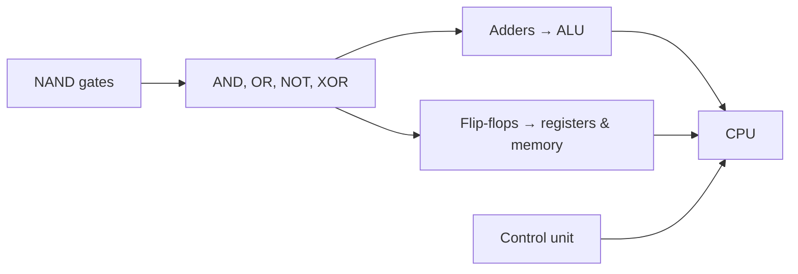
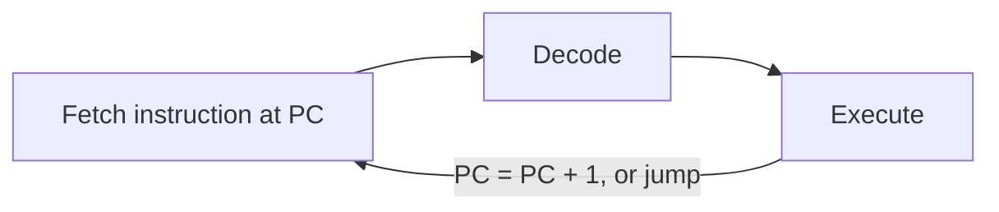
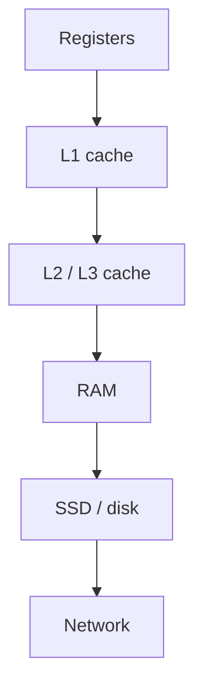

You can build web apps for years without thinking about the CPU. But the moment you ask "why is
this loop slow?", "why does reading this array row by row beat column by column?" or "what is a
pointer, really?", you need a mental model of the machine. This session builds that model from the
bottom up, in the spirit of [Nand2Tetris](https://www.nand2tetris.org/): from logic gates to a
working computer.

## Logic gates to CPU: ALU, registers, control unit

Start with the smallest piece. A **logic gate** is a tiny circuit that takes one or two bits in and
gives one bit out according to a fixed rule. Think of them as light switches wired in clever ways.

| Gate | Output is 1 when… |
|---|---|
| **NOT** | the input is 0 |
| **AND** | both inputs are 1 |
| **OR** | at least one input is 1 |
| **XOR** | exactly one input is 1 |
| **NAND** | NOT (both inputs are 1) |

A remarkable fact, and the starting point of Nand2Tetris: **every other gate can be built from NAND
alone**. Combine gates and you get circuits that compute. An XOR and an AND together make a
**half adder** (XOR gives the sum bit, AND gives the carry). Chain adders and you can add 64-bit
numbers. Add a circuit that remembers its output (a **flip-flop**) and you get memory.

From these building blocks, a **CPU** (central processing unit) is assembled out of three main
parts:

- **ALU (arithmetic logic unit)**: the calculator. It adds, subtracts, compares and does bitwise
  operations on the numbers it is given.
- **Registers**: a handful of tiny, ultra-fast storage slots inside the CPU, each holding one word
  (64 bits on modern machines). The ALU works on registers, not directly on RAM. Special registers
  include the **program counter** (address of the next instruction).
- **Control unit**: the conductor. It reads each instruction and sets the switches so that the
  right registers flow into the ALU and the result goes to the right place.



> [!NOTE]
> A **clock** ticks billions of times per second (a 3 GHz CPU ticks 3 billion times a second).
> On each tick, circuits move one step forward. "Faster CPU" historically meant a faster clock;
> today it mostly means more cores and doing more work per tick.

## The fetch–decode–execute cycle

A program, once compiled, is a list of **machine instructions** stored in memory, each a few bytes
long. Examples: "load the value at address 1000 into register R1", "add R1 and R2, put the result
in R3", "if R3 is zero, jump to address 2040".

The CPU runs them with one loop, repeated forever:

1. **Fetch**: read the instruction at the address in the program counter, and move the counter on
   to the next one.
2. **Decode**: the control unit works out what the instruction means: which operation, which
   registers, which address.
3. **Execute**: the ALU does the work, or data moves between registers and memory, or the program
   counter is changed (a **jump**, which is how `if` and loops are implemented).



> [!EXAMPLE]
> The Python line `total = a + b` might become something like:
> `LOAD R1, [a]` → `LOAD R2, [b]` → `ADD R3, R1, R2` → `STORE [total], R3`.
> Four trips through fetch–decode–execute. (Python adds many more steps on top, as session 0.2.3
> explains, but at the bottom it is always this loop.)

Real CPUs are cleverer than this simple picture. They **pipeline** (start fetching the next
instruction while the current one executes), run several instructions in parallel, and **predict
branches** to guess which way an `if` will go. The logical model stays the same: one instruction
after another, as if in order.

> [!TIP]
> Branch prediction explains a famous puzzle: looping over a *sorted* array with an `if` inside can
> be much faster than over an unsorted one, because the CPU guesses the branch correctly almost
> every time.

## Memory hierarchy: registers, caches, RAM, disk

Here is the key performance fact of modern computers: **the CPU is far faster than the memory
feeding it**. A CPU can do an addition in well under a nanosecond, while fetching data from main
memory takes on the order of 100 nanoseconds. Without help, the CPU would spend most of its time
waiting.

The solution is a **memory hierarchy**: small, fast, expensive storage close to the CPU, and large,
slow, cheap storage further away. Think of a chef: ingredients in hand (registers), on the counter
(L1 cache), in the kitchen fridge (L2/L3 cache), in the storeroom (RAM) and at the supermarket
across town (disk or network).

| Level | Typical size | Rough access time | Analogy |
|---|---|---|---|
| Registers | a few hundred bytes | < 1 ns | In your hands |
| L1 cache | tens of KB per core | ~1 ns | On the counter |
| L2 / L3 cache | MB to tens of MB | a few to tens of ns | Kitchen fridge |
| RAM | GB | ~100 ns | Storeroom |
| SSD | hundreds of GB to TB | tens to hundreds of µs | Supermarket |
| Network (another datacentre) | — | ms | Another city |

*(Orders of magnitude only; exact numbers vary by hardware.)*



Caches work because programs have **locality**:

- **Temporal locality**: data you just used will probably be used again soon (a loop counter).
- **Spatial locality**: data next to what you used will probably be used soon (the next array
  element). Caches load memory in **cache lines** (commonly 64 bytes), so neighbours come for free.

> [!WARNING]
> This is why the same algorithm can be several times faster or slower depending on memory access
> patterns. Walking an array in order is cache friendly; jumping around randomly (like following
> pointers in a linked list scattered across memory) is not.

For backend engineers, the hierarchy continues upward: an in-process cache beats Redis, Redis beats
the database, the database beats a call to another region. The same trade-off — closer means faster
but smaller — drives caching design in Tracks 3 and 4.

## A taste of C: pointers and memory addresses

Memory is a giant array of bytes, each with a numbered **address**. Every variable lives somewhere
in that array. High-level languages like Python hide addresses from you; **C** shows them, which is
why it's the best language for building a mental model of memory.

A **pointer** is a variable that holds an address. Analogy: a house is a variable, its street
address is a pointer. Writing the address on a note doesn't copy the house; following the address
gets you to it.

```c
#include <stdio.h>

int main(void) {
    int x = 42;      // an int stored somewhere in memory
    int *p = &x;     // p holds the ADDRESS of x (& = "address of")

    printf("x = %d\n", x);       // 42
    printf("address = %p\n", (void *)p);  // something like 0x7ffd5e8c
    printf("*p = %d\n", *p);     // 42 (* = "follow the pointer")

    *p = 7;          // change x through the pointer
    printf("x = %d\n", x);       // 7
    return 0;
}
```

Two symbols to remember: `&x` means "the address of x" and `*p` means "the value at the address in
p". Arrays in C are just a pointer to the first element plus arithmetic: `a[i]` is `*(a + i)`,
"start at `a` and move forward `i` elements".

> [!WARNING]
> C trusts you completely. Reading past the end of an array, using memory after freeing it, or
> following a pointer to nothing (`NULL`) leads to crashes or, worse, silent corruption and
> security holes. Much of the push towards memory-safe languages (Rust, Go, Java, Python) is about
> removing exactly these bugs.

> [!NOTE]
> Python variables are also references under the hood: `b = a` makes `b` point to the same list
> object as `a`, which is why appending to `b` changes `a`. Understanding C pointers makes this
> behaviour obvious instead of surprising.

## Practice: complete the first Nand2Tetris project or CS50 week on memory

Pick **one** of the two tracks below. Both are free and both turn this lesson into something your
hands remember.

### Option A: Nand2Tetris Project 1 (Boolean logic)

On [Nand2Tetris](https://www.nand2tetris.org/), download the software suite and open Project 1. You
start with a single given chip, NAND, and build the others in a simple hardware description
language, testing each one in the provided hardware simulator.

1. **Build `Not`** from one NAND (hint: feed the same input into both legs).
2. **Build `And`** from `Nand` and your new `Not`.
3. **Build `Or`** using De Morgan's law: `a OR b = NOT(NOT a AND NOT b)`.
4. **Build `Xor`** and `Mux` (a multiplexer: picks input `a` or `b` depending on a selector bit).
5. **Run the test scripts** for each chip in the simulator. A chip is done when its test passes;
   when one fails, compare your truth table with the expected one line by line.
6. Continue with the 16-bit and multi-way versions as far as you can.

### Option B: CS50 week on memory

On [CS50x](https://cs50.harvard.edu/x/), find the week that covers memory (pointers, `malloc`,
hexadecimal and addresses).

1. **Watch the lecture** with a notebook open. Every time an address or pointer appears, draw the
   memory boxes and arrows yourself.
2. **Do the lab and at least one problem set** for that week in the CS50 online environment.
3. **Write a three-line explanation** from memory of `&`, `*` and why `a[i]` equals `*(a + i)`.

### Wrap-up for either option

Write a short note answering: "What surprised me about how the machine works, and how could it
affect code I write in Python?" One honest paragraph is enough. If you have time, read the
introduction to [OSTEP](https://pages.cs.wisc.edu/~remzi/OSTEP/) to preview how the operating
system builds on this hardware.

> [!TIP]
> Stuck on a chip for more than 30 minutes? Write its truth table on paper first. Most gate designs
> become obvious once you see the rows where the output is 1.
