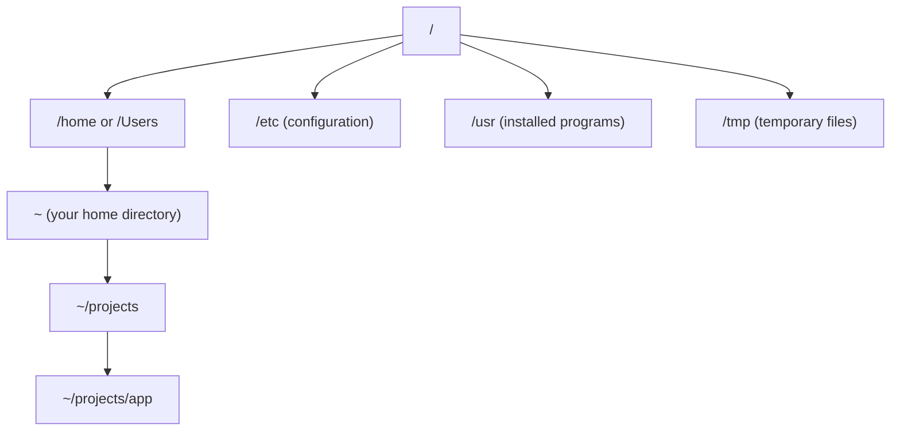
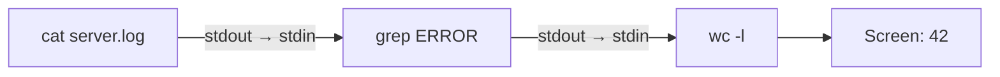
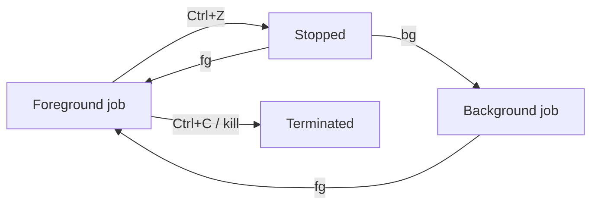

Every developer tool you will meet in this roadmap (Git, Docker, Python, databases, cloud CLIs) is
most powerful from the command line. Graphical interfaces are fine, but the terminal is where you
can automate, combine and repeat work. This session takes you from "the black window scares me" to
moving around, inspecting files and managing processes with confidence.

## Shells, prompts and the file system tree

Think of the terminal as a phone line to your computer, and the **shell** as the operator who
answers. The **terminal** (Terminal.app, iTerm2, Windows Terminal, the VS Code panel) is just the
window that shows text. The **shell** is the program inside it that reads what you type, interprets
it and runs other programs. Common shells are `bash` (the default on most Linux servers) and `zsh`
(the default on macOS). They are very similar for everyday work.

When the shell is ready for input, it shows a **prompt**, something like:

```sh
grazia@laptop:~/projects $
```

That line usually tells you who you are (`grazia`), which machine you are on (`laptop`) and where
you are in the file system (`~/projects`). Reading the prompt before typing is a habit that saves
you from running a command on the wrong server or in the wrong folder.

The **file system** is a tree. On macOS and Linux there is one root, written `/`, and everything
hangs below it:



A **path** is the address of a file in that tree. An **absolute path** starts from the root
(`/Users/grazia/projects/app`). A **relative path** starts from where you are now (`projects/app`).
A few shortcuts appear everywhere:

| Symbol | Meaning |
|---|---|
| `/` | The root of the tree |
| `~` | Your home directory |
| `.` | The current directory |
| `..` | The parent directory |

> [!NOTE]
> On Windows, use WSL (Windows Subsystem for Linux) for this course. It gives you a real Linux
> shell, and the servers you deploy to will almost always run Linux.

## Core commands: ls, cd, cp, mv, rm, find, grep

Most daily work uses a small set of commands. The general shape is
`command -options arguments`, for example `ls -l projects`.

- `pwd` prints where you are ("print working directory").
- `ls` lists a directory. `ls -l` shows details (size, date, permissions), `ls -a` shows hidden
  files (names starting with `.`, like `.gitignore`).
- `cd` changes directory. `cd ..` goes up one level, `cd ~` or plain `cd` goes home, `cd -` jumps
  back to where you were.
- `mkdir notes` creates a directory; `mkdir -p a/b/c` creates the whole chain.
- `cp source dest` copies; `cp -r` copies a directory recursively.
- `mv source dest` moves *or renames* (renaming is just moving within the same folder).
- `rm file` deletes; `rm -r dir` deletes a directory and everything inside it.
- `cat file` prints a file; `less file` lets you scroll through it (press `q` to quit).

> [!WARNING]
> `rm` does not use a trash can. There is no undo. Before running `rm -r` with a wildcard, run the
> same pattern with `ls` first (`ls *.log`) to see exactly what would be deleted.

Two commands are worth extra attention because you will use them to *find* things.

`find` searches for files by name, type, size or date, walking the tree from a starting point:

```sh
find . -name "*.py"              # every Python file below the current directory
find ~/projects -type d -name node_modules   # directories called node_modules
```

`grep` searches *inside* files for lines that match a pattern:

```sh
grep "TODO" app.py               # lines containing TODO in one file
grep -rn "def main" .            # recursive, with line numbers
grep -i "error" server.log       # case-insensitive
```

> [!TIP]
> Every command has a manual: `man ls`, `man grep`. Many also support `--help`. The manuals are
> dense, so skim the synopsis and the options you need. *The Linux Command Line* by William
> Shotts, free at [linuxcommand.org](https://linuxcommand.org/tlcl.php), explains the common ones
> in plain language.

Press `Tab` to autocomplete file and command names, and the up arrow to recall previous commands.
`Ctrl+R` searches your history. These three keys alone make the shell feel much faster.

## Pipes, redirection and composing commands

Here is the idea that makes the shell powerful: small programs that each do one thing, connected
together. The analogy is plumbing. Every program has an input pipe and an output pipe, and you can
connect them.

Each program has three standard streams:

- **stdin** (standard input): where it reads data, usually your keyboard.
- **stdout** (standard output): where it writes results, usually your screen.
- **stderr** (standard error): where it writes error messages, also your screen by default.

**Redirection** sends those streams to files:

```sh
ls -l > listing.txt      # write stdout to a file (overwrites it)
echo "done" >> log.txt   # append to a file
sort < names.txt         # read stdin from a file
python app.py 2> errors.txt   # send stderr (stream 2) to a file
```

A **pipe** (`|`) connects the stdout of one command to the stdin of the next:

```sh
cat server.log | grep "ERROR" | wc -l
```

That reads the log, keeps only the error lines and counts them. None of those programs knows about
the others; the shell wires them together.



> [!EXAMPLE]
> Which five IP addresses hit your server most often? Assume the IP is the first field of each
> access-log line:
>
> ```sh
> cut -d' ' -f1 access.log | sort | uniq -c | sort -rn | head -5
> ```
>
> `cut` extracts the first field, `sort` groups identical lines, `uniq -c` counts them, `sort -rn`
> orders by count descending, and `head -5` keeps the top five. Five tiny tools, one useful answer.

You can also run commands in sequence: `a ; b` runs both regardless, `a && b` runs `b` only if `a`
succeeded, and `a || b` runs `b` only if `a` failed. `mkdir build && cd build` is a common idiom.

## Permissions, users and sudo

Unix systems are multi-user. Every file has an **owner**, a **group**, and a set of permissions
saying who can do what. Run `ls -l` and you will see something like:

```sh
-rwxr-xr-- 1 grazia staff 1204 Oct 19 09:12 deploy.sh
```

The first column is the permission string. Read it in groups of three after the first character:

| Part | Who | Meaning here |
|---|---|---|
| `-` | type | regular file (`d` would mean directory) |
| `rwx` | owner (grazia) | read, write, execute |
| `r-x` | group (staff) | read and execute |
| `r--` | everyone else | read only |

For a directory, "execute" means "allowed to enter it". You change permissions with `chmod`:

```sh
chmod +x deploy.sh      # make it executable, so ./deploy.sh works
chmod 600 secrets.env   # owner can read/write, nobody else can do anything
```

The numeric form adds up read=4, write=2, execute=1 for owner, group and others: `755` is
`rwxr-xr-x`, `644` is `rw-r--r--`. You will see these numbers in Dockerfiles and deployment guides.

The special user **root** can do anything, including breaking the system. Instead of logging in as
root, you prefix a single command with `sudo` ("superuser do") to run it with root privileges, for
example `sudo apt install git` on Ubuntu.

> [!WARNING]
> "Permission denied" is a signal, not an obstacle. Before reaching for `sudo` or `chmod 777`,
> ask *why* you lack permission. `chmod 777` makes a file writable by everyone, which is a classic
> security hole on servers.

## Processes and jobs: ps, top, kill

A **program** is a file on disk. A **process** is a running instance of it, with its own memory and
a unique number called the **PID** (process ID). Opening two terminal windows starts two shell
processes from the same program.

- `ps` lists processes. `ps aux` shows all of them with owner, CPU and memory use. Combine it with
  grep: `ps aux | grep python`.
- `top` (or the friendlier `htop`, if installed) is a live dashboard of the busiest processes.
  Press `q` to quit.
- `kill PID` asks a process to stop by sending it a **signal**. By default this is `SIGTERM`
  ("please terminate"), which lets the program clean up. `kill -9 PID` sends `SIGKILL`, which the
  program cannot catch or ignore: use it only when a polite request fails.

In the shell itself you can manage **jobs**, the processes started from that terminal:

- `Ctrl+C` sends an interrupt to the foreground program (the usual way to stop a dev server).
- `Ctrl+Z` suspends it; `bg` resumes it in the background; `fg` brings it back.
- Adding `&` at the end (`python server.py &`) starts it in the background directly. `jobs` lists
  what is running.



> [!TIP]
> "Port 8000 is already in use" usually means an old dev server is still running. Find it with
> `lsof -i :8000`, then `kill` the PID it shows.

## Practice: complete the Missing Semester shell lecture exercises

MIT's [The Missing Semester of Your CS Education](https://missing.csail.mit.edu/) is a free course
about exactly the tools in this module. Its first lecture covers the shell, and its exercises are
short and practical. Budget about 60–90 minutes.

### Step 1: Watch or read the shell lecture

Open the course site and go to the first lecture on the shell. Watch the video or read the notes,
typing every command yourself in your own terminal as you go. Retyping beats watching (it's
retrieval practice for your fingers).

### Step 2: Do the exercises in a sandbox folder

Create a scratch area so mistakes are harmless:

```sh
mkdir -p ~/sandbox/missing && cd ~/sandbox/missing
```

Work through the lecture's exercises in order. They ask you to create files, write a tiny script,
make it executable and use redirection. When an exercise says "use `man`", actually read the
relevant part of the manual page.

### Step 3: Add your own composition drills

After the official exercises, solve these with pipes, without opening any editor:

1. Count how many `.md` files exist under your home directory (`find` + `wc -l`).
2. Show the 10 largest files in a project folder (`du -a` or `ls -lS`, plus `head`).
3. List every distinct file extension in a project and how many files use each one (hint:
   `find`, `sed` or `awk`, `sort`, `uniq -c`).
4. Start `sleep 300` in the background, find its PID with `ps`, and stop it with `kill`.

### Step 4: Write it down

Create `~/notes/shell.md` with the 15 commands you used most, each with a one-line example you
wrote yourself. Review it tomorrow without looking at this lesson first, then check.

> [!EXAMPLE]
> A good cheat-sheet line looks like: `grep -rn "TODO" src/ — find every TODO with file and line
> number`. A personal example sticks better than a copied definition.
