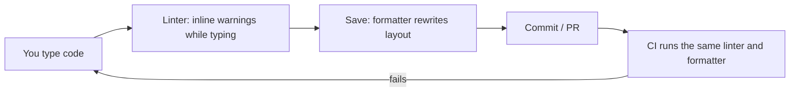
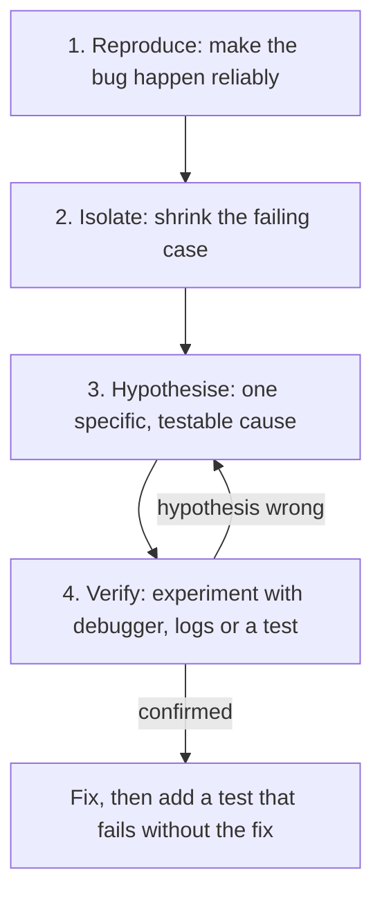

Most of a developer's time is not spent writing new code. It is spent reading code, understanding
why it misbehaves and changing it safely. Two things separate developers who fix bugs in ten
minutes from those who lose a whole afternoon: a well-tuned environment that catches mistakes
early, and a *method* for debugging instead of guesswork. This session gives you both.

## Editor setup: extensions, formatting on save, linters

Your editor is your workshop. A carpenter keeps tools sharp and within reach; you should do the
same with your editor. This roadmap assumes **VS Code** (or a fork of it), because it is free,
popular and has extensions for every language, but the ideas apply to JetBrains IDEs, Neovim or
anything else.

Three kinds of tooling matter most:

- **Language support.** An extension that understands your language gives you autocompletion,
  "go to definition", "find all references", rename-symbol and inline errors. For Python that is
  the Python extension with a type checker; for TypeScript it is built in.
- **A formatter.** A program that rewrites your code into a consistent layout: indentation, quotes,
  line length. Examples: Ruff or Black for Python, Prettier for JavaScript and TypeScript.
- **A linter.** A program that reads your code and warns about likely bugs and bad patterns: unused
  variables, unreachable code, a variable used before it is defined. Examples: Ruff for Python,
  ESLint for TypeScript.

The difference: a formatter changes *how code looks* and never its meaning; a linter flags *what
code does* that is probably wrong.

> [!TIP]
> Turn on **format on save**. In VS Code: `"editor.formatOnSave": true` in your settings. You will
> never think about indentation or trailing commas again, and code reviews stop arguing about
> style.

Configure tools **in the project, not just in your editor**. A `pyproject.toml` with Ruff settings,
or an `eslint.config.js`, lives in the repository, so every teammate and the CI pipeline apply the
same rules. This project does exactly that: CI runs `ruff check`, `ruff format --check` and
`eslint` on every change.



> [!WARNING]
> Don't install fifty extensions on day one. Each one adds noise, slows the editor and can
> conflict with others (two formatters fighting over the same file is a classic). Start with
> language support, one formatter, one linter and a Git integration; add more when you feel a
> specific need.

## Using a debugger: breakpoints, stepping, watches

The beginner's debugging tool is `print()`. It works, but it is like investigating a crime by
asking witnesses to shout updates from another room. A **debugger** lets you freeze time at a
chosen line and walk around the crime scene: inspect every variable, see the call stack, and move
forward one step at a time.

Core concepts:

- **Breakpoint**: a marker on a line that pauses the program when execution reaches it. In VS
  Code, click left of the line number. A **conditional breakpoint** only pauses when an expression
  is true (`user_id == 42`), which is invaluable inside loops.
- **Stepping**: once paused, you control execution.
  - *Step over*: run the current line, including any function calls on it, and stop at the next
    line.
  - *Step into*: if the line calls a function, go inside it.
  - *Step out*: finish the current function and stop in the caller.
  - *Continue*: run until the next breakpoint.
- **Watches**: expressions the debugger re-evaluates at every pause, like `len(items)` or
  `order.total - discount`.
- **Call stack**: the chain of function calls that led here. Clicking a frame shows that function's
  local variables at that moment.

Python ships with a terminal debugger, **pdb**, documented in the
[Python pdb docs](https://docs.python.org/3/library/pdb.html). Since Python 3.7 you can drop into
it from anywhere with the built-in `breakpoint()`:

```python
def average(scores):
    total = sum(scores)
    breakpoint()            # execution pauses here
    return total / len(scores)
```

At the `(Pdb)` prompt, a few commands go a long way:

| Command | Meaning |
|---|---|
| `p expr` | print an expression, e.g. `p scores` |
| `n` | next: step over |
| `s` | step into |
| `r` | return: run until the current function returns |
| `c` | continue to the next breakpoint |
| `l` / `ll` | list source around the current line / the whole function |
| `w` | where: print the call stack |
| `q` | quit |

You can also run a whole script under the debugger with `python -m pdb script.py`; if it crashes,
pdb enters **post-mortem** mode at the line that raised the exception, so you can inspect the state
that caused it.

> [!NOTE]
> The graphical debugger in VS Code and pdb are the same idea with different interfaces. Learn
> pdb once: it is the one that works over SSH on a server, inside a Docker container, or anywhere
> without a GUI.

## Debugging method: reproduce, isolate, hypothesise, verify

Tools help, but method matters more. Debugging is applied science: you observe, form a
hypothesis, run an experiment and update your belief. Random changes ("let me try adding a `+1`
here") are the opposite.



**1. Reproduce.** If you can't make the bug happen on demand, you can't know you fixed it. Find the
exact input, steps or environment. Write them down. Ideally, turn them into a failing automated
test.

**2. Isolate.** Shrink the problem. Remove code, data and steps until you have the smallest case
that still fails. If a 10,000-row CSV breaks the importer, binary search: does the first half fail?
The second? Keep halving until one row remains. Git offers the same trick across history:
`git bisect` finds the commit that introduced a bug by testing halfway points.

**3. Hypothesise.** State one concrete cause: "the date parser fails on rows where the day is
greater than 12, because it assumes MM/DD". A good hypothesis predicts something you can check.

**4. Verify.** Test the prediction with the debugger, a log line or a quick experiment. If it is
wrong, that is progress: you eliminated a cause. If it is right, fix the root cause, run the
failing test again and keep the test so the bug can never silently return.

> [!TIP]
> **Rubber duck debugging**: explain the problem, line by line, to a rubber duck (or a patient
> colleague). Explaining forces you to state assumptions you have been skipping over, and the bug
> often reveals itself mid-sentence.

> [!WARNING]
> Read the error message and the stack trace *completely* before doing anything else (session
> 0.1.3). Many "mysterious" bugs are fully described in the last line of the traceback, which
> people skip in their hurry to change code.

Use **logs** when the debugger can't help: bugs in production, in concurrent code, or that only
appear after hours of running. Log the inputs and decisions at the boundaries (requests in,
queries out), not every line.

## Keyboard-driven workflow and dotfiles

Every trip from keyboard to mouse costs a second and a little focus. Over a day, keyboard
shortcuts add up to real time and, more importantly, keep you in flow. Learn a handful well rather
than a hundred badly. In VS Code (Cmd on macOS, Ctrl on Windows/Linux):

| Shortcut | Action |
|---|---|
| `Cmd/Ctrl+P` | Quick open a file by name |
| `Cmd/Ctrl+Shift+P` | Command palette: run any command by name |
| `F12` / `Shift+F12` | Go to definition / find references |
| `F2` | Rename a symbol everywhere |
| `Cmd/Ctrl+D` | Select next occurrence (multi-cursor) |
| `` Ctrl+` `` | Toggle the integrated terminal |
| `F5` / `F9` / `F10` / `F11` | Start debugging / toggle breakpoint / step over / step into |

> [!TIP]
> Learn one new shortcut per week. Put it on a sticky note on your monitor, and use it deliberately
> until it is automatic. That is deliberate practice (session 0.1.1) applied to your tools.

**Dotfiles** are configuration files whose names start with a dot, so they are hidden by default:
`~/.zshrc` or `~/.bashrc` (your shell), `~/.gitconfig` (Git), editor settings, and so on. The
[Missing Semester](https://missing.csail.mit.edu/) course has a whole lecture on them. Over time you
accumulate aliases and settings that make you fast:

```sh
# ~/.zshrc
alias gs="git status"
alias gl="git log --oneline --graph --decorate -20"
export EDITOR="code --wait"
```

```ini
# ~/.gitconfig
[user]
    name = Ana Rossi
    email = ana@example.com
[pull]
    rebase = true
```

The best practice is to keep your dotfiles in a **Git repository** and link them into your home
directory with a small install script. A new laptop or a fresh server then becomes "yours" in a
couple of minutes, and you get history for every change to your setup.

> [!WARNING]
> Never commit secrets (tokens, private keys, passwords) to a dotfiles repository, especially a
> public one. Keep them in a separate, untracked file such as `~/.secrets` that your `.zshrc`
> sources if it exists.

## Practice: find a planted bug using only the debugger

You will hunt a bug with breakpoints, stepping and watches, with **no `print()` allowed**. Budget
about 45 minutes.

### Step 1: Create the buggy program

Save this as `~/sandbox/debug/grades.py`:

```python
def parse(line):
    name, *scores = line.strip().split(",")
    return name, [int(s) for s in scores]


def average(scores):
    total = 0
    for i in range(1, len(scores)):
        total += scores[i]
    return total / len(scores)


def report(lines):
    results = {}
    for line in lines:
        name, scores = parse(line)
        results[name] = round(average(scores), 1)
    return results


data = ["ana,90,80,70", "luca,100,100,100", "sara,60,75,90"]
print(report(data))
```

Run it with `python grades.py`. Expected averages are 80.0, 100.0 and 75.0. What do you get?

### Step 2: Reproduce and write down the symptom

Record the exact actual output next to the expected output. Notice the pattern: are all values
wrong by the same amount, or proportionally? This is your first clue, gathered without changing
any code.

### Step 3: Isolate with breakpoints

Run the file under the debugger, either `python -m pdb grades.py` or VS Code's "Run and Debug"
(`F5`). Set a breakpoint on the `return` line of `average`. When it pauses, inspect `scores`,
`total` and `len(scores)`. Is `total` what you expect for `ana`?

### Step 4: Hypothesise and verify by stepping

Form a specific hypothesis about *which* line produces the wrong `total`. Restart, put a breakpoint
on the `for` line, and step through the loop with `n` (or `F10`), adding watches for `i` and
`scores[i]`. Confirm or reject your hypothesis by what the watches show at each iteration.

### Step 5: Fix and protect

Fix the root cause (the simplest fix is `return sum(scores) / len(scores)`). Then add a small
check so the bug can never return unnoticed:

```python
assert average([90, 80, 70]) == 80
```

Finally, write three lines in your notes: the symptom, the root cause, and which debugger feature
found it fastest.

> [!EXAMPLE]
> Stretch: plant your own bug for a friend (an off-by-one, a mutable default argument, an integer
> division) and swap programs. Hunting someone else's bug in unfamiliar code is the real-world
> version of this exercise.
