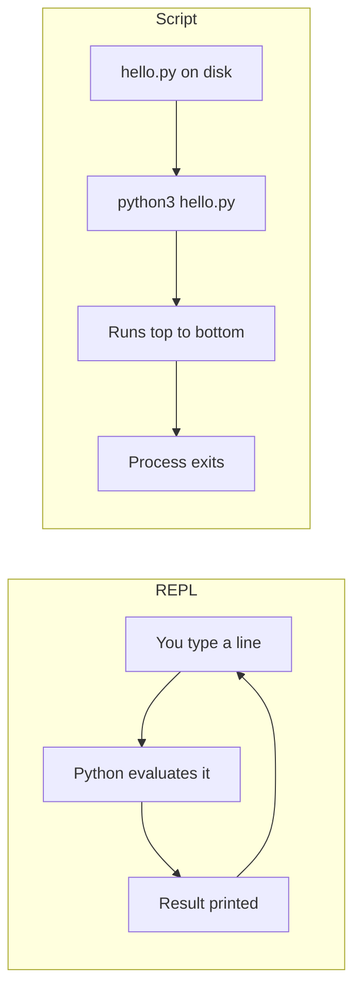
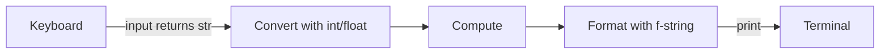

This is where you start writing real code. Python is the main language of this roadmap: the API of
this very platform is written in it, and it dominates backend scripting, data work and AI
engineering. The goal of this session is modest but important: get Python running on your machine,
understand the handful of building blocks every program is made of, and write two small programs
that take input, compute something and print a clean result.

## Installing Python and running scripts vs the REPL

Think of Python like a translator sitting between you and the computer. You write instructions in
a language humans can read; the **Python interpreter** reads them line by line and makes the
computer carry them out. "Installing Python" means installing that interpreter program.

On most systems you install it from the official python.org installers,
your package manager (`brew install python` on macOS, `apt install python3` on Ubuntu), or a
version manager. Later in the roadmap (session 0.4.5) you will use `uv`, which can install and
manage Python versions for you. For now, any recent Python 3 is fine. Check it in a terminal:

```sh
python3 --version
```

> [!WARNING]
> On many systems `python` (without the 3) is missing or points to an old Python 2. Python 2 is
> dead: it stopped receiving updates in 2020. Always make sure you are running Python 3.

There are two ways to talk to the interpreter.

**The REPL** (Read–Eval–Print Loop) is an interactive conversation. Type `python3` with no
arguments and you get a `>>>` prompt. Each line you type is read, evaluated, and its result
printed, then it waits for the next line. It is your scratchpad: perfect for checking "what does
`7 // 2` give?" in two seconds.

```python
>>> 7 // 2
3
>>> "hello".upper()
'HELLO'
>>> exit()
```

**A script** is a text file ending in `.py` that you run as a whole: `python3 hello.py`. The
interpreter executes it top to bottom and exits. Scripts are how real programs live: they are
saved, versioned in Git, reviewed and re-run.



> [!TIP]
> Use both together. Explore in the REPL until a line works, then paste it into your script. And
> notice one difference: the REPL *echoes* the value of an expression automatically, while a
> script only shows what you explicitly `print()`.

The official [Python Tutorial](https://docs.python.org/3/tutorial/) has a whole chapter on using
the interpreter; it is worth skimming once, and the rest of the tutorial is the best free
reference for everything in this module.

## Variables, numbers, strings and booleans

A **variable** is a name tag you stick on a value. In Python, `price = 20` does not create a box
called `price` holding 20; it creates the value `20` somewhere in memory and ties the label
`price` to it. If you later write `price = 25`, you move the label to a new value. This "labels,
not boxes" picture will save you from confusion in later sessions on lists and dictionaries.

```python
name = "Grazia"      # a string (str)
age = 34             # an integer (int)
height = 1.68        # a floating-point number (float)
is_student = True    # a boolean (bool)
```

Every value has a **type**, and you can ask for it with `type(age)`. Python is **dynamically
typed**: the variable has no fixed type, the *value* does. You can rebind `age = "thirty-four"` and
Python won't complain (your colleagues will). In session 0.4.7 you will add type hints to catch
this kind of mistake.

The four basic types:

| Type | Example | Notes |
|---|---|---|
| `int` | `42`, `-7`, `1_000_000` | Whole numbers, no size limit in Python |
| `float` | `3.14`, `0.1`, `2e-3` | Decimals, stored approximately (see session 0.2.1) |
| `str` | `"hi"`, `'hi'`, `"""multi-line"""` | Text, immutable sequence of characters |
| `bool` | `True`, `False` | Capitalised; result of comparisons |

Strings support indexing and many handy **methods** (functions attached to the value):

```python
city = "Rome"
city[0]          # 'R'
len(city)        # 4
city.lower()     # 'rome'
city + "!"       # 'Rome!'
```

> [!NOTE]
> Strings are **immutable**: `city.lower()` does not change `city`, it returns a *new* string. If
> you want to keep the result, rebind it: `city = city.lower()`.

**Converting between types** is something you will do constantly, because data from the outside
world (files, keyboard, web requests) usually arrives as text:

```python
int("42")       # 42
float("3.5")    # 3.5
str(42)         # '42'
int("4.5")      # ValueError: invalid literal for int()
```

> [!WARNING]
> Variable names are case-sensitive (`Age` and `age` are different), cannot start with a digit,
> and should not shadow built-ins. Naming a variable `list`, `str` or `input` works until the
> moment you need the real `input()` and get a confusing error.

## Operators and expressions

An **expression** is anything that produces a value: `2 + 3`, `price * 1.22`, `age >= 18`. Python
evaluates it and hands back the result. Operators are the verbs of expressions.

**Arithmetic operators:**

| Operator | Meaning | Example | Result |
|---|---|---|---|
| `+ - *` | add, subtract, multiply | `3 * 4` | `12` |
| `/` | true division, always a float | `7 / 2` | `3.5` |
| `//` | floor division | `7 // 2` | `3` |
| `%` | remainder (modulo) | `7 % 2` | `1` |
| `**` | power | `2 ** 10` | `1024` |

`%` is more useful than it looks: `n % 2 == 0` tests whether `n` is even, and `minutes % 60` gives
the minutes left after whole hours.

**Comparison operators** (`==`, `!=`, `<`, `<=`, `>`, `>=`) produce booleans. **Logical operators**
`and`, `or` and `not` combine them: `age >= 18 and has_ticket`.

**Precedence** works like in school maths: `**` first, then `* / // %`, then `+ -`, then
comparisons, then `not`, `and`, `or`. When in doubt, add parentheses; they cost nothing and make
intent obvious.

> [!EXAMPLE]
> `2 + 3 * 4` is `14`, not `20`. `(2 + 3) * 4` is `20`. And `-7 // 2` is `-4`, not `-3`, because
> floor division rounds *down* towards negative infinity, not towards zero.

Some operators work on strings too: `"ab" + "cd"` is `"abcd"` and `"-" * 10` is a line of ten
dashes. But `"3" + 4` raises a `TypeError`: Python refuses to guess whether you meant `"34"` or
`7`. That strictness is a feature; it turns silent bugs into loud ones.

**Augmented assignment** is shorthand for updating a variable: `total += price` means
`total = total + price`. You will see it in nearly every loop.

> [!WARNING]
> `=` assigns, `==` compares. `if x = 5:` is a syntax error in Python, which is kinder than
> languages where it silently assigns.

## Input, output and f-strings

Programs become useful when they talk to the outside world. The simplest channels are the keyboard
and the terminal, which you met as *standard input* and *standard output* in session 0.2.3.

`print()` writes to standard output. It accepts several values, separated by spaces by default:

```python
print("Total:", 42)           # Total: 42
print("a", "b", sep="-")      # a-b
print("no newline", end="")   # stays on the same line
```

`input()` shows a prompt, waits for the user to press Enter, and returns what they typed **as a
string**, always.

```python
name = input("What's your name? ")
age = int(input("How old are you? "))   # convert, or you can't do maths with it
```

> [!WARNING]
> The single most common beginner bug: `input()` returns `"20"`, not `20`. `input("Bill: ") * 2`
> gives `"2020"`. Convert with `int()` or `float()` as soon as you read the value.

**f-strings** are the modern way to build text from values. Put an `f` before the quotes and
expressions inside `{}`:

```python
name, total = "Ana", 23.456
print(f"Hi {name}, you owe {total:.2f} euros")   # Hi Ana, you owe 23.46 euros
print(f"{'Item':<10}|{'Price':>8}")              # left/right aligned columns
print(f"{1234567:,}")                            # 1,234,567
print(f"{total=}")                               # total=23.456  (handy for debugging)
```

The part after the colon is the **format spec**: `.2f` means "float with two decimals", `<10`
means "left-align in 10 characters", `,` adds thousands separators. You do not need to memorise
these; the [Python Tutorial](https://docs.python.org/3/tutorial/) chapter on input and output lists
them, and you will look them up as needed.



> [!TIP]
> This input → convert → compute → format → output shape is the skeleton of countless programs,
> from a CLI tool to a web endpoint (where "input" is a JSON request and "output" a JSON
> response). Learn it well now.

## Practice: a tip calculator and a unit converter

Two small programs, about 45 minutes in total. Write each as a script in its own file, run it from
the terminal, and test it with a few different inputs, including silly ones.

### Step 1: Set up a folder

```sh
mkdir -p ~/code/python-basics && cd ~/code/python-basics
python3 --version
```

Open the folder in your editor. If you use Git (session 0.3.3), run `git init` now and commit
after each working program.

### Step 2: Write the tip calculator

Create `tip.py`. The program asks for the bill, the tip percentage and the number of people, then
prints what each person pays.

```python
bill = float(input("Bill total (€): "))
tip_percent = float(input("Tip percentage (e.g. 10): "))
people = int(input("Number of people: "))

tip = bill * tip_percent / 100
total = bill + tip
per_person = total / people

print(f"Tip:        {tip:8.2f} €")
print(f"Total:      {total:8.2f} €")
print(f"Per person: {per_person:8.2f} €")
```

Run it with `python3 tip.py`. Try `bill=84.50`, `tip=12`, `people=3`. Check the result by hand
once: tests come later, but the habit of verifying one case manually starts now.

### Step 3: Break it on purpose

Run it again and type `abc` for the bill, then `0` for the people. Read the error messages: a
`ValueError` and a `ZeroDivisionError`. You will learn to handle these properly in session 0.4.4;
for now, notice that the last line of the traceback tells you *what* went wrong and the line above
it tells you *where*.

### Step 4: Write the unit converter

Create `convert.py`, converting kilometres to miles and Celsius to Fahrenheit.

```python
KM_PER_MILE = 1.609344

km = float(input("Distance in km: "))
celsius = float(input("Temperature in °C: "))

miles = km / KM_PER_MILE
fahrenheit = celsius * 9 / 5 + 32

print(f"{km} km = {miles:.2f} miles")
print(f"{celsius} °C = {fahrenheit:.1f} °F")
```

> [!NOTE]
> `KM_PER_MILE` is written in capitals to signal "this is a constant, don't reassign it". Python
> doesn't enforce this; it is a naming convention every Python developer recognises.

Check two known values: `0 °C` must give `32.0 °F`, and `100 °C` must give `212.0 °F`.

### Step 5: Stretch goals

- In the tip calculator, also print the tip rounded *up* to the next whole euro per person (hint:
  `import math` and `math.ceil`).
- In the converter, ask which direction to convert (`km→mi` or `mi→km`). You will need `if`, which
  is the topic of the next session, so peek ahead in the
  [Python Tutorial](https://docs.python.org/3/tutorial/) or [CS50x](https://cs50.harvard.edu/x/).
- Compare your learning path with the [roadmap.sh Python](https://roadmap.sh/python) map and tick
  off what you have now covered.

> [!EXAMPLE]
> A finished run of `tip.py`:
>
> | Prompt | Input |
> |---|---|
> | Bill total (€) | 84.50 |
> | Tip percentage | 12 |
> | Number of people | 3 |
>
> Output: `Tip: 10.14 €`, `Total: 94.64 €`, `Per person: 31.55 €`.
