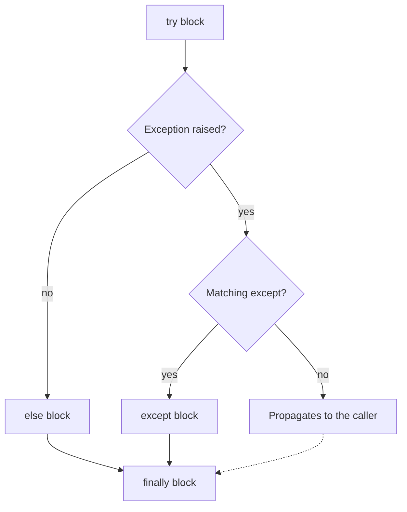
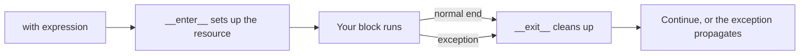

Real programs live in a messy world. Files go missing, users type letters where you expected
numbers, a CSV has a broken row, the disk is full. Beginners write code for the happy path and hope;
professionals write code that expects failure and handles it on purpose. This session covers the
two halves of that skill: reading and writing data in the formats you will meet daily (plain text,
CSV, JSON), and Python's exception system for dealing with everything that goes wrong.

## Reading and writing text, CSV and JSON files

Think of a file like a notebook in a drawer. To use it you **open** it (choosing whether to read,
write or append), do your work, and **close** it so the next person, or the operating system, can
use it. In Python, `open()` gives you a **file object** that represents that open notebook.

```python
with open("notes.txt", "w", encoding="utf-8") as f:
    f.write("first line\n")
    f.write("second line\n")

with open("notes.txt", encoding="utf-8") as f:
    for line in f:                 # iterates line by line, memory-friendly
        print(line.rstrip("\n"))
```

The second argument is the **mode**:

| Mode | Meaning | If the file exists | If it doesn't |
|---|---|---|---|
| `"r"` (default) | read | read from the start | `FileNotFoundError` |
| `"w"` | write | **erased** first | created |
| `"a"` | append | add at the end | created |
| `"x"` | exclusive create | `FileExistsError` | created |

Add `b` (`"rb"`, `"wb"`) for binary files like images.

> [!WARNING]
> Always pass `encoding="utf-8"` for text files. Without it Python uses the platform's default
> encoding, which may differ between your Mac, a Windows colleague and a Linux server. You met
> UTF-8 in session 0.2.1; here is where it bites in practice.

> [!WARNING]
> Mode `"w"` truncates the file the moment you open it, before you write anything. Opening the
> wrong path with `"w"` silently destroys its contents.

**CSV** (comma-separated values) is the lingua franca of spreadsheets and data exports. Don't split
lines on commas yourself: a field like `"Rome, Italy"` contains a comma inside quotes. Use the
standard `csv` module, which handles quoting correctly.

```python
import csv

with open("people.csv", newline="", encoding="utf-8") as f:
    for row in csv.DictReader(f):          # each row is a dict keyed by the header
        print(row["name"], row["city"])

with open("out.csv", "w", newline="", encoding="utf-8") as f:
    writer = csv.DictWriter(f, fieldnames=["name", "city"])
    writer.writeheader()
    writer.writerow({"name": "Ana", "city": "Rome, Italy"})
```

> [!NOTE]
> The `newline=""` argument is what the Python docs recommend for CSV files: it lets the `csv`
> module handle line endings itself, so you don't get blank rows on Windows.

**JSON** is the format of web APIs, config files and this platform's API responses. It maps almost
one-to-one onto Python types: objects become dicts, arrays become lists, strings, numbers,
`true`/`false` and `null` become `str`, `int`/`float`, `True`/`False` and `None`.

```python
import json

data = {"name": "Ana", "skills": ["python", "sql"], "active": True}

with open("user.json", "w", encoding="utf-8") as f:
    json.dump(data, f, indent=2)          # Python -> JSON file

with open("user.json", encoding="utf-8") as f:
    loaded = json.load(f)                 # JSON file -> Python

text = json.dumps(data)                   # Python -> JSON string ('s' for string)
again = json.loads(text)                  # JSON string -> Python
```

The [Python Tutorial chapter on input and output](https://docs.python.org/3/tutorial/inputoutput.html)
covers files and the `json` module in more depth.

## Exceptions: try / except / else / finally

An **exception** is Python's way of saying "I cannot continue normally". Think of it as a fire
alarm: when something goes wrong deep inside a function, the alarm goes off, normal work stops, and
the alarm travels *up* through every caller until someone handles it. If nobody does, the program
crashes and prints a **traceback**, the route the alarm took.

You have already met several: `ValueError` (`int("abc")`), `ZeroDivisionError`, `KeyError`,
`IndexError`, `FileNotFoundError`, `TypeError`. Each is a **class**, and they form a hierarchy:
`FileNotFoundError` is a kind of `OSError`, which is a kind of `Exception`.

You handle exceptions with `try`:

```python
def read_age(text):
    try:
        age = int(text)
    except ValueError:
        print(f"Not a number: {text!r}")
        return None
    else:
        print("Parsed fine")       # runs only if no exception happened
        return age
    finally:
        print("Done parsing")      # runs no matter what
```

| Clause | Runs when… | Typical use |
|---|---|---|
| `try` | always first | the risky operation, kept as small as possible |
| `except X` | an exception of type X (or a subclass) is raised in `try` | recover, report, or translate the error |
| `else` | `try` finished with no exception | the code that should run only on success |
| `finally` | always, even after `return` or an unhandled error | cleanup: close, release, log |



The [Python Tutorial chapter on errors](https://docs.python.org/3/tutorial/errors.html) walks
through each clause with examples.

> [!WARNING]
> Never write a bare `except:` or a blanket `except Exception: pass`. It swallows *every* error,
> including typos in your own code, and turns a loud, easy bug into a silent, impossible one.
> Catch the specific exceptions you expect and know how to handle.

> [!TIP]
> Keep the `try` block tiny. If it wraps twenty lines, you can't tell which line raised the
> `KeyError` you're catching, and you may hide a different bug. Put the success-path code in
> `else`.

You can catch several types at once, and get the exception object for its message:

```python
try:
    value = data["price"] / data["qty"]
except (KeyError, ZeroDivisionError) as err:
    print(f"Bad record: {err!r}")
```

> [!NOTE]
> Python culture favours **EAFP**, "easier to ask forgiveness than permission": try the operation
> and handle the exception, rather than checking every precondition first (**LBYL**, "look before
> you leap"). For files this is also more correct: a file can be deleted between your
> `os.path.exists()` check and your `open()`.

## Raising and defining custom exceptions

Handling errors is half the story; your own code should also **raise** them when it receives
something it cannot work with. Raising is how a function says "this input is wrong, and I refuse to
guess".

```python
def withdraw(balance, amount):
    if amount <= 0:
        raise ValueError(f"amount must be positive, got {amount}")
    if amount > balance:
        raise ValueError("insufficient funds")
    return balance - amount
```

Returning `None` or `-1` to signal an error is easy to ignore; an exception cannot be ignored by
accident. That's the point.

When your program has its own kinds of failure, define **custom exceptions** by subclassing
`Exception`. One line is often enough:

```python
class ConversionError(Exception):
    """Raised when a row cannot be converted."""

class MissingColumnError(ConversionError):
    def __init__(self, column):
        super().__init__(f"missing column: {column}")
        self.column = column
```

Custom exceptions let callers react precisely: `except MissingColumnError` handles one case while
others still propagate. A small hierarchy with one base class for your module (here
`ConversionError`) lets callers catch "anything from the converter" in one clause.

**Re-raising and chaining.** Sometimes you catch a low-level error and want to raise a more
meaningful one. Use `raise ... from ...` so the original cause stays in the traceback:

```python
try:
    qty = int(row["qty"])
except ValueError as err:
    raise ConversionError(f"row {line_no}: bad qty {row['qty']!r}") from err
```

> [!EXAMPLE]
> A layered app translates errors at each boundary. The database layer raises its own error; the
> service layer turns it into `UserNotFound`; the web layer turns that into an HTTP 404. This
> platform does exactly this: `main.py` maps the LLM layer's `LLMError` to an HTTP 503.

> [!TIP]
> A bare `raise` inside an `except` block re-raises the current exception unchanged. Use it when
> you only want to log something and let the error continue upwards.

## Context managers and the with statement

You have been using `with open(...)` all session. Here is why.

A **context manager** is like a hotel key card: when you check in, the room is set up for you;
when you check out, it is cleaned up, *even if you leave in a hurry*. The `with` statement is the
check-in and check-out.

```python
with open("data.txt", encoding="utf-8") as f:
    content = f.read()
# here the file is guaranteed closed, even if f.read() raised an exception
```

Without `with`, you need `try` / `finally` to get the same guarantee:

```python
f = open("data.txt", encoding="utf-8")
try:
    content = f.read()
finally:
    f.close()
```

`with` is shorter and impossible to forget. Under the hood, the object's `__enter__` method runs at
the start and its `__exit__` method runs at the end, receiving any exception that happened.



Files are only the beginning. Context managers handle database connections and transactions, locks
in concurrent code, temporary directories, network sessions and timers. You can open several at
once:

```python
with open("in.csv", newline="", encoding="utf-8") as src, \
     open("out.json", "w", encoding="utf-8") as dst:
    ...
```

The easiest way to write your own is the `contextlib.contextmanager` decorator: everything before
`yield` is setup, everything after is cleanup.

```python
from contextlib import contextmanager
import time

@contextmanager
def timer(label):
    start = time.perf_counter()
    try:
        yield
    finally:
        print(f"{label}: {time.perf_counter() - start:.3f}s")

with timer("convert"):
    run_conversion()
```

> [!NOTE]
> Decorators (the `@` line) are covered in session 0.4.6. For now, read it as "turn this
> generator function into a context manager".

## Practice: a CSV-to-JSON converter with error handling

Build `csv2json.py`: it reads a CSV of products and writes a JSON file, skipping bad rows with a
clear report instead of crashing. You will extend this exact script in session 0.4.7, so keep it.

### Step 1: Create sample input

Save this as `products.csv`, bad rows included on purpose:

```text
name,price,qty
Pen,1.50,10
Notebook,abc,5
Backpack,39.90,
"Mug, large",8.00,3
```

### Step 2: Define your exceptions and a row converter

```python
import csv
import json
import sys

class ConversionError(Exception):
    """A row could not be converted."""

def convert_row(row, line_no):
    try:
        return {
            "name": row["name"].strip(),
            "price": float(row["price"]),
            "qty": int(row["qty"]),
        }
    except KeyError as err:
        raise ConversionError(f"line {line_no}: missing column {err}") from err
    except ValueError as err:
        raise ConversionError(f"line {line_no}: {err}") from err
```

### Step 3: Read, convert, collect errors

```python
def convert(src, dst):
    products, errors = [], []
    with open(src, newline="", encoding="utf-8") as f:
        for line_no, row in enumerate(csv.DictReader(f), start=2):  # line 1 is the header
            try:
                products.append(convert_row(row, line_no))
            except ConversionError as err:
                errors.append(str(err))
    with open(dst, "w", encoding="utf-8") as f:
        json.dump(products, f, indent=2)
    return len(products), errors
```

### Step 4: Handle file-level errors and exit codes

```python
if __name__ == "__main__":
    try:
        ok, errors = convert(sys.argv[1], sys.argv[2])
    except FileNotFoundError as err:
        print(f"error: {err}", file=sys.stderr)
        sys.exit(1)
    for e in errors:
        print(f"skipped {e}", file=sys.stderr)
    print(f"wrote {ok} products, skipped {len(errors)}")
```

Errors go to standard error and a missing file exits with code 1, as you learned in session 0.2.3.

### Step 5: Test the failure paths

Run `python3 csv2json.py products.csv products.json`. You should get two valid products (Pen and
"Mug, large", with its comma intact) and two skipped lines (3 and 4). Then try a missing input
file and check the exit code with `echo $?`. Finally, delete the `qty` column from the header and
see the `missing column` message.

> [!TIP]
> Ask yourself for each error: should this stop the whole run, or just skip one row? A missing
> input file is fatal; one bad row usually isn't. Making that choice deliberately is what "robust"
> means.
