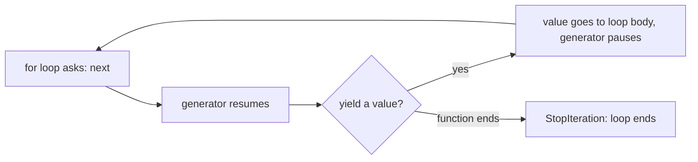
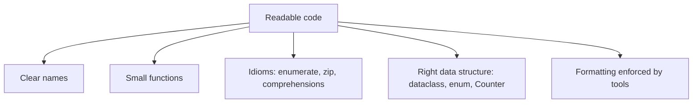

You can now write Python that works. This session is about writing Python that *reads like Python*.
"Pythonic" code uses the language's own idioms instead of patterns translated from other languages.
It is shorter, but more importantly it is easier for the next developer to understand, and in code
review it is one of the first things a senior engineer notices.

## Iterators and generators

Picture a vending machine for values. You do not get all the snacks at once; you press a button and
receive the next one, until the machine says it is empty. That is an **iterator**: an object that
hands out values one at a time when asked.

Every `for` loop in Python works this way. When you write `for line in file:`, Python calls `iter()`
on the file to get an iterator, then calls `next()` on it repeatedly until it raises
`StopIteration`. Lists, strings, dicts, files and `range` are all **iterables**: things you can get
an iterator from.

```python
numbers = [10, 20, 30]
it = iter(numbers)
print(next(it))  # 10
print(next(it))  # 20
print(next(it))  # 30
next(it)         # raises StopIteration: the loop's signal to stop
```

A **generator** is the easiest way to build your own iterator. It is a function that uses `yield`
instead of `return`. Each `yield` hands out one value and *pauses* the function, keeping its local
variables, until the next value is requested.

```python
def countdown(n: int):
    while n > 0:
        yield n
        n -= 1

for x in countdown(3):
    print(x)  # 3, 2, 1
```

The big win is **laziness**: values are produced only when needed, so memory stays flat no matter how
much data flows through. Reading a 10 GB log file into a list would exhaust your RAM; a generator
processes it line by line.

```python
from pathlib import Path

def error_lines(path: Path):
    with path.open() as f:
        for line in f:
            if "ERROR" in line:
                yield line.rstrip()

for line in error_lines(Path("app.log")):
    print(line)
```

**Generator expressions** are the one-line form, written like a list comprehension with parentheses:

```python
total = sum(len(line) for line in open("app.log"))  # no list is ever built
```



> [!WARNING]
> An iterator can only be consumed once. If you loop over a generator a second time, it is already
> empty and the loop silently does nothing. If you need the values twice, store them in a list.

## Decorators and higher-order functions

In Python, functions are values. You can store them in variables, put them in lists, pass them to
other functions and return them from functions. A **higher-order function** is a function that takes
or returns another function. You already know some: `sorted(words, key=len)` takes the function
`len` as an argument.

```python
def apply_twice(func, value):
    return func(func(value))

print(apply_twice(lambda x: x * 2, 5))  # 20
```

A **decorator** is a higher-order function that takes a function and returns an improved version of
it. The analogy is gift wrapping: the present inside is unchanged, but it now comes with extra
behaviour around it. The `@` syntax is just shorthand:

```python
import functools
import time

def timed(func):
    @functools.wraps(func)  # keep the original name and docstring
    def wrapper(*args, **kwargs):
        start = time.perf_counter()
        result = func(*args, **kwargs)
        print(f"{func.__name__} took {time.perf_counter() - start:.3f}s")
        return result
    return wrapper

@timed            # same as: slow_sum = timed(slow_sum)
def slow_sum(n: int) -> int:
    return sum(range(n))

slow_sum(10_000_000)
```

You will mostly *use* decorators rather than write them. They are everywhere in real projects:

| Decorator | Where | What it adds |
|---|---|---|
| `@functools.cache` | standard library | remembers results of previous calls |
| `@property` | standard library | a method you read like an attribute |
| `@dataclass` | standard library | generated `__init__`, `__repr__`, `__eq__` |
| `@app.get("/items")` | FastAPI | registers the function as an HTTP route |
| `@pytest.fixture` | pytest | turns a function into reusable test setup |

> [!TIP]
> Always use `functools.wraps` in your own decorators. Without it, every decorated function reports
> its name as `wrapper`, which makes stack traces and debugging confusing.

## dataclasses and enums

Beginners often store records in dictionaries: `{"name": "Ada", "email": "ada@example.com"}`. It
works until someone types `"emial"` and the bug appears three files away. A **dataclass** gives the
record a proper shape with almost no code:

```python
from dataclasses import dataclass, field

@dataclass
class Student:
    name: str
    email: str
    xp: int = 0
    badges: list[str] = field(default_factory=list)

ada = Student("Ada", "ada@example.com")
print(ada)            # Student(name='Ada', email='ada@example.com', xp=0, badges=[])
ada.xp += 50
print(ada == Student("Ada", "ada@example.com", 50))  # True: compares fields
```

The decorator writes `__init__`, `__repr__` and `__eq__` for you. Use `@dataclass(frozen=True)` for
values that should never change after creation, like a coordinate or a configuration.

> [!WARNING]
> Never write `badges: list[str] = []` in a dataclass. A mutable default would be shared by every
> instance; that is why `field(default_factory=list)` exists, and why dataclasses refuse a plain
> list default.

An **enum** is a fixed set of named constants. Instead of passing strings like `"pending"` around and
hoping nobody types `"pendng"`, you define the allowed values once:

```python
from enum import Enum

class Status(Enum):
    PENDING = "pending"
    DONE = "done"
    FAILED = "failed"

def describe(status: Status) -> str:
    if status is Status.DONE:
        return "finished"
    return "not finished"

print(Status("done"))  # Status.DONE: converts and validates raw input
```

A typo like `Status.DOEN` fails immediately with an `AttributeError`, and editors can autocomplete
the options.

## Useful standard library: pathlib, collections, itertools, datetime

Four modules turn up in almost every codebase. Learning them replaces dozens of hand-written loops.

### pathlib

`pathlib.Path` treats file paths as objects instead of strings, and works the same on Windows and
macOS:

```python
from pathlib import Path

data = Path("data")
report = data / "2026" / "report.txt"   # `/` joins path parts
report.parent.mkdir(parents=True, exist_ok=True)
report.write_text("hello")
print(report.suffix, report.stem)        # .txt report
for csv_file in data.glob("*.csv"):
    print(csv_file.name)
```

### collections

```python
from collections import Counter, defaultdict, deque

Counter("mississippi").most_common(2)   # [('i', 4), ('s', 4)]

by_track = defaultdict(list)            # missing keys start as []
by_track["python"].append("0.4.6")

recent = deque(maxlen=3)                 # keeps only the last 3 items
for n in range(5):
    recent.append(n)                     # deque([2, 3, 4])
```

### itertools

```python
from itertools import batched, chain, groupby, islice

list(chain([1, 2], [3]))                 # [1, 2, 3]
list(islice(countdown(100), 3))          # first 3 values of any iterator
list(batched(range(7), 3))               # [(0, 1, 2), (3, 4, 5), (6,)]  (Python 3.12+)
```

### datetime

```python
from datetime import date, datetime, timedelta, timezone

today = date.today()
next_review = today + timedelta(days=3)
now = datetime.now(timezone.utc)          # timezone-aware: always prefer this
print(now.isoformat())
```

> [!NOTE]
> A datetime without a time zone is called *naive*. Mixing naive and aware datetimes raises errors,
> and naive ones cause bugs across time zones. Store and compare in UTC; convert to local time only
> for display.

## PEP 8 and readable code

[PEP 8](https://peps.python.org/pep-0008/) is the official style guide for Python code. Its key
point is that code is read much more often than it is written, so consistency and readability win.
The headline rules:

- 4 spaces per indentation level, never tabs.
- `snake_case` for functions and variables, `PascalCase` for classes, `UPPER_CASE` for constants.
- Imports at the top of the file, grouped: standard library, third party, local.
- Compare to `None` with `is` / `is not`, never `==`.
- Use the truthiness of sequences: `if not items:` rather than `if len(items) == 0:`.

PEP 8 also says to know when to be inconsistent: if following a rule would make code less readable,
or break consistency with the surrounding code, use judgement.

Beyond style, a few idioms mark code as Pythonic:

| Instead of | Write |
|---|---|
| `for i in range(len(items)): print(i, items[i])` | `for i, item in enumerate(items): print(i, item)` |
| `for i in range(len(a)): f(a[i], b[i])` | `for x, y in zip(a, b): f(x, y)` |
| `if key in d: v = d[key] else: v = 0` | `v = d.get(key, 0)` |
| `temp = a; a = b; b = temp` | `a, b = b, a` |
| `f = open(p); data = f.read(); f.close()` | `data = Path(p).read_text()` |
| building a list with `append` in a loop | a comprehension |

> [!TIP]
> Do not memorise PEP 8. Let a formatter and linter enforce it automatically (session 0.4.7 sets up
> Ruff). Spend your attention on names and structure, which no tool can fix for you.



## Practice: refactor an old script to idiomatic Python

Pick a script you wrote earlier in this track (the word frequency counter from 0.4.3 is ideal) or use
the deliberately clumsy one below. The goal is to make it shorter *and* clearer without changing its
behaviour.

```python
import os

def main():
    f = open(os.path.join("data", "words.txt"))
    lines = f.readlines()
    f.close()
    counts = {}
    for i in range(len(lines)):
        for w in lines[i].split():
            w = w.lower()
            if w in counts:
                counts[w] = counts[w] + 1
            else:
                counts[w] = 1
    items = list(counts.items())
    items.sort(key=lambda x: x[1], reverse=True)
    for i in range(len(items)):
        if i < 5:
            print(str(i + 1) + ". " + items[i][0] + ": " + str(items[i][1]))

main()
```

### Step 1: Lock in the behaviour

Before changing anything, run the script and save its output to `before.txt`. Refactoring means
*same behaviour, better structure*, so you need something to compare against.

### Step 2: Replace manual file handling

Use `pathlib` and stream the file instead of reading it all into a list. A generator that yields
lower-cased words is a natural fit:

```python
def words(path: Path):
    with path.open() as f:
        for line in f:
            yield from line.lower().split()
```

### Step 3: Replace the counting loop

The whole dictionary dance is `Counter(words(path))`, and the sort-and-slice is `most_common(5)`.

### Step 4: Use enumerate and f-strings

```python
for rank, (word, count) in enumerate(counter.most_common(5), start=1):
    print(f"{rank}. {word}: {count}")
```

### Step 5: Add structure and verify

Add a `main()` guarded by `if __name__ == "__main__":`, give the top-N a named constant, and run the
script again. Compare against `before.txt` (for example `diff before.txt after.txt`). Words with tied
counts may print in a different order; decide whether that matters and note it.

> [!EXAMPLE]
> A typical result is about 12 lines instead of 20, with no index arithmetic, no manual `close()`,
> and memory use that stays flat even for a very large file.

Finally, write down three idioms you used for the first time. Those are your flashcards for the next
review.
