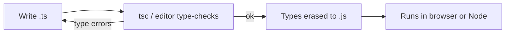
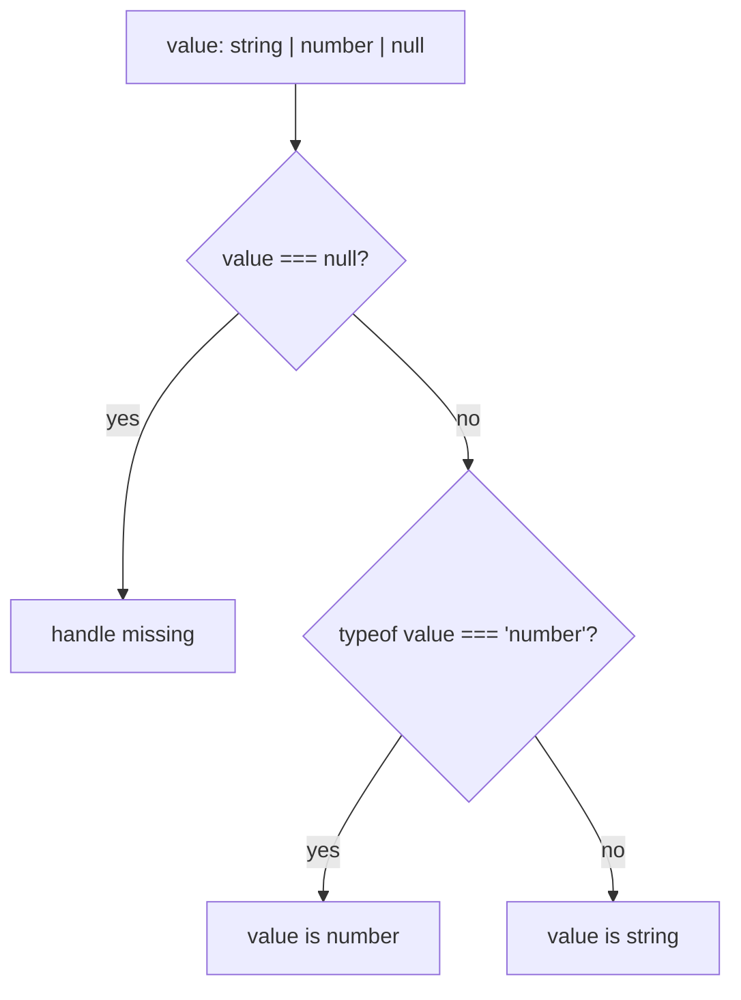

If you come from front-end work, you already write JavaScript. TypeScript is JavaScript plus a type
system: every valid JavaScript program is (almost) valid TypeScript, and the types are erased when
the code is compiled back to plain JavaScript. This session is a bridge. It shows you what the type
system buys you, the everyday building blocks, and the habits of *strict* TypeScript that this
platform's web app uses.

## Why static typing: catching bugs before runtime

Think of building a house. You can discover that a door frame is too narrow when the sofa gets stuck
on moving day (runtime), or you can see it on the blueprint before anything is built (compile time).
Static typing moves a whole category of bugs from moving day to the blueprint.

In JavaScript, this code is perfectly happy until it runs:

```js
function total(items) {
  return items.reduce((sum, item) => sum + item.price, 0);
}

total([{ name: "book", prise: 12 }]); // NaN: a typo, discovered by a user
```

The same function in TypeScript:

```ts
type Item = { name: string; price: number };

function total(items: Item[]): number {
  return items.reduce((sum, item) => sum + item.price, 0);
}

total([{ name: "book", prise: 12 }]);
// error: Object literal may only specify known properties,
// and 'prise' does not exist in type 'Item'.
```

The [TypeScript Handbook](https://www.typescriptlang.org/docs/handbook/intro.html) describes the
goal as being a *static type checker* for JavaScript: it finds errors before the code runs, based on
the kinds of values involved. The benefits in practice:

- **Errors move left.** Typos, missing properties, `undefined` access and wrong argument orders are
  caught in your editor.
- **Editor superpowers.** Autocomplete, go-to-definition and safe rename all rely on types.
- **Living documentation.** A function signature tells you what to pass and what you get back.
- **Fearless refactoring.** Rename a field and the compiler lists every place that needs updating.



> [!NOTE]
> Types do not exist at runtime. TypeScript cannot check data that arrives later, such as a JSON
> response from an API. For that you need either runtime validation or types generated from the
> API's own schema (session 0.5.2).

## Primitive types, arrays, objects, interfaces and type aliases

The **primitive** types match JavaScript's values: `string`, `number` (integers and decimals are both
`number`), `boolean`, `null`, `undefined`, plus the rarer `bigint` and `symbol`.

```ts
let title: string = "Advanced TypeScript";
let xp = 120;          // inferred as number: no annotation needed
let done = false;      // inferred as boolean
```

> [!TIP]
> Let TypeScript **infer** local variables. Annotate function parameters, return types of exported
> functions, and anything that crosses a boundary. Over-annotating makes code noisy without making it
> safer.

**Arrays** are written `string[]` or `Array<string>`. **Tuples** are fixed-length arrays with a type
per position: `[number, number]` for a coordinate.

**Objects** are described by their shape. You can name a shape with an **interface** or a **type
alias**:

```ts
interface Student {
  id: number;
  name: string;
  email?: string;            // optional: string | undefined
  readonly createdAt: Date;  // cannot be reassigned
}

type Session = {
  id: string;
  title: string;
  completed: boolean;
};
```

For object shapes the two are nearly interchangeable. The practical difference:

| | `interface` | `type` alias |
|---|---|---|
| Object shapes | yes | yes |
| Unions, primitives, tuples | no | yes (`type Id = string \| number`) |
| Can be extended | `extends`, and re-opened by declaration merging | intersections (`A & B`) |

A reasonable rule: use `type` by default because it handles every case, and use `interface` when you
want something to be extended or re-opened (for example, library typings).

TypeScript is **structurally typed**: two types are compatible if their shapes match, regardless of
their names. Anything with an `id`, `title` and `completed` of the right types is a `Session`.

### `any` versus `unknown`

`any` switches the type checker off for a value: anything goes, nothing is checked. `unknown` means
"I do not know yet", and the compiler forces you to check before using it.

```ts
const raw: unknown = JSON.parse(text);
raw.title;                          // error: 'raw' is of type 'unknown'
if (typeof raw === "object" && raw !== null && "title" in raw) {
  console.log(raw.title);           // allowed after the checks
}
```

> [!WARNING]
> Every `any` is a hole in your safety net, and it spreads: values derived from an `any` are `any`
> too. Prefer `unknown` for data you have not checked yet.

## Unions, literal types and narrowing

A **union** says a value is one of several types: `string | number`. A **literal type** is a single
exact value: `"asc"` rather than any string. Combined, they let you describe precise sets of
options, much like an enum:

```ts
type Theme = "light" | "dark" | "system";
type Size = "sm" | "md" | "lg";

function setTheme(theme: Theme) { /* ... */ }
setTheme("dark");   // ok
setTheme("drak");   // error: not assignable to type 'Theme'
```

This is how React component libraries type props like `variant="outline"`, and why your editor can
autocomplete them.

When a value is a union, you can only use what is common to *all* members until you **narrow** it.
Narrowing means using a runtime check that the compiler understands, after which the type becomes
more specific inside that branch:

```ts
function formatId(id: string | number): string {
  if (typeof id === "number") {
    return id.toFixed(0);        // id: number here
  }
  return id.toUpperCase();       // id: string here
}
```

The common narrowing tools:

| Check | Narrows |
|---|---|
| `typeof x === "string"` | primitives |
| `x instanceof Date` | class instances |
| `"email" in x` | objects with a given property |
| `x === null`, `if (x)` | removes `null` / `undefined` |
| `Array.isArray(x)` | arrays |



> [!EXAMPLE]
> A React hook that fetches data often returns `data: Session | undefined`. Writing
> `data.title` is an error; writing `if (!data) return <Spinner />` first narrows `data` to
> `Session` for the rest of the component.

## Functions and strict mode

Functions get types for parameters and the return value. Optional and default parameters work as
you would expect:

```ts
function greet(name: string, greeting = "Hello", punctuation?: string): string {
  return `${greeting}, ${name}${punctuation ?? "!"}`;
}

const double = (n: number): number => n * 2;

type Handler = (event: MouseEvent) => void;   // a function type
```

A function that returns nothing returns `void`. Callbacks are typed with function types like
`Handler` above, which is how you type props such as `onClick`.

### Strict mode

TypeScript's checks are configurable in `tsconfig.json`, and the defaults are lenient so that old
JavaScript can be migrated gradually. The single most important setting is:

```json
{
  "compilerOptions": {
    "strict": true
  }
}
```

`strict` turns on a family of checks. The two you will feel most:

- **`strictNullChecks`**: `null` and `undefined` are no longer silently allowed everywhere. A
  `string` is a string; if it might be missing, the type must say `string | undefined`, and you
  must handle it. This alone prevents the most common JavaScript crash, "cannot read properties of
  undefined".
- **`noImplicitAny`**: if TypeScript cannot infer a type, it reports an error instead of quietly
  using `any`. Parameters must be annotated.

```ts
const sessions: Session[] = [];
const found = sessions.find((s) => s.id === "0.5.1"); // Session | undefined
found.title;   // strict: error, 'found' is possibly 'undefined'
found?.title;  // ok: optional chaining returns undefined if missing
```

> [!TIP]
> Start every new project with `"strict": true`. Turning it on later in a large codebase produces
> hundreds of errors at once. This platform's web app (`apps/web`) runs in strict mode, and
> `npm run typecheck` runs the compiler without producing output files.

## Practice: convert a small JS project to strict TypeScript

Pick a small JavaScript project you have written (a to-do list, a calculator, a fetch-and-render
page), or write a 50-line one first. The goal is to reach zero errors in strict mode without using
`any`.

### Step 1: Set up the compiler

```sh
npm init -y
npm install --save-dev typescript
npx tsc --init
```

Open the generated `tsconfig.json` and make sure `"strict": true` is set. Add `"allowJs": true` so
you can convert files one at a time.

### Step 2: Rename one file and read the errors

Rename the simplest file from `.js` to `.ts` and run `npx tsc --noEmit`. Read each error message
fully: TypeScript messages say what was expected and what it found. Do not fix anything yet; just
group the errors by kind (missing parameter types, possible `undefined`, unknown properties).

### Step 3: Describe your data first

Before fixing errors one by one, write `type` declarations for the main data in the app, such as:

```ts
type Todo = { id: number; text: string; done: boolean };
type Filter = "all" | "active" | "done";
```

Then annotate function parameters and return types with them. Many errors disappear at once,
because the compiler can now infer everything else.

### Step 4: Handle null and undefined properly

DOM lookups are the classic case: `document.querySelector("#list")` returns `Element | null`.
Narrow instead of silencing:

```ts
const list = document.querySelector<HTMLUListElement>("#list");
if (!list) throw new Error("#list not found");
list.append(item);   // list is HTMLUListElement here
```

Avoid the `!` non-null assertion unless you can explain why the value can never be missing.

### Step 5: Finish, then reflect

Convert the remaining files, remove `allowJs`, and confirm `npx tsc --noEmit` reports nothing. Then
search the code for `any` and `!` and try to remove each one. Write down two bugs (or near-bugs) the
compiler found that you had not noticed.

> [!EXAMPLE]
> Done looks like: all files are `.ts`, strict mode is on, zero `any`, every `null` from the DOM is
> handled, and a `Filter` union replaces the old magic strings.
