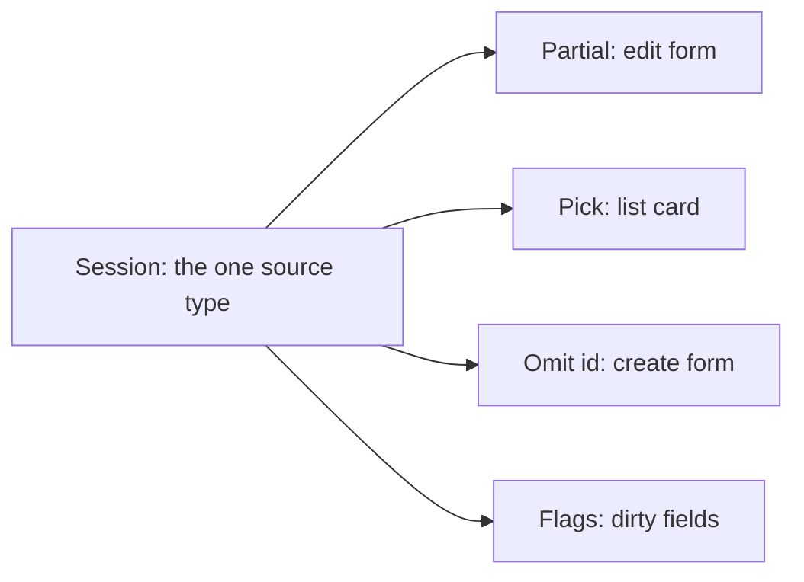
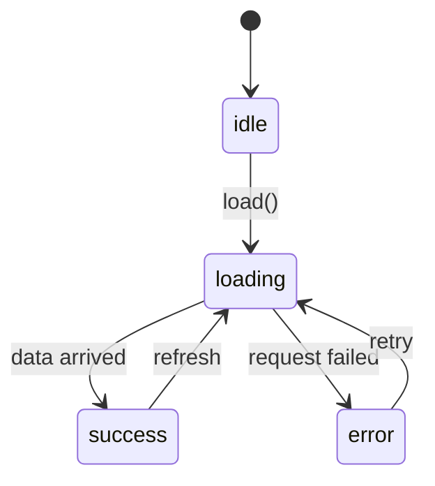
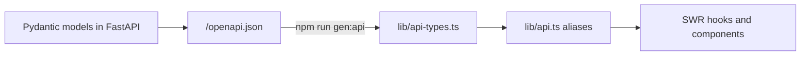

The fundamentals let you describe *values*. This session is about describing *relationships between
types*: a function that returns the same type it was given, a type derived from another type, a
state that can only be in one valid shape at a time, and a client whose types come straight from
the server's schema. These are the tools that make large TypeScript codebases safe to change, and
they are exactly how this platform's web app talks to its API.

## Generics and constraints

Imagine a labelled storage box. A box that says "contents: something" is useless for planning; a box
that says "contents: whatever you put in, and you get the same thing back" is useful. A **generic**
is that second kind of box: a type with a *parameter*, filled in when it is used.

Without generics you have to choose between being specific and being reusable:

```ts
function firstNumber(items: number[]): number | undefined { return items[0]; }
function firstAny(items: any[]): any { return items[0]; }   // reusable, but unsafe
```

With a type parameter `T`, you get both:

```ts
function first<T>(items: T[]): T | undefined {
  return items[0];
}

const n = first([1, 2, 3]);         // n: number | undefined
const s = first(["a", "b"]);        // s: string | undefined
```

TypeScript **infers** `T` from the argument, so you rarely write `first<number>(...)` yourself. You
already use generics constantly: `Array<string>`, `Promise<Response>`, React's
`useState<Session | null>(null)`.

### Constraints

Sometimes `T` cannot be *anything*; it needs a certain shape. A **constraint** (`extends`) says "any
type, as long as it has at least this":

```ts
function byId<T extends { id: string }>(items: T[], id: string): T | undefined {
  return items.find((item) => item.id === id);
}

byId([{ id: "0.5.2", title: "Advanced TypeScript" }], "0.5.2"); // returns the full object type
byId([1, 2, 3], "x"); // error: number does not satisfy { id: string }
```

The function can safely read `item.id`, and the caller still gets back the full, specific type, not
just `{ id: string }`.

A very common constraint is `keyof`, which produces the union of an object type's property names:

```ts
function pluck<T, K extends keyof T>(obj: T, key: K): T[K] {
  return obj[key];
}

const session = { id: "0.5.2", xp: 50 };
pluck(session, "xp");     // number
pluck(session, "title");  // error: '"title"' is not assignable to '"id" | "xp"'
```

`T[K]` is an **indexed access type**: "the type of property `K` on `T`".

> [!TIP]
> Reach for a generic when the same function or component works with many types *and* you want the
> output type to depend on the input type. If the type never varies, a generic is just noise.

## Utility and mapped types

Real code often needs a variation of an existing type: the same object but with every field
optional for an update form, or only some fields for a list view. Copying the type by hand means two
definitions that drift apart. **Utility types** derive the new type from the original instead.

```ts
type Session = {
  id: string;
  title: string;
  completed: boolean;
  notes: string;
};

type SessionPatch = Partial<Session>;              // every field optional
type SessionCard = Pick<Session, "id" | "title">; // only these fields
type NewSession = Omit<Session, "id">;           // everything but id
type ById = Record<string, Session>;             // object keyed by string
type Frozen = Readonly<Session>;                 // no reassignment
```

The most used ones, all listed in the [TypeScript Handbook](https://www.typescriptlang.org/docs/handbook/intro.html):

| Utility | Produces |
|---|---|
| `Partial<T>` | all properties optional |
| `Required<T>` | all properties required |
| `Readonly<T>` | all properties read-only |
| `Pick<T, K>` / `Omit<T, K>` | keep / drop some properties |
| `Record<K, V>` | object with keys `K` and values `V` |
| `ReturnType<F>` | the return type of a function type |
| `Awaited<T>` | the value inside a `Promise` |
| `NonNullable<T>` | `T` without `null` and `undefined` |

### Mapped types: how utilities are built

Utility types are not magic; they are **mapped types**, which loop over the keys of a type the way
`map` loops over an array:

```ts
type MyPartial<T> = {
  [K in keyof T]?: T[K];
};

type Flags<T> = {
  [K in keyof T]: boolean;   // same keys, every value becomes boolean
};

type SessionDirty = Flags<Session>;
// { id: boolean; title: boolean; completed: boolean; notes: boolean }
```

`Flags<Session>` is a handy shape for tracking which form fields a user has edited, and it updates
itself automatically when `Session` gains a field.



> [!NOTE]
> The principle is **one source of truth per shape**. Derive variations with utility and mapped
> types so that when the source changes, every derived type changes with it and the compiler points
> at the code that needs updating.

## Discriminated unions for state modelling

Here is a very common, very buggy way to model a data fetch:

```ts
type BadState = {
  loading: boolean;
  error?: string;
  data?: Session[];
};
```

Nothing stops `loading: true` *and* `error` *and* `data` all at once. With three independent fields
there are many combinations, and most are nonsense. Every component has to guess which ones matter.

A **discriminated union** makes impossible states impossible. Each variant has a shared literal
field (the *discriminant*, here `status`) and only the fields that make sense for that variant:

```ts
type FetchState =
  | { status: "idle" }
  | { status: "loading" }
  | { status: "error"; message: string }
  | { status: "success"; data: Session[] };
```

Checking the discriminant narrows to exactly one variant:

```ts
function render(state: FetchState): string {
  switch (state.status) {
    case "idle":
      return "Press load";
    case "loading":
      return "Loading...";
    case "error":
      return `Failed: ${state.message}`;          // message exists only here
    case "success":
      return `${state.data.length} sessions`;     // data exists only here
    default: {
      const unreachable: never = state;           // exhaustiveness check
      return unreachable;
    }
  }
}
```

The `never` line is the bonus: if someone later adds `{ status: "stale" }` to the union and forgets
to handle it, the compiler reports an error here, because `state` would no longer be `never`.



> [!EXAMPLE]
> The same pattern models API results (`{ ok: true; value } | { ok: false; error }`), UI steps in a
> wizard, chat messages (`{ role: "user"; text } | { role: "assistant"; text; sources }`) and Redux
> or reducer actions (`{ type: "add"; item } | { type: "remove"; id }`).

## Typing API responses (generated types from OpenAPI)

So far the compiler has trusted whatever types you wrote. The weakest point in any front end is the
line where data arrives from the server, because types are erased at runtime and the server can
change without telling you. If you hand-write `type Session = {...}` in the front end, it is a copy
of the back-end model, and copies drift.

The fix is to generate the front-end types from a single, machine-readable description of the API.
The [OpenAPI Specification](https://spec.openapis.org/oas/latest.html) is the standard format for
describing HTTP APIs: paths, methods, parameters and the JSON schemas of request and response
bodies. FastAPI produces it automatically at `/openapi.json` from your Pydantic models.

This platform uses exactly that pipeline:



`npm run gen:api` runs the `openapi-typescript` tool, which writes `lib/api-types.ts` with two main
exports: `paths` (every endpoint, method, parameters and responses) and `components` (the named
schemas). The app then aliases the schemas it uses:

```ts
import type { components } from "./api-types";

type Schemas = components["schemas"];
export type SessionDetail = Schemas["SessionDetail"];
export type Stats = Schemas["StatsOut"];
```

When a back-end developer renames a field in a Pydantic model and the types are regenerated, every
component that used the old name fails to compile. The mismatch is found on the developer's
machine, not by a user.

> [!WARNING]
> Generated types describe what the server *promises*, not what actually arrives. They are only as
> current as your last generation, so regenerate whenever a response model changes (and consider a
> CI check that fails if the committed file is stale). For untrusted third-party APIs, also validate
> at runtime.

## Practice: a typed API client generated from an OpenAPI schema

Build a small typed client for this platform's API. You need the stack running
(`docker compose up -d --build`) so the schema is available at `http://localhost:8000/openapi.json`.

### Step 1: Explore the schema

Open `http://localhost:8000/docs` (FastAPI's interactive page built from the OpenAPI document) and
then the raw `/openapi.json`. Find one endpoint under `paths` and follow its `$ref` to the schema in
`components.schemas`.

### Step 2: Generate types in a scratch project

```sh
mkdir typed-client && cd typed-client
npm init -y
npm install --save-dev typescript openapi-typescript
npx tsc --init
npx openapi-typescript http://localhost:8000/openapi.json -o api-types.ts
```

Open `api-types.ts` and find the `paths` and `components` exports.

### Step 3: Write a generic fetch helper

```ts
import type { components } from "./api-types";

type Schemas = components["schemas"];
export type TrackNode = Schemas["TrackNode"];

type Result<T> = { ok: true; value: T } | { ok: false; error: string };

export async function get<T>(path: string): Promise<Result<T>> {
  try {
    const res = await fetch(`http://localhost:8000${path}`);
    if (!res.ok) return { ok: false, error: `HTTP ${res.status}` };
    return { ok: true, value: (await res.json()) as T };
  } catch (err) {
    return { ok: false, error: String(err) };
  }
}
```

Notice the three ideas from this lesson: a generic `T`, a discriminated union `Result<T>`, and
schema types taken from generated code instead of written by hand.

### Step 4: Use it and let the compiler guide you

Call one endpoint that returns a schema you aliased, handle both branches of `Result`, and print a
field. Then deliberately misspell a property and confirm the compiler catches it.

### Step 5: Watch drift get caught

Pick a field in your generated types, imagine it was renamed on the server, and simulate it by
editing your alias with `Omit<..., "field">` plus the new name. Every usage now errors, which shows
what a real regeneration would surface. Undo, regenerate, and confirm the build is clean.

> [!EXAMPLE]
> Done looks like: zero hand-written response types, one generic helper returning a discriminated
> `Result<T>`, strict mode on, and `npx tsc --noEmit` clean.
