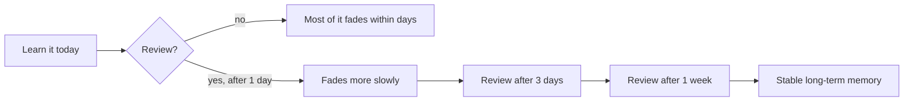
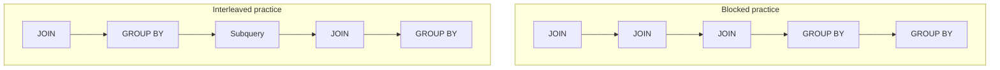
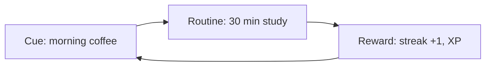

Before you learn Python, databases or system design, it pays to learn _how to learn_. The whole
roadmap is long, and the difference between finishing it and quitting in month two is rarely talent.
It is method. This session gives you a small toolkit backed by decades of memory research, and a
weekly plan you will actually use for the rest of the course.

## How memory works: encoding, forgetting curve, consolidation

Think of your memory like a library. **Encoding** is putting a new book on the shelf, **storage** is
the book staying there, and **retrieval** is finding it again when you need it. Most "I forgot it"
moments are not missing books: they are books shelved in the wrong place, with no catalogue entry
pointing to them.

**Encoding** is how information gets into long-term memory. You encode better when you pay
attention, when you connect the new idea to something you already know, and when you process its
_meaning_ rather than its surface. Reading "a list is ordered and mutable" encodes weakly; asking
"why would I want a list to be mutable, and when would that bite me?" encodes strongly.

The **forgetting curve**, first measured by Hermann Ebbinghaus in the 1880s, describes how quickly
new information fades if you never revisit it. The drop is steepest in the first hours and days,
then flattens out. The key insight is not that we forget (everyone knows that) but that _each
successful review makes the next drop slower_.



**Consolidation** is the process by which a fragile, fresh memory becomes stable. A large part of
it happens offline, especially during sleep. This is why a 45-minute session every day beats a
five-hour session on Sunday: each night gives your brain another round of consolidation.

> [!NOTE]
> **Encoding** = getting it in. **Consolidation** = making it stick. **Retrieval** = getting it
> out. Good study habits target all three, not just the first.

> [!WARNING]
> Re-reading your notes feels productive because the text looks familiar. Familiarity is not
> recall. Recognising an answer when you see it is much easier than producing it from scratch in
> a job interview.

## Retrieval practice and spaced repetition

These two techniques are the most reliable tools in this lesson, so if you only remember one
section, make it this one.

**Retrieval practice** means pulling information _out_ of your memory instead of putting it in
again. Closing the book and writing down everything you remember about HTTP status codes is
retrieval practice. So is answering a quiz, explaining a concept to a rubber duck, or trying to
rebuild yesterday's function without looking. The analogy: a path through a field becomes a clear
trail only by walking it, not by looking at a map of it.

Retrieval works _because_ it is effortful. When recall is a bit hard, the memory gets strengthened
more than when it is easy. Getting answers wrong is part of the process, as long as you check the
correct answer straight afterwards.

**Spaced repetition** means scheduling those retrievals at growing intervals: review tomorrow, then
in three days, then in a week, then in two or three weeks. Each review happens just as the memory
is starting to fade, which is exactly where the forgetting curve says it does the most good.

> [!EXAMPLE]
> On Monday you learn Git's `rebase` vs `merge`. Your schedule:
>
> | Review | When            | What you do                                             |
> | ------ | --------------- | ------------------------------------------------------- |
> | 1      | Tuesday         | Write the difference from memory in 3 lines, then check |
> | 2      | Friday          | Draw both histories as a diagram from memory            |
> | 3      | Next Monday     | Explain it out loud in under a minute                   |
> | 4      | Two weeks later | Rebase a real branch without looking anything up        |

> [!TIP]
> You do not need to manage intervals by hand. Flashcard apps such as Anki schedule reviews for
> you, and the quizzes at the end of every session on this platform are built-in retrieval
> practice. Take them _the day after_ you study, not right away.

## Chunking, interleaving and dual coding

**Chunking** is grouping small pieces into one bigger, meaningful unit. Your working memory can only
juggle a handful of items at once, so experts are not people with bigger working memory: they are
people with bigger chunks. A beginner sees `for i in range(len(items)):` as six separate tokens; an
experienced developer sees one chunk, "loop over indexes", and maybe a second thought, "I should
probably use `enumerate`". Practise until small patterns become single chunks, and harder topics
get room to fit.

**Interleaving** is mixing different types of problems in one session instead of doing a block of
the same kind (that's called _blocking_). Ten SQL `JOIN` exercises in a row feel smooth, but the
real skill on the job is recognising _which_ tool a problem needs. Mixing `JOIN`, `GROUP BY` and
subquery problems forces you to make that choice each time. It feels harder and slower, and that
discomfort is a sign it's working.

**Dual coding** is pairing words with visuals. When you learn how a request travels from browser to
server to database, draw it as boxes and arrows as well as writing it down. Two representations
give you two routes back to the same memory. This is why lessons on this platform use Mermaid
diagrams.



> [!TIP]
> Good technical writing uses the same ideas: short paragraphs, one idea per chunk, lists and
> diagrams that support the text. The free
> [Google Tech Writing](https://developers.google.com/tech-writing) courses are a great model for
> how to make your own notes easier to review.

## Deliberate practice and the growth mindset

Ten thousand hours of doing the same thing at the same level does not make you an expert. What
works is **deliberate practice**: practice designed to improve a specific weakness, slightly beyond
your current comfort zone, with fast feedback. A pianist does not play the whole song again and
again; they loop the four bars they keep getting wrong.

For a developer, deliberate practice looks like this:

- **A specific target.** Not "get better at Python" but "write list comprehensions with a
  condition without looking up the syntax".
- **Just beyond your comfort zone.** If an exercise feels easy, raise the difficulty. If you are
  completely lost, step back one level.
- **Fast feedback.** Tests, a linter, a code review, the answer key of a quiz. The faster you know
  you were wrong, the faster you correct it.
- **Reflection.** After each session, write one line: what was hard, and what you will try next
  time.

The **growth mindset** is the belief that ability grows with effort and good strategy, rather than
being a fixed amount you either have or don't. It matters here for a practical reason: deliberate
practice is uncomfortable by design. If you read every struggle as "I'm not a programmer", you will
stop. If you read it as "this is the part where the learning happens", you keep going.

> [!WARNING]
> A growth mindset is not "just try harder". Effort with the wrong strategy (re-reading, copying
> tutorials line by line) leads to frustration. Pair effort with the techniques from this lesson,
> and ask for help when you are stuck for more than about 30 minutes.

> [!NOTE]
> Many experienced engineers learned without a CS degree. Self-study guides such as
> [Teach Yourself CS](https://teachyourselfcs.com/) exist precisely because a structured plan plus
> consistent practice can cover the same ground.

## Building a sustainable study routine (streaks, small daily goals)

Learning a craft is a marathon. The best plan is not the most ambitious one; it is the one you will
still be following in six months. Three principles help.

**1. Make the daily goal small.** "Study for 3 hours" fails the first time work runs late. "One
subchapter, or 30 minutes, whichever comes first" survives a bad day. On good days you will do
more; on bad days the small goal keeps the habit alive.

**2. Use streaks, but forgive yourself.** This platform tracks your streak because a visible chain
of days is motivating. But a streak is a tool, not a judge. If you miss a day, the rule is simple:
_never miss two in a row_. One missed day is noise; two is the start of a new (bad) habit.

**3. Attach study to an existing habit.** "After my morning coffee, I open the roadmap" works
better than "sometime today". A fixed cue removes the daily decision of _when_.



> [!TIP]
> End each session by writing down the very first step for tomorrow ("open session 0.1.2, read the
> first heading"). Starting is the hardest part, and a pre-decided first step makes it trivial.

Sustainable also means _rest_. Sleep is when consolidation happens, so trading sleep for extra study
hours usually loses more than it gains. Plan at least one lighter day a week, with reviews only.
Platforms like [Khan Academy](https://www.khanacademy.org/) are built around exactly this rhythm:
short lessons, frequent practice, and steady progress over time.

## Practice: design your weekly study plan and review schedule

Now turn the theory into a plan. Set aside about 30 minutes and produce a one-page document (a
note, a spreadsheet, or a Markdown file in your notes repo).

### Step 1: Find your real time budget

Write down, honestly, how many minutes you can study on each day of the week. Use your _worst
realistic week_, not your best. Example: Mon–Fri 45 min, Sat 90 min, Sun 20 min (reviews only).

### Step 2: Fix a cue and a daily minimum

For each day, pick a cue ("after dinner", "on the train") and a minimum goal ("one subchapter").
Write the "never miss two days in a row" rule at the top of the page.

### Step 3: Split new learning and review

Give about two thirds of each session to new material and one third to review. Reviews come
_first_, while you are fresh: retrieval is the hard, valuable part.

### Step 4: Build the review schedule

Every time you complete a session, add review dates at +1 day, +3 days, +7 days and +21 days.
A simple table is enough:

| Session | Learned | Review 1 (+1) | Review 2 (+3) | Review 3 (+7) | Review 4 (+21) |
| ------- | ------- | ------------- | ------------- | ------------- | -------------- |
| 0.1.1   | Mon 3   | Tue 4         | Thu 6         | Mon 10        | Mon 24         |
| 0.1.2   | Wed 5   | Thu 6         | Sat 8         | Wed 12        | Wed 26         |

Each review is retrieval, not re-reading: take the session quiz, write a summary from memory, or
redo the practice exercise without looking.

### Step 5: Add interleaving and a weekly reflection

On your longest day, mix exercises from two or three different sessions. On Sunday, spend 10
minutes answering three questions in writing:

1. What did I learn this week that I can now explain without notes?
2. Where did I get stuck, and what will I do differently?
3. Is my daily minimum still realistic, or should I adjust it?

> [!EXAMPLE]
> A finished plan might read: "Mon–Fri after dinner, 45 min: 15 min reviews from the table, then
> one new subchapter. Saturday morning 90 min: interleaved exercises + practice task. Sunday
> 20 min: reviews and weekly reflection. Rule: never miss two days in a row."

Keep the page somewhere you see daily, and revise it after two weeks with what you learned about
yourself.

```quiz
{"questions": [
  {"question": "You read a chapter twice and feel you know it well. Why might that feeling be misleading?", "options": ["Re-reading builds familiarity, which is easy to confuse with being able to recall the material", "Re-reading erases the earlier memory", "Reading twice is always too little; you need five reads", "Feelings of knowing are always accurate"], "answer": 0, "explanation": "Recognising text you have seen is much easier than producing it from memory. Test yourself with retrieval practice to know whether you really know it."},
  {"question": "According to the forgetting curve, when is a review most valuable?", "options": ["Immediately after learning, while it is still fresh", "Just as the memory is starting to fade, at growing intervals", "Only the night before an exam", "Never; reviews do not change the rate of forgetting"], "answer": 1, "explanation": "Spaced repetition places reviews where forgetting has begun. Each successful, slightly effortful recall makes the next decline slower."},
  {"question": "You do 10 JOIN exercises, then 10 GROUP BY, then 10 subqueries. What would interleaving change, and why?", "options": ["Nothing; blocked practice is always better", "Do only the hardest type of problem", "Mix the problem types so you practise choosing which tool fits each problem", "Do the same exercises again in reverse order"], "answer": 2, "explanation": "Interleaving forces you to identify the right technique each time, which is the skill real problems require. It feels harder, but transfers better."},
  {"question": "Which of these is the best example of deliberate practice?", "options": ["Watching a full Python course at 2x speed", "Rewriting the same easy script every day", "Copying a tutorial project line by line", "Solving list-comprehension exercises you keep getting wrong, checking each one against tests"], "answer": 3, "explanation": "Deliberate practice targets a specific weakness, sits just beyond your comfort zone and gives fast feedback."},
  {"question": "You missed your study session yesterday. What does a sustainable routine suggest?", "options": ["Study today as normal and make sure you don't miss two days in a row", "Study five hours today to make up for it", "Restart the whole plan from the beginning next Monday", "Give up the streak idea entirely"], "answer": 0, "explanation": "One missed day is noise. Protect the habit with the small daily goal and the never-miss-twice rule instead of overcompensating."}
]}
```
