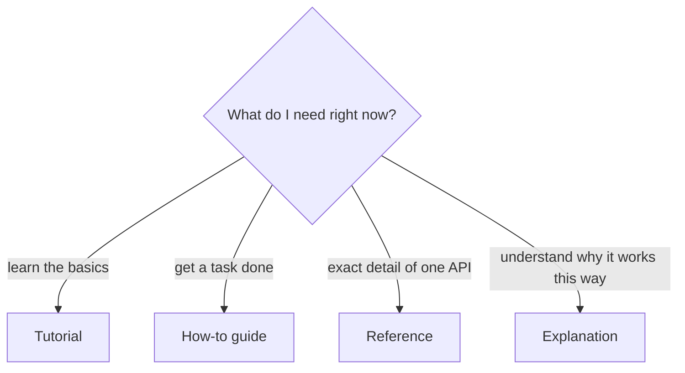
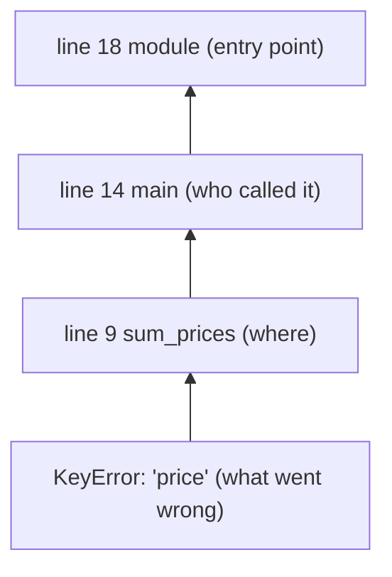

English is the working language of software: documentation, error messages, RFCs, issue trackers,
code review comments and most job interviews. You don't need perfect English to be a great
engineer, but you do need two specific skills: *reading* technical text quickly and accurately, and
*writing* short, clear technical text that others can act on. This session trains both.

## Anatomy of official documentation: tutorials, how-tos, reference, explanation

Imagine learning to cook. A cooking class for beginners, a recipe for tonight's dinner, the
nutrition table on a packet and a book about why bread rises are all "cooking documentation", but
you would never use them for the same purpose. Good software documentation is split the same way.
A widely used model (often called *Diátaxis*) names four kinds:

| Type | Analogy | Purpose | Example |
|---|---|---|---|
| **Tutorial** | Cooking class | *Learning*: take a beginner through a complete, guided first experience | The [Python Tutorial](https://docs.python.org/3/tutorial/) |
| **How-to guide** | Recipe | *Doing*: steps to achieve one specific goal, assuming basic knowledge | "How to configure CORS" |
| **Reference** | Nutrition table | *Looking up*: complete, accurate, dry descriptions of every function, flag or field | Python's Library Reference, MDN's list of HTTP headers |
| **Explanation** | Book on bread chemistry | *Understanding*: background, design decisions, the "why" | An "Overview of HTTP" page |



Knowing which kind you're in saves enormous time. If you need the exact parameters of
`json.dumps`, a tutorial is the wrong place: go to the reference. If you're new to HTTP, reading the
reference list of every header first will only confuse you: start with an explanation such as
[MDN's HTTP docs](https://developer.mozilla.org/en-US/docs/Web/HTTP).

> [!TIP]
> Learn the *shape* of the reference pages you use most. Python's reference entries show the
> signature first, then a description, then notes and examples, plus "Changed in version X"
> markers. Once you know where things are, you skim instead of reading top to bottom.

**Specifications and RFCs** are a fifth, stricter kind of document: they define how something must
behave so that different implementations agree. RFCs use capitalised keywords with precise
meanings: **MUST** is a requirement, **SHOULD** is a strong recommendation with possible
exceptions, **MAY** is optional. When a spec says a server "SHOULD" do something, don't assume every
server does.

> [!WARNING]
> Always check the version. Docs for an old version of a library often rank high in search
> results. Look for a version switcher at the top of the page and match it to what your project
> actually uses.

## Reading error messages and stack traces

An error message is not an insult; it is the program telling you exactly where it got stuck. Most
beginners read the first line, panic and paste it into a search engine. Experienced engineers read
it like a detective reads a crime scene report: carefully, and in the right order.

Here is a Python **traceback** (Python's name for a stack trace):

```text
Traceback (most recent call last):
  File "/app/report.py", line 18, in <module>
    main()
  File "/app/report.py", line 14, in main
    total = sum_prices(load("orders.json"))
  File "/app/report.py", line 9, in sum_prices
    return sum(o["price"] for o in orders)
  File "/app/report.py", line 9, in <genexpr>
    return sum(o["price"] for o in orders)
KeyError: 'price'
```

How to read it:

1. **Start at the bottom.** The last line is the *exception type* and *message*: `KeyError:
   'price'`. A dictionary was asked for a key it doesn't have.
2. **Walk up to your code.** Python prints "most recent call last", so the frame just above the
   error is where it happened: line 9 in `sum_prices`.
3. **Read the call chain upwards** to understand *how* you got there: `main` called `sum_prices`
   with the result of `load("orders.json")`.
4. **Form a hypothesis**: at least one order in `orders.json` has no `"price"` key. Now you know
   what to check.



> [!NOTE]
> Not every language prints in the same order. Python puts the most recent call *last*; Java and
> JavaScript print the error first and the most recent frame *first*. Always look for the line
> that names your own file rather than library internals.

> [!TIP]
> When the trace runs through library code, the bug is still usually in *your* call to the
> library. Find the last frame in your own code and look at what you passed in.

## Searching effectively and judging source reliability

Searching is a core engineering skill, and it improves with a few habits.

**Search with the exact error, minus the noise.** Copy the stable part of the message and remove
what's specific to you: file paths, IDs, your variable names. `KeyError` + "generator expression"
is a poor search; `TypeError: unsupported operand type(s) for +: 'int' and 'str'` in quotes is a
great one.

**Add context words**: the language, library and version (`pydantic v2 validator`, not just
`validator`).

**Prefer primary sources.** For any fact, ask: who is in a position to know? Then rank sources:

| Reliability | Source | Use it for |
|---|---|---|
| Highest | Official docs, specs, RFCs, the project's changelog and issue tracker | Ground truth on behaviour and versions |
| High | Source code of the library itself | When docs are silent or ambiguous |
| Medium | Well-known Q&A answers, blog posts by maintainers | Workarounds, context, examples |
| Lower | Random blog posts, old forum threads, unreviewed AI answers | Hints to verify, never final answers |

**Check freshness.** A highly voted answer from years ago may describe an API that has since
changed. Compare its version with yours.

> [!WARNING]
> AI assistants are excellent for explaining an error or suggesting where to look, but they can
> state invented functions or flags with full confidence. Treat their output like a colleague's
> guess: verify it against the official docs or by running the code.

> [!EXAMPLE]
> You search "python read json file". Result 1 is a blog with ads, result 2 is a Q&A answer, result
> 3 is the [Python docs](https://docs.python.org/3/) for the `json` module. Read the docs first;
> use the others for extra examples if needed.

## Writing clear technical English: short sentences, active voice

Most technical writing you'll do is unglamorous: commit messages, PR descriptions, ticket comments,
README files, incident notes. Clear writing here saves your team hours. The free
[Google Technical Writing courses](https://developers.google.com/tech-writing) teach a handful of
rules that do most of the work.

**1. Prefer active voice.** In active voice, the actor comes first and does the action.

- Passive: "The cache is invalidated when the config is changed."
- Active: "The API invalidates the cache when you change the config."

Active sentences are shorter and say *who* does what, which is exactly what a reader debugging a
system needs to know.

**2. Keep sentences short, one idea each.** If a sentence has "and", "which" and "but", split it.

**3. Use strong, specific verbs and nouns.** "There is an issue with the endpoint" says almost
nothing. "`GET /orders` returns 500 when `limit` is 0" says everything.

**4. Define terms and use them consistently.** If you call it a "job" in one paragraph, don't call
it a "task" in the next. Readers will assume they are different things.

**5. Put the conclusion first.** Busy readers decide in one sentence whether to keep reading.

> [!EXAMPLE]
> Before: "So basically I was looking into the issue that some users had reported and it seems like
> there might be a problem that is caused by the timeout which was set too low in some cases."
>
> After: "Some exports fail because the request timeout (5 s) is shorter than large exports take.
> This PR moves exports to a background job."

> [!TIP]
> If English is not your first language, this is good news: plain technical English is *easier*
> to write than elaborate English, and it is what readers prefer. Short words, short sentences,
> active voice.

## Practice: summarise one documentation page in 10 lines

This exercise combines both halves of the session: reading for structure and writing concisely.

### Step 1: Pick a page

Choose one page from official documentation you will need soon, for example the
[Python Tutorial](https://docs.python.org/3/tutorial/) chapter on data structures, or an
[MDN HTTP](https://developer.mozilla.org/en-US/docs/Web/HTTP) page about HTTP methods. Note its
type: tutorial, how-to, reference or explanation.

### Step 2: Skim, then read

Spend two minutes reading only headings, code samples and the first sentence of each paragraph.
Write down what you expect the page to teach. Then read it fully, and mark (or copy) the three
sentences that carry the most information.

### Step 3: Write the summary from memory

Close the page. Write at most 10 lines:

1. One line: what the page is about and who it is for.
2. Five to seven lines: the key facts, rules or steps, each as a short active sentence.
3. One line: a gotcha or warning the page mentions.
4. One line: when you would come back to this page.

Writing from memory turns this into retrieval practice (see session 0.1.1).

### Step 4: Check and edit

Reopen the page. Fix anything wrong, then edit for clarity: cut filler words ("basically",
"actually", "in order to"), turn passive sentences into active ones, and make every line specific.

### Step 5: Keep it

Save the summary in your notes repo with the page URL and the date. Over the roadmap you'll build a
personal, searchable reference written in your own words.

> [!EXAMPLE]
> A summary of a Python `dict` section might start: "Reference-style tutorial section on
> dictionaries, for Python beginners. A dict maps unique, hashable keys to values. `d[key]` raises
> `KeyError` if the key is missing; `d.get(key, default)` doesn't…"

```quiz
{"questions": [
  {"question": "You know what you want to do (paginate API results) but not the exact steps. Which kind of documentation fits best?", "options": ["A tutorial", "A how-to guide", "The reference", "An explanation"], "answer": 1, "explanation": "How-to guides give the steps for a specific goal, assuming you already know the basics."},
  {"question": "A Python traceback ends with `ValueError: invalid literal for int() with base 10: 'abc'`. Where should you look first?", "options": ["The first frame at the top of the traceback", "The last line, then the frame just above it in your own code", "Only at the library's source code", "Restart the program and hope it disappears"], "answer": 1, "explanation": "Python prints the most recent call last. Read the exception at the bottom, then find the nearest frame in your own code."},
  {"question": "A blog post from several years ago and the current official docs disagree about a function's parameters. What do you trust?", "options": ["The blog post, because it has more examples", "Whichever ranks higher in search", "The official docs for the version you use, then verify by running the code", "Neither; avoid the function"], "answer": 2, "explanation": "Official docs for your version are the primary source. Older posts may describe an API that has changed."},
  {"question": "Which sentence is the clearest technical English?", "options": ["It was found that errors are sometimes being caused by the configuration.", "The worker crashes when `QUEUE_URL` is empty.", "There might possibly be some kind of issue relating to the queue.", "Basically, the thing with the queue is kind of broken in certain cases."], "answer": 1, "explanation": "It uses active voice, a specific subject and verb, and states the exact condition."}
]}
```
