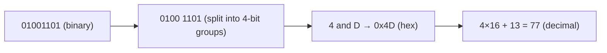
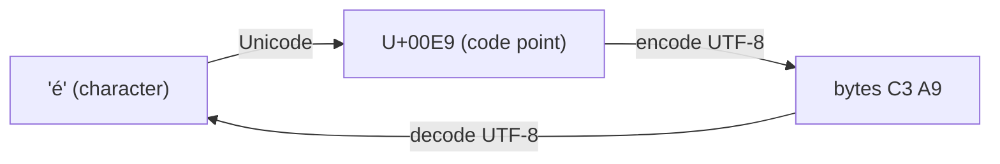
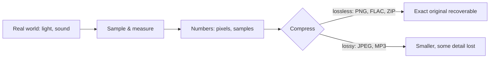

Everything a computer stores, from your bank balance to a cat photo to this sentence, ends up as a
long row of 0s and 1s. This session explains how that works and, more usefully, why it leaks into
your everyday code: why an integer can suddenly turn negative, why `0.1 + 0.2` isn't `0.3`, and why
a name like "José" sometimes shows up as "José".

## Bits, bytes and number bases (binary, hex)

A **bit** is a single switch: off (0) or on (1). One switch isn't very expressive, so we group
them. Eight bits make a **byte**, which can be in 2⁸ = 256 different states, enough to represent
the numbers 0 to 255.

The decimal system you grew up with is **base 10**: each position is worth ten times the one to its
right (ones, tens, hundreds). **Binary** is the same idea in **base 2**: each position is worth twice
the one to its right.

| Position value | 128 | 64 | 32 | 16 | 8 | 4 | 2 | 1 |
|---|---|---|---|---|---|---|---|---|
| Bits of 77 | 0 | 1 | 0 | 0 | 1 | 1 | 0 | 1 |

64 + 8 + 4 + 1 = 77, so 77 in binary is `01001101`.

Binary is long and hard to read, so programmers use **hexadecimal** (**base 16**) as a shorthand.
Hex digits go 0–9 then A–F (A = 10 … F = 15). The trick that makes hex so handy: **one hex digit is
exactly four bits**, so a byte is always exactly two hex digits.



You meet hex everywhere: colours (`#FF8800` is three bytes: red 255, green 136, blue 0), memory
addresses, Git commit hashes, UUIDs. The prefixes `0b` and `0x` mark binary and hex in Python and
many other languages.

```python
>>> bin(77), hex(77)
('0b1001101', '0x4d')
>>> int("4d", 16), int("1001101", 2)
(77, 77)
```

> [!NOTE]
> Base conversion is just repeated division. To turn 77 into binary, divide by 2 and keep the
> remainders: 77→38 r1, 38→19 r0, 19→9 r1, 9→4 r1, 4→2 r0, 2→1 r0, 1→0 r1. Read the remainders
> bottom-up: `1001101`.

## Integers, overflow and two's complement

Think of a car's odometer with only three digits. After 999 km it rolls over to 000. Fixed-size
integers in a computer behave exactly the same way: an 8-bit unsigned integer holds 0–255, and
255 + 1 wraps around to 0. That wrap-around is called **overflow**.

What about negative numbers? The scheme almost every CPU uses is **two's complement**. The idea:
give the leftmost bit a *negative* weight. In 8 bits, the top bit is worth −128 instead of +128.

| Bits | Calculation | Value |
|---|---|---|
| `00000001` | 1 | 1 |
| `01111111` | 64+32+16+8+4+2+1 | 127 |
| `10000000` | −128 | −128 |
| `11111111` | −128 + 127 | −1 |

So a signed 8-bit integer ranges from −128 to 127. To negate a number, flip all bits and add 1
(5 = `00000101` → `11111010` → `11111011` = −5). The beauty of the scheme is that the CPU uses the
*same* adding circuit for positive and negative numbers.

It also explains a classic bug: in a signed 8-bit integer, 127 + 1 gives `10000000`, which is
**−128**. The odometer rolled over into the negative half.

> [!WARNING]
> Python's built-in `int` grows as large as needed, so you won't see overflow in plain Python. But
> it is very real in C, Java, Go, Rust, databases (an `INTEGER` column in PostgreSQL is 32 bits,
> max 2,147,483,647) and NumPy arrays. An auto-increment ID that outgrows a 32-bit column is a real
> production incident pattern; it is why many schemas use 64-bit `BIGINT` keys.

> [!EXAMPLE]
> You can simulate 8-bit wrap-around in Python with a mask:
> `(127 + 1) & 0xFF` gives `128`, which as a *signed* byte means `128 - 256 = -128`.

## Floating point (IEEE 754) and why 0.1 + 0.2 ≠ 0.3

Try this in Python:

```python
>>> 0.1 + 0.2
0.30000000000000004
>>> 0.1 + 0.2 == 0.3
False
```

This isn't a Python bug; every language using standard floating point does it. The reason is an
analogy you already know: in decimal, 1/3 can't be written exactly, so you write 0.333… and stop
somewhere. In binary, **0.1 can't be written exactly either**: it becomes an infinitely repeating
binary fraction, and the computer has to cut it off.

Real numbers in computers follow the **IEEE 754** standard. A 64-bit "double" stores three parts,
like scientific notation (6.02 × 10²³) but in base 2:

- **sign** (1 bit): positive or negative,
- **exponent** (11 bits): where the binary point goes,
- **mantissa / significand** (52 bits): the significant digits.

That gives about 15–17 significant decimal digits of precision and a huge range, but most decimal
fractions are stored as the *nearest* representable binary value. Small rounding errors appear, and
they can accumulate.

Practical rules:

- **Never compare floats with `==`.** Use a tolerance: `math.isclose(0.1 + 0.2, 0.3)` is `True`.
- **Never use floats for money.** Use integers in the smallest unit (cents) or
  `decimal.Decimal` in Python, and `NUMERIC` in SQL.
- Large and small numbers mixed in one sum lose precision; that's rarely an issue in web
  apps but matters in data science.

> [!TIP]
> `Decimal("0.1") + Decimal("0.2") == Decimal("0.3")` is `True`. Note the strings: `Decimal(0.1)`
> would copy the already-imprecise float.

## Text encoding: ASCII, Unicode, UTF-8

Text is numbers too: we agree on a table that maps each character to a number. The original table,
**ASCII** (1960s), used 7 bits for 128 characters: English letters, digits, punctuation and control
codes. `A` is 65 (`0x41`), `a` is 97. Fine for English, useless for "è", "ß", "日" or "😀".

**Unicode** solved this by giving every character in every writing system a unique number called a
**code point**, written like `U+00E9` (é) or `U+1F600` (😀). Unicode is the *catalogue*; it doesn't
say how to store those numbers as bytes.

That's the job of an **encoding**, and the one that won is **UTF-8**. It uses a variable number of
bytes per character:

| Character | Code point | UTF-8 bytes |
|---|---|---|
| `A` | U+0041 | `41` (1 byte, identical to ASCII) |
| `é` | U+00E9 | `C3 A9` (2 bytes) |
| `€` | U+20AC | `E2 82 AC` (3 bytes) |
| `😀` | U+1F600 | `F0 9F 98 80` (4 bytes) |

UTF-8 is backwards compatible with ASCII, compact for English, and can represent every code point.
It is the default for the web, JSON and Python source files.



In Python, `str` holds code points and `bytes` holds raw bytes; you move between them explicitly:

```python
>>> "é".encode("utf-8")
b'\xc3\xa9'
>>> b'\xc3\xa9'.decode("utf-8")
'é'
>>> len("😀"), len("😀".encode("utf-8"))
(1, 4)
```

> [!WARNING]
> **Mojibake** (garbled text like "José") happens when bytes written in one encoding are read
> with another. "é" saved as UTF-8 (`C3 A9`) but read as Latin-1 shows two characters: "Ã" and
> "©". Always pass `encoding="utf-8"` when opening text files in Python, and never assume
> `len(text)` equals its size in bytes.

## Images, sound and compression in one picture

Images and sound follow the same pattern: measure something physical, turn each measurement into a
number, store the numbers.

- A **bitmap image** is a grid of **pixels**. Each pixel is usually three bytes: red, green and
  blue intensity from 0 to 255. A 1920×1080 photo is about 2 million pixels × 3 bytes ≈ 6 MB raw.
- **Digital audio** samples the height of the sound wave many times per second. CD audio takes
  44,100 samples per second, 16 bits each, for two channels: about 10 MB per minute raw.

Those sizes are why **compression** exists. There are two families:

- **Lossless** compression finds patterns and writes them more briefly, so the original can be
  rebuilt bit for bit. "AAAAAAAB" becomes "7×A, 1×B". ZIP, PNG and FLAC are lossless.
- **Lossy** compression throws away detail humans barely notice, giving much smaller files. JPEG
  drops fine colour detail, MP3 and AAC drop sounds masked by louder ones. You can't get the
  original back.



> [!TIP]
> Rule of thumb for the web: PNG (or lossless WebP) for screenshots, logos and diagrams with sharp
> edges; JPEG, WebP or AVIF for photos. Never use lossy formats for data you must reproduce
> exactly, such as text or source code.

## Practice: write a Python base converter

Build a small command-line tool that converts numbers between bases *without* using `bin()`,
`hex()` or `int(x, base)` for the conversion itself. Then use those built-ins to test your code.
This is the kind of exercise [CS50x](https://cs50.harvard.edu/x/) uses to make number
representation concrete.

### Step 1: From any base to decimal

Each digit is worth `digit × base^position`. Walk the string left to right, multiplying the running
total by the base each time:

```python
DIGITS = "0123456789abcdef"

def to_decimal(text: str, base: int) -> int:
    total = 0
    for ch in text.lower():
        value = DIGITS.index(ch)
        if value >= base:
            raise ValueError(f"{ch!r} is not a valid base-{base} digit")
        total = total * base + value
    return total
```

### Step 2: From decimal to any base

Use repeated division and collect remainders, exactly like the note in the first section:

```python
def from_decimal(n: int, base: int) -> str:
    if n == 0:
        return "0"
    digits = []
    while n > 0:
        n, remainder = divmod(n, base)
        digits.append(DIGITS[remainder])
    return "".join(reversed(digits))
```

### Step 3: Wire up a tiny CLI

```python
import sys

def main() -> None:
    value, src, dst = sys.argv[1], int(sys.argv[2]), int(sys.argv[3])
    print(from_decimal(to_decimal(value, src), dst))

if __name__ == "__main__":
    main()
```

Run it: `python convert.py 4d 16 2` should print `1001101`.

### Step 4: Test against the built-ins

```python
for n in [0, 1, 77, 255, 256, 65535]:
    assert from_decimal(n, 2) == bin(n)[2:]
    assert from_decimal(n, 16) == hex(n)[2:]
    assert to_decimal(from_decimal(n, 7), 7) == n
print("all good")
```

### Step 5: Stretch goals

- Support negative numbers with a leading `-`.
- Add `--bits 8` to print the two's complement form of a negative number (hint: `n & 0xFF`).
- Print the UTF-8 bytes of a string in hex: `" ".join(f"{b:02x}" for b in s.encode())`.

```quiz
{"questions": [
  {"question": "Why do programmers like hexadecimal for showing raw bytes?", "options": ["It uses less memory than binary", "Each hex digit maps to exactly 4 bits, so a byte is always two hex digits", "CPUs compute in base 16", "It is required by the Unicode standard"], "answer": 1, "explanation": "Hex is a compact, lossless way to write binary: 4 bits per digit, 2 digits per byte."},
  {"question": "A signed 8-bit counter holds 127 and you add 1. In two's complement, what is the result?", "options": ["128", "0", "-128", "An error is always raised"], "answer": 2, "explanation": "127 is 01111111; adding 1 gives 10000000, and the top bit is worth -128, so the value wraps to -128."},
  {"question": "Why does `0.1 + 0.2 == 0.3` return False in Python?", "options": ["Python has a bug in its addition", "0.1 and 0.2 can't be represented exactly in binary floating point, so tiny rounding errors appear", "Floats are only accurate to 2 decimal places", "The == operator doesn't work on floats"], "answer": 1, "explanation": "Like 1/3 in decimal, 0.1 is a repeating fraction in binary. IEEE 754 stores the nearest value, so compare with a tolerance (math.isclose) and use Decimal or integers for money."},
  {"question": "A user's name appears as 'José' on your page. What's the most likely cause?", "options": ["The database is corrupted", "UTF-8 bytes were decoded with a different encoding such as Latin-1", "The name contains an emoji", "The font doesn't support accents"], "answer": 1, "explanation": "'é' in UTF-8 is the two bytes C3 A9; read as Latin-1 they appear as 'Ã' and '©'. This is mojibake from mismatched encodings."},
  {"question": "You must store a company's logo with sharp edges and flat colours, without any loss. Which choice fits best?", "options": ["JPEG at high quality", "PNG", "MP3", "JPEG at low quality to save space"], "answer": 1, "explanation": "PNG is lossless and handles sharp edges well. JPEG is lossy and suited to photos."}
]}
```
