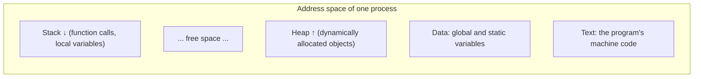
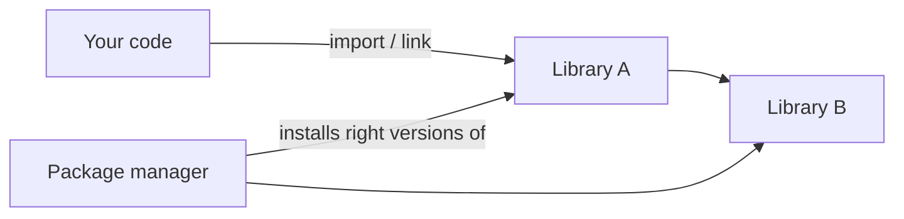

You type `python app.py`, press Enter, and something happens. Between those two moments sits a
chain of steps: your text is translated into something a machine can run, the operating system
creates a process, memory is laid out, libraries are found and loaded, and when it ends an exit code
reports how it went. Knowing this chain turns mysterious failures ("works on my machine",
"`ModuleNotFoundError`", "the container exits immediately") into ordinary, fixable problems.

## Compilers, interpreters and bytecode (how CPython runs your code)

The CPU only understands machine instructions (session 0.2.2). Your source code is text for
humans. Something has to translate, and there are two classic strategies.

Imagine translating a book. A **compiler** is like a translator who translates the *whole book* in
advance and hands you a finished copy: slow to produce, fast to read. An **interpreter** is like a
live interpreter at a conference, translating sentence by sentence as the speaker talks: you can
start immediately, but every sentence costs translation time.

- **Compiled languages** (C, C++, Rust, Go) are turned into a native **executable** for a specific
  CPU and operating system before running. Errors like type mismatches are caught at compile time.
- **Interpreted languages** run source through a program (the interpreter) that executes it
  directly.

Most modern languages sit in between, using **bytecode**: a compact, portable instruction set for a
*virtual* machine rather than a real CPU. Java compiles to JVM bytecode; Python does it too.

Here's what **CPython**, the standard Python implementation, does with your script:

1. **Parse**: read the source text and build a tree describing its structure. Syntax errors are
   reported here, before any of your code runs.
2. **Compile** that tree into **bytecode**. For imported modules, CPython caches the bytecode in
   `__pycache__/*.pyc` files so the next run can skip this step.
3. **Execute**: the CPython **virtual machine**, a big loop written in C, runs the bytecode one
   instruction at a time. It is the fetch–decode–execute cycle again, in software.

```mermaid
flowchart LR
  S[app.py source] --> P[Parse → syntax tree]
  P --> C[Compile → bytecode]
  C -. cached as .pyc for imports .-> C
  C --> VM[CPython VM loop in C]
  VM --> CPU[Machine instructions on the CPU]
```

You can see the bytecode yourself with the standard `dis` module:

```python
>>> import dis
>>> def add(a, b):
...     return a + b
...
>>> dis.dis(add)
```

The output lists instructions such as loading `a` and `b` and a binary add operation. The exact
names change between Python versions, but the idea doesn't: a stack-based virtual machine, one small
step at a time.

> [!NOTE]
> "Python is slow" mostly means: each bytecode instruction does a lot of work (checking types,
> managing reference counts) compared to one native CPU instruction. That's why heavy numeric work
> is delegated to libraries such as NumPy written in C, and why recent CPython versions keep adding
> optimisations to the interpreter loop.

> [!TIP]
> A `SyntaxError` means step 1 failed: nothing ran. A `NameError` or `TypeError` happens during
> step 3, so code *before* the failing line already ran. This tells you whether side effects (files
> written, rows inserted) may already have happened.

## Processes, memory layout: stack and heap

A program is a file on disk. A **process** is a program *running*: the operating system has loaded
it, given it memory, a process ID (**PID**), open files and at least one thread of execution.
Analogy: the recipe is the program; the actual cooking happening in a kitchen right now is the
process. You can run the same program as many processes at once, each with its own kitchen.

The OS gives each process its own **virtual address space**, as if it had the whole memory to itself.
That space is organised into regions:



- **Text (code)**: the machine instructions, read-only.
- **Data**: global and static variables.
- **Heap**: memory allocated at runtime, of any size, that lives until it is freed. In C you call
  `malloc`/`free`; in Python *every object* lives on the heap and is freed automatically by
  reference counting and the garbage collector.
- **Stack**: one **frame** per active function call, holding its local variables and where to
  return to. Calling a function pushes a frame; returning pops it. Fast and automatic, but limited
  in size.

> [!EXAMPLE]
> A function that calls itself without a base case keeps pushing frames until the stack runs out.
> In C that's a *stack overflow* crash; Python protects you with a recursion limit and raises
> `RecursionError: maximum recursion depth exceeded`. The traceback you learned to read in session
> 0.1.3 is literally a printout of the stack frames at the moment of the error.

> [!NOTE]
> [OSTEP](https://pages.cs.wisc.edu/~remzi/OSTEP/) (Operating Systems: Three Easy Pieces) covers
> processes and address spaces in depth, and is free to read online.

## Standard input/output, exit codes, environment variables

Every process starts with three open channels, numbered **file descriptors**:

| fd | Name | Default | Python |
|---|---|---|---|
| 0 | **stdin** (standard input) | keyboard | `input()`, `sys.stdin` |
| 1 | **stdout** (standard output) | terminal | `print()`, `sys.stdout` |
| 2 | **stderr** (standard error) | terminal | `sys.stderr`, tracebacks, logging by default |

Keeping normal output (stdout) separate from errors and diagnostics (stderr) is what lets the shell
redirect them independently: `python report.py > out.csv` sends data to the file while errors still
appear on screen. You'll use this constantly in session 0.3.1.

When a process ends, it returns an **exit code** (or *exit status*), a small integer. The
convention is simple: **0 means success, anything else means failure**. Python exits with 0 when a
script finishes normally and 1 when an uncaught exception kills it; you can choose with
`sys.exit(2)`. The shell stores the last exit code in `$?`:

```sh
$ python -c "import sys; sys.exit(3)"
$ echo $?
3
```

Exit codes are how scripts, CI pipelines, Docker and Kubernetes know whether something worked.
A CI job "fails" because a test command returned non-zero.

**Environment variables** are key–value strings that a process inherits from its parent. They
configure behaviour without changing code: `PATH` (where to look for programs), `HOME`, `LANG`, and
your app's own settings like `DATABASE_URL`.

```python
import os
db_url = os.environ.get("DATABASE_URL", "sqlite:///local.db")
```

> [!WARNING]
> Environment variables are inherited by *child* processes only, never passed back up. Running
> `export DEBUG=1` inside a script doesn't change your terminal's environment afterwards. And never
> print the whole environment in logs: it often contains secrets.

## Libraries, linking and package managers

No program is written from scratch. You use **libraries**: code written by others, packaged for
reuse. Something has to connect your code to them, and that's **linking**.

- **Static linking**: library code is copied into your executable at build time. One big
  self-contained file; easy to ship; must be rebuilt to pick up a library fix. Go binaries are
  usually built this way.
- **Dynamic linking**: the executable records *which* shared library it needs (`.so` on Linux,
  `.dylib` on macOS, `.dll` on Windows) and the OS loads it at start-up. Smaller files, shared
  security fixes, but the right version must be present on the machine.

Python has its own version of this. `import requests` makes Python search the directories in
`sys.path` for a module named `requests`, then load and execute it. Some Python packages also
contain compiled C extensions, which are dynamically linked libraries under the hood.

**Package managers** automate finding, downloading and installing libraries and their dependencies,
at the right versions: `pip` and `uv` for Python, `npm` for JavaScript, `apt` or `brew` for system
packages.



> [!WARNING]
> "Works on my machine" usually means the two machines resolved different library versions or a
> different `PATH`/`sys.path`. Lock files and virtual environments (session 0.4.5) and containers
> (Track 5) exist to make that resolution identical everywhere.

## Practice: trace one Python script from file to process

You'll follow a tiny script through every stage of this lesson. Use any Unix-like terminal (macOS,
Linux or WSL).

### Step 1: Write the script

Save this as `trace_me.py`:

```python
import os
import sys
import time

def main() -> int:
    print(f"PID: {os.getpid()}  parent PID: {os.getppid()}")
    print(f"GREETING env var: {os.environ.get('GREETING', '(not set)')}")
    print(f"Python looks for modules in {len(sys.path)} places, first: {sys.path[0]}")
    print("this goes to stderr", file=sys.stderr)
    time.sleep(30)  # time to inspect the process from another terminal
    return 0 if len(sys.argv) == 1 else 4

if __name__ == "__main__":
    sys.exit(main())
```

### Step 2: Look at the bytecode

```sh
python -c "import dis, trace_me; dis.dis(trace_me.main)"
ls __pycache__
```

Importing the module compiled it and cached the result in `__pycache__`. Skim the instructions and
find where `getpid` is loaded and called.

### Step 3: Run it and inspect the process

In terminal 1: `GREETING=hello python trace_me.py`. Note the PID it prints. In terminal 2 within
30 seconds:

```sh
ps -p <PID> -o pid,ppid,rss,command
```

`rss` is the memory actually in use (in KB). The parent PID is your shell.

### Step 4: Separate the streams

```sh
python trace_me.py > out.txt
cat out.txt
```

The stderr line still appeared on screen; the rest went to the file.

### Step 5: Check exit codes

```sh
python trace_me.py; echo "exit: $?"
python trace_me.py extra-arg; echo "exit: $?"
python -c "1/0"; echo "exit: $?"
```

You should see 0, 4 and 1 (uncaught exception).

### Step 6: Write it down

In five or six lines, describe the journey of `trace_me.py`: parse, bytecode, process creation,
environment, streams, exit code. Check the [Python docs](https://docs.python.org/3/) for `sys.exit`
and `os.environ` to confirm one detail you weren't sure about.

```quiz
{"questions": [
  {"question": "A Python script has a typo that causes a SyntaxError on line 50. Line 1 writes to a file. Is the file written?", "options": ["Yes, lines 1–49 run first", "No, the whole file is parsed and compiled before any code runs", "Only if the file already exists", "It depends on the operating system"], "answer": 1, "explanation": "Parsing and compiling to bytecode happen before execution, so a syntax error stops everything. Runtime errors like NameError happen during execution, after earlier lines ran."},
  {"question": "A recursive function without a base case eventually fails. Which memory region runs out?", "options": ["The heap", "The stack, because every call pushes a new frame", "The text segment", "The disk"], "answer": 1, "explanation": "Each call adds a stack frame. Python stops it early with RecursionError; in C it crashes with a stack overflow."},
  {"question": "Your CI step runs a script that prints 'ERROR: tests failed' but the pipeline shows green. What is most likely wrong?", "options": ["The message should be in capitals", "The script exits with code 0 even on failure", "It printed to stdout instead of a file", "The CI is ignoring environment variables"], "answer": 1, "explanation": "Tools judge success by exit code, not by text. A failing script must exit non-zero, e.g. sys.exit(1)."},
  {"question": "A Go binary runs on a fresh server with nothing installed, while a C program built on your laptop fails there with a missing .so error. What's the likely difference?", "options": ["Go is interpreted", "The Go binary was statically linked; the C program was dynamically linked to a shared library missing on the server", "The C program has a syntax error", "Servers can't run C"], "answer": 1, "explanation": "Static linking bundles libraries into the executable. Dynamic linking expects the shared library to exist on the target machine at start-up."},
  {"question": "Inside a script you run `os.environ['MODE'] = 'test'`. After the script ends, what does `echo $MODE` in your terminal show?", "options": ["test", "Nothing new: environment changes only flow down to child processes, never back to the parent", "An error", "It depends on the exit code"], "answer": 1, "explanation": "Each process has its own copy of the environment, inherited from its parent. Changes never propagate upwards."}
]}
```
