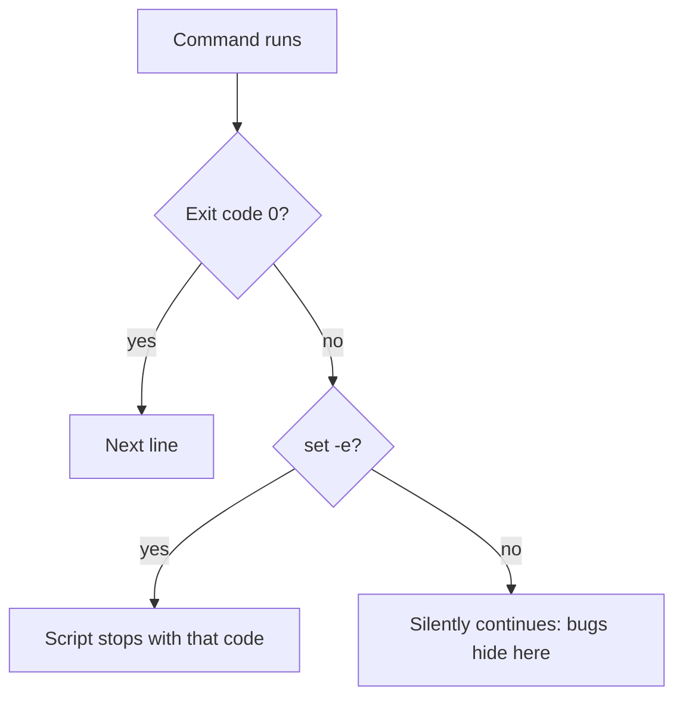
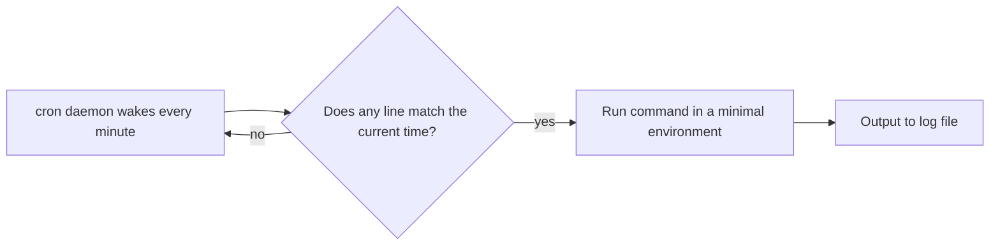

In the previous session you typed commands one at a time. A **shell script** is those same commands
saved in a file so the computer can run them for you, the same way, every time. If you have ever
done a five-step chore twice and thought "there must be a better way", this session is the better
way. Scripts are the glue of real engineering work: build steps, deploy hooks, CI jobs and backups
are very often a few dozen lines of Bash.

## Variables, quoting and expansion

A script is a text file that starts with a **shebang** line telling the system which interpreter
to use, followed by commands:

```bash
#!/usr/bin/env bash
echo "Hello from a script"
```

Save it as `hello.sh`, make it executable with `chmod +x hello.sh`, and run `./hello.sh`.

A **variable** is a labelled box for a value. In Bash you assign with `name=value` (no spaces
around `=`) and read with `$name`:

```bash
project="youcandoit"
echo "Building $project"
```

> [!WARNING]
> `name = value` with spaces does not assign anything. Bash reads it as "run a command called
> `name` with the arguments `=` and `value`", and fails with "command not found".

Before running a line, the shell performs **expansion**: it replaces special syntax with values.
The most important kinds:

| Syntax | Expands to | Example |
|---|---|---|
| `$var` / `${var}` | the variable's value | `echo "${project}_backup"` |
| `$(command)` | the command's output | `today=$(date +%F)` |
| `*`, `?` | matching file names (globbing) | `ls *.log` |
| `~` | your home directory | `cd ~/projects` |
| `$((...))` | arithmetic | `echo $((3 * 4))` |
| `$1`, `$2`, `$@` | script arguments | `./deploy.sh staging` → `$1` is `staging` |

**Quoting** controls expansion. Think of double quotes as a protective envelope: inside
`"..."` variables still expand, but the result stays one single word, even if it contains spaces.
Single quotes `'...'` are a sealed envelope: nothing inside expands at all.

```bash
file="my notes.txt"
rm $file      # WRONG: becomes rm my notes.txt → two files, "my" and "notes.txt"
rm "$file"    # right: one argument, "my notes.txt"
echo '$HOME'  # prints the literal text $HOME
```

> [!TIP]
> Rule of thumb: always wrap variable references in double quotes, `"$var"`, unless you have a
> specific reason not to. Unquoted variables are the number one source of Bash bugs.

## Conditionals, loops and functions in Bash

**Conditionals** use `if` with a test. The `[[ ... ]]` form is the modern, safer test syntax in
Bash:

```bash
if [[ -f "config.env" ]]; then
  echo "Config found"
elif [[ -d "config" ]]; then
  echo "Config directory found"
else
  echo "No config" >&2
fi
```

Common tests: `-f` (is a file), `-d` (is a directory), `-z "$x"` (string is empty),
`"$a" == "$b"` (strings equal), `$n -gt 5` (number greater than). `>&2` sends a message to stderr,
which is where error messages belong.

**Loops** repeat work. A `for` loop iterates over a list of words or files:

```bash
for f in *.csv; do
  echo "Processing $f"
  wc -l "$f"
done
```

A `while` loop repeats as long as a condition holds; `while read -r line` is the standard way to
process a file line by line:

```bash
while read -r host; do
  ping -c 1 "$host" > /dev/null && echo "$host is up"
done < hosts.txt
```

**Functions** give a name to a block of commands. They receive arguments as `$1`, `$2` just like
the script itself. Use `local` so variables don't leak into the rest of the script:

```bash
log() {
  local level="$1"; shift
  echo "$(date +%T) [$level] $*"
}

log INFO "Starting backup"
```

> [!NOTE]
> Bash is great for gluing commands together, and poor for complex logic, data structures or
> anything over a couple of hundred lines. When a script needs lists of records, JSON parsing
> beyond `jq`, or real error handling, rewrite it in Python (Module 0.4).

## Exit codes and error handling (set -euo pipefail)

Every command finishes with an **exit code**, a number from 0 to 255. Zero means success, anything
else means failure. It is like a traffic light at the end of each command: green (0) or one of
many shades of red. The shell stores the last exit code in `$?`:

```bash
grep -q "admin" users.txt
echo $?   # 0 if found, 1 if not found, 2 if the file is missing
```

`if` and `&&` / `||` work on exit codes, not on true/false values. That is why
`if grep -q admin users.txt; then ...` works: grep "succeeds" when it finds a match.

The dangerous default is that **a Bash script keeps going after a command fails**. If `cd build`
fails, the next line, `rm -rf *`, runs in whatever directory you happen to be in. To prevent this,
start almost every script with "strict mode":

```bash
#!/usr/bin/env bash
set -euo pipefail
```

| Option | Effect |
|---|---|
| `-e` | Exit immediately if a command fails |
| `-u` | Treat use of an unset variable as an error (catches typos like `$porject`) |
| `-o pipefail` | A pipeline fails if *any* command in it fails, not just the last one |



You can run cleanup on exit with `trap`, and return your own codes with `exit`:

```bash
tmp=$(mktemp -d)
trap 'rm -rf "$tmp"' EXIT   # always remove the temp dir, even on failure

if [[ $# -lt 1 ]]; then
  echo "usage: $0 <target>" >&2
  exit 2
fi
```

> [!WARNING]
> `set -e` has edge cases: failures inside `if` conditions, or on the left of `&&` / `||`, do not
> stop the script. Strict mode is a safety net, not a substitute for checking the commands that
> matter.

## Text processing: sed, awk, jq

A lot of automation is "take some text, change it, pass it on". Three tools cover most cases.

**`sed`** (stream editor) edits text line by line, most often to search and replace:

```bash
sed 's/localhost/db.internal/g' config.template > config.env
```

`s/old/new/g` means "substitute old with new, globally on each line". Note that `sed -i` (edit in
place) takes different arguments on macOS and Linux; writing to a new file avoids that trap.

**`awk`** treats each line as a row of fields (split on whitespace by default), which makes it
ideal for columns in logs and tables:

```bash
awk '{ print $1, $9 }' access.log          # IP and HTTP status of each request
awk '$9 >= 500 { count++ } END { print count }' access.log   # count server errors
```

**`jq`** is `sed` and `awk` for JSON, which is what most APIs and cloud CLIs output:

```bash
curl -s https://api.github.com/repos/git/git | jq '.stargazers_count'
jq -r '.items[] | select(.status == "failed") | .name' results.json
```

> [!EXAMPLE]
> A pipeline that combines them: from a JSON log file with one object per line, list the five
> most common error messages.
>
> ```bash
> jq -r 'select(.level == "error") | .msg' app.jsonl | sort | uniq -c | sort -rn | head -5
> ```

> [!TIP]
> `jq` is usually not installed by default. Install it with `brew install jq` (macOS) or
> `sudo apt install jq` (Ubuntu). It is worth it: you will use it in every module that touches APIs.

## Scheduling with cron

**cron** is the classic Unix scheduler: a background service that wakes up every minute and runs
any jobs whose time has come. You edit your personal schedule with `crontab -e` and list it with
`crontab -l`. Each line has five time fields followed by the command:

```sh
# min hour day-of-month month day-of-week  command
  0   2    *            *     *            /home/ana/bin/backup.sh >> /home/ana/backup.log 2>&1
```

That line means "every day at 02:00". A `*` means "every". Some more examples:

| Schedule | Meaning |
|---|---|
| `*/15 * * * *` | every 15 minutes |
| `0 9 * * 1-5` | 09:00 on weekdays |
| `30 3 1 * *` | 03:30 on the first day of each month |



Cron jobs run in a minimal environment: a short `PATH`, no aliases, and usually your home
directory as the working directory. Scripts that work in your terminal often fail under cron for
that reason.

> [!WARNING]
> In cron, always use absolute paths (for the script, for files it reads, and for the commands it
> calls if they are not in `/usr/bin` or `/bin`), and redirect output to a log file. Otherwise a
> failing job fails silently.

This very platform runs scheduled jobs too (news refresh, source indexing), but with a scheduler
library inside the application. Cron is the simplest version of the same idea.

## Practice: a backup script that runs nightly

Build a script that archives a folder into a dated `.tar.gz`, keeps only the last 7 backups and
runs every night. Chapters on shell scripting in
[The Linux Command Line](https://linuxcommand.org/tlcl.php) and the
[Missing Semester](https://missing.csail.mit.edu/) shell-tools lecture are good references while
you work.

### Step 1: Set up a safe playground

```bash
mkdir -p ~/sandbox/backup-demo/data ~/backups ~/bin
echo "important" > ~/sandbox/backup-demo/data/notes.txt
```

### Step 2: Write the script

Create `~/bin/backup.sh`:

```bash
#!/usr/bin/env bash
set -euo pipefail

src="${1:?usage: backup.sh <source-dir> [dest-dir]}"
dest="${2:-$HOME/backups}"
keep=7
stamp=$(date +%Y-%m-%d_%H%M)
name="$(basename "$src")_$stamp.tar.gz"

log() { echo "$(date '+%F %T') $*"; }

[[ -d "$src" ]] || { log "ERROR: $src is not a directory" >&2; exit 1; }
mkdir -p "$dest"

log "Archiving $src → $dest/$name"
tar -czf "$dest/$name" -C "$(dirname "$src")" "$(basename "$src")"

# Delete all but the newest $keep archives for this source.
ls -1t "$dest/$(basename "$src")"_*.tar.gz | tail -n +$((keep + 1)) | while read -r old; do
  log "Removing old backup $old"
  rm -- "$old"
done

log "Done"
```

`${1:?message}` stops with an error if no argument was given; `${2:-default}` falls back to a
default. Make it executable: `chmod +x ~/bin/backup.sh`.

### Step 3: Test it by hand, including failures

```bash
~/bin/backup.sh ~/sandbox/backup-demo/data
ls -l ~/backups
~/bin/backup.sh /does/not/exist; echo "exit code: $?"
~/bin/backup.sh; echo "exit code: $?"
```

Run the first command nine times (or fake older files with `touch`) and check that only seven
archives remain. Open one with `tar -tzf` to verify its contents.

### Step 4: Schedule it

Run `crontab -e` and add (replace the paths with your real absolute paths):

```sh
0 2 * * * /Users/you/bin/backup.sh /Users/you/sandbox/backup-demo/data >> /Users/you/backups/backup.log 2>&1
```

To test quickly, temporarily use `* * * * *` (every minute), wait two minutes, check the log,
then put the nightly time back.

> [!TIP]
> On macOS, cron may need "Full Disk Access" in System Settings to read some folders. On a laptop
> that sleeps at 02:00, the job simply won't run; for a real personal backup, pick a time your
> machine is awake.

### Step 5: Stretch goals

Add a `--dry-run` flag that prints what would happen without doing it, and make the script exit
with a non-zero code if the archive is smaller than expected.

```quiz
{"questions": [
  {"question": "Given file=\"my report.pdf\", why is `rm $file` dangerous?", "options": ["rm cannot delete PDF files", "Without quotes, word splitting turns it into two arguments: 'my' and 'report.pdf'", "$file is never expanded inside scripts", "It deletes the whole directory"], "answer": 1, "explanation": "Unquoted variables are split on spaces. \"$file\" keeps the value as a single argument."},
  {"question": "A script runs `cd /app/build` followed by `rm -rf *`. The directory does not exist. What does `set -e` change?", "options": ["Nothing; rm still runs", "The script stops after the failed cd, so rm never runs in the wrong directory", "It creates /app/build automatically", "It makes rm ask for confirmation"], "answer": 1, "explanation": "With -e the non-zero exit code of cd stops the script before the destructive command."},
  {"question": "`curl ... | jq .name` fails because curl could not connect, yet the script reports success. Which option fixes this?", "options": ["set -u", "set -x", "set -o pipefail", "set +e"], "answer": 2, "explanation": "By default a pipeline's exit code is that of the last command. pipefail makes the pipeline fail if any command in it fails."},
  {"question": "Your backup script works in the terminal but not from cron. What is the most likely cause?", "options": ["cron cannot run Bash scripts", "cron uses a minimal environment, so relative paths and commands outside the default PATH are not found", "cron only runs on weekends", "The script needs to be renamed to .cron"], "answer": 1, "explanation": "Cron jobs don't load your shell profile. Use absolute paths and log output to see errors."},
  {"question": "Which tool fits best for extracting a field from a cloud CLI's JSON output?", "options": ["sed", "awk", "jq", "cron"], "answer": 2, "explanation": "jq understands JSON structure; sed and awk work on lines and columns and break easily on nested data."}
]}
```
