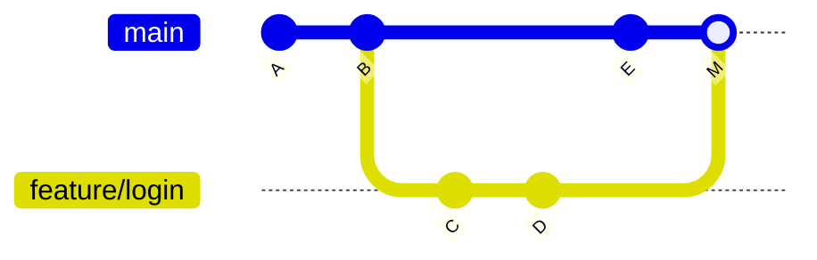
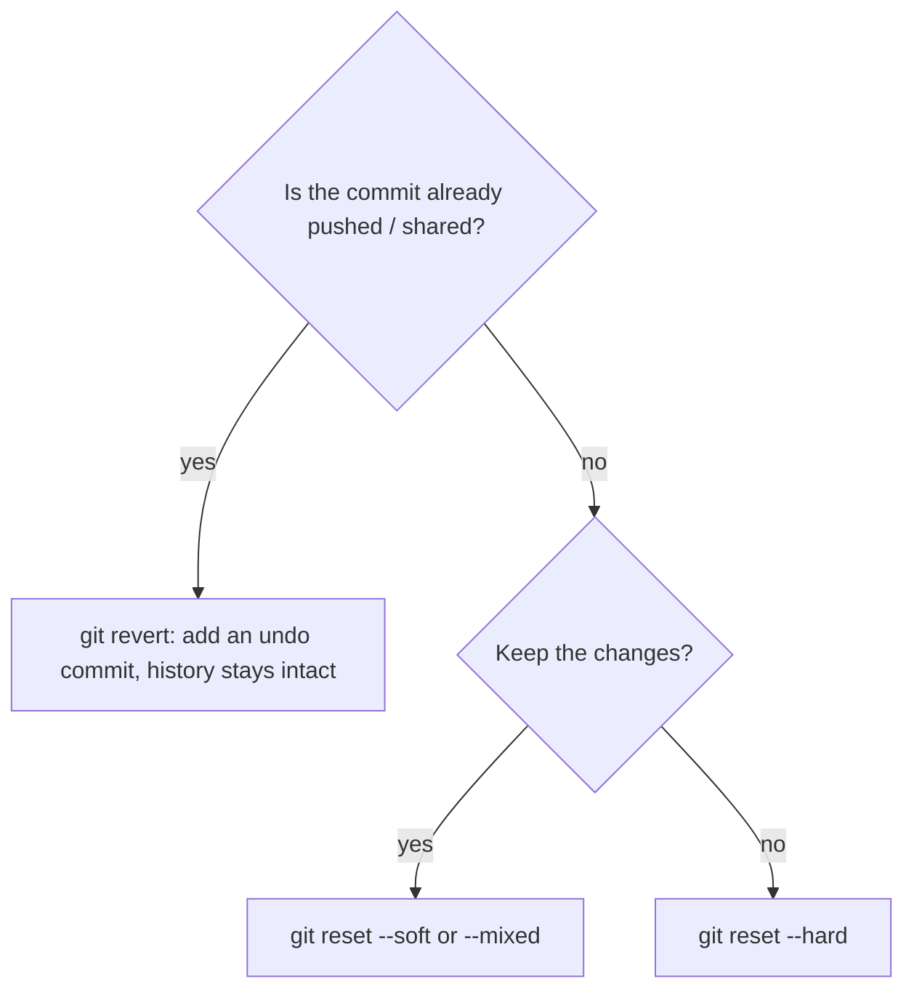

Git is the tool you will use more than any other in your career, often dozens of times a day. It
is also the tool that scares beginners most, because one wrong command *seems* to destroy work.
The good news: Git almost never loses anything you have committed, and once you understand its
simple underlying model, the commands stop being magic spells. This session builds that model.

## Why version control: snapshots, history, collaboration

Without version control, projects end up with folders like `app_final`, `app_final_v2` and
`app_final_REALLY_final`. Version control replaces that with a proper system that answers three
questions: *what* changed, *when*, and *why*.

The best analogy for Git is a **photo album of your project**. Each time you **commit**, Git takes
a **snapshot** of every tracked file as it is at that moment and adds it to the album, with a
caption (the commit message), the author and the date. Git does not primarily store "diffs"; it
stores snapshots, and cleverly reuses unchanged files so the album stays small. The
[Pro Git](https://git-scm.com/book/en/v2) book, free online, explains this "snapshots, not
differences" idea in its first chapter.

That album gives you three superpowers:

- **History.** You can see who changed a line and why (`git log`, `git blame`), and go back to any
  earlier snapshot.
- **Safe experiments.** You can try an idea on a separate line of work (a branch) and throw it away
  if it doesn't pan out.
- **Collaboration.** Many people can work on the same project in parallel and combine their work.

Git is **distributed**: every clone contains the full history, not just the latest files. You can
commit, branch and browse history entirely offline; services like GitHub are just a shared copy
everyone synchronises with (next session).

> [!NOTE]
> Each commit is identified by a **hash**, a 40-character hexadecimal ID such as
> `39c42f3a...`. It is computed from the commit's content and its parent, so if anything in history
> changed, the hash would change too. You usually only need the first 7 characters.

## The three areas: working tree, staging, repository

This is the single most important concept in Git. Your project lives in three places at once:

1. **Working tree**: the actual files on disk that you edit.
2. **Staging area** (also called the *index*): a draft of the next commit. You choose what goes in.
3. **Repository** (the `.git` folder): the album of committed snapshots.

Think of packing a parcel. The working tree is your room with stuff everywhere, the staging area is
the open box where you place exactly the items you want to send, and committing is taping the box
shut and labelling it.

```mermaid
flowchart LR
  W[Working tree<br/>your files] -- git add --> S[Staging area<br/>next commit draft]
  S -- git commit --> R[Repository<br/>history of snapshots]
  R -- git restore / git switch --> W
  S -- git restore --staged --> W
```

A typical cycle:

```sh
git init                      # once: create the .git folder
git status                    # what changed? what is staged?
git add app.py                # stage one file
git add -p                    # stage interactively, hunk by hunk
git commit -m "Add input validation to signup form"
git log --oneline             # view history
```

Why have a staging area at all? Because you often change several unrelated things at once. Staging
lets you split them into separate, focused commits: "Fix typo in README" and "Add retry to HTTP
client" instead of one commit called "stuff".

> [!TIP]
> Run `git status` constantly. It tells you which area every changed file is in and even suggests
> the commands to move it. `git diff` shows unstaged changes; `git diff --staged` shows what you are
> about to commit.

> [!WARNING]
> Never commit secrets (API keys, `.env` files, passwords). Add them to `.gitignore` before the
> first commit. Once a secret is in history, deleting the file in a later commit does not remove it
> from older snapshots.

## Commits, branches, merges and resolving conflicts

A **commit** points to its parent commit, so history is a chain going backwards in time. A
**branch** is surprisingly simple: it is just a *movable label pointing at a commit*. When you
commit on a branch, the label moves forward to the new commit. **HEAD** is a pointer to "the branch
you are on right now".

```sh
git switch -c feature/login   # create a branch and move to it
# ...edit, add, commit...
git switch main               # go back to main
git merge feature/login       # bring the feature's commits into main
```

When you merge, two things can happen:

- **Fast-forward**: `main` has not moved since you branched, so Git just slides the `main` label
  forward. No new commit is needed.
- **Three-way merge**: both branches have new commits. Git finds their common ancestor, combines
  both sets of changes, and creates a **merge commit** with two parents.



A **conflict** happens when both branches changed the *same lines* of the same file differently.
Git cannot guess which version is right, so it pauses the merge and marks the file:

```text
<<<<<<< HEAD
TIMEOUT = 30
=======
TIMEOUT = 60
>>>>>>> feature/login
```

The top part is your current branch, the bottom part is the incoming one. To resolve:

1. Open the file and decide what the code should be (one side, the other, or a combination).
2. Delete the markers `<<<<<<<`, `=======` and `>>>>>>>`.
3. Run your tests, then `git add` the file and `git commit` to finish the merge.

> [!NOTE]
> A conflict is not an error, and it is not anybody's fault. It is Git asking a human to make a
> decision only a human can make. If you get lost mid-merge, `git merge --abort` returns you to
> the state before you started.

## Undoing things: restore, reset, revert, reflog

Different mistakes need different tools. The key question is always: *has this change been shared
with other people yet?*

| Situation | Command | What it does |
|---|---|---|
| Discard unsaved edits to a file | `git restore app.py` | Copies the committed version back over the working tree file |
| Unstage a file (keep the edits) | `git restore --staged app.py` | Moves it out of staging |
| Fix the last commit's message or add a forgotten file | `git commit --amend` | Replaces the last commit with a new one |
| Undo local commits that nobody else has | `git reset --soft HEAD~1` | Moves the branch back one commit, keeps the changes staged |
| Throw local commits *and* changes away | `git reset --hard HEAD~1` | Moves the branch back and overwrites your files |
| Undo a commit that is already shared | `git revert <hash>` | Creates a *new* commit that does the opposite |



The difference between `reset` and `revert` matters: `reset` *rewrites* history (the commits
disappear from the branch), while `revert` *adds* to history. Rewriting shared history breaks your
teammates' copies, so on shared branches you revert.

Finally, the safety net: the **reflog**. Git records every position HEAD has been at, including
commits you "lost" with a reset or a deleted branch.

```sh
git reflog
# 4f2a1c9 HEAD@{0}: reset: moving to HEAD~3
# 9b7e0d2 HEAD@{1}: commit: Add password reset email
git reset --hard 9b7e0d2   # back to where you were before the reset
```

> [!WARNING]
> The reflog saves *commits*, not uncommitted edits. `git reset --hard` and `git restore` on files
> you never committed are the few truly destructive operations in Git. When in doubt, commit
> first (even a "WIP" commit), then experiment.

## Practice: Learn Git Branching main levels

[Learn Git Branching](https://learngitbranching.js.org/) is an interactive visual sandbox: you type
real Git commands and watch the commit graph change. It turns the mental model from this lesson
into something you can see. Plan for two or three sittings of 45 minutes.

### Step 1: Do the "Main" levels in order

Open the site and work through the *Main* tab's introduction sequence (commits, branches, merging,
rebasing) and then the following sequences. Before typing each command, predict out loud what the
graph will look like afterwards. Prediction is retrieval practice.

### Step 2: Keep a "surprises" list

Each time the graph does something you did not expect, write one line: the command, what you
expected, what happened. These surprises are exactly the gaps in your mental model, and they make
perfect review material.

### Step 3: Replay it on a real repository

In a terminal, create a throwaway repository and reproduce a conflict on purpose:

```sh
mkdir ~/sandbox/git-play && cd ~/sandbox/git-play
git init
echo "TIMEOUT = 30" > config.py
git add config.py && git commit -m "Add config"
git switch -c slow-network
echo "TIMEOUT = 60" > config.py && git commit -am "Raise timeout"
git switch main
echo "TIMEOUT = 10" > config.py && git commit -am "Lower timeout"
git merge slow-network        # conflict!
```

Resolve the conflict, finish the merge and inspect the result with
`git log --oneline --graph --all`.

### Step 4: Practise recovery

Still in the sandbox: run `git reset --hard HEAD~2`, confirm with `git log` that commits are
"gone", then find them in `git reflog` and bring them back. Finally, use `git revert` on one commit
and compare how history looks compared with the reset.

> [!EXAMPLE]
> A good "surprises" entry: "`git commit` after `git switch <hash>` → expected it to update main,
> but HEAD was detached and the commit belonged to no branch. Fix: create a branch with
> `git switch -c` before committing."
