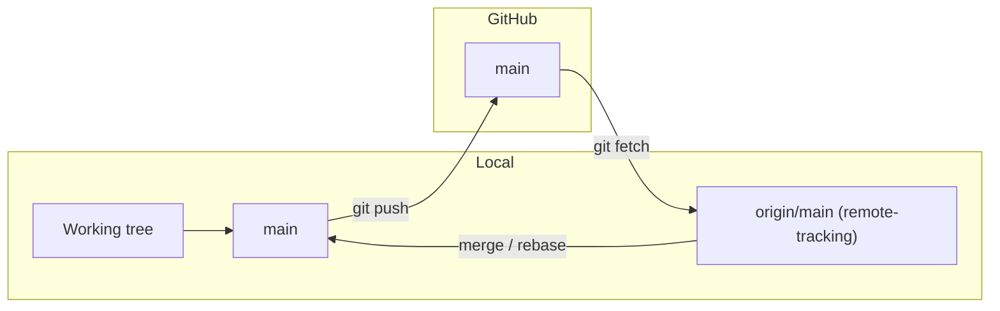
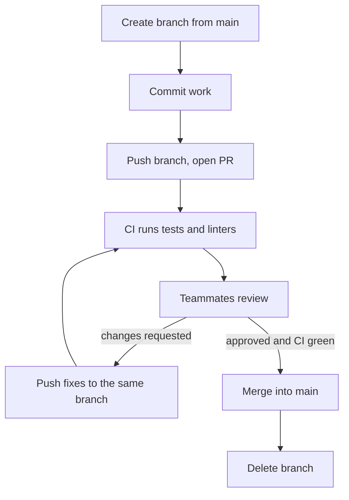
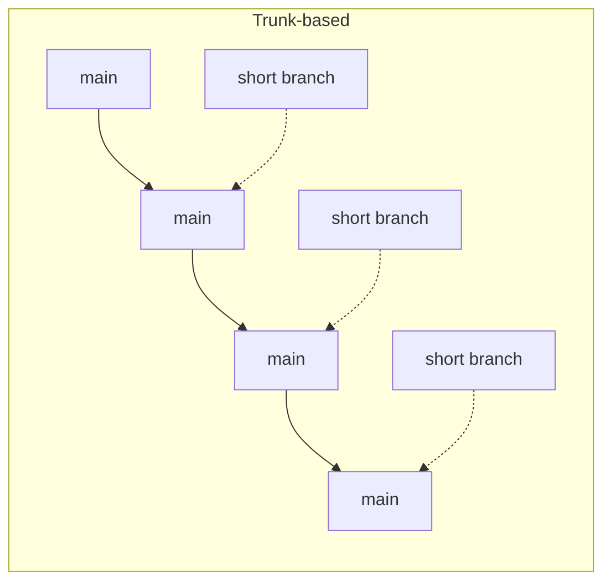
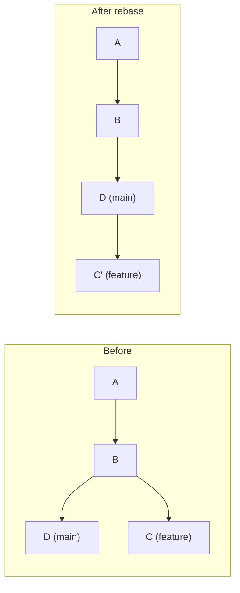

In the last session Git was a personal photo album. In a team, it becomes a shared album that many
people add to at the same time, and the hard problems shift from "how do I commit?" to "how do we
keep main working while ten people change it?". This session covers the workflow almost every
company uses: remotes, pull requests, a branching strategy, a clean history and versioned releases.

## Remotes, fetch, pull, push

A **remote** is another copy of the repository that yours knows about, usually hosted on GitHub,
GitLab or a company server. When you `git clone` a project, Git creates a remote called `origin`
pointing at the URL you cloned from.

```sh
git remote -v                 # list remotes and their URLs
git remote add upstream https://github.com/org/project.git
```

The analogy: your local repository is your notebook; the remote is the shared notebook in the
office. Four commands move work between them:

| Command | Direction | What it does |
|---|---|---|
| `git fetch` | remote → local | Downloads new commits and updates **remote-tracking branches** like `origin/main`. Your own branches and files are untouched. |
| `git pull` | remote → local | `fetch` and then integrate (merge, or rebase if configured) into your current branch. |
| `git push` | local → remote | Uploads your commits and moves the remote branch forward. |
| `git clone` | remote → new local | Copies the whole repository, history included. |



`origin/main` is your *last known picture* of the remote's `main`. It only updates when you fetch.
That is why `git status` can say "Your branch is up to date with 'origin/main'" while a teammate
pushed five minutes ago: Git hasn't asked the server yet.

> [!NOTE]
> A push is refused ("rejected, non-fast-forward") when the remote has commits you don't have.
> Git is protecting your teammates' work. The fix is to `git pull` (or fetch and rebase), resolve
> any conflicts, then push again — never to force push over a shared branch.

> [!TIP]
> Prefer `git fetch` followed by a look at `git log --oneline main..origin/main` when you want to
> see what is new *before* it lands in your branch. `git pull` is fetch plus integrate in one step,
> which is convenient but less transparent.

## Pull requests and review flow

A **pull request** (PR; GitLab calls it a *merge request*) is a proposal: "please merge my branch
into main". It is not a Git feature but a feature of the hosting platform, documented in
[GitHub Docs](https://docs.github.com/en/get-started). A PR shows the diff, runs automated checks,
and gives teammates a place to comment line by line before anything reaches main.

The typical flow:



What makes a PR easy to review:

- **Small.** A 150-line PR gets a thoughtful review; a 2,000-line PR gets "LGTM" (looks good to me)
  and hidden bugs.
- **One purpose.** Don't mix a refactor, a bug fix and a dependency upgrade.
- **A good description.** What changed, *why*, how you tested it, and screenshots for UI changes.

> [!EXAMPLE]
> A clear PR description:
>
> **Title:** Add rate limiting to login endpoint
>
> **Why:** We saw brute-force attempts in the logs (see issue #142).
>
> **What:** 5 attempts per minute per IP, returns 429 after that.
>
> **Testing:** Unit tests for the limiter; manually checked with 10 rapid requests.

Being a good reviewer is a senior skill. Comment on behaviour and risk, not personal style that a
formatter should handle; ask questions ("what happens if this list is empty?") rather than issuing
orders; and approve when it is good enough, not when it is how you would have written it.

> [!WARNING]
> Don't take review comments personally, and don't argue in circles in comments. If a thread goes
> back and forth more than twice, a five-minute call usually resolves it.

## Branching strategies: trunk-based vs GitFlow

A **branching strategy** is a team agreement about which branches exist and how work flows between
them. Two families dominate.

**GitFlow** uses several long-lived branches: `main` holds released versions, `develop` collects
finished features, and there are `feature/*`, `release/*` and `hotfix/*` branches with rules for
how each merges into the others. It fits products with planned, versioned releases (installed
desktop software, libraries supporting several versions), but it adds ceremony and long-lived
branches that drift apart.

**Trunk-based development** keeps one main branch (the "trunk"). Everyone works on short-lived
branches, a day or two at most, and merges into main frequently. Unfinished features hide behind
**feature flags** (configuration switches) rather than living on a branch for weeks. Main must
always be releasable, which requires good automated tests.



| | Trunk-based | GitFlow |
|---|---|---|
| Long-lived branches | Only main | main, develop |
| Branch lifetime | Hours to a couple of days | Days to weeks |
| Merge conflicts | Small and frequent | Large and painful |
| Best for | Web services deployed continuously | Versioned products with release cycles |

Most modern web teams use trunk-based development (often called "GitHub flow" in its simplest
form: branch, PR, merge to main, deploy). It is the strategy this roadmap assumes.

## Rebase, squash and a clean history

**Rebase** is an alternative to merge for bringing your branch up to date. Instead of creating a
merge commit, it *replays* your commits one by one on top of the latest main, as if you had started
your work today.

```sh
git switch feature/search
git fetch origin
git rebase origin/main        # replay my commits on top of the latest main
```



The analogy: merging is writing "meanwhile, elsewhere..." in a story; rebasing is rewriting your
chapter so it starts after the latest events. The result is a straight, linear history that is
easier to read and bisect.

Because rebase creates *new* commits (new hashes), it rewrites history. Hence the golden rule from
[Pro Git](https://git-scm.com/book/en/v2): **do not rebase commits that exist outside your
repository and that people may have based work on.** Rebasing your own feature branch before
opening or updating a PR is fine; rebasing main is not. After rebasing an already-pushed branch of
your own, you need `git push --force-with-lease`, which refuses to overwrite the remote if someone
else pushed to it in the meantime.

**Squashing** combines several commits into one. Your branch might contain "WIP", "fix typo",
"actually fix it"; nobody needs those in main. Two common ways:

- `git rebase -i origin/main` and mark commits as `squash`/`fixup` (interactive, in your editor).
- "Squash and merge" on the PR, which turns the whole PR into one commit on main.

> [!TIP]
> A clean history is not vanity. When a bug appears, `git bisect` searches history to find the
> commit that introduced it, and `git blame` explains why a line exists. Both work far better when
> each commit is a meaningful, working change.

## Conventional Commits and semantic versioning

**Conventional Commits** is a lightweight convention for commit messages, specified at
[conventionalcommits.org](https://www.conventionalcommits.org/en/v1.0.0/). Each message starts
with a type, an optional scope and a description:

```text
feat(auth): add password reset via email
fix(api): return 404 instead of 500 for unknown session id
docs: explain local setup in README
refactor!: drop support for Python 3.10

BREAKING CHANGE: the minimum supported Python is now 3.11
```

The common types are `feat` (a new feature), `fix` (a bug fix), plus others such as `docs`,
`refactor`, `test` and `chore`. A `!` after the type, or a `BREAKING CHANGE:` footer, marks a
breaking change.

The structure is machine-readable, which connects it to **Semantic Versioning** (SemVer), specified
at [semver.org](https://semver.org/). A version number has three parts, `MAJOR.MINOR.PATCH`:

| Part | Increment when you... | Example |
|---|---|---|
| MAJOR | make incompatible API changes | 1.4.2 → 2.0.0 |
| MINOR | add functionality in a backwards-compatible way | 1.4.2 → 1.5.0 |
| PATCH | make backwards-compatible bug fixes | 1.4.2 → 1.4.3 |

The mapping is direct: `fix` → patch, `feat` → minor, breaking change → major. Tools can read
your commits, pick the next version and generate a changelog automatically.

> [!NOTE]
> Under SemVer, versions `0.y.z` are for initial development: anything may change at any time,
> and the public API should not be considered stable. Version `1.0.0` is the promise of a stable
> public API.

> [!WARNING]
> Dependencies declared as `^1.4.2` (npm) accept any `1.x.y` from 1.4.2 upwards because they trust
> SemVer. A library that ships a breaking change in a minor version breaks every project that
> trusted it. Respect SemVer in what you publish.

## Practice: open a PR with a feature branch and address review comments

You will run the full team workflow on your own repository. If you have a study buddy, swap
reviews; otherwise review your own PR the next day with fresh eyes.

### Step 1: Create a repository on GitHub

Create a new repository (for example `study-notes`) with a README, and clone it:

```sh
git clone https://github.com/<you>/study-notes.git
cd study-notes
```

### Step 2: Work on a feature branch with conventional commits

```sh
git switch -c feat/shell-cheatsheet
# add shell.md from session 0.3.1
git add shell.md
git commit -m "docs: add shell cheat sheet"
# make a second, small improvement
git commit -am "docs(shell): add pipe examples"
git push -u origin feat/shell-cheatsheet
```

`-u` links your local branch to the remote one, so later a plain `git push` is enough.

### Step 3: Open the pull request

On GitHub, open a PR from your branch into `main`. Write a description with *What*, *Why* and
*How I checked it*. Following [GitHub Docs](https://docs.github.com/en/get-started), protect
`main` so that changes must go through a PR.

### Step 4: Review and respond

Leave at least two line comments on the diff (or ask your buddy to). Then address them: push new
commits to the same branch and watch the PR update. Reply to each comment explaining what you
changed, and resolve the thread.

### Step 5: Clean up and merge

Simulate a teammate's change: edit the README directly on `main` in the GitHub UI. Then rebase:

```sh
git fetch origin
git rebase origin/main
git push --force-with-lease
```

Merge the PR with **Squash and merge**, using a conventional commit title. Delete the branch, then
update locally with `git switch main && git pull`. Finally, tag a release:

```sh
git tag v0.1.0 && git push origin v0.1.0
```

> [!EXAMPLE]
> Reply to a review comment like: "Good catch, the example was missing quotes around `$file`.
> Fixed in a3f9c21." It shows what you changed and where, so the reviewer can verify in seconds.

```quiz
{"questions": [
  {"question": "After `git fetch`, what has changed in your repository?", "options": ["Your working files now include teammates' changes", "Remote-tracking branches like origin/main are updated; your own branches and files are unchanged", "Your commits have been uploaded", "Nothing; fetch only checks the connection"], "answer": 1, "explanation": "fetch downloads commits and updates origin/* only. Integrating them into your branch is a separate merge or rebase (which pull does for you)."},
  {"question": "Why is rebasing main (a shared branch) a bad idea?", "options": ["Rebase only works on feature branches", "Rebase rewrites commits with new hashes, so everyone else's copy of main no longer matches", "Rebase deletes merge conflicts", "It makes history non-linear"], "answer": 1, "explanation": "Rebased commits are new commits. Teammates who based work on the old ones get diverging histories. Rebase only your own, unshared work."},
  {"question": "A team deploys a web service several times a day and wants to avoid big painful merges. Which strategy fits best?", "options": ["GitFlow with long-lived develop and release branches", "Trunk-based development with short-lived branches and feature flags", "Everyone commits directly to main without review", "One branch per developer, merged monthly"], "answer": 1, "explanation": "Short branches merged often keep conflicts small, and feature flags let unfinished work ship hidden."},
  {"question": "A library at 2.3.1 ships a fix with commit `fix: handle empty input`. What is the next version under SemVer?", "options": ["3.0.0", "2.4.0", "2.3.2", "2.3.1-fix"], "answer": 2, "explanation": "A backwards-compatible bug fix increments PATCH. feat would bump MINOR; a breaking change would bump MAJOR."},
  {"question": "What makes a pull request easiest to review well?", "options": ["Bundling every change from the week into one PR", "A small diff with a single purpose and a description of what, why and how it was tested", "No description, so the code speaks for itself", "Many WIP commits so reviewers see your thought process"], "answer": 1, "explanation": "Small, focused PRs with context get careful reviews; huge mixed PRs get skimmed and hide bugs."}
]}
```
