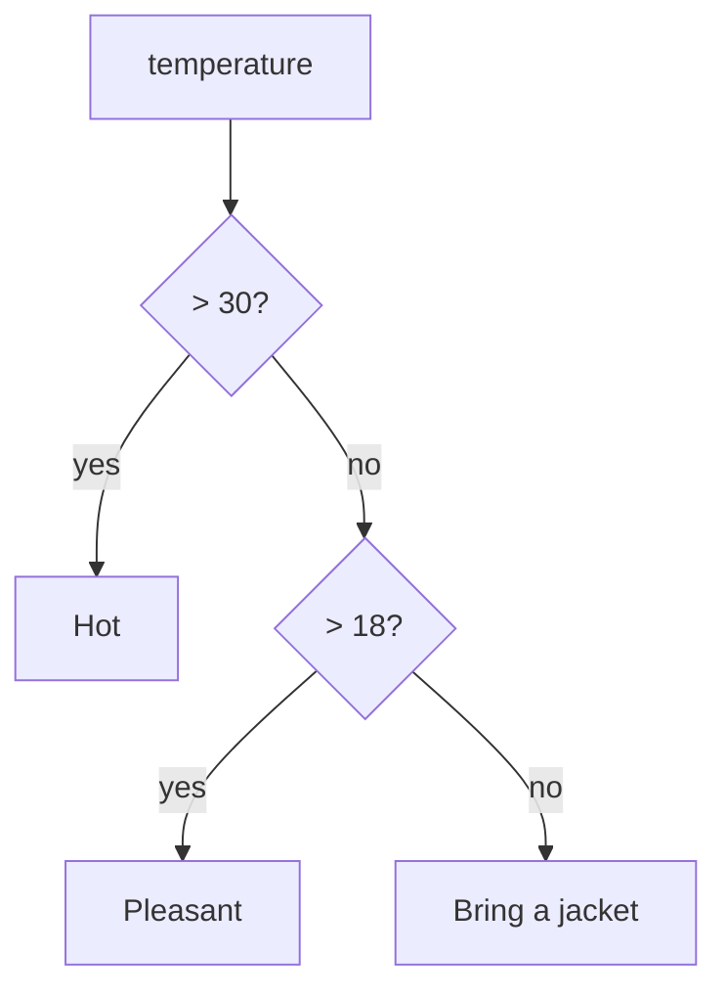
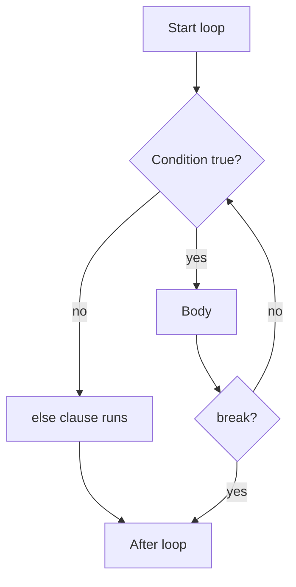

So far your programs run straight down, top to bottom, one line after another. Real programs make
decisions ("is the password correct?"), repeat work ("for every order in the list…") and package
logic into named, reusable pieces. These three ideas, **branching**, **looping** and **functions**,
are the backbone of every language you will ever use. Master them in Python and you will recognise
them instantly in TypeScript, Java or SQL procedures.

## if / elif / else and boolean logic

Think of `if` as a fork in a road. The program arrives at a condition, checks whether it is true,
and takes one path or the other.

```python
temperature = 31

if temperature > 30:
    print("Hot: drink water")
elif temperature > 18:
    print("Pleasant")
else:
    print("Bring a jacket")
```

Python checks the conditions **in order** and runs the *first* branch whose condition is true;
the rest are skipped. `elif` ("else if") adds more branches, and `else` catches everything left
over. Both are optional.

> [!NOTE]
> **Indentation is syntax** in Python. The indented block under `if` *is* the body. Other
> languages use `{ }`; Python uses four spaces. Mixing tabs and spaces, or indenting one line by
> three spaces, produces an `IndentationError`. Let your editor insert four spaces for you.



**Boolean logic** combines conditions with `and`, `or` and `not`:

| Expression | True when… |
|---|---|
| `a and b` | both are true |
| `a or b` | at least one is true |
| `not a` | `a` is false |

Python also lets you chain comparisons the way you would in maths: `18 <= age < 65` means
`18 <= age and age < 65`.

**Truthiness.** In a condition, Python doesn't need a real boolean. Empty things and zero count as
false (`0`, `0.0`, `""`, `[]`, `{}`, `None`); almost everything else counts as true. So
`if name:` means "if name is not an empty string". It is idiomatic and concise, but be careful:

> [!WARNING]
> `if count:` is false both when `count` is `None` (no value yet) and when it is `0` (a real
> value). If zero is meaningful, write `if count is not None:` explicitly.

**Short-circuiting.** `and` stops at the first false operand and `or` at the first true one. That
lets you write guards like `if user and user.is_admin:`: if `user` is `None`, the second part is
never evaluated, so you never get an error for reading `.is_admin` on nothing.

> [!TIP]
> Deeply nested `if`s are hard to read. Prefer **early exits**: handle the error or edge case
> first and stop, then write the main logic without extra indentation. You will apply this inside
> functions below.

## for and while loops, break and continue

Loops repeat a block. Python has two kinds, and choosing the right one is half the battle.

A **`for` loop** walks through a collection, one item at a time. Use it when you know *what* you
are iterating over: the characters of a string, the items in a list, the lines in a file, or a
range of numbers.

```python
for fruit in ["apple", "pear", "fig"]:
    print(fruit.upper())

for i in range(1, 6):      # 1, 2, 3, 4, 5  (the stop value is excluded)
    print(i * i)
```

`range(start, stop, step)` produces numbers lazily: `range(0, 10, 2)` gives 0, 2, 4, 6, 8. The
"stop is excluded" rule feels odd at first, but it means `range(len(items))` gives exactly the
valid indexes of `items`.

> [!TIP]
> If you need both the index and the item, don't write `for i in range(len(items)):`. Use
> `for i, item in enumerate(items):`. It is shorter, clearer and impossible to get off by one.

A **`while` loop** repeats *as long as a condition stays true*. Use it when you don't know in
advance how many repetitions you need: "keep asking until the user types a valid number", "keep
retrying until the server answers".

```python
attempts = 0
while attempts < 3:
    password = input("Password: ")
    if password == "open sesame":
        print("Welcome")
        break
    attempts += 1
else:
    print("Locked out")
```

Two keywords change a loop's flow:

- **`break`** exits the loop immediately.
- **`continue`** skips the rest of this iteration and jumps to the next one.

And a Python peculiarity: a loop can have an **`else`** clause that runs only if the loop finished
*without* hitting `break`. Above, "Locked out" prints only when all three attempts failed. It is
handy for search loops, though some teams avoid it because it surprises readers.



> [!WARNING]
> A `while` loop whose condition never becomes false runs forever. If your terminal freezes,
> press `Ctrl+C` to interrupt the program (it raises `KeyboardInterrupt`). Then check that
> something inside the loop actually moves you towards the exit condition.

## Defining functions, parameters, return values

A **function** is a named recipe. You write the recipe once, give it ingredients (**parameters**)
and it hands you back a dish (the **return value**). Then you can cook it a hundred times by name
without rewriting the steps.

```python
def area_of_rectangle(width, height):
    """Return the area of a rectangle."""
    return width * height

room = area_of_rectangle(4, 3.5)   # 14.0
```

The anatomy:

- `def` starts the definition, followed by the **name** and the **parameters** in parentheses.
- The first string in the body is the **docstring**: it documents what the function does and
  shows up in `help(area_of_rectangle)` and in your editor's tooltips.
- `return` sends a value back to the caller and ends the function immediately.
- When you call it, the values you pass (`4`, `3.5`) are the **arguments**.

> [!NOTE]
> **Parameter** = the name in the definition (`width`). **Argument** = the actual value passed
> at the call (`4`). People mix them up all the time, but interviewers sometimes notice.

A function without `return` (or with a bare `return`) returns `None`. This leads to a classic
bug:

> [!WARNING]
> `print` and `return` are different. A function that *prints* its result gives the caller
> `None`, so `total = add(2, 3)` ends up as `None`. Functions should usually **return** values and
> let the caller decide whether to print, save or send them. It also makes them testable.

You can pass arguments **by position** or **by keyword**: `area_of_rectangle(height=3.5, width=4)`.
Keyword arguments make calls self-documenting, especially when a function takes several numbers or
booleans: `send_email(to, subject, urgent=True)` reads far better than `send_email(to, subject,
True)`.

Why bother with functions at all? Three reasons that matter on the job:

1. **No duplication.** Fix a bug once, and every caller benefits.
2. **Names explain intent.** `is_prime(n)` tells the reader what happens without reading the loop.
3. **Testability.** A function with inputs and a return value can be checked automatically:
   `assert is_prime(7) is True`.

## Scope, default arguments, *args and **kwargs

**Scope** answers the question "where can this name be seen?". Think of a function as a room with
one-way glass: code inside can see names defined outside (globals), but names created inside the
room (locals) vanish when the function returns and are invisible from outside.

```python
rate = 0.22                 # global

def with_vat(price):
    total = price * (1 + rate)   # reads the global 'rate'
    return total                 # 'total' is local

with_vat(100)   # 122.0
print(total)    # NameError: 'total' is not defined
```

Python looks names up in order: **L**ocal, **E**nclosing function, **G**lobal, **B**uilt-in,
known as the **LEGB rule**.

> [!WARNING]
> Assigning to a name inside a function makes it local for the *whole* function. Writing
> `count += 1` inside a function, where `count` is a global, raises `UnboundLocalError`. The fix
> is almost never `global count`; instead pass the value in as a parameter and return the new one.

**Default arguments** give parameters a fallback value:

```python
def greet(name, greeting="Hello"):
    return f"{greeting}, {name}!"

greet("Ana")                 # 'Hello, Ana!'
greet("Ana", "Ciao")         # 'Ciao, Ana!'
```

> [!WARNING]
> Defaults are evaluated **once**, when the function is defined. A mutable default like
> `def add_item(item, items=[])` shares the same list across every call, so items pile up between
> unrelated calls. Use `items=None` and inside write `if items is None: items = []`.

**`*args` and `**kwargs`** let a function accept a variable number of arguments.

```python
def total(*prices):              # prices is a tuple of all positional args
    return sum(prices)

def make_user(**fields):         # fields is a dict of all keyword args
    return fields

total(3, 4, 5)                   # 12
make_user(name="Ana", role="dev")  # {'name': 'Ana', 'role': 'dev'}
```

The names `args` and `kwargs` are conventions; the stars are what matter. The same stars also
*unpack* at call time: `total(*[1, 2, 3])` spreads a list into separate arguments, and
`make_user(**{"name": "Ana"})` spreads a dict into keyword arguments. You'll meet this pattern
constantly in frameworks like FastAPI, which forward arguments through layers of functions.

> [!EXAMPLE]
> Order of parameters in a signature: regular ones, then `*args`, then keyword-only ones, then
> `**kwargs`. For example `def log(message, *values, level="INFO", **context):` accepts
> `log("saved", 3, level="DEBUG", user="ana")`.

## Practice: FizzBuzz, prime checker, number guessing game

Three classic exercises, each practising a different skill. Put them in one folder, one file each,
and commit after each one works. The [Python Tutorial](https://docs.python.org/3/tutorial/)
chapter "More Control Flow Tools" and the early weeks of [CS50x](https://cs50.harvard.edu/x/) cover
the same ground if you get stuck.

### Step 1: FizzBuzz (loops + conditions)

Print the numbers 1 to 100, but print `Fizz` for multiples of 3, `Buzz` for multiples of 5 and
`FizzBuzz` for multiples of both. Write it as a function that *returns* the word for one number,
then loop over it.

```python
def fizzbuzz(n):
    if n % 15 == 0:
        return "FizzBuzz"
    if n % 3 == 0:
        return "Fizz"
    if n % 5 == 0:
        return "Buzz"
    return str(n)

for i in range(1, 101):
    print(fizzbuzz(i))
```

Ask yourself: why must the `% 15` check come first? Swap the order and see what breaks.

### Step 2: Prime checker (functions + early exit)

Write `is_prime(n)` returning `True` or `False`. A prime is an integer greater than 1 divisible
only by 1 and itself.

```python
def is_prime(n):
    if n < 2:
        return False
    i = 2
    while i * i <= n:          # no need to test beyond the square root
        if n % i == 0:
            return False
        i += 1
    return True

assert is_prime(2) and is_prime(13) and not is_prime(1) and not is_prime(21)
```

The `assert` line is your first automated test: if any check fails, Python stops with an
`AssertionError`. Then print all primes below 50 with a `for` loop.

### Step 3: Number guessing game (while + input + break)

The computer picks a secret number between 1 and 100; the player guesses until they get it, with
"too high" / "too low" hints, and the program reports the number of attempts.

```python
import random

secret = random.randint(1, 100)
attempts = 0

while True:
    guess = int(input("Your guess: "))
    attempts += 1
    if guess < secret:
        print("Too low")
    elif guess > secret:
        print("Too high")
    else:
        print(f"Correct in {attempts} attempts!")
        break
```

### Step 4: Improve it

- Add a `max_attempts=7` default parameter by wrapping the game in `def play(max_attempts=7):`.
- Skip invalid input with `continue` when `guess` is outside 1–100.
- Explain in a comment why 7 attempts are always enough with the halving strategy. (Hint: 2⁷ =
  128.)

> [!TIP]
> When something doesn't work, add a temporary `print(f"{guess=} {secret=}")` inside the loop, or
> use the debugger from session 0.3.5. Guessing at the cause is slower than looking.

```quiz
{"questions": [
  {"question": "With `x = 20`, what does this print? `if x > 10: print('A')` / `elif x > 15: print('B')` / `else: print('C')`", "options": ["A", "B", "A and B", "C"], "answer": 0, "explanation": "Python runs only the first branch whose condition is true. x > 10 matches, so the elif is never checked."},
  {"question": "You need to keep asking the user for input until they type a valid email. Which loop fits best?", "options": ["A for loop over range(10)", "A while loop that stops when the input is valid", "No loop; a single if is enough", "A for loop over the email string"], "answer": 1, "explanation": "You don't know in advance how many attempts are needed, so loop while a condition holds and break when the input is valid."},
  {"question": "`def add(a, b): print(a + b)` and then `result = add(2, 3)`. What is `result`?", "options": ["5", "'5'", "None", "An error"], "answer": 2, "explanation": "The function prints but never returns, so the call evaluates to None. Return values, then let the caller print."},
  {"question": "Why is `def add_tag(tag, tags=[])` a bug waiting to happen?", "options": ["Lists cannot be default values", "The default list is created once and shared by every call that omits tags", "It makes tags a global variable", "Default arguments must come before regular ones"], "answer": 1, "explanation": "Defaults are evaluated once at definition time. Use tags=None and create a new list inside the function."},
  {"question": "In FizzBuzz, why must the check for multiples of 15 come before the checks for 3 and 5?", "options": ["Because 15 is the largest number", "Because the first matching branch wins, so 15 would otherwise return Fizz", "Because % only works with 15", "It doesn't matter; the order is irrelevant"], "answer": 1, "explanation": "Conditions are tested in order and the first true one returns. 15 is divisible by 3, so checking 3 first would return Fizz and never reach FizzBuzz."}
]}
```
