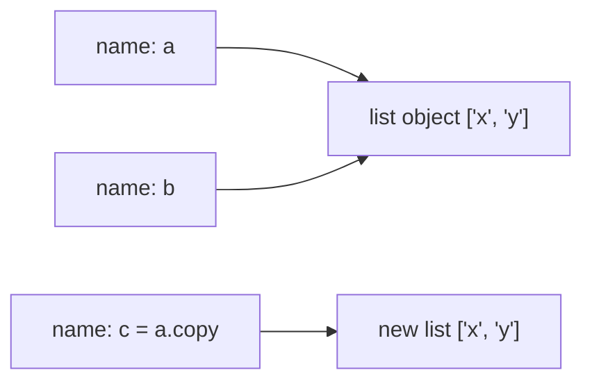
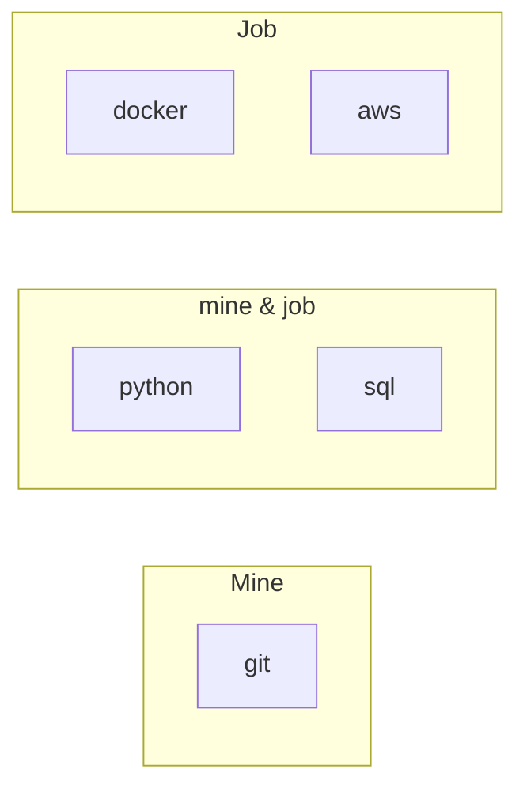

Almost every program is really about *data*: a list of orders, a user profile, the set of tags on
an article. Python gives you four built-in containers for that data: **lists**, **tuples**,
**dictionaries** and **sets**. Choosing the right one is a design decision, not a detail. The
right container makes code short, fast and obvious; the wrong one makes it slow and fiddly. This
session teaches you each container, when to reach for it, and the comprehension syntax that lets
you build them in one readable line.

## Lists and tuples: indexing, slicing, mutability

A **list** is like a numbered shopping list: items in a fixed order, each with a position, and you
can cross things out, add more or rearrange them. A **tuple** is like a printed receipt: also
ordered and numbered, but once printed you cannot change it.

```python
langs = ["python", "sql", "typescript"]   # list: square brackets
point = (41.9, 12.5)                      # tuple: parentheses (really, the comma)
```

Both are **sequences**, so they share the same access tools. **Indexing** starts at 0, and
negative indexes count from the end:

```python
langs[0]     # 'python'
langs[-1]    # 'typescript'
langs[3]     # IndexError: list index out of range
```

**Slicing** extracts a sub-sequence with `[start:stop:step]`. Like `range`, `stop` is excluded,
and any part can be omitted:

| Slice | Result | Meaning |
|---|---|---|
| `langs[0:2]` | `['python', 'sql']` | items 0 and 1 |
| `langs[1:]` | `['sql', 'typescript']` | from 1 to the end |
| `langs[:-1]` | `['python', 'sql']` | all but the last |
| `langs[::-1]` | `['typescript', 'sql', 'python']` | reversed copy |

> [!TIP]
> Slices never raise `IndexError`: `langs[10:20]` is just `[]`. And `langs[:]` is a quick
> (shallow) copy of the list.

**Mutability** is the real difference between the two. A list can change in place:

```python
langs.append("go")        # add at the end
langs.insert(0, "bash")   # add at position 0
langs.remove("sql")       # remove the first matching value
last = langs.pop()        # remove and return the last item
langs.sort()              # sort in place, returns None
```

A tuple cannot: `point[0] = 0` raises `TypeError`. That sounds like a limitation, but it is a
promise. When a function receives a tuple, it knows nobody will change it behind its back. Use
tuples for small, fixed groups of values whose *position* has meaning: coordinates, an RGB colour,
a `(name, score)` pair, or several values returned from a function.

```python
def min_max(numbers):
    return min(numbers), max(numbers)   # returns a tuple

low, high = min_max([4, 9, 1])          # tuple unpacking: low=1, high=9
```

> [!WARNING]
> Remember "labels, not boxes" from session 0.4.1. `b = a` does **not** copy a list: both names
> now point to the same list, so `b.append(1)` also changes `a`. Make a copy with `a.copy()` or
> `list(a)` when you need independence.



> [!WARNING]
> `sorted(langs)` returns a new sorted list; `langs.sort()` sorts in place and returns `None`.
> Writing `langs = langs.sort()` replaces your list with `None`, a very common bug.

## Dictionaries: key–value modelling

A **dictionary** (`dict`) is like a real dictionary or a phone book: you look things up by a
**key** (a word, a name) and get a **value** (a definition, a number). You don't care about
position; you care about the label.

```python
user = {"name": "Ana", "role": "backend", "years": 3}

user["name"]                 # 'Ana'
user["years"] += 1           # update a value
user["email"] = "ana@x.io"   # add a new key
del user["role"]             # remove a key
user["phone"]                # KeyError: 'phone'
user.get("phone")            # None, no error
user.get("phone", "n/a")     # 'n/a', a default
```

Dictionaries are the workhorse of Python and of the web in general: a JSON object from an API maps
directly to a dict. They also model "records" (one user's fields, like above) and "lookups" (from
an id to an object, or from a word to its count).

Iterating over a dict gives you its keys; use `.items()` to get key and value together:

```python
for key, value in user.items():
    print(f"{key}: {value}")
```

Since Python 3.7, dicts keep **insertion order**: keys come back in the order you added them.

**Keys must be hashable**, which in practice means immutable: strings, numbers and tuples of those
work; lists do not. A **hash** is a number computed from the key that tells Python exactly where to
look, which is why dictionary lookups are fast no matter how big the dict gets.

> [!NOTE]
> "Fast no matter the size" is called **O(1)** or constant time on average. Searching for a value
> in a list means checking items one by one: **O(n)**, slower as the list grows. You'll study
> Big-O properly in Track 1; for now remember *lookup by key in a dict is fast, searching a list
> is slow*.

> [!EXAMPLE]
> Modelling choice. A list of tuples `[("Ana", 3), ("Luca", 5)]` makes "what is Luca's
> experience?" a loop. A dict `{"Ana": 3, "Luca": 5}` makes it `team["Luca"]`. If you find
> yourself looping to *look something up*, you probably want a dict.

Dicts nest naturally to describe richer data:

```python
order = {
    "id": 1042,
    "customer": {"name": "Ana", "city": "Rome"},
    "items": [{"sku": "A1", "qty": 2}, {"sku": "B7", "qty": 1}],
}
order["customer"]["city"]       # 'Rome'
order["items"][0]["qty"]        # 2
```

## Sets and membership tests

A **set** is like a bag of unique stickers: no duplicates, no order, and the only question that
really matters is "do I have this one?". Sets are built on the same hashing machinery as dict
keys, so membership tests are fast.

```python
tags = {"python", "sql", "python"}   # {'python', 'sql'}: duplicate dropped
"sql" in tags                         # True, O(1) on average
tags.add("docker")
tags.discard("java")                  # no error if absent
unique = set(["a", "b", "a"])         # dedupe a list
```

> [!WARNING]
> `{}` creates an empty **dict**, not an empty set. Write `set()` for an empty set.

Sets support the operations you know from maths diagrams, which are surprisingly practical:

```python
mine = {"python", "sql", "git"}
job  = {"python", "docker", "sql", "aws"}

mine & job   # intersection: {'python', 'sql'}       skills I already have
job - mine   # difference:   {'docker', 'aws'}       skills to learn
mine | job   # union:        all skills mentioned
mine ^ job   # symmetric difference: in one but not both
```



> [!TIP]
> Use `in` with any container, but know the cost: `x in a_list` scans every item, while
> `x in a_set` or `x in a_dict` is a hash lookup. If you test membership many times against a big
> collection, convert it to a set once first.

A quick decision guide:

| Need | Use |
|---|---|
| Ordered items you will change | `list` |
| Small fixed group, position has meaning | `tuple` |
| Look up values by a label | `dict` |
| Unique items, fast "is it there?" | `set` |

## Comprehensions for lists, dicts and sets

A **comprehension** builds a new collection from an existing one in a single expression. Think of
it as a recipe written in one sentence: "give me *this*, for each item in *that*, if *condition*".

The long way:

```python
squares = []
for n in range(10):
    if n % 2 == 0:
        squares.append(n * n)
```

The comprehension:

```python
squares = [n * n for n in range(10) if n % 2 == 0]   # [0, 4, 16, 36, 64]
```

Read it left to right: *expression*, *for clause*, optional *if filter*. The same syntax works for
dicts and sets, just with braces:

```python
words = ["Apple", "banana", "apple", "Cherry"]

lower = [w.lower() for w in words]                  # list
unique = {w.lower() for w in words}                 # set: {'apple', 'banana', 'cherry'}
lengths = {w: len(w) for w in words}                # dict: word -> length
prices = {"pen": 2, "book": 15}
expensive = {k: v for k, v in prices.items() if v > 10}   # {'book': 15}
```

The [Python Tutorial's Data Structures chapter](https://docs.python.org/3/tutorial/datastructures.html)
covers comprehensions, including nested ones, with more examples.

> [!WARNING]
> Comprehensions are for *building collections*. If a comprehension needs two nested loops, two
> conditions and a function call, it is no longer readable: write a normal `for` loop. And never
> use a comprehension only for side effects, like `[print(x) for x in items]`.

> [!NOTE]
> Swap the brackets for parentheses and you get a **generator expression**:
> `sum(n * n for n in range(10))`. It produces values one at a time instead of building a whole
> list in memory. You'll explore generators in session 0.4.6.

## Practice: word frequency counter for a text file

Build a script that reads a text file and prints its 10 most common words. It uses every container
from this session. Budget about 45 minutes.

### Step 1: Get a text file

Save any long text as `book.txt` next to your script: a public-domain book, a long article, or the
README of a project you like. A few thousand words is ideal.

### Step 2: Read and split the text

```python
with open("book.txt", encoding="utf-8") as f:
    text = f.read()

words = text.lower().split()
print(len(words), "words")
```

`with open(...)` opens the file and guarantees it is closed afterwards; session 0.4.4 explains it
in detail. `.split()` with no argument splits on any whitespace.

### Step 3: Clean the words

Punctuation sticks to words (`"python,"` and `"python"` would count separately). Strip it with a
list comprehension:

```python
import string

cleaned = [w.strip(string.punctuation) for w in words]
cleaned = [w for w in cleaned if w]          # drop empty strings
```

### Step 4: Count with a dict

```python
counts = {}
for w in cleaned:
    counts[w] = counts.get(w, 0) + 1
```

`counts.get(w, 0)` returns the current count, or 0 the first time we see a word. This
"accumulate into a dict" pattern appears everywhere: grouping orders by customer, counting errors
by type, summing sales by month.

### Step 5: Sort and print the top 10

```python
top = sorted(counts.items(), key=lambda pair: pair[1], reverse=True)[:10]
for word, n in top:
    print(f"{word:<15}{n:>6}")
```

`counts.items()` gives `(word, count)` tuples; `key=` tells `sorted` to order by the count (index
1); the slice keeps the first ten. Notice how lists, tuples, dicts and slicing all cooperate.

### Step 6: Extensions

- Ignore common words: define `STOPWORDS = {"the", "a", "and", "of", "to"}` (a set, because you
  test membership for every word) and filter them out in step 3.
- Print how many *distinct* words the text has: `len(set(cleaned))`.
- Rewrite step 4 with `collections.Counter` from the standard library
  ([Python docs](https://docs.python.org/3/)) and compare: `Counter(cleaned).most_common(10)`.
  Knowing the hand-written version first means you understand what the library does for you.

> [!EXAMPLE]
> For a novel, with stopwords removed, the top of the list is usually the main characters' names
> and verbs like "said". Without stopwords, "the", "and" and "of" dominate. Check your output
> against intuition: counts sorted from highest to lowest, no punctuation glued to words, no empty
> strings. Then verify one count by hand with your editor's search.

```quiz
{"questions": [
  {"question": "You need to store the (latitude, longitude) of a fixed location and pass it around safely. Which type fits best?", "options": ["A list, because it is ordered", "A tuple, because it is a small fixed group whose positions have meaning", "A set, because coordinates are unique", "A dict with keys 0 and 1"], "answer": 1, "explanation": "Tuples are immutable and positional, which signals a fixed record that nobody should modify."},
  {"question": "`a = [1, 2]; b = a; b.append(3)`. What is `a` now?", "options": ["[1, 2]", "[1, 2, 3]", "[3]", "An error"], "answer": 1, "explanation": "b = a binds a second name to the same list object, so changes through b are visible through a. Use a.copy() for an independent list."},
  {"question": "You must check 100,000 times whether a user id is in a collection of 50,000 banned ids. What should the banned collection be?", "options": ["A list, sorted", "A set (or dict), so each membership test is a fast hash lookup", "A tuple, because it is immutable", "A string of ids joined by commas"], "answer": 1, "explanation": "Membership in a list scans items one by one; a set uses hashing and is constant time on average."},
  {"question": "What does `{w: len(w) for w in ['hi', 'hello'] if len(w) > 2}` produce?", "options": ["{'hi': 2, 'hello': 5}", "{'hello': 5}", "['hello']", "{5}"], "answer": 1, "explanation": "It is a dict comprehension filtered by length: only 'hello' passes, mapped to its length 5."},
  {"question": "Why does `counts[w] = counts.get(w, 0) + 1` work for words seen for the first time?", "options": ["Because dicts create missing keys automatically when read", "Because get returns the default 0 instead of raising KeyError when the key is missing", "Because w is always already in counts", "Because + 1 creates the key"], "answer": 1, "explanation": "get(key, default) returns the default for a missing key, so the first occurrence becomes 0 + 1 = 1."}
]}
```
