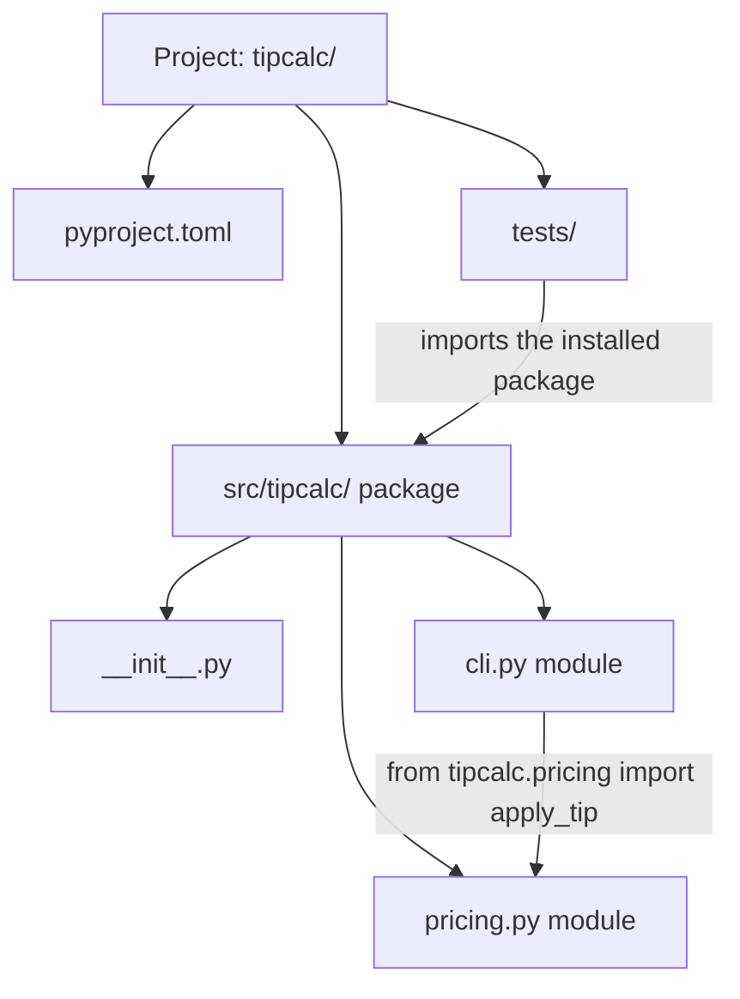
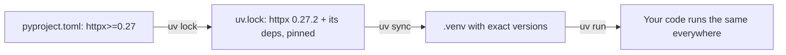

So far your Python programs have lived in a single file. That works for a 50-line script, but real
projects have thousands of lines, depend on other people's code, and must run the same way on your
laptop, a colleague's machine and a server. This session covers the three things that make that
possible: **modules** to split code into files, **packages** to organise those files, and
**environments** to pin down exactly which dependencies a project uses.

## Modules, imports and the standard library tour

Think of a module as a toolbox with a label on it. Instead of keeping every tool in one giant pile
(one huge file), you put the screwdrivers in one box and the wrenches in another, and you fetch the
box you need by name.

In Python, a **module** is simply a `.py` file. If you have a file `pricing.py` with a function
`apply_tip`, any other file in the same folder can use it:

```python
# pricing.py
TAX_RATE = 0.22

def apply_tip(amount: float, percent: float) -> float:
    return round(amount * (1 + percent / 100), 2)
```

```python
# main.py
import pricing
from pricing import apply_tip

print(pricing.TAX_RATE)
print(apply_tip(40, 10))
```

There are three common import forms:

| Form | What you get | When to use it |
|---|---|---|
| `import pricing` | the module, used as `pricing.apply_tip` | default; the prefix shows where a name comes from |
| `from pricing import apply_tip` | just that name | when you use one or two names often |
| `import numpy as np` | the module under a shorter alias | for well-known community conventions |

> [!WARNING]
> Avoid `from pricing import *`. It dumps every public name into your file, so a reader can no
> longer tell where `apply_tip` came from, and two modules can silently overwrite each other's names.

When Python runs `import pricing`, it searches a list of folders called `sys.path` (the script's
folder first, then the standard library, then installed packages), executes the module's code
**once**, and caches the result. A second import of the same module is free. This also explains a
classic beginner bug: naming your own file `random.py` or `json.py` *shadows* the standard library
module of the same name, because your folder is searched first.

Every module has a `__name__`. When you run a file directly, its `__name__` is `"__main__"`; when it
is imported, it is the module name. That gives us a standard idiom:

```python
def main() -> None:
    print(apply_tip(40, 10))

if __name__ == "__main__":
    main()  # runs only when executed as a script, not when imported
```

### A short tour of the standard library

Python is called "batteries included" because the standard library covers a lot before you install
anything. The [Python Tutorial — Modules](https://docs.python.org/3/tutorial/modules.html) chapter
explains imports in depth; here are modules you will meet constantly:

| Module | What it is for |
|---|---|
| `pathlib` | file paths as objects (`Path("data") / "notes.txt"`) |
| `json`, `csv` | reading and writing structured data |
| `datetime` | dates, times and durations |
| `collections` | `Counter`, `defaultdict`, `deque` |
| `itertools` | building blocks for loops |
| `random`, `math`, `statistics` | numbers |
| `argparse` | command-line arguments |
| `logging` | structured log messages instead of `print` |
| `subprocess`, `os`, `sys` | talking to the operating system |

> [!TIP]
> Before you `pip install` something, spend one minute checking whether the standard library already
> does it. Every dependency you add is code you have to trust, update and secure.

## Packages and project layout

If a module is a toolbox, a **package** is a shelf of toolboxes: a folder of modules that you import
with dotted names, such as `import tipcalc.pricing`. A folder becomes a regular package when it
contains an `__init__.py` file (it can be empty). That file runs when the package is first imported.

As soon as a project has more than one file and might be installed or tested, use the **src
layout**, which is the layout `uv init --package` generates:

```text
tipcalc/
├── pyproject.toml        # project metadata and dependencies
├── uv.lock               # exact versions (generated)
├── README.md
├── src/
│   └── tipcalc/
│       ├── __init__.py
│       ├── pricing.py
│       └── cli.py
└── tests/
    └── test_pricing.py
```

Why put the code under `src/`? Because it prevents a subtle bug: without it, running tests from the
project root can import your code straight from the folder instead of from the *installed* package,
so a packaging mistake (a missing file, a wrong name) only shows up when a user installs it. With
`src/`, your tests use the code the same way users will.

Inside a package, modules import each other with the full package name:

```python
# src/tipcalc/cli.py
from tipcalc.pricing import apply_tip
```

> [!NOTE]
> **Module** = one `.py` file. **Package** = a folder of modules (with `__init__.py`).
> **Distribution** = the installable thing (a wheel or source archive) you publish or `uv add`.
> People say "package" for all three; context tells you which one is meant.



## Virtual environments and dependency management with uv

Here is the problem environments solve. Project A needs `requests` version 2.31; project B needs a
newer version with different behaviour. If both install into the one global Python, the last
install wins and the other project breaks. The analogy: each project gets its own kitchen instead of
everyone cooking in one shared kitchen and moving each other's ingredients.

A **virtual environment** (venv) is a folder, usually `.venv/`, containing its own `python`
executable link and its own `site-packages` where dependencies are installed. Activating it (or
running commands through a tool that uses it) makes `python` and `import` look there first.

For years the workflow was `python -m venv .venv`, `source .venv/bin/activate`, `pip install ...`,
and a hand-maintained `requirements.txt`. It still works, but **uv** from Astral wraps all of it into
one fast tool. From the [uv docs](https://docs.astral.sh/uv/), it can install Python versions,
create virtual environments, add and lock dependencies, run commands and build packages.

The everyday commands:

```sh
uv init --package tipcalc   # new project with src layout and pyproject.toml
cd tipcalc
uv add httpx                # add a dependency: updates pyproject.toml, uv.lock and .venv
uv add --dev pytest ruff    # development-only dependencies
uv run pytest               # run a command inside the project environment
uv sync                     # make .venv match the lock file exactly
uv remove httpx             # drop a dependency
```

You rarely need to activate the environment by hand: `uv run` makes sure `.venv` exists and is in
sync with the lock file, then runs your command inside it.

> [!WARNING]
> Never commit the `.venv/` folder to Git. It is large, contains machine-specific paths, and can be
> rebuilt at any time with `uv sync`. Add `.venv/` to `.gitignore` (uv does this for you).

> [!EXAMPLE]
> A teammate clones your repo. Instead of a page of setup instructions, the README says:
> `uv sync` then `uv run tipcalc 40 10`. uv installs the right Python version if needed, builds the
> environment from the lock file and runs the CLI.

## pyproject.toml and lock files

`pyproject.toml` is the single configuration file of a modern Python project. It is written in TOML,
a simple `key = value` format with `[sections]`. The `[project]` table describes the project:

```toml
[project]
name = "tipcalc"
version = "0.1.0"
description = "Split restaurant bills"
requires-python = ">=3.12"
dependencies = [
    "httpx>=0.27",
]

[project.scripts]
tipcalc = "tipcalc.cli:main"   # installs a `tipcalc` command that calls cli.main()

[dependency-groups]
dev = ["pytest>=8", "ruff>=0.6"]

[build-system]
requires = ["hatchling"]
build-backend = "hatchling.build"
```

Notice `httpx>=0.27`. That is a **version constraint**: a range of acceptable versions, written by a
human, describing what your code is *compatible* with. It is deliberately loose so the project can
pick up bug fixes.

A **lock file** (`uv.lock`) is the opposite: generated by the tool, it records the *exact* version
(and a hash) of every package, including dependencies of your dependencies. The analogy is a recipe
versus a shopping receipt. The recipe says "some flour, at least 500 g"; the receipt says exactly
which brand and batch you bought, so someone else can reproduce the cake precisely.

| | `pyproject.toml` | `uv.lock` |
|---|---|---|
| Written by | you | uv |
| Contains | direct dependencies, ranges | every dependency, exact versions and hashes |
| Commit to Git? | yes | yes, for applications |
| Purpose | what the project *accepts* | what the project *uses* |



> [!TIP]
> Upgrades become a deliberate, reviewable change: run `uv lock --upgrade-package httpx`, run your
> tests, and commit the updated `uv.lock`. Everyone else gets the new version with their next
> `uv sync`.

## Practice: turn a script into an installable package

Take the tip calculator (or unit converter) from session 0.4.1 and turn it into a real package with
a command-line entry point and a test. Budget about 45 minutes.

### Step 1: Create the project

```sh
uv init --package tipcalc
cd tipcalc
```

Open the generated files. You should see `pyproject.toml`, `src/tipcalc/__init__.py` and a
`README.md`. Run `uv run tipcalc` once to see the generated hello-world entry point work.

### Step 2: Split the logic into a module

Create `src/tipcalc/pricing.py` with pure functions only (no `input`, no `print`):

```python
def apply_tip(amount: float, percent: float) -> float:
    if amount < 0 or percent < 0:
        raise ValueError("amount and percent must be non-negative")
    return round(amount * (1 + percent / 100), 2)

def split(total: float, people: int) -> float:
    if people < 1:
        raise ValueError("people must be at least 1")
    return round(total / people, 2)
```

Keeping I/O out of this module is what makes it easy to test and reuse.

### Step 3: Add a command-line interface

Create `src/tipcalc/cli.py` using `argparse` from the standard library:

```python
import argparse

from tipcalc.pricing import apply_tip, split

def main() -> None:
    parser = argparse.ArgumentParser(description="Split a bill with tip")
    parser.add_argument("amount", type=float)
    parser.add_argument("percent", type=float)
    parser.add_argument("--people", type=int, default=1)
    args = parser.parse_args()
    total = apply_tip(args.amount, args.percent)
    print(f"Total {total:.2f}, each pays {split(total, args.people):.2f}")
```

Point the script entry in `pyproject.toml` at it: `tipcalc = "tipcalc.cli:main"`.

### Step 4: Add a test and a dev dependency

```sh
uv add --dev pytest
```

```python
# tests/test_pricing.py
import pytest
from tipcalc.pricing import apply_tip, split

def test_apply_tip():
    assert apply_tip(40, 10) == 44.0

def test_split_rejects_zero_people():
    with pytest.raises(ValueError):
        split(10, 0)
```

Run `uv run pytest`. Then run `uv run tipcalc 40 10 --people 2`.

### Step 5: Prove it is reproducible

Commit `pyproject.toml`, `uv.lock`, `src/` and `tests/` (not `.venv/`). Delete `.venv`, run
`uv sync`, and run the tests again. Finally run `uv build` and look inside `dist/`: the `.whl` file
is your installable package.

> [!EXAMPLE]
> Done looks like this: a fresh clone plus `uv sync` gives a working `tipcalc` command, tests pass,
> and `pricing.py` contains no `print` or `input`.

```quiz
{"questions": [
  {"question": "You create a file called json.py in your project and suddenly `import json` elsewhere in the project breaks. Why?", "options": ["json is not part of the standard library", "Python searches the script's folder before the standard library, so your file shadows the real module", "Modules can only be imported once per computer", "File names cannot contain the word json"], "answer": 1, "explanation": "The script's directory comes first on sys.path, so your json.py is found before the standard library's json module."},
  {"question": "What is the main reason to use a src/ layout?", "options": ["It makes imports shorter", "Python refuses to import packages outside src/", "Tests import the installed package rather than the raw folder, so packaging mistakes surface early", "It removes the need for pyproject.toml"], "answer": 2, "explanation": "With src/, the project root does not accidentally act as an import path, so tests exercise the code the way users install it."},
  {"question": "pyproject.toml says httpx>=0.27 and uv.lock says httpx 0.27.2. Which statement is correct?", "options": ["They contradict each other; one must be deleted", "The constraint states what is compatible; the lock records the exact version actually installed so every machine gets the same one", "uv.lock is optional documentation and is never read", "Only uv.lock should be committed"], "answer": 1, "explanation": "The constraint is a human-written range; the lock file pins exact versions (including transitive ones) for reproducible installs. Commit both."},
  {"question": "Why should the .venv folder not be committed to Git?", "options": ["Git cannot store binary files", "It contains your passwords", "It is large, machine-specific and fully rebuildable from the lock file with uv sync", "Committing it makes uv run slower"], "answer": 2, "explanation": "The environment is an output, not a source. The lock file is the source of truth; uv sync recreates the environment."},
  {"question": "What does `if __name__ == \"__main__\":` achieve?", "options": ["It runs the block only when the file is executed directly, not when it is imported", "It makes the module private", "It speeds up imports", "It is required in every Python file"], "answer": 0, "explanation": "When imported, __name__ is the module name, so the guarded code (like main()) does not run as a side effect of importing."}
]}
```
