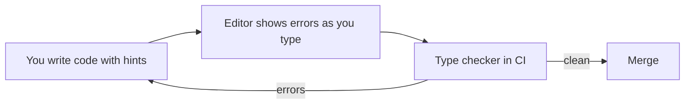
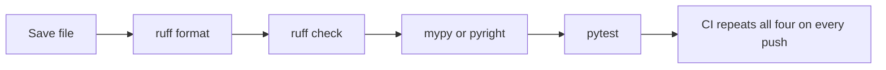

Python is dynamically typed: a variable can hold anything, and type mistakes only show up when the
line runs. That freedom is great for a 20-line script and painful in a 20,000-line service, where a
`None` sneaking into the wrong place crashes production at 3 a.m. This session adds three safety nets
that professional Python projects (including this platform's API) use every day: **type hints**
checked by a static checker, **Pydantic** to validate data at runtime, and **Ruff** to keep code
clean automatically.

## Type hints, generics and Protocols

Type hints are labels on the boxes. They tell readers and tools what *should* go in a variable,
parameter or return value. Python itself ignores them at runtime; their value comes from editors and
checkers that read them.

```python
def apply_tip(amount: float, percent: float = 10) -> float:
    return round(amount * (1 + percent / 100), 2)

names: list[str] = ["Ada", "Linus"]
scores: dict[str, int] = {"Ada": 90}
maybe_email: str | None = None      # either a str or None
```

The building blocks, all documented in the [Python typing docs](https://docs.python.org/3/library/typing.html):

| Hint | Meaning |
|---|---|
| `int`, `str`, `float`, `bool` | simple values |
| `list[str]`, `dict[str, int]`, `tuple[int, int]` | collections with their element types |
| `str \| None` | a union: one of several types |
| `Literal["asc", "desc"]` | only these exact values |
| `Callable[[int], str]` | a function taking an int and returning a str |
| `Any` | opt out of checking (use sparingly) |

### Generics

Some functions work with *any* type but keep a relationship between input and output. `first` takes
a list of something and returns one of those somethings. A **generic** uses a type variable to say
exactly that. Since Python 3.12 the syntax is built in:

```python
def first[T](items: list[T]) -> T:
    return items[0]

n = first([1, 2, 3])        # checker knows n is int
s = first(["a", "b"])       # checker knows s is str
```

Without the type variable you would have to write `list[Any] -> Any` and lose all information.

### Protocols

A **Protocol** describes what an object can *do*, not what class it inherits from. It is Python's
formal version of duck typing: "if it has a `.read()` method returning `str`, I can use it".

```python
from typing import Protocol

class Reader(Protocol):
    def read(self) -> str: ...

def word_count(source: Reader) -> int:
    return len(source.read().split())
```

Any object with a matching `read` method satisfies `Reader`: an open file, an HTTP response wrapper,
or a fake in a test. No inheritance needed. This is called **structural typing**, and it is how
this project's `app/llm.py` defines `LLMProvider`: the Ollama, Anthropic and Fake providers never
inherit from it, they just have the right methods.

> [!NOTE]
> Type hints do not change what Python does at runtime. `apply_tip("40", 10)` still runs (and fails
> inside). Hints only help when a tool checks them, which is the next section.

## Static checking with mypy or pyright

A **static type checker** reads your code without running it and reports places where the types do
not fit. Think of it as a spell-checker for logic: it cannot tell you the essay is good, but it
catches a whole class of mistakes before anyone reads it.

```python
def greet(user: str | None) -> str:
    return "Hello " + user.upper()   # error: "None" has no attribute "upper"
```

The checker forces you to handle the `None` case, which is exactly the bug that would otherwise hit
production. The fix is **narrowing**: after a check, the checker knows the narrower type.

```python
def greet(user: str | None) -> str:
    if user is None:
        return "Hello stranger"
    return "Hello " + user.upper()   # here user is known to be str
```

The two main checkers:

| | mypy | pyright |
|---|---|---|
| Written in | Python | TypeScript (runs on Node) |
| Typical use | CLI and CI | powers VS Code's Pylance, also a CLI |
| Speed | good | very fast |

Both read the same hints; pick one and run it in CI.

```sh
uv add --dev mypy
uv run mypy --strict src/
```



> [!TIP]
> Adding types to an existing project? Start without `--strict`, type the most-used modules first
> (data models, public functions), and tighten gradually. A strict check that nobody can make pass
> just gets switched off.

## Data validation with Pydantic models

Static checking has a blind spot: data that arrives at runtime. A JSON body from an HTTP request, a
row from a CSV file or an environment variable is just text until you check it. Type hints can
*claim* a field is an `int`; they cannot stop a user from sending `"abc"`.

[Pydantic](https://pydantic.dev/docs/validation/latest/get-started/) closes that gap. You declare a
model with ordinary type hints, and Pydantic **validates and converts** incoming data against it,
raising a clear error when it does not fit. The analogy: type hints are the sign on the door saying
"adults only"; Pydantic is the bouncer checking IDs.

```python
from pydantic import BaseModel, Field, ValidationError, field_validator

class Student(BaseModel):
    name: str = Field(min_length=1)
    age: int = Field(ge=16)
    email: str
    tracks: list[int] = []

    @field_validator("email")
    @classmethod
    def must_contain_at(cls, value: str) -> str:
        if "@" not in value:
            raise ValueError("not an email address")
        return value.lower()

ok = Student.model_validate({"name": "Ada", "age": "36", "email": "ADA@example.com"})
print(ok.age, ok.email)   # 36 ada@example.com  ("36" was converted to int)

try:
    Student.model_validate({"name": "", "age": 12, "email": "nope"})
except ValidationError as err:
    print(err)            # lists all three problems, each with the field name
```

Key points:

- **Conversion.** By default Pydantic coerces sensible inputs (the string `"36"` becomes `36`). Use
  strict mode when you want no conversion at all.
- **All errors at once.** `ValidationError` reports every invalid field, not just the first.
- **Serialisation.** `model.model_dump()` gives a dict; `model.model_dump_json()` gives JSON.

> [!EXAMPLE]
> FastAPI is built on Pydantic. In this platform's API, request bodies and responses such as
> `QuizOut` are Pydantic models, so a malformed request gets an automatic 422 error with details,
> and the same models generate the OpenAPI schema the web app's TypeScript types come from.

> [!WARNING]
> Validate at the **boundaries**: where data enters your program (HTTP, files, env vars, LLM output).
> Inside the program, trust your types. Re-validating the same data in every function adds noise
> and slows things down.

## Linting and formatting with Ruff

A **formatter** decides how code *looks*: indentation, line breaks, quotes. A **linter** looks for
code that is probably wrong or unidiomatic: unused imports, undefined names, a mutable default
argument, a bare `except:`. Doing either by hand wastes review time; arguing about it wastes more.

[Ruff](https://docs.astral.sh/ruff/) does both, very fast, replacing older tools such as Flake8,
isort and Black with one binary. Two commands to remember:

```sh
uv add --dev ruff
uv run ruff check .          # lint
uv run ruff check --fix .    # lint and auto-fix what is safe to fix
uv run ruff format .         # format
```

Configure it in `pyproject.toml`. Ruff's default rule set is small; most projects opt into a few
more families by their code prefix:

```toml
[tool.ruff]
line-length = 100

[tool.ruff.lint]
select = ["E", "F", "I", "UP", "B"]
# E = pycodestyle errors, F = Pyflakes, I = import sorting,
# UP = pyupgrade (modern syntax), B = flake8-bugbear (likely bugs)
```

A typical lint report reads like this:

```text
src/convert.py:3:8: F401 [*] `os` imported but unused
src/convert.py:14:5: E722 Do not use bare `except`
Found 2 errors.
[*] 1 fixable with the `--fix` option.
```

Each finding has a rule code you can look up in the Ruff docs, which is a great way to learn *why* a
pattern is risky.

> [!TIP]
> Turn on "format on save" with the Ruff extension in your editor, and run `ruff check` and
> `ruff format --check` in CI. That is exactly what this repository's CI does for the API.



## Practice: type and validate the CSV converter, add Ruff to the project

Take the CSV-to-JSON converter from session 0.4.4 and bring it up to professional standard. If you
skipped it, start from a CSV like this `students.csv`:

```text
name,age,email
Ada,36,ada@example.com
Linus,abc,linus@example.com
,22,grace@example.com
```

### Step 1: Put it in a uv project

If it is a loose script, move it into a package as in session 0.4.5 and add the tools:

```sh
uv add pydantic
uv add --dev ruff mypy
```

### Step 2: Run Ruff and fix what it finds

Add the `[tool.ruff]` configuration above, then run `uv run ruff check --fix .` and
`uv run ruff format .`. Fix the remaining findings by hand. Read the rule page for at least two of
them.

### Step 3: Add type hints everywhere

Every function gets parameter and return types. Use `Path` for paths. For example:

```python
def read_rows(path: Path) -> list[dict[str, str]]: ...
def convert(rows: list[dict[str, str]]) -> tuple[list[Student], list[str]]: ...
def write_json(students: list[Student], path: Path) -> None: ...
```

Run `uv run mypy --strict src/` and fix errors until it passes.

### Step 4: Validate rows with a Pydantic model

Define a `Student` model with `name` (non-empty), `age` (an `int`, at least 16) and `email`. In
`convert`, validate each row and collect errors instead of crashing:

```python
students: list[Student] = []
errors: list[str] = []
for line_no, row in enumerate(rows, start=2):  # line 1 is the header
    try:
        students.append(Student.model_validate(row))
    except ValidationError as err:
        errors.append(f"line {line_no}: {err.errors()[0]['msg']}")
```

Write the valid students with `[s.model_dump() for s in students]` and print the errors.

### Step 5: Prove it

With the sample file, you should get one valid student and two clear error messages (for the
non-numeric age and the empty name). Then make the tools part of the routine: one command that runs
`ruff check`, `ruff format --check`, `mypy` and your tests, ideally in CI.

> [!EXAMPLE]
> Done looks like: `ruff check` clean, `mypy --strict` clean, invalid rows reported with line
> numbers instead of a traceback, and the JSON output contains only validated data.

```quiz
{"questions": [
  {"question": "A function is annotated `def f(x: int) -> int`, and you call f(\"5\"). What happens when the program runs?", "options": ["Python raises a TypeError immediately because of the hint", "Python ignores the hint at runtime; only a static checker or validator would catch it", "The string is converted to an int automatically", "The call is skipped"], "answer": 1, "explanation": "Type hints are not enforced by the interpreter. A checker like mypy flags it before running; Pydantic validates at runtime."},
  {"question": "Why is a Protocol useful compared with requiring a base class?", "options": ["It makes code run faster", "Any object with the right methods satisfies it, without inheriting, so real classes and test fakes both fit", "It disables type checking for that object", "It is required for dataclasses"], "answer": 1, "explanation": "Protocols are structural: they describe the shape an object must have, not its family tree."},
  {"question": "Your API receives JSON from users. Where does Pydantic validation belong?", "options": ["In every function that touches the data", "Nowhere; type hints already guarantee it", "At the boundary where the JSON enters the program", "Only in the unit tests"], "answer": 2, "explanation": "Validate once at the boundary and convert to typed models; inside, rely on the types."},
  {"question": "What is the difference between `ruff format` and `ruff check`?", "options": ["format changes how code looks; check finds likely bugs and unidiomatic patterns", "They are aliases", "format runs tests; check runs the type checker", "check only works in CI"], "answer": 0, "explanation": "The formatter handles layout; the linter reports rule violations such as unused imports or bare except clauses."},
  {"question": "mypy reports: Item \"None\" of \"str | None\" has no attribute \"upper\". What is the right fix?", "options": ["Add # type: ignore", "Change the hint to Any", "Handle the None case first (narrowing) so the checker knows the value is a str", "Delete the type hint"], "answer": 2, "explanation": "The checker found a real bug path. Narrowing with an `is None` check fixes the logic rather than hiding the warning."}
]}
```
