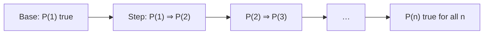
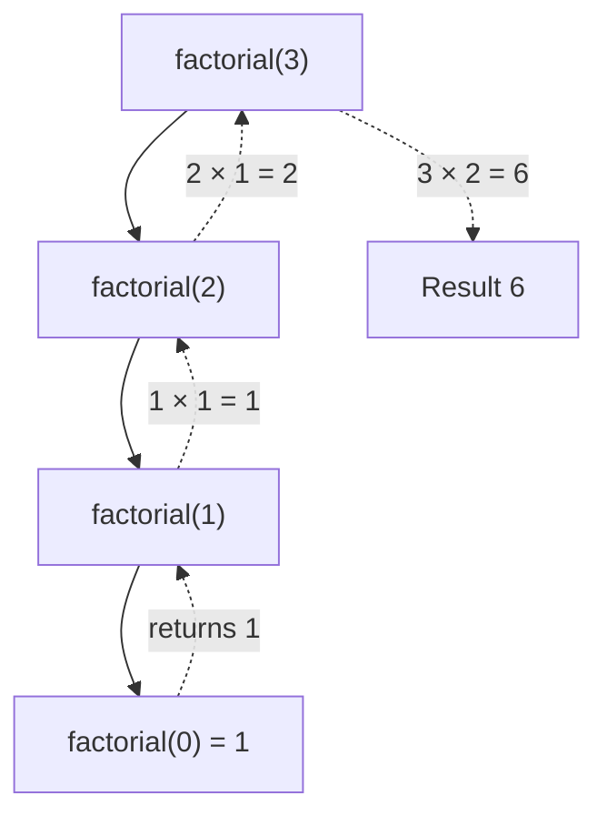

Induction and recursion are the same idea seen from two sides. Induction lets you prove that
something holds for *infinitely many* cases by checking one case and one step. Recursion lets you
*compute* something for any input by solving a smaller version of it first. Once you see the link,
recursive code stops feeling like magic and starts feeling like a proof you can run.

## Mathematical induction and strong induction

Picture an infinite row of dominoes. To be sure they all fall you need two facts: the first one
falls, and each one knocks over the next. You don't need to watch all of them. That is
**mathematical induction**.

To prove a statement P(n) for every natural number n ≥ n₀:

1. **Base case:** prove P(n₀).
2. **Inductive step:** assume P(k) is true for an arbitrary k ≥ n₀ (the **inductive hypothesis**)
   and use it to prove P(k + 1).



> [!EXAMPLE]
> *Claim:* 1 + 2 + … + n = n(n + 1)/2 for all n ≥ 1.
>
> *Base case:* n = 1. Left side is 1, right side is 1·2/2 = 1. ✓
>
> *Inductive step:* assume 1 + … + k = k(k + 1)/2. Then
> 1 + … + k + (k + 1) = k(k + 1)/2 + (k + 1) = (k + 1)(k/2 + 1) = (k + 1)(k + 2)/2,
> which is the formula with n = k + 1. ∎

**Strong induction** changes only the hypothesis: in the inductive step you may assume P(j) for
*every* j from n₀ up to k, not just P(k). It's the same dominoes, but each domino is allowed to lean
on all the ones before it. You need it when the case for k + 1 depends on a case further back.

> [!EXAMPLE]
> *Claim:* every integer n ≥ 2 is a product of primes.
> If n is prime, done. Otherwise n = a·b with 2 ≤ a, b < n. By strong induction both a and b are
> products of primes, so n is too. Plain induction (only P(n − 1)) wouldn't help here, because a
> and b can be anywhere below n.

> [!WARNING]
> The most common broken proof skips or fakes the base case, or uses the inductive step for a k
> where it doesn't actually hold. The famous "all horses are the same colour" fallacy fails exactly
> at the step from 1 horse to 2. Always check that your step works for the *smallest* k.

[MIT 6.042J](https://ocw.mit.edu/courses/6-042j-mathematics-for-computer-science-spring-2015/)
spends several lectures on induction and is worth watching if this section feels fast.

## Recursive definitions and recurrences

A **recursive definition** defines something in terms of smaller versions of itself, plus one or
more base cases that stop the regress. Russian nesting dolls are the picture: a doll is either the
tiny solid one, or a shell with a doll inside.

- **Factorial:** 0! = 1, and n! = n · (n − 1)! for n ≥ 1.
- **Fibonacci:** F(0) = 0, F(1) = 1, and F(n) = F(n − 1) + F(n − 2) for n ≥ 2.
- **A list** is either empty, or a first element followed by a list.
- **A binary tree** is either empty, or a node with a left tree and a right tree.

The last two are **recursively defined data structures**, and they are why recursion feels natural
on trees, JSON documents and file systems.

A **recurrence** is an equation that defines a sequence by its earlier terms, like
T(n) = T(n − 1) + 1 or T(n) = 2T(n/2) + n. Recurrences describe how much *work* a recursive
algorithm does, which you will analyse in Session 1.2.2. Solving one means finding a **closed form**,
a formula without the recursion. For a(n) = a(n − 1) + n with a(0) = 0, unrolling gives
a(n) = 1 + 2 + … + n = n(n + 1)/2, the very formula you proved above.

> [!TIP]
> To guess a closed form, compute the first five or six terms by hand and look for a pattern. Then
> *prove* the guess by induction. Guess-then-prove is a perfectly respectable technique.

## From induction to recursive programs

Here is the key insight. A correct recursive function is an inductive proof in disguise:

| Induction | Recursion |
|---|---|
| Base case: prove P(n₀) | Base case: return directly for the smallest input |
| Inductive hypothesis: assume P(k) | Trust that the recursive call on a smaller input is correct |
| Inductive step: prove P(k + 1) | Combine the smaller result into the answer for the current input |

That middle row is the "**recursive leap of faith**". When writing `factorial(n)`, you don't trace
every call down to zero. You assume `factorial(n - 1)` already works, exactly as you assume P(k) in
a proof, and you only check that one step is right.

```python
def factorial(n: int) -> int:
    if n == 0:              # base case
        return 1
    return n * factorial(n - 1)   # step: trust the smaller call
```

For recursion to be correct you need the same two things a proof needs:

1. **Base cases** that cover every input where you stop.
2. **Progress:** every recursive call is on a strictly "smaller" input, so you always reach a base
   case. Smaller can mean a smaller number, a shorter list, or a subtree.



> [!WARNING]
> Python has a recursion depth limit (about 1,000 frames by default, see
> `sys.getrecursionlimit()`). A recursive sum over a list of 100,000 items will raise
> `RecursionError`. Recursion is great for trees, which are rarely that deep; for long linear
> sequences, prefer a loop.

Recursion can also be *slow* when it recomputes the same thing. Naive Fibonacci calls F(n − 2)
from two different places, and the duplication explodes exponentially. You'll fix that with dynamic
programming in Session 1.4.7.

## Practice: prove a sum formula and implement it recursively

Budget about 45 minutes. You'll prove a formula, implement it, and let tests confirm that the code
and the proof agree.

### Step 1: Guess the formula

Compute S(n) = 1 + 3 + 5 + … + (2n − 1), the sum of the first n odd numbers, for n = 1 to 5.
You should spot the pattern quickly. Write your guess as S(n) = ….

### Step 2: Prove it by induction

Write the base case for n = 1, state the inductive hypothesis for k, then show that adding the next
odd number, 2(k + 1) − 1 = 2k + 1, gives the formula for k + 1. End with ∎.

### Step 3: Implement it recursively

```python
def sum_odds(n: int) -> int:
    """Sum of the first n odd numbers."""
    if n == 0:
        return 0
    return sum_odds(n - 1) + (2 * n - 1)
```

Point to the line that matches the base case and the line that matches the inductive step.

### Step 4: Test the code against the proof

```python
import pytest

@pytest.mark.parametrize("n", range(0, 200))
def test_sum_odds_matches_closed_form(n):
    assert sum_odds(n) == n * n   # replace with your formula if you wrote it differently
```

The test checks 200 cases; the proof covers all of them. Both are useful: the test catches typos
in code, the proof catches wrong reasoning.

### Step 5: Stretch

Write a recursive `depth(tree)` for a nested dict like `{"value": 1, "children": [...]}` and state,
in one sentence each, its base case and why every call makes progress.
