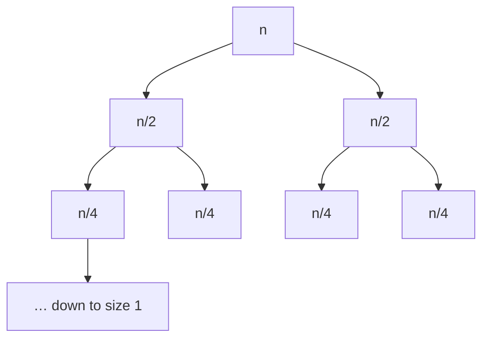
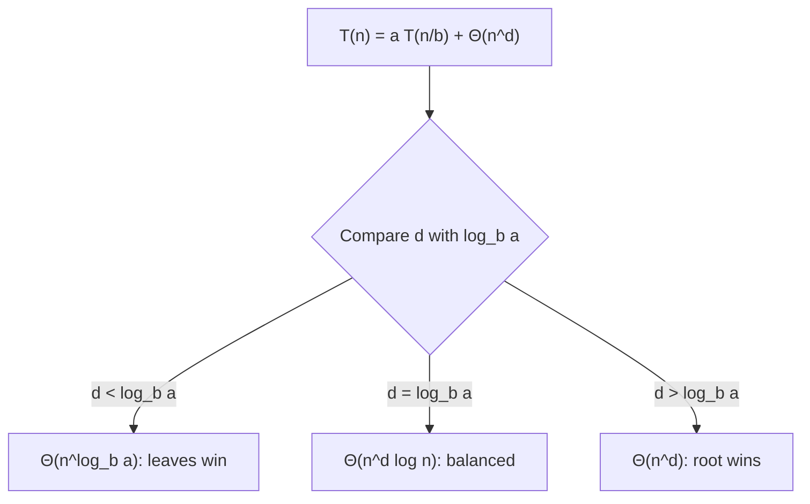

Loops are easy to analyse: count the iterations and multiply. Recursive functions are harder,
because the function's cost is defined in terms of *itself* on smaller inputs. This session gives
you three tools to untangle that: write the cost as a **recurrence**, picture it as a **recursion
tree**, and, for the most common shapes, read the answer straight off the **Master Theorem**.

## Recurrence relations

A **recurrence relation** expresses the running time T(n) of a recursive algorithm in terms of its
running time on smaller inputs, plus the work done outside the recursive calls. It's like
describing the cost of a project as "the cost of its sub-projects plus the cost of coordinating
them".

To write one, look at the function and ask three questions:

1. **How many** recursive calls does it make? (call it *a*)
2. **How big** is each sub-problem? (often n/b, or n − 1)
3. **How much work** happens outside the calls, to split the input and combine the results? (f(n))

Then T(n) = a · T(sub-problem size) + f(n), plus a base case like T(1) = O(1).

| Algorithm | Calls | Size | Extra work | Recurrence |
|---|---|---|---|---|
| Factorial | 1 | n − 1 | O(1) | T(n) = T(n − 1) + O(1) |
| Binary search | 1 | n/2 | O(1) | T(n) = T(n/2) + O(1) |
| Merge sort | 2 | n/2 | O(n) merge | T(n) = 2T(n/2) + O(n) |
| Naive Fibonacci | 2 | n − 1, n − 2 | O(1) | T(n) = T(n − 1) + T(n − 2) + O(1) |

> [!WARNING]
> Count the *hidden* work in the extra term. A function that slices `xs[1:]` before recursing
> copies the list each time, so its extra work is O(n), not O(1). That turns
> T(n) = T(n − 1) + O(1), which is O(n), into T(n) = T(n − 1) + O(n), which is O(n²).

The simplest way to solve a recurrence is **unrolling** (also called substitution or iteration):
expand it a few levels until you see a pattern.

> [!EXAMPLE]
> T(n) = T(n − 1) + c
> = T(n − 2) + 2c
> = T(n − 3) + 3c
> = … = T(1) + (n − 1)c, which is O(n).

Unrolling works well when there is a single recursive call. With several calls, a picture helps.

## Recursion trees

A **recursion tree** draws each call as a node, labelled with the work it does *outside* its own
recursive calls. Its children are the calls it makes. The total running time is the sum of every
label in the tree. Think of a company org chart where each box notes how many hours that person
spends coordinating; the project's total cost is the sum over the whole chart.

The usual approach is to sum **level by level**:

1. Work out the cost of each level.
2. Count how many levels there are.
3. Add the levels up.

For merge sort, T(n) = 2T(n/2) + n:



- Level 0 has one node costing n. Level 1 has two nodes of n/2: total n. Level 2 has four nodes of
  n/4: total n. Every level costs n.
- The sizes halve until they reach 1, so there are log₂ n + 1 levels.
- Total: n × (log₂ n + 1) = **O(n log n)**.

Compare naive Fibonacci, T(n) = T(n − 1) + T(n − 2) + 1. The tree branches in two at every node
and is about n levels deep, so the number of nodes grows exponentially (roughly like 1.6ⁿ). Each
node does constant work, so the whole thing is exponential. That's the duplication you will remove
with dynamic programming in Session 1.4.7.

> [!TIP]
> Three patterns cover most trees. If every level costs about the same, multiply by the depth. If
> the cost *shrinks* geometrically going down, the root dominates. If it *grows* geometrically, the
> leaves dominate. The Master Theorem below is exactly these three cases, written formally.

## The Master Theorem

Many divide-and-conquer algorithms produce recurrences of one shape:

T(n) = a · T(n/b) + f(n), with a ≥ 1 sub-problems, each of size n/b (b > 1).

The **Master Theorem** solves them by comparing f(n) with n^(log_b a), which is the number of
leaves in the recursion tree. Call c* = log_b a, the **critical exponent**. In the common case where
f(n) = Θ(n^d):

| Case | Condition | Who dominates | Result |
|---|---|---|---|
| 1 | d < c* | the leaves | T(n) = Θ(n^c*) |
| 2 | d = c* | every level equally | T(n) = Θ(n^d log n) |
| 3 | d > c* | the root | T(n) = Θ(n^d) |

> [!EXAMPLE]
> **Merge sort:** a = 2, b = 2, f(n) = n, so d = 1 and c* = log₂ 2 = 1. d = c*: case 2, so
> Θ(n log n).
>
> **Binary search:** a = 1, b = 2, f(n) = 1, so d = 0 and c* = log₂ 1 = 0. Case 2: Θ(log n).
>
> **Karatsuba multiplication:** a = 3, b = 2, f(n) = n. c* = log₂ 3 ≈ 1.585 > 1: case 1, so
> Θ(n^1.585), better than the schoolbook Θ(n²).
>
> **A recursion with heavy combine work:** T(n) = 2T(n/2) + n². d = 2 > c* = 1: case 3, Θ(n²).

> [!WARNING]
> The theorem only applies to the a·T(n/b) + f(n) shape. It doesn't handle T(n) = T(n − 1) + n
> (subtract, not divide; unroll it instead: O(n²)) or sub-problems of different sizes like
> T(n) = T(n/3) + T(2n/3) + n (draw the tree). Case 3 also has a technical "regularity condition"
> that ordinary polynomial f(n) always satisfies.

The full statement, with proofs, is in the lecture notes of
[MIT 6.006](https://ocw.mit.edu/courses/6-006-introduction-to-algorithms-spring-2020/) and in the
recursion chapter of [Jeff Erickson's Algorithms](https://jeffe.cs.illinois.edu/teaching/algorithms/).
You don't need to memorise the proof; you do need to recognise the three cases quickly.



## Practice: analyse merge sort and binary search

Budget about 50 minutes. You'll derive both complexities three ways and confirm them by counting
operations in code.

### Step 1: Write the recurrences

Read these implementations and write T(n) for each, naming a, b and f(n):

```python
def binary_search(xs, target, lo=0, hi=None):
    if hi is None:
        hi = len(xs)
    if lo >= hi:
        return -1
    mid = (lo + hi) // 2
    if xs[mid] == target:
        return mid
    if xs[mid] < target:
        return binary_search(xs, target, mid + 1, hi)
    return binary_search(xs, target, lo, mid)

def merge_sort(xs):
    if len(xs) <= 1:
        return xs
    mid = len(xs) // 2
    left, right = merge_sort(xs[:mid]), merge_sort(xs[mid:])
    out, i, j = [], 0, 0
    while i < len(left) and j < len(right):
        if left[i] <= right[j]:
            out.append(left[i]); i += 1
        else:
            out.append(right[j]); j += 1
    return out + left[i:] + right[j:]
```

> [!TIP]
> Notice that `binary_search` passes indexes instead of slicing. If it sliced `xs[mid + 1:]`, what
> would its recurrence and complexity become?

### Step 2: Solve each one three ways

For each algorithm: unroll the recurrence for four levels, draw the recursion tree with the cost
per level, and apply the Master Theorem. All three answers must agree.

### Step 3: Count operations

Add a global counter that increments once per comparison, run both functions for
n = 2¹⁰, 2¹⁴ and 2¹⁸, and compare the counts with n log₂ n and log₂ n respectively. The ratios
should stay roughly constant as n grows.

### Step 4: Explain it in one paragraph

Write, without notes, why merge sort is O(n log n): what each level of the tree costs and why
there are log n levels. If you can do this from memory a week later, the lesson stuck.
