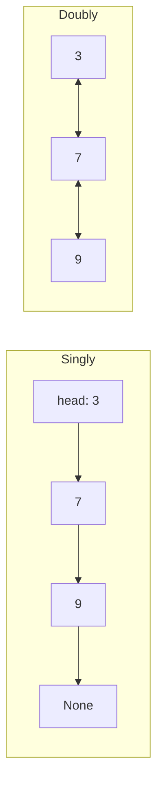
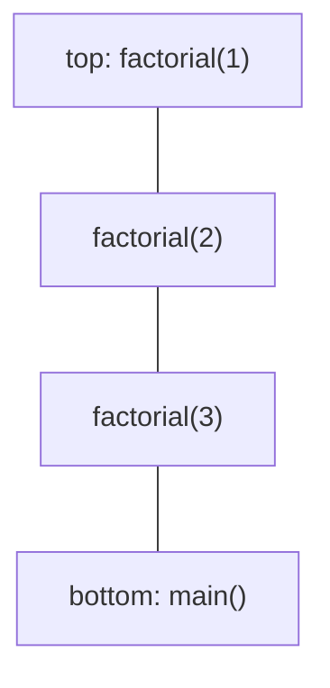
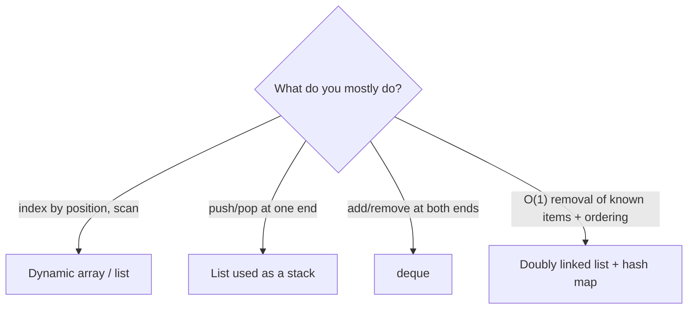

Arrays are great when you mostly read by position. But some problems are all about the *ends*: the
last thing you started is the first thing you must finish, or the first request in must be the
first one served. This session covers the linked list, a structure that trades fast indexing for
cheap insertion, and the two disciplined containers built on these ideas: the **stack** and the
**queue**. You use both every day, often without noticing.

## Singly and doubly linked lists

Think of a treasure hunt. Each clue tells you something and also where to find the next clue. You
can't jump to clue 7; you have to follow the chain. But adding a new clue in the middle is easy:
change one note to point to the new clue, and have the new clue point onwards.

A **linked list** is a chain of **nodes**. Each node stores a value and a reference (a pointer) to
the next node. The list itself just remembers the first node, the **head**, and often the last one,
the **tail**.

```python
class Node:
    def __init__(self, value, next=None):
        self.value = value
        self.next = next
```

In a **singly linked list** each node points only forwards. In a **doubly linked list** each node
also points back to the previous one, so you can walk in both directions and remove a node when
you only have a reference to it.



| Operation | Singly linked | Doubly linked | Dynamic array |
|---|---|---|---|
| Access i-th element | O(n) | O(n) | O(1) |
| Insert/remove at head | O(1) | O(1) | O(n) |
| Insert at tail | O(1) with a tail pointer | O(1) | amortised O(1) |
| Remove at tail | O(n) (must find the previous node) | O(1) | O(1) |
| Insert/remove after a known node | O(1) | O(1) | O(n) |
| Search by value | O(n) | O(n) | O(n) |

> [!EXAMPLE]
> Inserting 5 after the node holding 7 in a singly linked list:
> ```python
> node7.next = Node(5, node7.next)
> ```
> One allocation and one pointer change. No other node moves, however long the list is.

A common implementation trick is a **sentinel** (or dummy) node: a fake node that always sits
before the head. It removes the special cases for "list is empty" and "insert at the front", which
are where most linked-list bugs hide.

> [!WARNING]
> Linked-list code fails in a few predictable ways: losing the rest of the list by overwriting
> `next` before saving it, forgetting to update `tail`, and dereferencing `None` at the end of the
> list. When in doubt, draw the boxes and arrows *before* and *after* the change.

The [Open Data Structures](https://opendatastructures.org/) book covers singly and doubly linked
lists in detail, and [VisuAlgo](https://visualgo.net/en) animates insertions and deletions so you
can watch the pointers move.

## Stacks (LIFO) and the call stack

A **stack** is a collection with one rule: **last in, first out** (LIFO). Think of a stack of
plates: you add to the top and take from the top. The operations are:

- `push(x)`: put x on top;
- `pop()`: remove and return the top item;
- `peek()`: look at the top without removing it;
- `is_empty()`.

All of them are O(1). In Python, a plain `list` makes an excellent stack, because `append` and
`pop()` work at the end of the array:

```python
stack = []
stack.append("a")
stack.append("b")
stack.pop()   # "b"
```

Stacks appear wherever you need to remember "where was I?" and come back in reverse order:

- **Undo** in an editor: each edit is pushed; undo pops the latest.
- **Browser back button**: pages you visited are pushed; back pops.
- **Parsing**: matching brackets, evaluating expressions, reading nested JSON or HTML.
- **Depth-first search**, which you'll meet in Session 1.4.4.

The most important stack of all is the **call stack**. Every time a function is called, the runtime
pushes a **stack frame** holding its local variables and the place to return to. When the function
returns, its frame is popped and execution resumes in the caller.



That's why recursion has a depth limit (Session 1.1.3), and why a Python traceback lists the
chain of calls that led to an error: it *is* a snapshot of the call stack at that moment.

> [!TIP]
> Any recursive algorithm can be rewritten as a loop with an explicit stack. You'd do that when the
> recursion might be too deep for the runtime's limit.

## Queues and deques (FIFO)

A **queue** is the opposite discipline: **first in, first out** (FIFO), like a line at a shop. You
`enqueue` at the back and `dequeue` from the front.

Queues are everywhere in systems:

- **Task queues** and job workers process jobs in arrival order.
- **Message brokers** buffer events between producers and consumers.
- **Printers, network buffers and web servers** queue incoming work.
- **Breadth-first search** explores a graph level by level with a queue (Session 1.4.4).

A **deque** (double-ended queue, pronounced "deck") allows O(1) insertion and removal at *both*
ends, so it can act as a stack, a queue, or both. Python's `collections.deque` is the tool to use:

```python
from collections import deque

q = deque()
q.append("job-1")      # enqueue at the right
q.append("job-2")
q.popleft()            # "job-1": dequeue from the left, O(1)
```

> [!WARNING]
> Don't use `list.pop(0)` as a queue. It shifts every remaining element, so it's O(n) per call. A
> loop that drains a big list this way is quietly O(n²). `deque.popleft()` is O(1).

Internally, CPython's `deque` is a doubly linked list of fixed-size blocks: it gets O(1) operations
at both ends from the linking and decent memory locality from the blocks. Another classic
implementation is a **circular buffer**: an array with head and tail indexes that wrap around.

`deque(maxlen=n)` turns it into a bounded buffer that discards items from the opposite end when
full, ideal for "keep the last 100 log lines".

## Choosing between arrays and linked lists

On paper, linked lists win at insertion and arrays win at indexing. In practice, arrays win more
often than the table suggests:

- **Cache locality.** Arrays are contiguous; linked nodes are scattered across memory, so walking a
  list causes many more cache misses. A linear scan of an array is usually much faster than one of
  a linked list of the same length.
- **Memory overhead.** Every node carries one or two pointers plus object overhead.
- **Finding the spot.** "O(1) insertion" assumes you already *have* the node. If you first have to
  search for the position, that search is O(n) anyway.

Linked structures still earn their place when:

- you insert and remove at both ends a lot (a deque);
- you hold references to nodes and need O(1) removal from the middle, as in an **LRU cache**,
  which combines a hash map with a doubly linked list;
- elements are large or must not move in memory.



> [!TIP]
> Default to `list`. Reach for `deque` when you need the front too, and write your own linked list
> mainly to learn, or when you need the node-reference trick.

## Practice: balanced-parentheses checker and a task queue

Budget about 60 minutes.

### Step 1: The balanced-parentheses checker

Write `is_balanced(s) -> bool` that returns True when every `(`, `[` and `{` is closed by the
matching bracket in the right order. Ignore other characters.

```python
PAIRS = {")": "(", "]": "[", "}": "{"}

def is_balanced(s: str) -> bool:
    stack = []
    for ch in s:
        if ch in "([{":
            stack.append(ch)
        elif ch in PAIRS:
            if not stack or stack.pop() != PAIRS[ch]:
                return False
    return not stack
```

Explain in one sentence why a stack (and not a queue) fits this problem.

### Step 2: Test it

```python
import pytest

@pytest.mark.parametrize("s, ok", [
    ("", True), ("()", True), ("([]{})", True), ("f(a[1], {b: 2})", True),
    ("(", False), (")(", False), ("([)]", False), ("{[}", False),
])
def test_is_balanced(s, ok):
    assert is_balanced(s) is ok
```

### Step 3: A task queue

Build a `TaskQueue` class backed by `collections.deque` with `submit(name, fn)`, `run_next()` and
`run_all()`. Tasks run in submission order; if a task raises, record the error and move on.

```python
from collections import deque

class TaskQueue:
    def __init__(self):
        self._q = deque()
        self.errors = []

    def submit(self, name, fn):
        self._q.append((name, fn))

    def run_next(self):
        name, fn = self._q.popleft()
        try:
            return fn()
        except Exception as e:
            self.errors.append((name, e))

    def run_all(self):
        while self._q:
            self.run_next()
```

Write tests for FIFO order and for error handling.

### Step 4: Stretch

Add a `retry` option: a failed task goes back to the end of the queue at most twice. Draw the
queue's contents after each step for three tasks where the second fails once.
