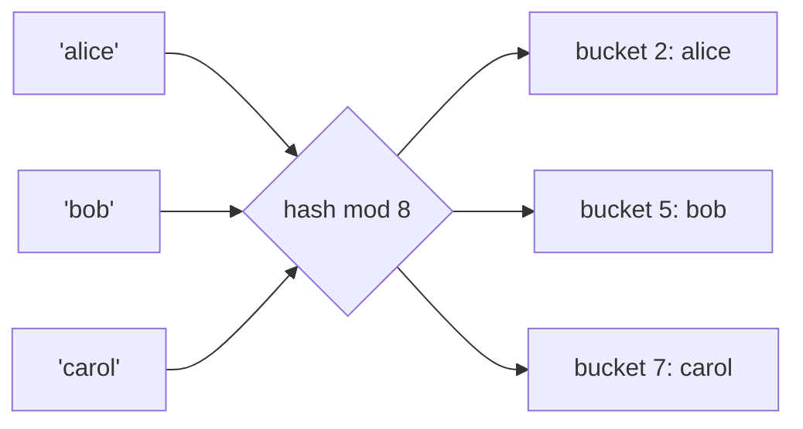
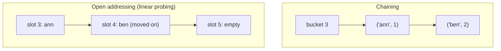
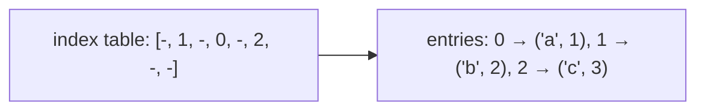

If arrays are the most used data structure, hash tables are a close second. Every Python `dict`
and `set`, every JavaScript object, every cache keyed by user id and every "have I seen this
before?" check relies on one trick: turning a key into an array index in constant time. This
session explains that trick, what happens when it goes wrong, and why Python's dictionaries behave
the way they do.

## Hash functions and buckets

Picture a cloakroom with 100 numbered hooks. Instead of searching every hook for your coat, the
attendant uses a rule: take the last two digits of your ticket number, and that's your hook. Finding
a coat takes one step, however many coats are hanging.

A **hash table** works the same way. It stores entries in an array of **buckets** (slots). To decide
where a key goes it computes:

index = hash(key) mod number_of_buckets

A **hash function** maps a key of any size (a string, a tuple, a number) to an integer. A good one
has three properties:

- **Deterministic:** the same key always gives the same hash (within one run of a program).
- **Fast:** computing it is cheap compared with what you save.
- **Well spread:** similar keys land in very different buckets, so entries are distributed evenly.



With a good hash function and enough buckets, insert, lookup and delete are **O(1) on average**.
That's why `x in some_set` is fast and `x in some_list` is not.

> [!NOTE]
> A hash for a hash table is not a cryptographic hash. SHA-256 is designed so that nobody can find
> two inputs with the same output; a hash-table hash only needs to be fast and spread keys well.
> They solve different problems.

Python adds one important rule: **a key must be hashable**, meaning its hash never changes during
its lifetime. That's why you can use a tuple or a string as a dict key but not a list. If a list's
contents changed after insertion, its hash would change and the table would look in the wrong
bucket. Objects that compare equal must also have equal hashes; if you override `__eq__` on a
class you must think about `__hash__` too.

## Collision handling: chaining and open addressing

There are infinitely many possible keys and only a few buckets, so by the pigeonhole principle
(Session 1.1.4) two keys will eventually land in the same bucket. That's a **collision**, and every
hash table needs a strategy for it.

**Separate chaining.** Each bucket holds a small list of entries. On a collision, append to that
bucket's list; on lookup, hash to the bucket and scan its short list. It's simple and degrades
gracefully. Java's `HashMap` uses chaining (and turns very long chains into small balanced trees).

**Open addressing.** All entries live directly in the array. On a collision, **probe** other slots
in a fixed sequence until you find an empty one. Lookups follow the same sequence until they find
the key or hit an empty slot.

- *Linear probing* tries i, i+1, i+2, … It's cache-friendly but entries tend to bunch up into
  long runs ("clustering").
- *Quadratic probing* and *double hashing* jump around more to avoid clustering.



> [!WARNING]
> Deletion in open addressing is subtle. If you simply empty a slot, a later lookup can stop early
> at that hole and miss a key that probed past it. Implementations leave a **tombstone** marker
> ("deleted, keep probing") instead.

In the worst case, if every key collides, a hash table degrades to O(n) per operation. With a
decent hash function that almost never happens by accident. It *can* happen on purpose: attackers
once crashed web servers by sending form fields crafted to collide. That's why Python randomises
the hash of strings and bytes per process (you can see `hash("abc")` change between runs).

## Load factor and resizing

The **load factor** is α = number of entries / number of buckets. It measures how full the table is.

- With chaining, α is the average chain length. Lookups cost about O(1 + α).
- With open addressing, α must stay below 1 (every entry needs its own slot), and probe sequences
  get long quickly as α approaches 1.

To keep α low, hash tables **resize**: when α passes a threshold, allocate a bigger array (usually
around double) and **rehash** every entry into it. Each key's bucket depends on the array size, so
entries can't just be copied across; they have to be re-inserted.

This is exactly the dynamic-array idea from Session 1.3.1: a resize costs O(n), but growing by a
multiplicative factor makes it rare enough that insertion stays **amortised O(1)**.

| Implementation | Strategy | Typical resize threshold |
|---|---|---|
| Java `HashMap` | chaining | load factor 0.75 by default |
| CPython `dict` | open addressing | about two thirds full |

> [!TIP]
> If you know you'll insert a million keys, building the dict in one go (a comprehension or
> `dict.fromkeys`) is simpler and usually faster than many separate assignments, though both are
> amortised O(1) per key.

## Python dict and set internals

CPython's `dict` uses **open addressing** with a probing scheme that mixes in the higher bits of the
hash (so keys whose hashes differ only in high bits still spread out). Since Python 3.6 it also
uses a **compact** layout with two arrays:

1. a small, sparse **index table** of slot numbers, which is what gets probed;
2. a dense **entries array** of (hash, key, value) rows, in insertion order.



That layout saves memory (the sparse part holds small integers, not full rows) and gives you a
famous side effect: **dicts remember insertion order**. It became an official language guarantee in
Python 3.7, which is why `json.dumps(d)` keeps your keys in the order you added them.

Practical facts that follow from the design:

- `d[k]`, `k in d`, `d[k] = v` and `del d[k]` are O(1) on average.
- Iterating a dict is O(n) and follows insertion order.
- Each entry stores the key's hash, so resizing doesn't need to call `__hash__` again.
- Keys must be hashable; values can be anything.

A `set` is a hash table with keys and no values. It doesn't keep the compact ordered layout, so
**sets are not ordered**: don't rely on iteration order. Set operations (`|`, `&`, `-`) are
implemented with hashing too, so `a & b` costs about O(min(len(a), len(b))).

> [!EXAMPLE]
> Deduplicating while keeping order: `list(dict.fromkeys(items))`. Deduplicating when order doesn't
> matter: `set(items)`. Counting occurrences: `collections.Counter(items)`, which is a dict
> subclass.

## Practice: implement a hash map and compare with dict

Budget about 60 minutes. You'll write a hash map with separate chaining, test it, then measure it
against the built-in `dict`.

### Step 1: Implement it

```python
class HashMap:
    def __init__(self, capacity=8):
        self._buckets = [[] for _ in range(capacity)]
        self._size = 0

    def _bucket(self, key):
        return self._buckets[hash(key) % len(self._buckets)]

    def __setitem__(self, key, value):
        bucket = self._bucket(key)
        for i, (k, _) in enumerate(bucket):
            if k == key:
                bucket[i] = (key, value)
                return
        bucket.append((key, value))
        self._size += 1
        if self._size / len(self._buckets) > 0.75:
            self._resize(2 * len(self._buckets))

    def __getitem__(self, key):
        for k, v in self._bucket(key):
            if k == key:
                return v
        raise KeyError(key)

    def __len__(self):
        return self._size

    def _resize(self, capacity):
        old = self._buckets
        self._buckets = [[] for _ in range(capacity)]
        for bucket in old:
            for k, v in bucket:
                self._bucket(k).append((k, v))
```

### Step 2: Finish and test it

Add `__delitem__`, `__contains__` and `__iter__`. Write pytest tests for: overwrite keeps the size
unchanged, missing key raises `KeyError`, resizing preserves every entry, and deletion works on a
bucket with several entries.

### Step 3: Force collisions

Create a key class whose `__hash__` always returns 42 (with a proper `__eq__`). Insert 2,000 of
them into your map and time it, then do the same with normal integer keys. Explain the difference
using the words *collision* and *load factor*.

### Step 4: Compare with dict

```python
import timeit
n = 200_000
mine, builtin = HashMap(), {}
print("mine", timeit.timeit(lambda: [mine.__setitem__(i, i) for i in range(n)], number=1))
print("dict", timeit.timeit(lambda: [builtin.__setitem__(i, i) for i in range(n)], number=1))
```

Both should grow linearly with n; the built-in will be much faster because it's written in C and
avoids a Python list per bucket. Write down the ratio, and one reason you'd still never ship your
own hash map in production Python.
