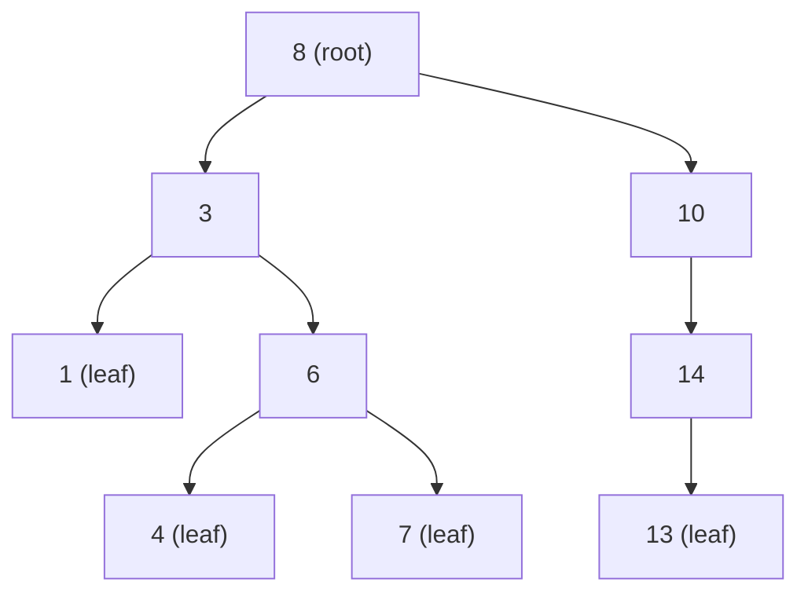
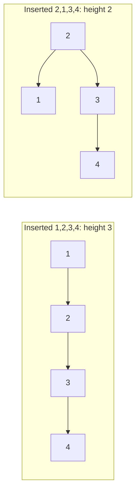
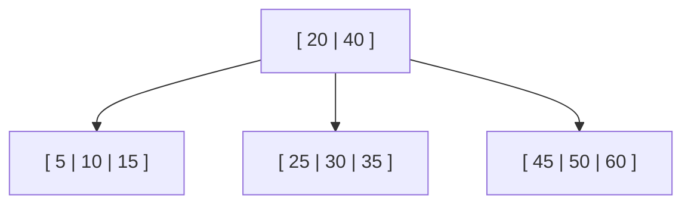

Hash tables answer "is this key here?" in constant time, but they can't answer "what's the next
key after this one?" or "give me everything between March and May". For ordered questions, the
workhorse is the **tree**. Trees model hierarchies (folders, HTML, org charts), and the binary
search tree and its balanced cousins power sorted maps, database indexes and file systems.

## Tree terminology and binary trees

A **tree** is a hierarchy: one **root** at the top, and every other **node** has exactly one
**parent**. Think of a family tree drawn upside down, or the folders on your disk.



The vocabulary, using the tree above:

- **Children** of a node are the nodes directly below it (3 and 10 are children of 8).
- A **leaf** has no children (1, 4, 7, 13). An **internal node** has at least one.
- A **subtree** is a node together with all its descendants: the subtree rooted at 3 is {3, 1, 6,
  4, 7}.
- The **depth** of a node is the number of edges from the root (6 has depth 2).
- The **height** of the tree is the greatest depth of any node (here 3).

A **binary tree** is a tree where each node has at most two children, called **left** and
**right**. Some shapes have names:

- **Full:** every node has 0 or 2 children.
- **Complete:** every level is full except possibly the last, which fills from the left (this is
  the shape heaps use, next session).
- **Perfect:** every level is completely full. A perfect binary tree of height h has 2^(h+1) − 1
  nodes, so a tree with n nodes can be as short as about log₂ n levels.

```python
class Node:
    def __init__(self, key, left=None, right=None):
        self.key = key
        self.left = left
        self.right = right
```

> [!NOTE]
> A binary tree is a recursive structure (Session 1.1.3): it's either empty, or a node with a left
> binary tree and a right binary tree. That's why almost every tree algorithm is naturally recursive.

## Traversals: pre-order, in-order, post-order, level-order

A **traversal** visits every node exactly once. The order matters because each order is useful for
a different job. The first three are **depth-first** and differ only in *when* you visit the node
relative to its subtrees:

| Traversal | Order | On the tree above | Typical use |
|---|---|---|---|
| Pre-order | node, left, right | 8 3 1 6 4 7 10 14 13 | copy or serialise a tree |
| In-order | left, node, right | 1 3 4 6 7 8 10 13 14 | read a BST in sorted order |
| Post-order | left, right, node | 1 4 7 6 3 13 14 10 8 | delete a tree, compute folder sizes |
| Level-order | level by level | 8 3 10 1 6 14 4 7 13 | shortest-depth search, printing by level |

```python
def in_order(node):
    if node is None:
        return
    yield from in_order(node.left)
    yield node.key
    yield from in_order(node.right)
```

Moving the `yield node.key` line before or after the two recursive calls gives pre-order and
post-order. **Level-order** (breadth-first) uses a queue instead of recursion:

```python
from collections import deque

def level_order(root):
    q = deque([root] if root else [])
    while q:
        node = q.popleft()
        yield node.key
        q.extend(c for c in (node.left, node.right) if c)
```

> [!TIP]
> Post-order is the natural fit whenever a parent needs its children's answers first: the size of
> a folder is the sum of its subfolders' sizes, and you can only compute a node's height after its
> children's heights.

## Binary search trees: insert, search, delete

A **binary search tree** (BST) is a binary tree with one ordering rule, the **BST property**: for
every node, all keys in its left subtree are smaller and all keys in its right subtree are larger.
The tree at the top of this lesson is a BST.

It's the binary search idea (Session 1.4.1) made into a data structure. To **search**, start at the
root and go left if the target is smaller, right if it's larger; each comparison discards a whole
subtree.

```python
def search(node, key):
    while node and node.key != key:
        node = node.left if key < node.key else node.right
    return node
```

To **insert**, search for the key; where the search falls off the tree is exactly where the new
leaf belongs.

**Delete** has three cases:

1. **Leaf:** just remove it.
2. **One child:** replace the node with its child.
3. **Two children:** find the node's **in-order successor** (the smallest key in its right
   subtree), copy that key into the node, then delete the successor, which has at most one child.

All three operations take O(h), where h is the height. That's the catch. If you insert keys in a
random order, h stays around O(log n). If you insert them **already sorted**, each new key becomes
the right child of the last one and the tree degenerates into a linked list with h = n.



> [!WARNING]
> Sorted or nearly sorted input is common in real life: auto-increment ids, timestamps, alphabetical
> imports. A plain BST fed such data quietly becomes O(n) per operation.

[VisuAlgo](https://visualgo.net/en) has an excellent BST animation where you can try insertions and
deletions and watch the height change.

## Balanced trees (AVL, red-black) and B-trees in databases

A **self-balancing** BST restores a low height after every insert or delete, guaranteeing O(log n)
operations whatever the input order. It does so with **rotations**: local rearrangements of a few
nodes that keep the BST property but change the shape.

- **AVL trees** keep, at every node, the heights of the two subtrees within 1 of each other. They
  are strictly balanced, which makes lookups very fast.
- **Red-black trees** colour each node red or black and enforce rules that keep the longest path at
  most about twice the shortest. They do fewer rotations on updates. Java's `TreeMap` and C++'s
  `std::map` are typically red-black trees.

Both give O(log n) search, insert and delete. You rarely implement them yourself; you need to know
they exist and what they guarantee. The [Open Data Structures](https://opendatastructures.org/)
book covers both, and
[MIT 6.006](https://ocw.mit.edu/courses/6-006-introduction-to-algorithms-spring-2020/) has lectures
on AVL trees.

**B-trees** take a different approach for data stored on disk. Reading from disk (or SSD) costs far
more than comparing keys in memory, so a B-tree node holds **many** keys and has many children,
often hundreds. The tree becomes very wide and very shallow: a few levels can index millions of
rows, so a lookup touches only a few disk pages.



Most relational databases, including PostgreSQL and MySQL's InnoDB, use the **B+ tree** variant
for their default indexes: all values live in the leaves, and leaves are linked so range queries
(`WHERE created_at BETWEEN …`) can scan them in order. That's why an index on a column helps both
`=` and range queries.

> [!NOTE]
> Python has no built-in sorted map. For a sorted collection, people use `bisect` on a list, or the
> third-party `sortedcontainers` package.

## Practice: implement a BST with all traversals

Budget about 60–75 minutes.

### Step 1: The class

Create a `BST` class with a `root` and these methods: `insert(key)`, `contains(key)`,
`delete(key)`, `pre_order()`, `in_order()`, `post_order()`, `level_order()` and `height()`. Use
generators for traversals. Ignore duplicate keys.

### Step 2: Tests that pin the behaviour

```python
import random

def test_in_order_is_sorted():
    keys = random.sample(range(1000), 200)
    t = BST()
    for k in keys:
        t.insert(k)
    assert list(t.in_order()) == sorted(keys)

def test_traversals_on_known_tree():
    t = BST()
    for k in [8, 3, 10, 1, 6, 14, 4, 7, 13]:
        t.insert(k)
    assert list(t.pre_order()) == [8, 3, 1, 6, 4, 7, 10, 14, 13]
    assert list(t.post_order()) == [1, 4, 7, 6, 3, 13, 14, 10, 8]
    assert list(t.level_order()) == [8, 3, 10, 1, 6, 14, 4, 7, 13]
```

Add delete tests for each of the three cases: a leaf, a node with one child, and a node with two
children (the root is a good one). After each delete, check that `in_order()` is still sorted.

### Step 3: The degenerate case

Insert 1 to 1,000 in order and print `height()`. Then insert the same keys shuffled and print it
again. Write one sentence connecting the numbers to O(n) vs O(log n).

> [!TIP]
> If `height()` is recursive, the sorted case may hit Python's recursion limit around depth 1,000.
> That itself is a lesson: write it with an explicit stack or queue.

### Step 4: Stretch

Add `range_query(lo, hi)` that yields keys in [lo, hi] in order, skipping subtrees that can't
contain matches. This is a miniature of what a database index does.
