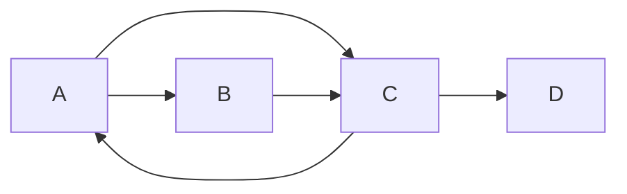
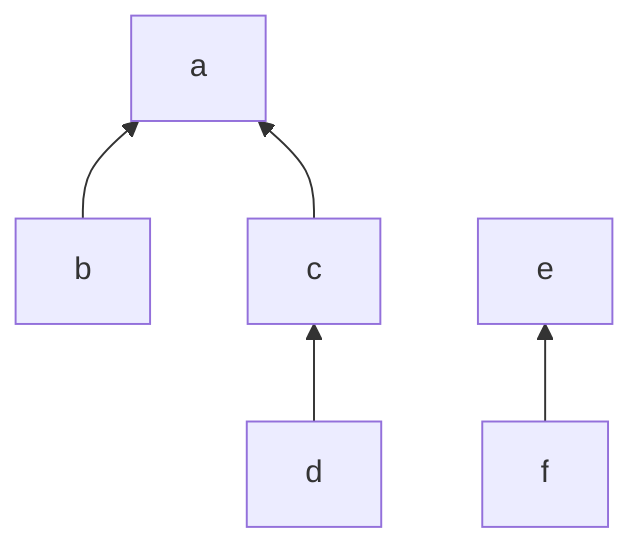
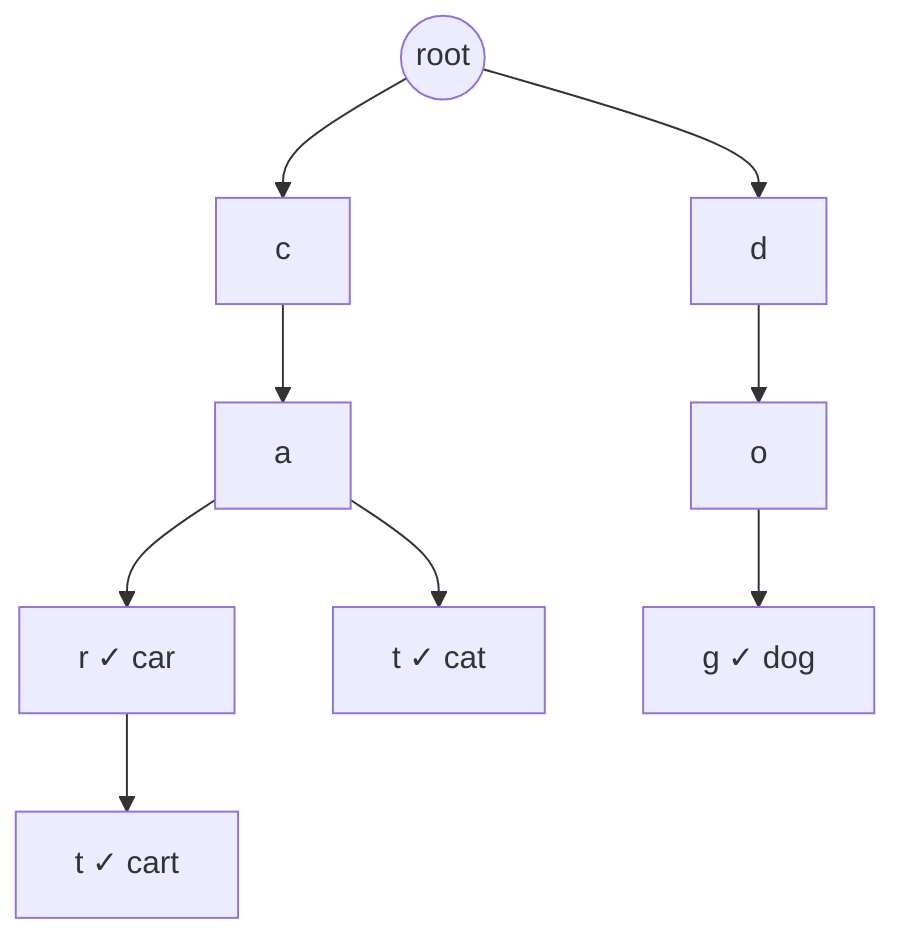

In Session 1.1.5 you learned to *see* graphs: vertices, edges, paths and trees. Now you need to
*store* them so an algorithm can work on them. The representation you pick decides how fast you can
ask "who are this node's neighbours?" and how much memory a graph with millions of nodes needs. This
session also covers two specialised structures that come up constantly in interviews and in real
systems: **union–find** for grouping, and **tries** for prefix search.

## Adjacency list vs adjacency matrix

There are two classic ways to store a graph with V vertices and E edges.

An **adjacency matrix** is a V × V grid of booleans (or weights). Cell [u][v] says whether there's
an edge from u to v. It's like a mileage chart in a road atlas: every city against every other
city, whether or not a road exists.

An **adjacency list** stores, for each vertex, the list of its neighbours. It's like everyone's
contacts list: you record only the people you actually know. In Python, a dict of lists (or of sets)
is the natural form:

```python
graph = {
    "A": ["B", "C"],
    "B": ["C"],
    "C": ["A", "D"],
    "D": [],
}
```



The same graph as a matrix (rows = from, columns = to):

| | A | B | C | D |
|---|---|---|---|---|
| A | 0 | 1 | 1 | 0 |
| B | 0 | 0 | 1 | 0 |
| C | 1 | 0 | 0 | 1 |
| D | 0 | 0 | 0 | 0 |

| | Adjacency matrix | Adjacency list |
|---|---|---|
| Memory | O(V²) | O(V + E) |
| Is there an edge u → v? | O(1) | O(degree of u), or O(1) with sets |
| List the neighbours of u | O(V) | O(degree of u) |
| Iterate over all edges | O(V²) | O(V + E) |
| Add a vertex | O(V²) (rebuild) | O(1) |

Most real graphs are **sparse**: E is much smaller than V². A social network with a billion users
doesn't have a billion squared friendships. For sparse graphs the adjacency list wins on memory and
on the operation most algorithms use most, "iterate over my neighbours". Matrices make sense for
small or **dense** graphs, or when constant-time edge checks matter more than memory (some
dynamic-programming algorithms on graphs, like Floyd–Warshall, work directly on a matrix).

> [!TIP]
> Default to `dict[node, list[node]]` (or `defaultdict(list)`). Switch the inner lists to sets if
> you often need "is v a neighbour of u?". For weighted graphs, store `dict[node, dict[node, weight]]`.

An **edge list**, simply a list of (u, v) or (u, v, weight) tuples, is a third, minimal option. It's
how graphs often arrive from files and databases, and it's exactly what Kruskal's algorithm wants
(Session 1.4.5).

## Directed, weighted and implicit graphs

The representations adapt easily to the graph flavours you met in Session 1.1.5:

- **Undirected:** store each edge in both directions (`graph[u].append(v)` and
  `graph[v].append(u)`). In a matrix, it's symmetric.
- **Directed:** store each edge once, from source to target. If you also need "who points to me?",
  keep a second, reversed adjacency list.
- **Weighted:** store the weight with the neighbour: `graph[u][v] = 7`, or a list of
  `(neighbour, weight)` tuples.

An **implicit graph** isn't stored at all. Instead, you have a function that generates a node's
neighbours on demand. Many search problems are like this:

- A grid maze: the neighbours of cell (r, c) are the open cells among (r±1, c) and (r, c±1).
- A puzzle like the Rubik's cube: each state's neighbours are the states one move away. There are
  far too many states to store, but you never need all of them.
- Word ladders: neighbours are the dictionary words that differ by one letter.

```python
def neighbours(grid, r, c):
    for dr, dc in ((1, 0), (-1, 0), (0, 1), (0, -1)):
        nr, nc = r + dr, c + dc
        if 0 <= nr < len(grid) and 0 <= nc < len(grid[0]) and grid[nr][nc] != "#":
            yield nr, nc
```

> [!NOTE]
> Recognising an implicit graph is a key interview skill. Once you see "states" as vertices and
> "moves" as edges, problems like "minimum moves to solve this puzzle" become a breadth-first
> search, which you'll write in Session 1.4.4.

## Union–find (disjoint sets)

Sometimes you don't care about paths, only about **which group** each element belongs to, while
groups keep merging. Think of companies acquiring each other: you want to answer "do these two
brands belong to the same parent company?" fast, as mergers keep happening.

The **union–find** (or **disjoint-set**) structure supports:

- `find(x)`: return the **representative** (root) of x's group;
- `union(x, y)`: merge the groups containing x and y.

Each element points to a parent; a root points to itself. Two elements are in the same group if
`find` gives the same root.

```python
class UnionFind:
    def __init__(self, items):
        self.parent = {x: x for x in items}
        self.size = {x: 1 for x in items}

    def find(self, x):
        while self.parent[x] != x:
            self.parent[x] = self.parent[self.parent[x]]   # path halving
            x = self.parent[x]
        return x

    def union(self, a, b):
        ra, rb = self.find(a), self.find(b)
        if ra == rb:
            return False
        if self.size[ra] < self.size[rb]:
            ra, rb = rb, ra
        self.parent[rb] = ra            # attach smaller tree under larger
        self.size[ra] += self.size[rb]
        return True
```



Two optimisations make it extremely fast. **Union by size (or rank)** attaches the smaller tree
under the larger one, so trees stay shallow. **Path compression** (or the path-halving variant
above) makes nodes point closer to the root each time you call `find`. Together they make each
operation take *nearly* constant amortised time; the precise bound involves the inverse Ackermann
function, which is at most 4 or 5 for any input size you'll ever see.

Uses: detecting whether adding an edge creates a cycle (Kruskal's MST), counting connected
components as edges stream in, grouping duplicate accounts, and image segmentation.

## Tries for prefix search

A **trie** (from re*trie*val, usually pronounced "try") is a tree specialised for strings. Each edge
is labelled with a character, and each path from the root spells a prefix. A node is marked when the
path to it spells a complete word.

Picture the index tabs in an old address book, but nested: the A tab has sub-tabs AL, AN, AR, and
so on. To find every name starting with "ALE" you open three tabs in a row and everything inside
is a match.



Operations take time proportional to the **length of the string**, L, not the number of words
stored:

- insert a word: O(L);
- check whether a word exists: O(L);
- find all words with a given prefix: O(L) to reach the prefix node, plus the size of the output.

That last operation is why tries power **autocomplete**, spell checkers, IP routing tables
(longest-prefix match) and some search-engine indexes. A hash set can tell you if "cart" exists, but
not efficiently which words start with "ca".

> [!WARNING]
> Tries can use a lot of memory: each node may hold a dict of children. Compressed variants (radix
> trees) merge chains of single-child nodes. For small word lists, a sorted list plus `bisect` can
> answer prefix queries with far less memory.

The [Open Data Structures](https://opendatastructures.org/) book discusses tries alongside other
integer and string structures, and
[Jeff Erickson's Algorithms](https://jeffe.cs.illinois.edu/teaching/algorithms/) covers graph
representations in depth.

## Practice: build an autocomplete with a trie

Budget about 60 minutes.

### Step 1: The node and the trie

```python
class TrieNode:
    __slots__ = ("children", "is_word", "count")
    def __init__(self):
        self.children = {}
        self.is_word = False
        self.count = 0          # how often this word was used, for ranking

class Trie:
    def __init__(self):
        self.root = TrieNode()

    def insert(self, word, count=1):
        node = self.root
        for ch in word:
            node = node.children.setdefault(ch, TrieNode())
        node.is_word = True
        node.count += count
```

### Step 2: Search and prefix lookup

Implement `contains(word)` and `_find(prefix)`, which walks down and returns the node for the
prefix or `None`.

### Step 3: Autocomplete

Implement `complete(prefix, k=5)`: collect every word under the prefix node with a depth-first
walk, then return the k with the highest `count` (ties alphabetically). You can reuse the heap
technique from Session 1.3.5 for the top k.

### Step 4: Test it

```python
def test_autocomplete():
    t = Trie()
    for w, c in [("car", 5), ("cart", 2), ("cat", 9), ("dog", 1), ("care", 5)]:
        t.insert(w, c)
    assert t.complete("ca", k=3) == ["cat", "car", "care"]
    assert t.complete("do") == ["dog"]
    assert t.complete("x") == []
    assert t.contains("cart") and not t.contains("ca")
```

### Step 5: Load real data

Insert the words of a book (use the counter from the last session as counts) and try a few
prefixes interactively. Then measure memory with `tracemalloc` and compare with a plain `set` of
the same words. Write one sentence on the trade-off.
