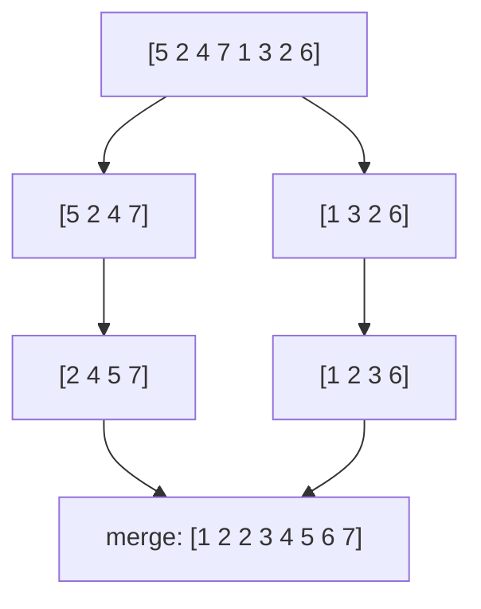
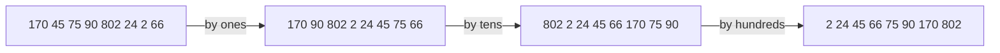

You will almost never write a sorting algorithm at work: `sorted()` is faster and better tested
than anything you'd write in an afternoon. So why study them? Because sorting is the best
playground for algorithmic ideas (incremental building, divide and conquer, randomisation, lower
bounds), because "stable" and "in-place" are properties you must understand to use library sorts
correctly, and because interviewers love them. This session covers the main families and when each
one wins.

## Selection, insertion and bubble sort

These three are the **elementary** sorts: simple, O(n²) in the worst case, and fine for small
inputs.

**Selection sort.** Find the smallest item, swap it to position 0. Find the smallest of the rest,
swap it to position 1. Repeat. It's how you might sort a hand of cards laid face up on a table:
repeatedly pick the lowest.

- Always does about n²/2 comparisons, even on sorted input.
- Does at most n − 1 swaps, which matters only when writes are very expensive.

**Insertion sort.** Take items one by one and insert each into its place among the already-sorted
items to its left, shifting larger items right. It's how most people sort a hand of cards as they
pick them up.

```python
def insertion_sort(xs):
    for i in range(1, len(xs)):
        x, j = xs[i], i - 1
        while j >= 0 and xs[j] > x:
            xs[j + 1] = xs[j]      # shift right
            j -= 1
        xs[j + 1] = x
```

- O(n²) worst case (reverse-sorted input), but **O(n) on already sorted input**, and fast on
  nearly sorted input: each item only moves a few places.
- Very low overhead, so it beats fancier algorithms on tiny arrays. Real-world sorts switch to
  insertion sort for small pieces.

**Bubble sort.** Walk through the list swapping adjacent items that are out of order; repeat until
a full pass makes no swaps. Large items "bubble" to the end. It's mostly of historical and teaching
interest: it does more swaps than insertion sort for the same result.

> [!TIP]
> If you remember only one elementary sort, make it insertion sort. It's adaptive (fast on
> nearly-sorted data), stable, in-place, and a building block of Python's own sort.

[VisuAlgo](https://visualgo.net/en) animates all of these side by side; watching insertion sort on
nearly sorted data versus random data makes "adaptive" click.

## Merge sort and quicksort

These are the two classic **divide-and-conquer** sorts, and both run in O(n log n) on typical input.

**Merge sort** splits the list in half, sorts each half recursively, then **merges** the two sorted
halves by repeatedly taking the smaller front item. You analysed it in Session 1.2.2:
T(n) = 2T(n/2) + O(n), so **O(n log n) in every case**.



- Guaranteed O(n log n), and **stable**.
- Needs O(n) extra memory for merging.
- Works well on linked lists and on data too big for memory (external sorting merges sorted runs
  from disk).

**Quicksort** picks a **pivot**, **partitions** the list so smaller items are on its left and larger
on its right, then sorts each side recursively. The work happens *before* the recursion
(partitioning) rather than after (merging).

```python
def quicksort(xs):
    if len(xs) <= 1:
        return xs
    pivot = xs[len(xs) // 2]
    return (quicksort([x for x in xs if x < pivot])
            + [x for x in xs if x == pivot]
            + quicksort([x for x in xs if x > pivot]))
```

That version is easy to read but copies lists; real implementations partition **in place**.

- **Average O(n log n)**, often faster than merge sort in practice thanks to good cache behaviour
  and in-place partitioning.
- **Worst case O(n²)**, when the pivot is repeatedly the smallest or largest item (for example,
  always choosing the first element of an already sorted list). Random pivots or "median of three"
  make this vanishingly unlikely.
- Not stable in its usual in-place form.

> [!NOTE]
> There's a proven lower bound: any sort that works only by comparing pairs of items needs
> Ω(n log n) comparisons in the worst case. Merge sort, heapsort and good quicksort implementations
> are therefore optimal among comparison sorts. To do better you must exploit the *structure* of the
> keys, which is what counting and radix sort do below.

## Stability and in-place sorting

A sort is **stable** if items with equal keys keep their original relative order. That sounds like a
detail until you sort by more than one field.

> [!EXAMPLE]
> You have orders already sorted by date, and you sort them by customer. With a **stable** sort,
> each customer's orders are still in date order. With an unstable sort, they could be shuffled.
> That's why "sort by the secondary key first, then stably by the primary key" works:
> ```python
> orders.sort(key=lambda o: o.date)
> orders.sort(key=lambda o: o.customer)   # stable: dates stay ordered within each customer
> ```

A sort is **in-place** if it needs only O(1) (or O(log n) for recursion) extra memory beyond the
input. In-place matters for huge arrays or memory-constrained devices.

| Algorithm | Best | Average | Worst | Extra space | Stable |
|---|---|---|---|---|---|
| Selection | O(n²) | O(n²) | O(n²) | O(1) | No |
| Insertion | O(n) | O(n²) | O(n²) | O(1) | Yes |
| Bubble | O(n) | O(n²) | O(n²) | O(1) | Yes |
| Merge sort | O(n log n) | O(n log n) | O(n log n) | O(n) | Yes |
| Quicksort | O(n log n) | O(n log n) | O(n²) | O(log n) | No |
| Heapsort | O(n log n) | O(n log n) | O(n log n) | O(1) | No |
| Counting sort | O(n + k) | O(n + k) | O(n + k) | O(n + k) | Yes |
| Timsort | O(n) | O(n log n) | O(n log n) | O(n) | Yes |

**Heapsort** is worth a mention: heapify the array (O(n), Session 1.3.5), then repeatedly pop the
max to the end. It's in-place and guaranteed O(n log n), but usually slower than quicksort in
practice because it jumps around memory.

## Counting and radix sort; Python's Timsort

**Counting sort** doesn't compare items at all. If keys are small integers in a range [0, k), count
how many times each key appears, then write them out in order. Cost: **O(n + k)**. Sorting a million
exam scores from 0 to 100 this way is a single pass plus a tiny table.

**Radix sort** extends the idea to larger keys by sorting digit by digit. Least-significant-digit
radix sort runs a *stable* counting sort on the last digit, then the next, and so on. Stability is
essential: it preserves the order established by earlier digits. For d digits in base b the cost is
O(d · (n + b)), linear when d is a small constant, as with fixed-width integers, IP addresses or
dates.



> [!WARNING]
> Counting and radix sort beat O(n log n) only because keys have a bounded structure. Counting sort
> on values up to 10⁹ needs a billion-entry table, which defeats the purpose.

**Timsort** is the algorithm behind Python's `list.sort()` and `sorted()` (and Java's sort for
objects). It's a hybrid designed for real data, which is often partly ordered:

1. It scans for **runs**: stretches that are already ascending (or strictly descending, which it
   reverses).
2. Short runs are extended to a minimum length using **insertion sort**.
3. Runs are **merged** pairwise, following rules that keep merges balanced. (Python 3.11 refined
   these rules with a strategy called *powersort*.)

The result is stable, O(n log n) in the worst case, and close to O(n) when the input is already
nearly sorted, which is very common: appending a few new rows to a sorted table, or re-sorting
after small updates.

> [!TIP]
> In Python, always pass `key=` rather than writing a comparison. `sorted(users, key=lambda u:
> (u.last, u.first))` computes each key once and compares tuples. `reverse=True` keeps stability
> (equal items stay in original order), unlike reversing afterwards.

## Practice: implement and benchmark four sorts

Budget about 75 minutes.

### Step 1: Implement

Write `insertion_sort`, `merge_sort`, `quicksort` (in place, with a random pivot) and
`counting_sort` (for integers in a known range). Each takes a list and returns a sorted list.

### Step 2: Test them all at once

```python
import random
import pytest

SORTS = [insertion_sort, merge_sort, quicksort]

@pytest.mark.parametrize("sort", SORTS)
@pytest.mark.parametrize("xs", [[], [1], [2, 1], [3, 3, 1], list(range(50)),
                                list(range(50, 0, -1)), [random.randint(0, 9) for _ in range(200)]])
def test_sorts(sort, xs):
    assert sort(list(xs)) == sorted(xs)
```

Add a stability test: sort `(key, original_index)` pairs by key only and check that equal keys keep
their index order. Which of your sorts pass?

### Step 3: Benchmark

Time each sort (plus `sorted`) on n = 1,000, 10,000 and 100,000 for three inputs: random, already
sorted and reverse sorted. Skip insertion sort above 10,000 if it's too slow, and note that as a
result.

```python
from time import perf_counter

def bench(sort, xs):
    start = perf_counter()
    sort(list(xs))
    return perf_counter() - start
```

### Step 4: Explain the table

Write a short paragraph for each surprise. Expected ones: insertion sort is fast on sorted input;
a first-element-pivot quicksort would collapse on sorted input (try it!); `sorted` beats all of
yours by a wide margin; counting sort wins when the value range is small.
