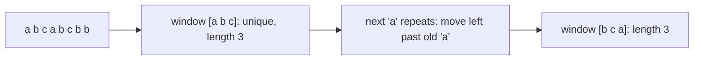
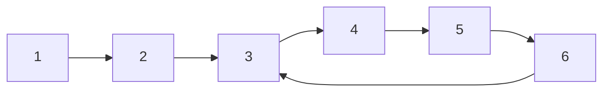

Experienced engineers rarely solve a problem from scratch. They recognise its *shape*: "this is a
sliding window", "this is a prefix sum", "sort the intervals first". This session collects the
patterns that come up most often in coding interviews and in everyday data processing, so you can
turn an O(n²) brute force into an O(n) pass by spotting which one applies.

## Two pointers and sliding window

**Two pointers** means walking through a sequence with two indexes instead of one, moving each
according to a rule. Because each pointer only moves forward (or only inwards), the total work is
O(n) instead of the O(n²) of trying every pair.

The most common form uses **opposite ends of a sorted array**. To find two numbers that sum to a
target, start with one pointer at each end. If the sum is too small, move the left pointer right
(to a bigger number); if too big, move the right pointer left.

```python
def pair_with_sum(xs, target):          # xs is sorted
    i, j = 0, len(xs) - 1
    while i < j:
        s = xs[i] + xs[j]
        if s == target:
            return i, j
        if s < target:
            i += 1
        else:
            j -= 1
    return None
```

Why is it safe to skip pairs? If `xs[i] + xs[j]` is too small, then `xs[i]` plus *any* element left
of j is even smaller, so `xs[i]` can't be part of an answer. Every move discards a whole row of
candidates. Other two-pointer classics: checking palindromes, reversing in place, removing
duplicates from a sorted array, and merging two sorted lists.

A **sliding window** is two pointers moving in the *same* direction, marking a contiguous stretch
`[left, right]`. You grow the window by advancing `right` and shrink it by advancing `left`, while
keeping some summary (a sum, a count, a set) up to date incrementally.

> [!EXAMPLE]
> *Longest substring without repeated characters.* Expand `right` one character at a time. If the
> new character is already in the window, advance `left` past its previous occurrence. Track the
> best length seen.
> ```python
> def longest_unique(s):
>     last, left, best = {}, 0, 0
>     for right, ch in enumerate(s):
>         if ch in last and last[ch] >= left:
>             left = last[ch] + 1
>         last[ch] = right
>         best = max(best, right - left + 1)
>     return best
> ```



> [!TIP]
> Signals for a sliding window: the problem says **contiguous** (subarray, substring), and asks for
> the longest, shortest or count of windows satisfying a condition that can be updated as items
> enter and leave. Signals for opposite-end pointers: the input is **sorted**, or you're comparing
> the two ends.

## Prefix sums and hashing tricks

A **prefix sum** array stores running totals: `prefix[i]` is the sum of the first i items. Once
built in O(n), the sum of any range `xs[a:b]` is `prefix[b] - prefix[a]` in O(1). It's like the
odometer in a car: to know how far you drove between two towns, subtract the readings; you don't
need to re-drive the road.

```python
from itertools import accumulate

xs = [3, 1, 4, 1, 5, 9]
prefix = [0, *accumulate(xs)]      # [0, 3, 4, 8, 9, 14, 23]
range_sum = prefix[5] - prefix[2]  # xs[2] + xs[3] + xs[4] = 4 + 1 + 5 = 10
```

Combine prefix sums with a **hash map** and you can answer questions about *all* subarrays in one
pass. "How many subarrays sum to k?" becomes: a subarray `xs[a:b]` sums to k exactly when
`prefix[b] - prefix[a] == k`, that is, when `prefix[a] == prefix[b] - k`. As you walk, keep a count
of every prefix value seen so far and look up `current - k`:

```python
from collections import Counter

def count_subarrays_with_sum(xs, k):
    seen, total, count = Counter({0: 1}), 0, 0
    for x in xs:
        total += x
        count += seen[total - k]
        seen[total] += 1
    return count
```

The general **hashing trick** is "remember what you've seen so you can answer in O(1) later". The
classic *two-sum on unsorted data* stores each number's index in a dict and, for each new number x,
checks whether `target - x` is already there. *Group anagrams* uses a sorted string (or a letter
count) as a dict key to bucket words. *Longest consecutive sequence* puts everything in a set and
only starts counting from numbers whose predecessor isn't present.

> [!NOTE]
> Prefix sums generalise beyond addition: prefix XORs, prefix counts of a category, and 2D prefix
> sums for rectangle sums in images or grids. Databases use the same idea in window functions like
> `SUM(...) OVER (ORDER BY day)`.

## Fast and slow pointers

Also called **Floyd's tortoise and hare**: two pointers move through a sequence at different
speeds, typically one step and two steps at a time. The idea is a race on a circular track. If the
track is a loop, the fast runner eventually laps the slow one; if it's a straight road, the fast
runner simply reaches the end.

```python
def has_cycle(head):
    slow = fast = head
    while fast and fast.next:
        slow, fast = slow.next, fast.next.next
        if slow is fast:
            return True
    return False
```

It detects cycles in a linked list using O(1) extra memory (a set of visited nodes would need O(n)).
Variations:

- **Find the middle** of a linked list: when the fast pointer reaches the end, the slow one is in
  the middle.
- **Find where the cycle starts:** after they meet, reset one pointer to the head and move both
  one step at a time; they meet again at the cycle's entrance.
- **Implicit sequences:** "is this number happy?" or "find the duplicate in an array of n + 1
  numbers in [1, n]" treat `x → f(x)` as a linked list and look for its cycle.



> [!WARNING]
> Always check `fast and fast.next` before stepping twice. Forgetting one of them is the most common
> crash in these solutions.

## Intervals and sorting-based approaches

Many problems involve **intervals**: meetings, bookings, time ranges in logs, IP ranges. Almost all
of them get easier after one step: **sort the intervals by start time**. Once sorted, overlapping
intervals are adjacent, so a single pass can handle them.

> [!EXAMPLE]
> *Merge overlapping intervals.* `[[1,3], [8,10], [2,6], [15,18]]` sorted is
> `[[1,3], [2,6], [8,10], [15,18]]`. Walk through: [2,6] starts before [1,3] ends, so merge into
> [1,6]; [8,10] doesn't overlap, start a new one. Result: `[[1,6], [8,10], [15,18]]`.
> ```python
> def merge(intervals):
>     out = []
>     for start, end in sorted(intervals):
>         if out and start <= out[-1][1]:
>             out[-1][1] = max(out[-1][1], end)
>         else:
>             out.append([start, end])
>     return out
> ```

Other interval patterns:

- **Can one person attend all meetings?** Sort by start; check that no meeting starts before the
  previous one ends.
- **How many rooms are needed?** Sort starts and ends separately (or use a min-heap of end times,
  Session 1.3.5) and sweep through time, counting how many meetings are in progress.
- **Insert an interval** into a sorted, non-overlapping list.

More broadly, **sorting first** is a pattern of its own. Sorting costs O(n log n) but often turns
the rest of the problem into a linear scan: finding duplicates, the closest pair of numbers, or
enabling two pointers. When a brute force is O(n²), ask "would this be easy if the data were
sorted?"

> [!TIP]
> The [NeetCode Roadmap](https://neetcode.io/roadmap) groups practice problems by exactly these
> patterns, and the [Tech Interview Handbook](https://www.techinterviewhandbook.org/) has concise
> cheat sheets per topic. Practise by pattern first, then mix them up (interleaving, from Session
> 0.1.1) so you learn to *choose* the pattern.

## Practice: one problem per pattern

Budget about 90 minutes. For each problem, first write the brute force and its complexity in one
line, then the pattern you'll use and the target complexity, then the code and at least three
tests (including an edge case like empty input).

### 1. Two pointers

**Container with most water:** given heights `h`, choose two lines that, with the x-axis, hold the
most water (area = distance × the shorter height). Start at both ends and always move the shorter
line inwards. Explain in one sentence why moving the taller one can never help.

### 2. Sliding window

**Minimum-size subarray sum:** given positive integers and a target, return the length of the
shortest contiguous subarray whose sum is at least the target (0 if none).

### 3. Prefix sums and hashing

**Subarray sum equals k:** implement `count_subarrays_with_sum` above *from memory*, then test it on
inputs with negative numbers. Explain why a sliding window doesn't work when negatives are allowed.

### 4. Fast and slow pointers

**Find the duplicate number:** an array of n + 1 integers, each in [1, n], has exactly one value
repeated. Find it with O(1) extra space by treating `i → nums[i]` as a linked list.

### 5. Intervals

**Meeting rooms II:** given meeting intervals, return the minimum number of rooms required.

```python
def test_rooms():
    assert min_rooms([]) == 0
    assert min_rooms([[0, 30], [5, 10], [15, 20]]) == 2
    assert min_rooms([[1, 5], [5, 10]]) == 1   # back-to-back meetings share a room
```

### Reflect

Make a five-row table: pattern, the clue in the problem statement that pointed to it, and the
complexity you achieved. This table is the thing to review next week.
