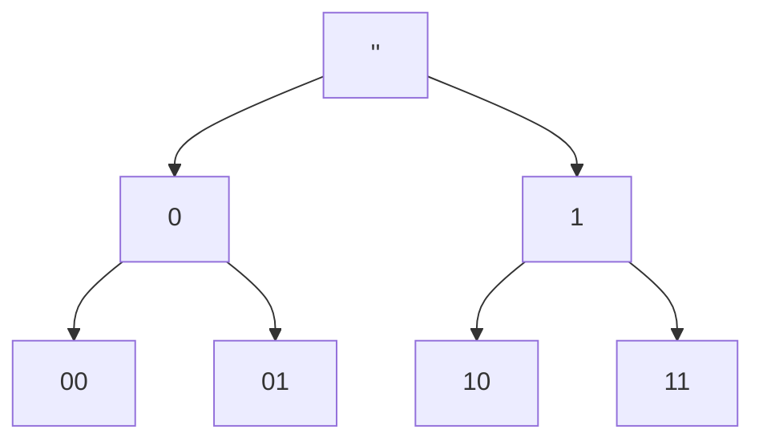
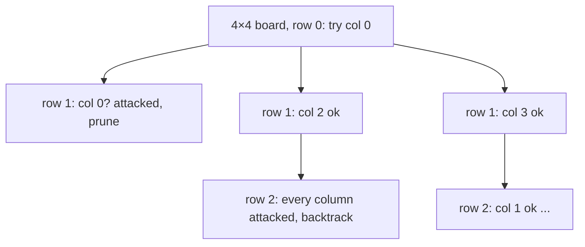

Some problems ask you to *search* through a huge space of possibilities: every arrangement, every
subset, every way to fill a grid. Others let you build the answer one decision at a time and never
look back. This session covers both ends: **backtracking**, the disciplined way to try everything
while pruning dead ends early, and **greedy algorithms**, which commit to the locally best choice
and are blazingly fast, but only correct when you can prove they are.

## Thinking recursively: base case and progress

Backtracking is recursion applied to search, so first make sure the recursive mindset is solid.
Session 1.1.3 gave you the two rules; here they are again from a problem-solving angle.

To solve a problem recursively, ask:

1. **What's the smallest version I can answer directly?** That's the **base case**: an empty list,
   n = 0, a leaf, a fully filled board.
2. **How can I make the problem smaller and use the smaller answer?** That's the **recursive
   step**, and every step must make **progress** towards the base case.

Then take the *leap of faith*: assume the recursive call returns the right answer for the smaller
input, and only check that you combine it correctly.

> [!EXAMPLE]
> *Generate all binary strings of length n.*
> - Base case: n = 0 → `[""]`, one empty string.
> - Step: every string of length n is "0" or "1" followed by a string of length n − 1.
> ```python
> def binary_strings(n):
>     if n == 0:
>         return [""]
>     shorter = binary_strings(n - 1)
>     return ["0" + s for s in shorter] + ["1" + s for s in shorter]
> ```

A useful way to picture any recursive search is a **decision tree**: each level is one decision,
each branch one option, and each leaf one complete candidate. Binary strings of length 3 form a
tree with 2³ = 8 leaves.



> [!WARNING]
> The usual recursion bugs: a missing base case (infinite recursion), a base case that returns the
> wrong *shape* (returning `""` instead of `[""]` above loses every result), and a step that doesn't
> shrink the input. When stuck, run the function by hand on the smallest non-trivial input.

## Backtracking: permutations, subsets, N-queens

**Backtracking** walks the decision tree depth-first, building a candidate step by step. At each
step it **chooses** an option, **explores** further, then **un-chooses** it (backtracks) and tries
the next option. Crucially, if a partial candidate already breaks a rule, it **prunes** that whole
branch instead of completing it.

It's how you'd solve a maze by hand, or how you try keys on a key ring: try one, and if it doesn't
fit, take it out and try the next.

The general template:

```python
def backtrack(state, choices):
    if is_complete(state):
        record(state)
        return
    for choice in choices(state):
        if is_valid(state, choice):
            apply(state, choice)       # choose
            backtrack(state, choices)  # explore
            undo(state, choice)        # un-choose
```

**Subsets.** For each element, decide "in" or "out". There are 2ⁿ subsets.

```python
def subsets(xs):
    out, current = [], []
    def go(i):
        if i == len(xs):
            out.append(current.copy())   # copy: current keeps changing
            return
        current.append(xs[i]); go(i + 1); current.pop()   # take xs[i]
        go(i + 1)                                          # skip xs[i]
    go(0)
    return out
```

**Permutations.** At each position, try every element not yet used. There are n! of them.

**N-queens.** Place n queens on an n × n board so that none attack each other. Place one queen per
row; for each row, try each column, but only if no earlier queen shares the column or a diagonal.
Without pruning you'd check nⁿ placements; with it, most branches die after a few rows. For n = 8
there are 92 solutions, found in a fraction of a second.



> [!TIP]
> Pruning is where backtracking gets its speed. Check constraints as **early** as possible, and
> keep the state needed for checks in sets (`used_columns`, `used_diagonals`) so each check is O(1).
> Note that the two diagonals of a cell (r, c) are identified by `r - c` and `r + c`.

Backtracking is still exponential in the worst case. It's the right tool when the input is small
(n up to roughly 10–20, depending on the problem) or when pruning is strong. The
[NeetCode Roadmap](https://neetcode.io/roadmap) has a dedicated backtracking section with these
classics.

## Greedy algorithms and exchange arguments

A **greedy algorithm** builds a solution by repeatedly making the choice that looks best *right
now*, and never reconsidering. Giving change with the fewest coins by always taking the largest
coin that fits is greedy. So are Dijkstra, Prim and Kruskal (Session 1.4.5).

Greedy algorithms are simple and fast, usually a sort plus a linear pass. The catch: **they're not
always correct**, and an intuition that "greedy obviously works" is wrong surprisingly often.

> [!EXAMPLE]
> With euro coins (1, 2, 5, 10, 20, 50 cents…), greedy change is optimal. With coins {1, 3, 4} and
> an amount of 6, greedy takes 4 + 1 + 1 (three coins), but 3 + 3 (two coins) is better. Same
> algorithm, different coin system, wrong answer. The general problem needs dynamic programming
> (Session 1.4.7).

**Interval scheduling** is the textbook case where greedy *is* optimal. Given meetings with start
and end times, choose as many non-overlapping meetings as possible. Candidates for "best choice":

- shortest meeting first: fails (a short meeting can overlap two others);
- earliest start first: fails (an early, very long meeting blocks everything);
- **earliest end first**: works.

How do you know? With an **exchange argument**, the standard way to prove a greedy algorithm
correct:

1. Take any optimal solution O.
2. Look at the first place where O differs from the greedy solution G.
3. Show you can **swap** O's choice for G's choice without making O worse.
4. Repeat: O can be turned into G step by step without losing quality, so G is optimal too.

For interval scheduling: let g be the meeting that ends earliest. Suppose an optimal schedule O
starts with some other meeting o. Since g ends no later than o, replacing o with g can't create an
overlap with anything else in O. The schedule is still valid and has the same size. Repeat for the
rest. ∎

> [!NOTE]
> [Jeff Erickson's Algorithms](https://jeffe.cs.illinois.edu/teaching/algorithms/) has an
> excellent chapter on greedy algorithms whose central message is: never trust a greedy algorithm
> until you've proved it, and try to break it with small counterexamples first.

> [!TIP]
> Quick test before you prove anything: brute-force small random inputs and compare with your
> greedy answer. If they ever differ, you've saved yourself a wrong proof.

## Practice: sudoku solver and interval scheduling

Budget about 90 minutes.

### Step 1: Sudoku with backtracking

Represent the board as a 9 × 9 list of ints, with 0 for empty cells. Write `solve(board) -> bool`
that fills it in place.

```python
def solve(board):
    for r in range(9):
        for c in range(9):
            if board[r][c] == 0:
                for d in range(1, 10):
                    if valid(board, r, c, d):
                        board[r][c] = d          # choose
                        if solve(board):          # explore
                            return True
                        board[r][c] = 0          # un-choose
                return False                     # no digit fits: backtrack
    return True                                  # no empty cell: solved
```

Write `valid(board, r, c, d)` to check the row, the column and the 3 × 3 box (`r // 3 * 3`,
`c // 3 * 3`). Test it on a puzzle from any newspaper or puzzle site, and check the result is a
valid grid.

### Step 2: Make it faster

Keep three lists of sets (`rows`, `cols`, `boxes`) so `valid` is O(1). Then try the "most
constrained cell first" heuristic: always fill the empty cell with the fewest legal digits. Time
both versions on a hard puzzle and record the difference.

### Step 3: Interval scheduling

Write `max_meetings(intervals) -> list` using earliest-end-first. Then write
`brute_force(intervals)` that tries every subset (reuse your `subsets` function) and returns the
largest non-overlapping one.

```python
import random

def test_greedy_matches_brute_force():
    for _ in range(300):
        xs = [(s, s + random.randint(1, 5)) for s in random.sample(range(20), 8)]
        assert len(max_meetings(xs)) == len(brute_force(xs))
```

### Step 4: Break a wrong greedy

Change `max_meetings` to sort by **start** time and rerun the test. Copy the smallest failing input
it finds, and explain in one sentence why the earliest-starting meeting was the wrong choice there.
