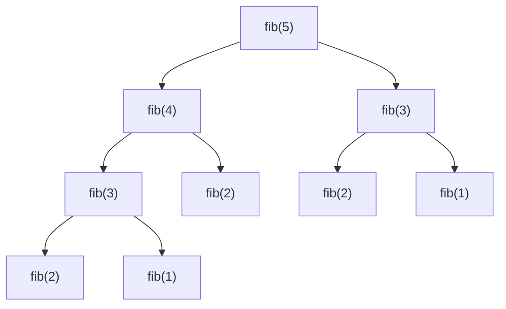
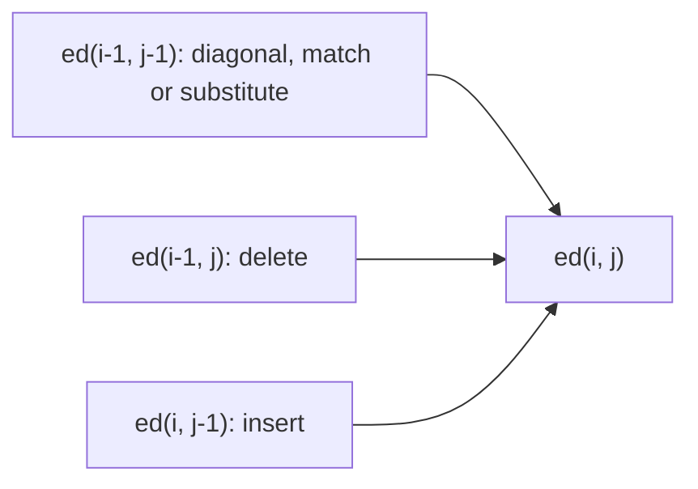

Dynamic programming has a fearsome reputation, mostly because of its name, which says nothing
about what it does. The idea is simple: **don't solve the same subproblem twice**. Many recursive
solutions recompute identical pieces over and over; remembering the answers turns exponential time
into polynomial time. This session shows you how to recognise those problems and two mechanical
ways to fix them.

## Overlapping subproblems and optimal substructure

Recall naive Fibonacci from Session 1.2.2:

```python
def fib(n):
    if n < 2:
        return n
    return fib(n - 1) + fib(n - 2)
```

Draw its call tree for `fib(5)` and you'll see `fib(3)` computed twice, `fib(2)` three times, and
so on. The tree has exponentially many nodes, but there are only n + 1 *distinct* subproblems.
Nearly all the work is repeated work.



Dynamic programming (DP) applies when a problem has two properties:

1. **Overlapping subproblems.** The recursive solution solves the same smaller problems many times.
   (Merge sort, by contrast, splits into *disjoint* halves; there's nothing to reuse, so DP doesn't
   help it.)
2. **Optimal substructure.** An optimal solution to the whole problem is built from optimal
   solutions to subproblems. The shortest route from Milan to Rome via Florence contains the
   shortest route from Milan to Florence.

> [!NOTE]
> The analogy: if someone asks you "what's 1 + 1 + 1 + 1 + 1?", you count to 5. If they then add
> "+ 1", you don't recount from the start; you remember 5 and answer 6. DP is that habit, applied
> systematically.

The hard, creative part of DP is defining the **state**: what parameters identify a subproblem? The
rest is mechanical. A good habit is to write the solution as a **recurrence** first, in words:

- "fib(n) = fib(n − 1) + fib(n − 2)";
- "the fewest coins for amount a = 1 + the minimum, over each coin c ≤ a, of the fewest coins for
  a − c".

## Memoisation (top-down) vs tabulation (bottom-up)

There are two ways to turn a recurrence into an efficient program.

**Memoisation (top-down).** Keep the natural recursive code, and cache each result the first time
you compute it. Later calls with the same arguments return the cached value. In Python,
`functools.cache` does it for you:

```python
from functools import cache

@cache
def fib(n):
    if n < 2:
        return n
    return fib(n - 1) + fib(n - 2)
```

One decorator, and `fib(90)` is instant: each of the n + 1 subproblems is computed once, so it's
O(n).

**Tabulation (bottom-up).** Fill a table iteratively, starting from the base cases, in an order
where every entry's dependencies are already filled.

```python
def fib(n):
    if n < 2:
        return n
    table = [0] * (n + 1)
    table[1] = 1
    for i in range(2, n + 1):
        table[i] = table[i - 1] + table[i - 2]
    return table[n]
```

| | Memoisation (top-down) | Tabulation (bottom-up) |
|---|---|---|
| Code | recursive, close to the recurrence | loops over a table |
| Computes | only the subproblems actually needed | usually every subproblem |
| Recursion depth | can hit Python's limit | none |
| Space optimisation | harder | easy: often keep only the last row |
| Easiest to write first | usually yes | needs the right fill order |

> [!TIP]
> Write the memoised version first; it's the recurrence plus a decorator, so it's hard to get
> wrong. Convert to tabulation when you hit recursion limits or want to save memory. Fibonacci only
> ever needs the previous two values, so the table shrinks to two variables: O(1) space.

> [!WARNING]
> `functools.cache` requires hashable arguments. Pass tuples, not lists, and be careful caching
> methods on objects: the cache keeps references to every argument, including `self`, alive.

## Classic problems: Fibonacci, knapsack, longest common subsequence, edit distance

Each classic problem teaches a reusable *shape* of state.

**Fibonacci: one index.** State: n. You've seen it.

**0/1 knapsack: index plus capacity.** You have items with weights and values and a bag with
capacity W. Each item is taken whole or left behind. Maximise total value.

- State: `best(i, w)` = best value using the first i items with capacity w.
- Recurrence: either skip item i, `best(i − 1, w)`, or take it if it fits,
  `value[i] + best(i − 1, w − weight[i])`. Take the larger.
- Table size (n + 1) × (W + 1), so **O(n · W)** time.

> [!EXAMPLE]
> Capacity 50; items (weight, value): (10, 60), (20, 100), (30, 120). Greedy by value per kilo
> takes (10, 60) then (20, 100), has 20 left, can't fit the last item, and gets 160. DP finds
> (20, 100) + (30, 120) = 220. Note that
> O(n · W) depends on the *number* W, not its length in digits, which is why knapsack is still
> considered hard for huge capacities.

**Longest common subsequence (LCS): two indexes into two sequences.** A subsequence keeps order but
may skip characters: "ACE" is a subsequence of "ABCDE".

- State: `lcs(i, j)` = LCS length of the first i characters of a and first j of b.
- If `a[i-1] == b[j-1]`: `1 + lcs(i − 1, j − 1)`. Otherwise `max(lcs(i − 1, j), lcs(i, j − 1))`.
- **O(m · n)** time. This is the core of `diff` tools and Git's line-by-line comparison.

**Edit distance (Levenshtein): two indexes, three moves.** The fewest single-character inserts,
deletes and substitutions to turn a into b.

- State: `ed(i, j)` for prefixes of length i and j.
- Base cases: `ed(i, 0) = i` (delete everything), `ed(0, j) = j` (insert everything).
- If the last characters match: `ed(i − 1, j − 1)`. Otherwise
  `1 + min(ed(i − 1, j), ed(i, j − 1), ed(i − 1, j − 1))` for delete, insert, substitute.

| | "" | s | i | t |
|---|---|---|---|---|
| "" | 0 | 1 | 2 | 3 |
| s | 1 | 0 | 1 | 2 |
| a | 2 | 1 | 1 | 2 |
| t | 3 | 2 | 2 | 1 |

"sat" → "sit" needs 1 edit (substitute a with i): the bottom-right cell. Spell checkers,
"did you mean…?" suggestions and fuzzy search use edit distance.



The DP chapters of [Jeff Erickson's Algorithms](https://jeffe.cs.illinois.edu/teaching/algorithms/)
and the dynamic programming lectures of
[MIT 6.006](https://ocw.mit.edu/courses/6-006-introduction-to-algorithms-spring-2020/) walk through
these and more, with a consistent recipe for defining states.

> [!TIP]
> A recipe for any DP problem: (1) define the state in words; (2) write the recurrence and base
> cases; (3) check the number of states × work per state for the complexity; (4) memoise;
> (5) if needed, convert to a table and pick a fill order where dependencies come first.

## Practice: five DP problems, each solved both ways

Budget about 2 hours (split it over two days if you like). For each problem: write the state and
recurrence in a comment, implement a memoised version with `@cache`, implement a tabulated version,
and test that both agree with each other and with a brute force on small inputs.

### Problem 1: Climbing stairs

You can climb 1 or 2 steps at a time. How many distinct ways are there to climb n steps? (It's
Fibonacci in disguise; explain why.)

### Problem 2: Coin change

Given coin values and an amount, return the fewest coins that make the amount, or −1. Test with
coins {1, 3, 4} and amount 6, where greedy fails (Session 1.4.6).

### Problem 3: 0/1 knapsack

Implement `knapsack(items, capacity)` both ways. Then reduce the tabulated version to a single row
of size W + 1. Hint: iterate capacities from high to low so each item is used at most once.

### Problem 4: Longest common subsequence

Return the length and, as a stretch, the subsequence itself by walking back through the table.

### Problem 5: Edit distance

Implement Levenshtein distance and check it on a few pairs:

```python
import pytest

@pytest.mark.parametrize("a, b, d", [
    ("", "", 0), ("abc", "", 3), ("sat", "sit", 1),
    ("kitten", "sitting", 3), ("flaw", "lawn", 2),
])
def test_edit_distance(a, b, d):
    assert edit_distance_memo(a, b) == edit_distance_table(a, b) == d
```

### Reflect

For each problem, record the state, the number of states, the work per state and the resulting
complexity in a table. Then time your memoised Fibonacci against the naive one for n = 30 and write
down the ratio.
