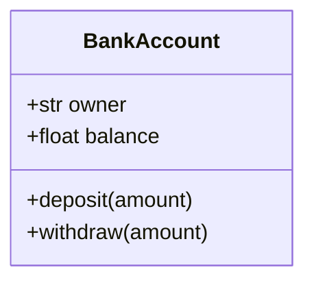
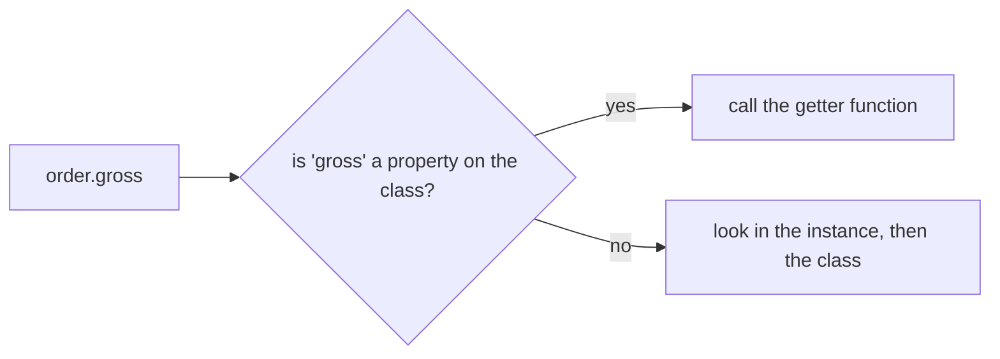

So far this track has been about algorithms: how to compute things efficiently. This module is
about **design**: how to organise code so that people can understand it and change it safely.
Object-oriented programming (OOP) is the most widespread way to do that. In this session you'll
learn the building blocks in Python, and, just as importantly, the reasons behind them, so you can
tell good class design from classes for the sake of classes.

## Classes, objects, attributes and methods

A **class** is a blueprint; an **object** (or **instance**) is a thing built from it. The class
`Car` describes what every car has and can do; your neighbour's red Fiat is one object of that
class.

- **Attributes** are the data an object holds: `colour`, `mileage`.
- **Methods** are functions defined in the class that act on an object's data: `drive(km)`.

```python
class BankAccount:
    def __init__(self, owner: str, balance: float = 0.0):
        self.owner = owner          # attribute
        self.balance = balance      # attribute

    def deposit(self, amount: float) -> None:   # method
        if amount <= 0:
            raise ValueError("deposit must be positive")
        self.balance += amount

acct = BankAccount("Ada")           # create an object (instantiate)
acct.deposit(50)
print(acct.balance)                 # 50.0
```

The `self` parameter is the object the method is called on. `acct.deposit(50)` is really
`BankAccount.deposit(acct, 50)`: Python passes the object in for you. That's all `self` is; there's
no magic.

Why bundle data and functions together at all? Because it puts the **rules** next to the **data**
they protect. The "deposits must be positive" rule lives in one place, the `deposit` method, rather
than being repeated (or forgotten) everywhere that touches a balance.



> [!TIP]
> Name classes with nouns (`Invoice`, `HttpClient`) and methods with verbs (`send`, `calculate_total`).
> If you struggle to name a class without "Manager", "Helper" or "Util", it may not have a clear
> single job yet.

> [!NOTE]
> The official [Python Tutorial on classes](https://docs.python.org/3/tutorial/classes.html) is
> short and worth reading end to end; it explains namespaces and scopes, which make the rest of
> Python's object model much less mysterious.

## Encapsulation and information hiding

**Encapsulation** means an object manages its own state, and the outside world interacts with it
through a small set of methods: its **interface**. **Information hiding** is the goal behind it:
callers shouldn't need to know, or be able to depend on, how the object works inside.

The analogy is a car's dashboard. You use the steering wheel, pedals and gear stick; you don't
reach into the engine to adjust the fuel injection. Because drivers only depend on the dashboard,
manufacturers can completely redesign the engine (petrol, hybrid, electric) without retraining
anyone.

In code, that freedom is the whole point. If ten modules read `account.balance` directly and you
later want to store the balance in cents as an integer, you must change all ten. If they all call
`account.balance_in_euros()`, you change one method.

Python doesn't enforce privacy. It uses **conventions**:

- `_name` (one underscore): "internal; don't use from outside". Tools and readers respect it.
- `__name` (two underscores): triggers **name mangling** (it becomes `_ClassName__name`), mainly to
  avoid accidental clashes in subclasses. It isn't a security feature.

```python
class BankAccount:
    def __init__(self, owner):
        self.owner = owner
        self._balance_cents = 0               # internal representation

    def deposit(self, euros: float) -> None:
        if euros <= 0:
            raise ValueError("deposit must be positive")
        self._balance_cents += round(euros * 100)

    def balance(self) -> float:
        return self._balance_cents / 100
```

> [!WARNING]
> Getters and setters for every attribute are not encapsulation. A class with `get_balance()` and
> `set_balance()` still lets anyone set any balance; the rules have just moved somewhere else.
> Expose *behaviour* (`deposit`, `withdraw`, `transfer_to`) that keeps the object valid, not raw
> fields.

A class's **invariants** are the facts that must always be true about its objects, like "balance is
never negative" or "end date is after start date". Good encapsulation means every public method
leaves the invariants intact, so no caller can put the object into an invalid state.

## Special methods (__init__, __repr__, __eq__)

Python calls **special methods** (also called *dunder* methods, for the double underscores) to make
your objects work with built-in syntax and functions.

**`__init__`** initialises a new object's attributes. Python creates the object, then calls
`__init__` on it with the arguments you passed to the class. It's the place to validate inputs and
establish invariants.

**`__repr__`** returns an unambiguous string for developers: what you see in the REPL, in
debuggers and in logs. A good convention is to make it look like the code that would recreate the
object:

```python
def __repr__(self):
    return f"BankAccount(owner={self.owner!r}, balance={self.balance()!r})"
```

(`__str__` is the friendlier, user-facing version used by `print`. If you only write one, write
`__repr__`.)

**`__eq__`** defines what `==` means. By default, two objects are equal only if they're the *same
object*. For **value objects** like money amounts, dates or coordinates, you usually want equality
by value:

```python
class Money:
    def __init__(self, cents: int, currency: str):
        self.cents, self.currency = cents, currency

    def __eq__(self, other):
        if not isinstance(other, Money):
            return NotImplemented
        return (self.cents, self.currency) == (other.cents, other.currency)

    def __hash__(self):
        return hash((self.cents, self.currency))
```

> [!WARNING]
> If you define `__eq__`, Python sets `__hash__` to `None` unless you define it too, so your
> objects can no longer go in sets or be dict keys. Equal objects must have equal hashes (Session
> 1.3.3), and the hash should only use fields that never change.

Others you'll meet: `__len__`, `__iter__`, `__contains__`, `__getitem__` (to make a container),
`__lt__` (for sorting), `__enter__`/`__exit__` (for `with` blocks) and `__call__`.

> [!TIP]
> For classes that are mostly data, `@dataclass` writes `__init__`, `__repr__` and `__eq__` for
> you. `@dataclass(frozen=True)` makes instances immutable and hashable, which is ideal for value
> objects like `Money`.

## Class vs instance state, properties

**Instance attributes** belong to one object, usually set in `__init__` via `self.x = …`. **Class
attributes** are defined in the class body and shared by all instances.

```python
class Order:
    tax_rate = 0.22            # class attribute: shared

    def __init__(self, net):
        self.net = net         # instance attribute: per object
```

Class attributes are good for constants and defaults shared by every instance. When you read
`order.tax_rate`, Python looks on the instance first, then on the class.

> [!WARNING]
> The classic trap is a **mutable** class attribute:
> ```python
> class Cart:
>     items = []                 # shared by every Cart!
>     def add(self, x):
>         self.items.append(x)
> ```
> Every cart now shares one list. Create mutable state in `__init__` (`self.items = []`).

A **property** lets you expose a computed value, or add validation, behind plain attribute syntax.
Callers write `order.gross`, not `order.gross()`, and you keep the freedom to change how it's
computed later:

```python
class Order:
    tax_rate = 0.22

    def __init__(self, net):
        self.net = net

    @property
    def gross(self) -> float:
        return round(self.net * (1 + self.tax_rate), 2)

    @property
    def net(self) -> float:
        return self._net

    @net.setter
    def net(self, value: float) -> None:
        if value < 0:
            raise ValueError("net must be non-negative")
        self._net = value
```

Properties are Python's answer to the getter/setter debate: start with a plain public attribute,
and switch to a property only when you need logic, without changing any calling code.



## Practice: model a library system with classes

Budget about 75 minutes. You'll design a small library: books, members and loans.

### Step 1: Find the nouns and verbs

Write the requirements in a few sentences, then underline nouns (candidate classes) and verbs
(candidate methods). A starting point: "Members borrow books. A book can have several copies. A
member can borrow at most 3 copies at a time. Loans last 14 days; returning late costs €0.50 per
day."

### Step 2: Design the classes

Sketch these classes with their attributes, methods and invariants (in a Mermaid `classDiagram` or
on paper):

- `Book` (isbn, title, author) — a value object: use `@dataclass(frozen=True)`;
- `Copy` (copy id, book, `is_available`);
- `Member` (id, name, current loans; invariant: at most 3);
- `Loan` (copy, member, due date; `fine(on_date)` as a method);
- `Library` (the catalogue, `borrow(member_id, isbn)`, `return_copy(copy_id, on_date)`).

### Step 3: Implement with encapsulation

Keep collections internal (`_copies`, `_loans`) and expose behaviour. `borrow` must raise a clear
exception if the member has 3 loans or no copy is available; it must never leave a copy marked as
both available and on loan.

### Step 4: Tests

```python
from datetime import date

def test_borrow_and_return_late():
    lib = Library()
    lib.add_book(Book("978-0", "Dune", "Herbert"), copies=1)
    m = lib.add_member("Ada")
    loan = lib.borrow(m.id, "978-0", on=date(2026, 1, 1))
    fine = lib.return_copy(loan.copy.id, on=date(2026, 1, 20))
    assert fine == 2.50          # 5 days late
```

Add tests for the 3-loan limit, borrowing an unavailable book, and `repr()` output being readable.

### Step 5: Review your own design

Write two sentences: which invariant was hardest to protect, and which class would change if the
library started lending e-books.
