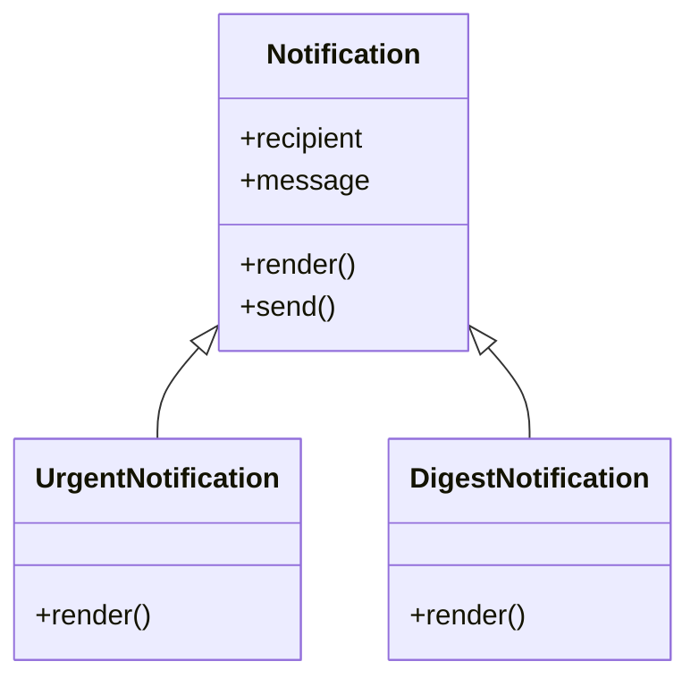
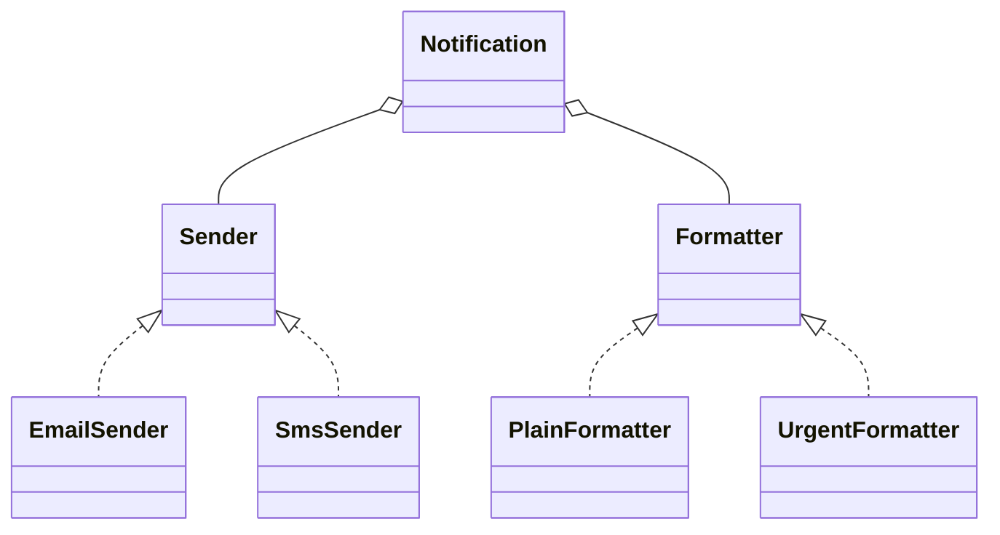

Once you have classes, the next questions are how they relate and how to reuse code between them.
Inheritance is the tool most tutorials reach for first, and it's also the one most often misused.
This session covers inheritance, the polymorphism it enables, Python's two ways of defining
interfaces, and the design rule that experienced engineers repeat most: **prefer composition over
inheritance**. The payoff is code where adding a new case means adding a class, not editing a
growing `if/elif` chain.

## Inheritance and method overriding

**Inheritance** lets a class (the **subclass** or child) start from another class (the
**superclass**, base or parent) and get all its attributes and methods. It models an **"is a"**
relationship: a `SavingsAccount` *is a* `BankAccount`, a `Dog` *is an* `Animal`.

```python
class Notification:
    def __init__(self, recipient: str, message: str):
        self.recipient = recipient
        self.message = message

    def render(self) -> str:
        return self.message

    def send(self) -> None:
        print(f"to {self.recipient}: {self.render()}")

class UrgentNotification(Notification):
    def render(self) -> str:                    # override
        return "URGENT: " + super().render()    # extend the parent's behaviour
```

**Overriding** means redefining a method in the subclass. When you call `send()` on an
`UrgentNotification`, the inherited `send` calls `self.render()`, and Python finds the subclass's
version first. `super()` gives you the parent's implementation when you want to extend rather than
replace it.

Python looks up methods along the **method resolution order** (MRO): the instance's class, then its
parents, up to `object`. You can inspect it with `UrgentNotification.__mro__`.



> [!WARNING]
> Inheritance couples the child tightly to the parent's *implementation*, not just its interface.
> A change in the base class (say, `send` stops calling `render`) can silently break every subclass.
> This is known as the **fragile base class** problem, and it's why deep hierarchies become hard to
> change.

Python supports **multiple inheritance** (a class with several parents). It's occasionally useful
for small **mixins** that add one capability (like `JsonSerializableMixin`), but deep or diamond-
shaped hierarchies are a reliable source of confusion. Keep hierarchies shallow, ideally one level.

## Polymorphism and duck typing

**Polymorphism** ("many forms") means code written against a general type works with any specific
type that fits. The caller sends the same message, and each object responds in its own way.

```python
def notify_all(notifications):
    for n in notifications:
        n.send()      # works for Notification, UrgentNotification, DigestNotification...
```

`notify_all` never checks which kind of notification it has. Add a new subclass tomorrow and
`notify_all` works unchanged. That's the real benefit: polymorphism replaces **type-checking
conditionals** with method calls.

Python takes this further with **duck typing**: "if it walks like a duck and quacks like a duck,
it's a duck". Python doesn't care about an object's class, only whether it has the methods you call.
Any object with a `send()` method works in `notify_all`, related by inheritance or not.

You already rely on duck typing constantly. `for x in thing` works on lists, dicts, files,
generators and your own classes, as long as they implement `__iter__`. `len(x)` works on anything
with `__len__`. None of them share a base class.

> [!EXAMPLE]
> Before: a function that switches on type.
> ```python
> def area(shape):
>     if shape["kind"] == "circle":
>         return 3.14159 * shape["r"] ** 2
>     elif shape["kind"] == "rect":
>         return shape["w"] * shape["h"]
>     # every new shape means editing this function, and every other function that switches on kind
> ```
> After: each shape knows its own area, and callers just call `shape.area()`.

The [Refactoring.Guru](https://refactoring.guru/refactoring) catalogue calls this refactoring
**Replace Conditional with Polymorphism**, and it's worth applying whenever the same type switch
appears in more than one place.

## Abstract base classes and Protocols

Duck typing is flexible, but it gives you no early warning. If a class forgets to implement
`render`, you find out at runtime, possibly in production. Python offers two ways to declare an
interface explicitly.

An **abstract base class** (ABC) from the `abc` module declares methods that subclasses *must*
implement. You can't instantiate the ABC itself, and you can't instantiate a subclass that misses
an abstract method.

```python
from abc import ABC, abstractmethod

class Shape(ABC):
    @abstractmethod
    def area(self) -> float: ...

class Circle(Shape):
    def __init__(self, r): self.r = r
    def area(self): return 3.14159 * self.r ** 2

Shape()        # TypeError: can't instantiate abstract class
```

ABCs use **nominal** typing: a class satisfies the interface because it *explicitly inherits* from
it.

A **Protocol** (from `typing`) describes an interface **structurally**: any class with matching
methods satisfies it, with no inheritance needed. It's duck typing that a type checker like mypy or
Pyright can verify before you run anything.

```python
from typing import Protocol

class Sender(Protocol):
    def send(self, recipient: str, message: str) -> None: ...

class EmailSender:                     # no inheritance from Sender
    def send(self, recipient: str, message: str) -> None:
        ...

def alert(sender: Sender) -> None:
    sender.send("ops@example.com", "disk full")

alert(EmailSender())                   # type checker: OK, EmailSender has a matching send
```

| | Abstract base class | Protocol |
|---|---|---|
| How a class satisfies it | inherits explicitly | just has the right methods |
| Checked | at instantiation (runtime) | by the type checker (static) |
| Can share implementation | yes (concrete methods) | not intended for that |
| Works with third-party classes | only if they inherit | yes |

> [!TIP]
> Use a **Protocol** to describe what a function *needs* from its arguments, especially across
> module boundaries. Use an **ABC** when you also want to share code among a family of classes you
> control. This platform's own API uses Protocols for its LLM providers and embedders.

## Composition over inheritance

**Composition** builds objects by **holding** other objects and delegating to them: a **"has a"**
relationship. A car *has an* engine; it isn't a kind of engine.

The problem with inheritance becomes clear when behaviour varies along more than one axis. Suppose
notifications vary by **channel** (email, SMS, Slack) and **format** (plain, urgent, digest). With
inheritance you need a class for every combination, `UrgentEmailNotification`,
`DigestSmsNotification` and so on: 3 × 3 = 9 classes, growing multiplicatively.

With composition, a notification *has* a sender and *has* a formatter:

```python
class Notification:
    def __init__(self, sender: Sender, formatter: Formatter):
        self.sender = sender
        self.formatter = formatter

    def send(self, recipient: str, message: str) -> None:
        self.sender.send(recipient, self.formatter.format(message))

n = Notification(SmsSender(), UrgentFormatter())
```

Now 3 senders + 3 formatters = 6 small classes cover all 9 combinations, and you can swap behaviour
at runtime or in tests (pass a fake sender).



> [!NOTE]
> "Favour object composition over class inheritance" is one of the core principles of the classic
> *Design Patterns* book, and many patterns you'll meet in Sessions 1.5.4 and 1.5.5 (strategy,
> decorator, adapter) are composition in disguise. See
> [Refactoring.Guru](https://refactoring.guru/refactoring) for the "Replace Inheritance with
> Delegation" refactoring.

Inheritance is still right when there's a genuine "is a" relationship, the hierarchy is shallow,
and subclasses can be used anywhere the parent is expected without surprises (the Liskov principle,
next session). Framework base classes, exception hierarchies and small ABCs are good examples.

## Practice: refactor a type-switching function into polymorphic classes

Budget about 60 minutes.

### Step 1: The starting code

```python
def shipping_cost(order):
    if order["method"] == "standard":
        return 4.99 if order["total"] < 50 else 0
    elif order["method"] == "express":
        return 9.99 + 0.5 * order["weight_kg"]
    elif order["method"] == "pickup":
        return 0
    else:
        raise ValueError(order["method"])

def delivery_days(order):
    if order["method"] == "standard":
        return 5
    elif order["method"] == "express":
        return 1
    elif order["method"] == "pickup":
        return 0
    raise ValueError(order["method"])
```

### Step 2: Pin the behaviour with tests first

Write parametrised tests for both functions covering every method, the free-shipping threshold
(49.99 vs 50) and an unknown method. They must pass before *and* after the refactor.

### Step 3: Introduce a Protocol and one class per method

Define `ShippingMethod(Protocol)` with `cost(order) -> float` and `days() -> int`, then
`Standard`, `Express` and `Pickup` classes. Build a registry `METHODS = {"standard": Standard(),
…}` and make `shipping_cost` and `delivery_days` one-line lookups that raise `ValueError` for
unknown keys.

### Step 4: Add a feature

Add a `"same_day"` method (€14.99, 0 days, only for orders under 5 kg; raise otherwise). Count how
many existing functions you had to edit. With the original design it would have been every function
that switches on `method`.

### Step 5: Composition variant

Refactor `Express` so its pricing rule is a separate `WeightPricing(base, per_kg)` object it holds.
Write one sentence on when that extra flexibility is worth it, and when it's over-engineering.
