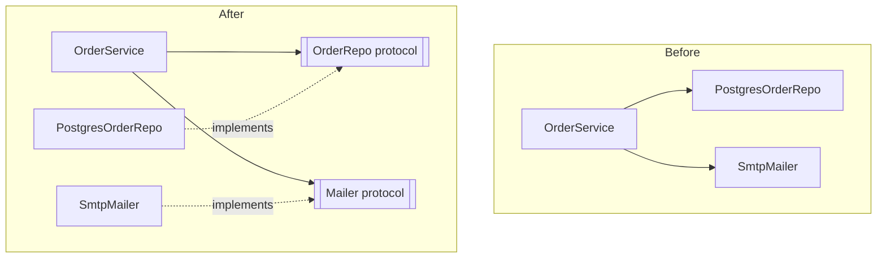

Code that works is the starting line, not the finish. The real cost of software is changing it:
adding features, fixing bugs, swapping a database or a payment provider. **SOLID** is a set of five
design principles, popularised by Robert C. Martin, that all aim at one thing: keeping code **easy
to change** without breaking what already works. They're guidelines, not laws, and this session
shows both how to apply them and how to tell when one is being over-applied.

## Single responsibility

> A class should have only one reason to change.

The **single responsibility principle** (SRP) isn't "a class should do one tiny thing". It's about
**who** asks for changes. If the accounting team, the design team and the operations team can each
force edits to the same class for unrelated reasons, that class has three responsibilities, and
every change risks breaking something another team relies on.

Think of a Swiss Army knife versus a kitchen drawer. The knife is handy, but if the scissors break
you send the whole knife for repair, and you can't sharpen the blade without disturbing the
corkscrew.

```python
class InvoiceService:                      # three reasons to change
    def calculate_total(self, invoice): ...      # pricing rules (finance)
    def render_pdf(self, invoice): ...           # layout (design)
    def save(self, invoice): ...                 # storage (engineering/ops)
```

Splitting along those lines gives `InvoiceCalculator`, `InvoicePdfRenderer` and
`InvoiceRepository`, each changing for one kind of reason and each testable on its own.

> [!TIP]
> Two quick smells: you can't describe the class without using "and", or its tests need to set up
> unrelated things (a database *and* a PDF library) to check one behaviour.

> [!WARNING]
> Over-applying SRP produces dozens of one-method classes and makes simple flows hard to follow.
> Split when responsibilities actually change independently, not pre-emptively.

## Open/closed

> Software entities should be open for extension but closed for modification.

The **open/closed principle** (OCP) means you should be able to add new behaviour **without editing
code that already works and is tested**. The analogy is a power strip: you can plug in a new
appliance without rewiring the house.

You saw the main technique in Session 1.5.2. A function with an `if/elif` chain over types must be
*modified* for every new type. A design where each type is a class implementing a shared interface
is *extended* by adding a class.

```python
class DiscountRule(Protocol):
    def applies(self, order) -> bool: ...
    def amount(self, order) -> float: ...

def total_discount(order, rules: list[DiscountRule]) -> float:
    return sum(r.amount(order) for r in rules if r.applies(order))
```

Adding a "Black Friday" rule means writing one new class and registering it. `total_discount` never
changes.

> [!NOTE]
> OCP is about protecting **stable** code from **likely** changes. You can't make code open to every
> possible extension, and trying to is a fast route to over-engineering. Apply it at the points
> where you've *already seen* variation, or where the business clearly expects it (payment
> providers, export formats, pricing rules).

## Liskov substitution

> Objects of a subtype must be usable wherever the base type is expected, without the program
> behaving incorrectly.

Named after Barbara Liskov, the **Liskov substitution principle** (LSP) is the rule that makes
inheritance and polymorphism safe. If code works with a `Bird`, it must keep working when handed
any subclass of `Bird`. A subclass may do *more*, but it must not break the promises of its parent.

The classic counterexample is the square and the rectangle. Mathematically a square *is a*
rectangle, so `Square(Rectangle)` looks natural. But a `Rectangle` promises that setting the width
leaves the height alone:

```python
def stretch(r: Rectangle):
    r.width = 10
    r.height = 5
    assert r.area() == 50     # holds for any Rectangle... unless it's a Square
```

A `Square` must keep its sides equal, so setting the height also changes the width, and the
assertion fails. The subclass is substitutable in name only.

Concretely, a subclass **violates** LSP when it:

- raises exceptions the parent never raises (`NotImplementedError` in an overridden method is a
  red flag);
- accepts **fewer** inputs than the parent (strengthens preconditions);
- returns results the parent's contract doesn't allow (weakens postconditions);
- breaks an invariant of the parent.

> [!EXAMPLE]
> A `ReadOnlyList(list)` that raises on `append` breaks every function that receives a `list` and
> appends to it. Better: don't inherit from `list`; implement a read-only interface (like
> `collections.abc.Sequence`) instead.

If you're tempted to override a method just to disable it, that's a strong sign the "is a"
relationship is false and composition would serve better.

## Interface segregation

> Clients should not be forced to depend on methods they do not use.

The **interface segregation principle** (ISP) says: prefer several small, focused interfaces over one
large one. A restaurant menu split into drinks, mains and desserts is easier to use than one
enormous list, and a waiter who only serves drinks doesn't need to learn the dessert menu.

```python
class Storage(Protocol):          # too wide
    def read(self, key): ...
    def write(self, key, data): ...
    def delete(self, key): ...
    def list_keys(self): ...
    def create_backup(self): ...
```

A report generator that only reads now *depends* on `write`, `delete` and `create_backup`. Tests
must fake all five methods, and a read-only implementation (say, a CDN cache) must stub methods it
can't support, which drifts towards an LSP violation.

Splitting into `Reader`, `Writer` and `Admin` protocols lets each consumer ask for exactly what it
needs:

```python
class Reader(Protocol):
    def read(self, key): ...

def build_report(source: Reader): ...
```

> [!TIP]
> In Python, Protocols make ISP almost free: a function can declare the one method it needs, and
> any object with that method is accepted, no inheritance required.

## Dependency inversion and dependency injection

> High-level modules should not depend on low-level modules. Both should depend on abstractions.

The **dependency inversion principle** (DIP) says the important business logic shouldn't be welded
to details like a specific database, HTTP client or email provider. Instead, the business logic
defines the **abstraction** it needs, and the details implement it.

Think of a wall socket. Your laptop doesn't depend on the power station; both depend on the
socket's standard. You can switch energy supplier without buying a new laptop.



**Dependency injection** (DI) is the everyday technique that makes DIP work: instead of a class
creating its own dependencies, they are **passed in** (usually through the constructor).

```python
class OrderService:
    def __init__(self, repo: OrderRepo, mailer: Mailer):   # injected
        self.repo, self.mailer = repo, mailer

    def place(self, order):
        self.repo.save(order)
        self.mailer.send(order.customer_email, "Thanks for your order")

# production
service = OrderService(PostgresOrderRepo(db), SmtpMailer(host))
# tests
service = OrderService(InMemoryOrderRepo(), FakeMailer())
```

The biggest practical win is **testability**: business logic can be tested in milliseconds with
in-memory fakes. Frameworks support the pattern too; FastAPI's `Depends` is a DI system, and this
platform's API chooses its LLM provider behind a Protocol so tests can inject a fake one.

> [!NOTE]
> Martin Fowler's writing on [martinfowler.com](https://martinfowler.com/) is a good source on
> dependency injection and on refactoring towards these principles. In Python, plain constructor
> injection usually beats a DI container library.

[Refactoring.Guru](https://refactoring.guru/design-patterns) explains how many design patterns
(strategy, adapter, factory) are concrete ways of applying these five principles.

## Practice: review a codebase for SOLID violations

Budget about 75 minutes. Use a project of your own, or this platform's `apps/api/app` folder.

### Step 1: Pick three targets

Choose the three largest classes or modules (by line count is fine). Large files are where
violations collect.

### Step 2: Review with a checklist

For each target, answer in a Markdown table:

| Principle | Question | Finding |
|---|---|---|
| SRP | Who would ask for changes here? More than one group? | |
| OCP | Is there a type/kind `if/elif` chain repeated in several places? | |
| LSP | Does any subclass override a method to raise or do nothing? | |
| ISP | Do callers depend on methods they never use? | |
| DIP | Does business logic construct its own DB/HTTP/email clients? | |

### Step 3: Rate and prioritise

Rate each finding *low*, *medium* or *high* by how often that code changes and how risky the change
is. A violation in code nobody touches is low priority, however ugly.

### Step 4: Fix one

Pick the highest-rated finding and refactor it with tests passing before and after. The most common
quick win is DIP: inject a dependency through the constructor and add a test with a fake.

### Step 5: Argue the other side

For one finding, write two sentences on why *leaving it* might be the right call. Good design
reviews weigh the cost of the change against the cost of the problem.
