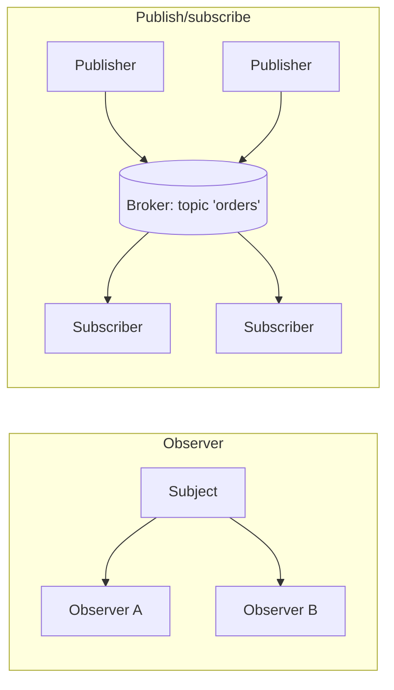
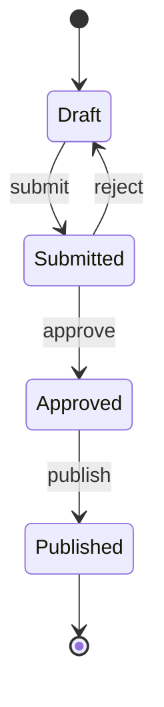

Creational and structural patterns are about how objects are built and wired together.
**Behavioural** patterns are about how they *collaborate*: who decides what happens, who gets told
when something changes, and how a request finds the object that should handle it. These are the
patterns behind plugin systems, event buses, undo buttons, middleware stacks and workflow engines,
so you'll meet them in almost every serious codebase, often under different names.

## Strategy and template method

Both patterns solve the same problem, "the overall process is fixed, but one part of it varies",
in two different ways.

**Strategy** puts each variant of an algorithm in its own object behind a common interface, and lets
the caller choose which one to use. Think of a navigation app: the route-finding process is the
same, but you choose a strategy, "fastest", "shortest" or "avoid tolls".

```python
from typing import Protocol

class PricingStrategy(Protocol):
    def price(self, base: float) -> float: ...

class Regular:
    def price(self, base): return base

class Sale:
    def __init__(self, pct): self.pct = pct
    def price(self, base): return round(base * (1 - self.pct), 2)

class Checkout:
    def __init__(self, pricing: PricingStrategy):
        self.pricing = pricing                      # composition: strategy is injected
    def total(self, items):
        return sum(self.pricing.price(i) for i in items)

Checkout(Sale(0.2)).total([10, 20])                 # 24.0
```

In Python a strategy is often just a **function**: `sorted(xs, key=len)` passes a strategy for
extracting the sort key. You only need classes when a strategy carries configuration or several
related methods.

**Template method** fixes the skeleton of an algorithm in a **base class** method and lets
subclasses override specific steps. A recipe card is a template: "prepare dough, add topping, bake"
is fixed; each pizza subclass fills in "add topping".

```python
class Report:
    def generate(self) -> str:                  # the template method
        return "\n".join([self.header(), self.body(), self.footer()])
    def header(self): return "Report"
    def body(self): raise NotImplementedError
    def footer(self): return "-- end --"

class SalesReport(Report):
    def body(self): return "Sales: 42"
```

| | Strategy | Template method |
|---|---|---|
| Mechanism | composition: pass an object or function | inheritance: override steps |
| Chosen | at runtime | when you pick the subclass |
| Flexibility | high; swap and combine freely | limited to one hierarchy |

> [!TIP]
> Following "composition over inheritance" (Session 1.5.2), prefer strategy. Template method is
> fine when a framework gives you a base class with hooks, like `unittest.TestCase.setUp` or a
> Django class-based view.

## Observer and publish/subscribe

**Observer** lets an object (the **subject**) notify a list of interested objects (**observers**)
whenever something happens, without knowing what they are. It's a newsletter: subscribers sign up,
and every new issue goes to all of them; the publisher doesn't care what each reader does with it.

```python
class EventEmitter:
    def __init__(self):
        self._listeners: dict[str, list] = {}

    def on(self, event: str, callback) -> None:
        self._listeners.setdefault(event, []).append(callback)

    def emit(self, event: str, **data) -> None:
        for cb in self._listeners.get(event, []):
            cb(**data)

orders = EventEmitter()
orders.on("placed", lambda order_id: print("email receipt", order_id))
orders.on("placed", lambda order_id: print("update stock", order_id))
orders.emit("placed", order_id=17)
```

The order code no longer needs to know about emails or stock. Adding analytics later means adding a
listener, not editing the checkout.

**Publish/subscribe** (pub/sub) is the same idea with a **broker** in the middle. Publishers send
messages to a named **topic**; subscribers listen to topics; neither knows the other exists. At
scale, the broker is a separate system such as Redis, RabbitMQ, Kafka or a cloud messaging service,
and publishers and subscribers can even run on different machines.



> [!WARNING]
> Events make control flow invisible: reading `emit("placed")` doesn't tell you what runs. Keep event
> names documented, avoid listeners that emit further events in long chains, and decide what happens
> when one listener raises (should the others still run?). Also remember to unsubscribe listeners
> that hold references to short-lived objects, or they'll never be garbage collected.

## Command and state

**Command** turns a request into an **object**. Instead of calling `editor.insert("x")` directly,
you create an `InsertCommand(editor, "x")` with an `execute()` method. That object can then be
stored, queued, logged, sent elsewhere, retried, or undone. A restaurant order slip is a command:
the waiter writes it, it's queued in the kitchen, and the cook executes it later.

```python
class InsertText:
    def __init__(self, doc, pos, text):
        self.doc, self.pos, self.text = doc, pos, text
    def execute(self):
        self.doc.insert(self.pos, self.text)
    def undo(self):
        self.doc.delete(self.pos, len(self.text))

history = []
def run(cmd):
    cmd.execute()
    history.append(cmd)        # undo = history.pop().undo()
```

Uses: undo/redo (a stack of commands, Session 1.3.2), job queues, macros, transactional
operations, and CLI tools where each subcommand is a command object.

**State** lets an object change its behaviour when its internal state changes, by delegating to a
**state object** instead of using a big `if self.status == …` in every method. Think of a vending
machine: pressing "dispense" does different things when it's idle, has money, or is out of stock.



Each state is a class with methods for the actions allowed in that state; an invalid action
(publishing a draft) raises a clear error in one place. For small workflows, a dictionary of allowed
transitions `{("Draft", "submit"): "Submitted", …}` is the lightweight Python version and is often
all you need.

## Iterator and chain of responsibility

**Iterator** gives a uniform way to walk through a collection without exposing how it's stored.
Python builds this pattern into the language: any object with `__iter__` returning an object with
`__next__` works in `for` loops, comprehensions, `sum()`, `zip()` and the rest. **Generators** make
writing one trivial:

```python
def paginate(fetch_page):
    page = 1
    while True:
        items = fetch_page(page)
        if not items:
            return
        yield from items        # callers just see a flat stream of items
        page += 1
```

Callers write `for item in paginate(api.get_orders)` and never think about pages. The iterator also
makes the work **lazy**: pages are fetched only as they are consumed.

**Chain of responsibility** passes a request along a chain of handlers. Each one either handles it,
or does part of the work and passes it to the next. A support hotline works like this: the first
line answers easy questions, escalates harder ones to the second line, and so on.

This is exactly how **web middleware** works. A request passes through logging, authentication,
rate limiting and compression before reaching your route handler, and each layer can stop it early
(return a 401) or pass it along.

```python
def auth(next_handler):
    def handle(request):
        if "token" not in request:
            return "401 Unauthorized"
        return next_handler(request)
    return handle

def logging_mw(next_handler):
    def handle(request):
        print("request:", request.get("path"))
        return next_handler(request)
    return handle

def route(request):
    return "200 OK"

app = logging_mw(auth(route))      # the chain
```

> [!NOTE]
> [Refactoring.Guru](https://refactoring.guru/design-patterns) has detailed pages for every pattern
> in this session, each with a "relations with other patterns" section. Notice how often the answer
> is "this is composition plus an interface", the same idea behind most of this module.

## Practice: implement a plugin system with strategy and observer

Budget about 90 minutes. You'll build a tiny text-processing pipeline where plugins can be added
without changing the core.

### Step 1: The strategy interface

```python
from typing import Protocol

class TextPlugin(Protocol):
    name: str
    def transform(self, text: str) -> str: ...
```

Write three plugins: `Strip` (trim whitespace), `Lowercase`, and `Censor(words)` that replaces each
listed word with asterisks.

### Step 2: A registry

Create `PLUGINS: dict[str, type]` and a decorator `register(name)` that adds a plugin class to it.
The pipeline will build plugins by name from a config list such as `["strip", "censor"]`.

### Step 3: The pipeline with events

```python
class Pipeline:
    def __init__(self, plugins: list[TextPlugin], events: EventEmitter):
        self.plugins, self.events = plugins, events

    def run(self, text: str) -> str:
        self.events.emit("started", text=text)
        for p in self.plugins:
            before = text
            text = p.transform(text)
            self.events.emit("step", plugin=p.name, changed=before != text)
        self.events.emit("finished", text=text)
        return text
```

Reuse the `EventEmitter` from above. Attach two observers: one that counts how many steps changed
the text, and one that collects a log of plugin names.

### Step 4: Tests

Test each plugin on its own, the pipeline order (`["lowercase", "censor"]` vs the reverse can give
different results — find an input where it does), and that observers receive exactly one `started`,
one `finished` and one `step` per plugin.

### Step 5: Extend without editing

Add a fourth plugin, `Truncate(n)`, in a *new file* that only imports `register`. If you had to edit
`Pipeline` or any existing plugin, revisit your design: the open/closed principle (Session 1.5.3)
says you shouldn't need to.
