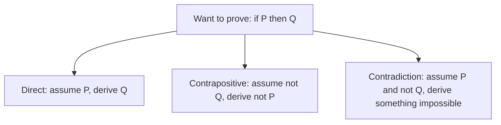

Every `if` statement you write is a small piece of logic, and every time you convince a reviewer
that "this loop always terminates" you are sketching a proof. Discrete maths sounds academic, but
this first session is the most directly practical one in the track: it gives you a precise
language for conditions, and a few reliable ways to show that something is *always* true rather
than "true in the three cases I tried".

## Propositions, connectives and truth tables

A **proposition** is a statement that is either true or false, with no in-between. "The user is
logged in" is a proposition. "Log the user in" is not (it's a command), and "x > 3" is not either
until you know what `x` is (we fix that in the next section).

You combine propositions with **connectives**, the same way you combine conditions in code:

| Connective | Symbol | Read as | Python |
|---|---|---|---|
| Negation | ¬p | not p | `not p` |
| Conjunction | p ∧ q | p and q | `p and q` |
| Disjunction | p ∨ q | p or q (or both) | `p or q` |
| Implication | p → q | if p then q | `(not p) or q` |
| Biconditional | p ↔ q | p if and only if q | `p == q` |

A **truth table** lists every combination of inputs and the result. With two propositions there are
four rows; with *n* propositions there are 2ⁿ. Truth tables are boring to write and impossible to
argue with, which is exactly why they are useful.

| p | q | p ∧ q | p ∨ q | p → q |
|---|---|---|---|---|
| T | T | T | T | T |
| T | F | F | T | F |
| F | T | F | T | T |
| F | F | F | F | T |

The implication column surprises almost everyone. "If it rains, I take an umbrella" is only
*broken* when it rains and I don't take one. When it doesn't rain, the promise wasn't tested, so it
counts as kept. This is called a **vacuously true** implication.

> [!WARNING]
> p → q does not mean q → p. "If the tests pass, the build is green" does not tell you that a green
> build means the tests ran. The reversed statement q → p is the **converse**, and confusing the two
> is one of the most common reasoning mistakes in code review and in debugging.

Two related forms matter for proofs later: the **contrapositive** of p → q is ¬q → ¬p, and it is
*always* equivalent to the original. You can check it with a truth table in two minutes.

## Predicates and quantifiers

"x > 3" isn't a proposition, but it becomes one once you plug in a value. A statement with a hole
in it is a **predicate**: P(x) = "x > 3". P(5) is true, P(1) is false.

**Quantifiers** turn a predicate into a proposition about a whole set of values:

- **Universal** ∀x P(x): "for every x, P(x)". In Python: `all(p(x) for x in xs)`.
- **Existential** ∃x P(x): "there is at least one x with P(x)". In Python: `any(p(x) for x in xs)`.

The analogy that helps: ∀ is a bouncer who checks *every* guest, ∃ is a search party that stops as
soon as it finds one. That's also why `all([])` is `True` in Python (no guest failed the check)
and `any([])` is `False` (the search found nothing).

Negating quantifiers flips them:

- ¬(∀x P(x)) ≡ ∃x ¬P(x). "Not every order shipped" means "some order didn't ship".
- ¬(∃x P(x)) ≡ ∀x ¬P(x). "No user is an admin" means "every user is not an admin".

> [!EXAMPLE]
> A spec says: "every request with a valid token is answered within 200 ms". To show the system
> *violates* it, you need just one counterexample: a request with a valid token that took longer.
> To show it *meets* it, testing a thousand requests is evidence, not proof.

Order matters when quantifiers are nested. ∀user ∃password "user has password" (each user has some
password) is very different from ∃password ∀user (one password shared by everyone).

## Direct proof, contradiction and contrapositive

A **proof** is a chain of steps, each justified by a definition, an earlier result or a rule of
logic, that leads from what you know to what you want to show. The
[Book of Proof](https://richardhammack.github.io/BookOfProof/) is an excellent free guide to
writing them; here are the three techniques you will use most.



**Direct proof.** Assume P, then reason forward until you reach Q.

> [!EXAMPLE]
> *Claim:* if n is even, then n² is even.
> *Proof:* n is even, so n = 2k for some integer k. Then n² = 4k² = 2(2k²), which is 2 times an
> integer, so n² is even. ∎

**Proof by contrapositive.** Prove ¬Q → ¬P instead, which is equivalent. Use it when "not Q" gives
you something concrete to work with.

> [!EXAMPLE]
> *Claim:* if n² is even, then n is even.
> Directly, "n² = 2k" doesn't easily tell you anything about n. So prove the contrapositive: if n is
> odd, then n² is odd. n = 2k + 1, so n² = 4k² + 4k + 1 = 2(2k² + 2k) + 1, which is odd. ∎

**Proof by contradiction.** Assume the statement is false and show that this leads to something
impossible. The classic example is that √2 is irrational: assume √2 = a/b in lowest terms, then
a² = 2b², so a² is even, so a is even (we just proved that!), so a = 2c, so 4c² = 2b², so b² = 2c²
and b is even too. Both even contradicts "lowest terms". ∎

> [!TIP]
> Pick the technique by asking "what gives me the most to work with?". An equation you can expand
> suggests a direct proof. A "not" in the conclusion often suggests contrapositive or contradiction.

## Logic in code: boolean algebra and De Morgan's laws

**Boolean algebra** is the set of rules for rewriting logical expressions without changing their
meaning. It is the same toolkit a refactoring IDE uses when it offers to "simplify condition". The
most useful laws:

| Law | Rule |
|---|---|
| Double negation | `not not p` ≡ `p` |
| Identity | `p and True` ≡ `p`, `p or False` ≡ `p` |
| Domination | `p and False` ≡ `False`, `p or True` ≡ `True` |
| Absorption | `p or (p and q)` ≡ `p` |
| Distribution | `p and (q or r)` ≡ `(p and q) or (p and r)` |

**De Morgan's laws** are the ones you will use weekly:

- `not (a and b)` ≡ `(not a) or (not b)`
- `not (a or b)` ≡ `(not a) and (not b)`

The analogy: to negate a group, negate each member *and* swap and/or. "Not (hungry and tired)"
means "either not hungry, or not tired".

```python
# Before: hard to read, a double negative hidden in a guard clause
if not (user.is_active and not user.is_banned):
    return forbidden()

# After De Morgan: not active, or banned
if not user.is_active or user.is_banned:
    return forbidden()
```

> [!WARNING]
> Python's `and`/`or` **short-circuit**: `a and b` never evaluates `b` if `a` is false. Rewrites
> are logically equivalent but can change *which* expressions run. `x is not None and x.ok` is safe;
> swapping the operands to `x.ok and x is not None` crashes on `None`.

Implication also appears in code more than you'd think. "If the feature flag is on, the user must be
in the beta group" is `flag → beta`, which as a check becomes `not flag or beta`.

## Practice: prove three small statements and simplify boolean conditions in code

Budget about 45 minutes. Write your answers in a Markdown file; the goal is clear, step-by-step
reasoning, not fancy notation.

### Step 1: Prove three statements

1. **Direct:** the sum of two odd integers is even. (Hint: write them as 2a + 1 and 2b + 1.)
2. **Contrapositive:** for an integer n, if 3n + 2 is odd then n is odd. (Assume n is even.)
3. **Contradiction:** there is no largest integer. (Assume N is the largest and look at N + 1.)

For each one, write the claim, name the technique, then the steps, and end with ∎.

### Step 2: Check an equivalence with a truth table in code

Brute force is a fine proof when the input space is finite. Verify De Morgan's laws for every
combination:

```python
from itertools import product

for a, b in product([True, False], repeat=2):
    assert (not (a and b)) == ((not a) or (not b))
    assert (not (a or b)) == ((not a) and (not b))
print("De Morgan holds for all 4 cases")
```

### Step 3: Simplify real conditions

Rewrite each condition into the simplest equivalent form, then add an `itertools.product` check like
the one above to prove your rewrite is equivalent:

```python
def can_edit(is_owner, is_admin, is_locked):
    return not (not is_owner and not is_admin) and not (is_locked and not is_admin)

def should_retry(ok, timeout, attempts_left):
    return (not ok and timeout) or (not ok and attempts_left > 0 and timeout)
```

> [!TIP]
> For `can_edit`, apply De Morgan to each bracket first. For `should_retry`, look for absorption:
> the second clause contains everything in the first one plus more.

### Step 4: Find one in your own code

Search a project you work on for `if not (`. Pick one condition, simplify it, and keep the
product-based check as a unit test. You have just used a proof to make a refactor safe.

```quiz
{"questions": [
  {"question": "A function's contract says: 'if the input is sorted, the output is sorted'. Your test passes an unsorted input and gets an unsorted output. What does that tell you about the contract?", "options": ["The contract is broken", "Nothing; an implication with a false premise is vacuously true", "The converse is now proven", "The function must be rewritten"], "answer": 1, "explanation": "p → q is only violated when p is true and q is false. An unsorted input never tests the promise."},
  {"question": "Which condition is equivalent to `not (is_admin or is_owner)`?", "options": ["`not is_admin or not is_owner`", "`is_admin and is_owner`", "`not is_admin and not is_owner`", "`not is_admin or is_owner`"], "answer": 2, "explanation": "De Morgan: negate each part and swap or for and."},
  {"question": "You want to prove 'if n² is odd then n is odd'. Which strategy gives you the most to work with?", "options": ["Contrapositive: assume n is even and show n² is even", "Direct: assume n² is odd and take a square root", "Check n = 1, 3, 5 and conclude", "Prove the converse instead"], "answer": 0, "explanation": "Assuming n = 2k gives a concrete form to expand; the contrapositive is equivalent to the original."},
  {"question": "What does `all(x > 0 for x in [])` return in Python, and why?", "options": ["False, because there is nothing to check", "It raises an error", "None", "True, because no element fails the condition"], "answer": 3, "explanation": "A universal statement over an empty set is vacuously true: there is no counterexample."},
  {"question": "Why can rewriting `x is not None and x.valid` to `x.valid and x is not None` break code even though the logic is equivalent?", "options": ["Python's `and` short-circuits, so the order decides which expressions are evaluated", "Python evaluates `and` from right to left", "De Morgan's laws don't apply to `is not`", "The two expressions are not logically equivalent"], "answer": 0, "explanation": "Logically they are equivalent, but evaluation order matters: the first form never touches `x.valid` when x is None."}
]}
```
