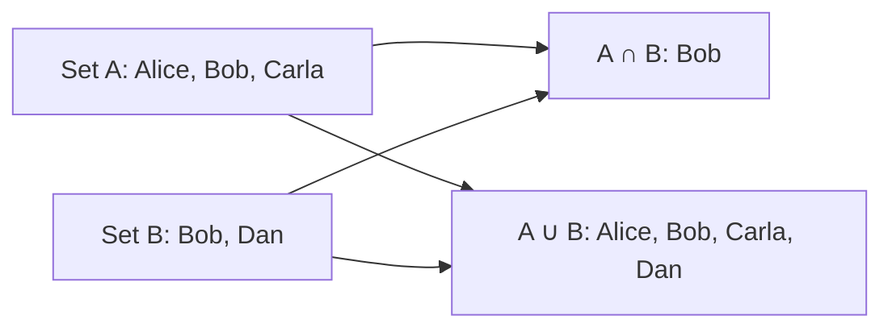
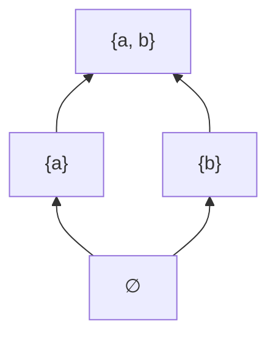

Almost every piece of software is a model of some corner of the world: users, orders, courses,
permissions. Sets, functions and relations are the mathematician's version of that modelling kit,
and they turn out to be the foundation under SQL tables, type systems and even Python's `dict`.
Learning the vocabulary lets you say precisely what your data means, and spot bugs that come from
saying it vaguely.

## Sets and set operations

A **set** is an unordered collection of distinct things, called **elements**. Think of a guest
list: it doesn't matter in which order names are written, and writing someone twice doesn't invite
them twice. We write A = {1, 2, 3}, and "2 ∈ A" means 2 is an element of A.

Some sets have standard names: ℕ (natural numbers), ℤ (integers), ℝ (real numbers) and ∅, the
**empty set**. A is a **subset** of B (A ⊆ B) when every element of A is also in B.

The operations you will meet constantly:

| Operation | Notation | Meaning | Python |
|---|---|---|---|
| Union | A ∪ B | in A or B (or both) | `a \| b` |
| Intersection | A ∩ B | in both A and B | `a & b` |
| Difference | A \ B | in A but not in B | `a - b` |
| Symmetric difference | A △ B | in exactly one of them | `a ^ b` |
| Complement | Aᶜ | not in A (relative to a universe U) | `universe - a` |
| Cartesian product | A × B | all ordered pairs (a, b) | `itertools.product(a, b)` |



The **cardinality** |A| is the number of elements. The **power set** P(A) is the set of all
subsets of A; if |A| = n then |P(A)| = 2ⁿ, because for each element you choose "in" or "out".

> [!EXAMPLE]
> Feature flags: `enabled = {"dark_mode", "beta_search"}` and `requested = {"beta_search", "ai"}`.
> `requested - enabled` is `{"ai"}`, the flags a user asked for that aren't on. One line, no loop,
> and it reads exactly like the maths.

> [!TIP]
> The free [Discrete Mathematics: An Open Introduction](https://discrete.openmathbooks.org/dmoi3.html)
> has a gentle chapter on sets with plenty of exercises. Venn diagrams are worth sketching by hand
> when an expression has three or more sets.

## Functions: injective, surjective, bijective

A **function** f: A → B assigns to *every* element of A exactly one element of B. A is the
**domain**, B the **codomain**, and the set of values actually hit is the **range** (or image).
The analogy is a vending machine: every button gives exactly one product. A button that gives two
products, or nothing, would not be a function.

Three properties describe how a function covers its codomain:

- **Injective** (one-to-one): different inputs always give different outputs. No two buttons give
  the same product. `user_id → email` should be injective if emails are unique.
- **Surjective** (onto): every element of B is hit by some input. Every product in the machine has
  a button.
- **Bijective**: both. Every input pairs with exactly one output and vice versa, so the function
  has an **inverse** f⁻¹ that undoes it.

| Function | Injective? | Surjective? |
|---|---|---|
| f(x) = 2x from ℤ to ℤ | Yes | No (odd numbers missed) |
| f(x) = x² from ℤ to ℕ | No (2 and −2 collide) | No (3 is missed) |
| f(x) = x + 1 from ℤ to ℤ | Yes | Yes (bijective) |

> [!NOTE]
> These words show up in real engineering. A hash function from long strings to 64-bit numbers
> *cannot* be injective: there are more inputs than outputs, so collisions must exist. Encryption
> must be bijective on its message space, or you couldn't decrypt. Serialisation (object → JSON →
> object) should behave like a bijection, and round-trip tests check exactly that.

To prove injectivity, assume f(a) = f(b) and show a = b. To prove surjectivity, take an arbitrary
b in B and construct an a with f(a) = b.

## Relations, equivalence and ordering

A **relation** R from A to B is any subset of A × B: a set of pairs saying who is related to whom.
"Student s is enrolled in course c" is a relation. Unlike a function, a student may relate to many
courses, or to none.

A relation on a single set A can have special properties:

- **Reflexive:** every a relates to itself (a R a).
- **Symmetric:** if a R b then b R a.
- **Antisymmetric:** if a R b and b R a then a = b.
- **Transitive:** if a R b and b R c then a R c.

Two combinations are important enough to have names.

An **equivalence relation** is reflexive, symmetric and transitive. It splits a set into
non-overlapping groups called **equivalence classes**. "Has the same email after lower-casing" is an
equivalence relation on user records, and each class is a group of accounts that are probably the
same person. Deduplication is literally "pick one element per equivalence class".

A **partial order** is reflexive, antisymmetric and transitive, like ≤ on numbers or ⊆ on sets.
"Partial" because some pairs may be incomparable: {1} and {2} are not subsets of each other. A
**total order** is one where every pair is comparable; that's what sorting needs.



The diagram above (a *Hasse diagram*) shows ⊆ on the subsets of {a, b}: {a} and {b} sit side by
side because neither contains the other.

> [!WARNING]
> Python's `sorted` assumes a consistent total order. If your `key` or `__lt__` is not transitive
> (for example, comparing floats that include `NaN`), the result can be silently wrong rather than
> raising an error.

## How sets and relations map to databases and types

This is where the theory pays rent. The relational model behind SQL is named after relations:

- A **table** is a relation: a set of rows (tuples). In theory row order doesn't matter, which is
  why SQL gives you no guaranteed order without `ORDER BY`.
- A **primary key** says the mapping from key to row is a function: each key identifies exactly
  one row.
- A **foreign key** from `enrollments.student_id` to `students.id` says every enrollment maps to a
  real student; the enrollment table itself is a relation between students and courses.
- `UNION`, `INTERSECT` and `EXCEPT` are set union, intersection and difference. A `JOIN` filters
  the Cartesian product of two tables.
- A `UNIQUE` constraint makes a column mapping injective.

Types are sets too. `bool` is the set {True, False}. A tuple type `tuple[int, str]` is a Cartesian
product int × str. A union type `int | None` is a set union. A function type `Callable[[A], B]` is
the set of functions from A to B. Thinking this way makes questions like "how many states can this
object be in?" concrete: a dataclass with two bools and an enum of three values has
2 × 2 × 3 = 12 possible states, and some of them may be invalid states you should make
unrepresentable.

> [!EXAMPLE]
> `status: str` plus `is_paid: bool` allows `("cancelled", True)`. Is that meaningful? If not, an
> enum `OrderState` with exactly the valid combinations shrinks the set of possible values to the
> set of *legal* values, and a whole class of bugs disappears.

## Practice: model a small domain (students, courses) with sets and relations

Budget about 45 minutes. You will describe a tiny school on paper first, then in Python.

### Step 1: Write the sets

Define S (students), C (courses) and T (teachers) with three to five elements each. Write them in
set notation.

### Step 2: Define the relations and functions

- Enrolled ⊆ S × C (a relation: many-to-many).
- teaches: C → T (a function: every course has exactly one teacher). Is it injective in your
  example? Surjective? Write one sentence explaining each answer.
- Prerequisite ⊆ C × C. Is it reflexive? Transitive? Should it be a partial order?

### Step 3: Encode them in Python

```python
students = {"ana", "ben", "chen"}
courses = {"maths", "python", "databases"}
enrolled = {("ana", "python"), ("ben", "python"), ("ben", "maths")}
teaches = {"maths": "rossi", "python": "kim", "databases": "kim"}

def courses_of(s):
    return {c for (st, c) in enrolled if st == s}

assert all(c in courses for (_, c) in enrolled)          # foreign key check
assert set(teaches) == courses                            # teaches is total on C
is_injective = len(set(teaches.values())) == len(teaches)
print(courses_of("ben"), is_injective)
```

### Step 4: Answer questions with set operations

Write one-line expressions for: students enrolled in nothing; courses nobody takes; students who
share at least one course with Ben; teachers who teach more than one course.

### Step 5: Translate to SQL

Sketch the three `CREATE TABLE` statements, mark the primary and foreign keys, and note which
constraint enforces which property (function, injectivity, membership).

```quiz
{"questions": [
  {"question": "A `users` table has a UNIQUE constraint on `email`. In set-theory terms, what does that guarantee about the mapping from users to emails?", "options": ["It is surjective", "It is injective", "It is an equivalence relation", "It is a partial order"], "answer": 1, "explanation": "No two users can share an email, so different inputs always map to different outputs."},
  {"question": "Why can't a function from all strings to 64-bit integers be injective?", "options": ["Strings are unordered", "Integers can be negative", "There are more possible inputs than outputs, so some must collide", "Functions on strings are never injective by definition"], "answer": 2, "explanation": "This is the pigeonhole principle: an infinite domain into a finite codomain forces collisions."},
  {"question": "'Two accounts have the same normalised email' is an equivalence relation. What do its equivalence classes give you?", "options": ["Groups of accounts that are likely duplicates of each other", "A sorted list of accounts", "The accounts with no email", "A single representative account"], "answer": 0, "explanation": "An equivalence relation partitions the set into disjoint groups of mutually related elements."},
  {"question": "A dataclass has an `is_active: bool`, an `is_deleted: bool` and a `role` enum with 3 values. How many states can it represent?", "options": ["5", "6", "7", "12"], "answer": 3, "explanation": "The type is a Cartesian product: 2 × 2 × 3 = 12, some of which may be invalid combinations."},
  {"question": "Why does SQL return rows in no guaranteed order without ORDER BY?", "options": ["Because indexes are random", "Because a table is a relation, which is a set of tuples and has no order", "Because SQL sorts by insertion time", "It always returns them by primary key"], "answer": 1, "explanation": "The relational model treats a table as a set. Order is something you request, not something it has."}
]}
```
