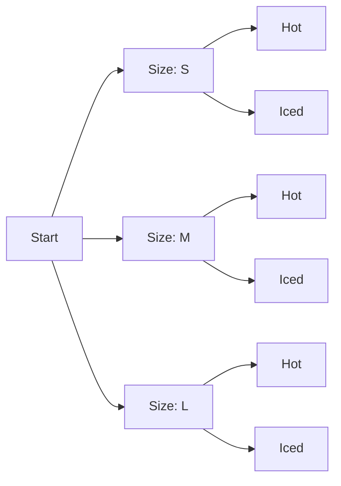
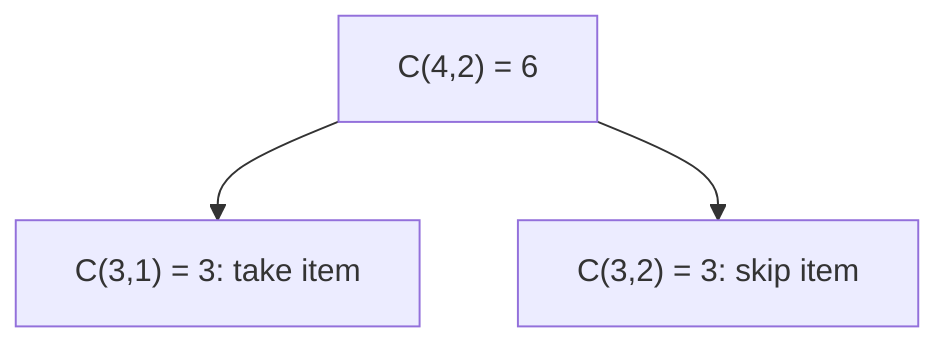

"How many ways could this go?" is a question engineers ask more than they realise. How many
passwords of length 8 are there? How many test cases does this function with four flags need? Will
brute force finish before lunch or after the heat death of the universe? **Combinatorics** is the
maths of counting without listing, and a handful of rules covers most of what you'll need.

## Sum and product rules

Two rules underpin everything else in this lesson.

**The sum rule:** if a task can be done in one of *m* ways **or** in one of *n* ways, and the two
groups don't overlap, there are m + n ways in total. A café offers 4 hot drinks or 3 cold drinks:
you can pick a drink in 4 + 3 = 7 ways.

**The product rule:** if a task is a sequence of steps, with *m* ways to do the first step **and**
*n* ways to do the second (whatever you chose first), there are m × n ways in total. A drink (7
options) and a pastry (5 options) gives 7 × 5 = 35 breakfasts.

The cue words help: **or** between disjoint options means add, **and then** between independent
choices means multiply.



The tree above shows 3 sizes × 2 temperatures = 6 leaves. Every product-rule count is a tree like
this; you just never draw the big ones.

> [!EXAMPLE]
> A password of exactly 8 characters from lowercase letters and digits: each position has 26 + 10 =
> 36 options (sum rule), and there are 8 positions (product rule), so 36⁸ ≈ 2.8 × 10¹² passwords.
> Allowing uppercase too gives 62⁸ ≈ 2.2 × 10¹⁴, about 78 times more.

> [!WARNING]
> The sum rule needs the groups to be **disjoint**. If they overlap you over-count. The fix is
> **inclusion–exclusion**: |A ∪ B| = |A| + |B| − |A ∩ B|. Ten people speak Italian, eight speak
> English and three speak both: that's 15 people, not 18.

## Permutations and combinations

The two most common counting questions differ by one thing: **does order matter?**

A **permutation** is an ordered arrangement. The number of ways to arrange *n* distinct items in a
row is n! (n factorial): n choices for the first slot, n − 1 for the second, and so on. Arranging
only *k* of them in order:

P(n, k) = n! / (n − k)! = n × (n − 1) × … × (n − k + 1)

A **combination** is an unordered selection. Choosing *k* items out of *n* when order doesn't
matter:

C(n, k) = n! / (k! (n − k)!), written "n choose k".

The relationship is the key to remembering it: every unordered group of k items can be ordered in
k! ways, so C(n, k) = P(n, k) / k!.

| Question | Order matters? | Formula | Example (n = 10, k = 3) |
|---|---|---|---|
| Gold, silver, bronze among 10 runners | Yes | P(10, 3) | 720 |
| A 3-person committee from 10 people | No | C(10, 3) | 120 |
| A PIN of 3 digits (repeats allowed) | Yes, with repetition | 10³ | 1,000 |

> [!TIP]
> Python has these built in: `math.factorial(n)`, `math.perm(n, k)` and `math.comb(n, k)`. For
> actually generating them, `itertools.permutations` and `itertools.combinations` do the job,
> lazily, one at a time.

> [!EXAMPLE]
> A function takes 5 boolean flags. To test every combination you need 2⁵ = 32 cases. If you only
> test each *pair* of flags in all four settings ("pairwise testing"), there are C(5, 2) = 10 pairs
> to cover, and a well-chosen set of about six tests can cover all of them.

## Pigeonhole principle

If you put more pigeons than holes, some hole holds at least two pigeons. It sounds too obvious to
be useful, yet it proves surprising things. More precisely: putting *n* items into *m* boxes with
n > m forces some box to contain at least ⌈n / m⌉ items.

Things it proves immediately:

- In any group of 367 people, two share a birthday (there are at most 366 birthdays).
- A hash function mapping arbitrary files to 256-bit digests **must** have collisions: there are
  far more possible files than 2²⁵⁶ digests. Security doesn't rely on collisions not existing; it
  relies on them being infeasible to *find*.
- A lossless compression algorithm cannot make *every* input shorter. There are 2ⁿ inputs of
  length n, but fewer than 2ⁿ strings that are shorter, so some inputs must grow or stay the same.

> [!NOTE]
> The pigeonhole principle is an existence argument: it tells you a collision *exists*, not where.
> Many proofs in algorithms work like this, showing that something must happen without saying
> which case it is.

The related **birthday paradox** says collisions show up much earlier than intuition suggests:
with only 23 people the chance of a shared birthday is already above 50%. That's why short IDs
collide sooner than you'd expect when generated randomly.

## Binomial coefficients and Pascal's triangle

C(n, k) is also called a **binomial coefficient** because it gives the coefficients when you expand
(x + y)ⁿ. For example (x + y)³ = x³ + 3x²y + 3xy² + y³, and 1, 3, 3, 1 are C(3, 0) to C(3, 3).

**Pascal's triangle** arranges them in rows. Each number is the sum of the two above it:

```text
        1
       1 1
      1 2 1
     1 3 3 1
    1 4 6 4 1
  1 5 10 10 5 1
```

That rule is **Pascal's identity**: C(n, k) = C(n − 1, k − 1) + C(n − 1, k). It has a lovely
counting proof. To choose k items from n, look at one particular item: either you take it (and
choose k − 1 from the remaining n − 1) or you don't (and choose all k from the remaining n − 1).
Sum rule, done.

A few facts that fall out of the triangle:

- Each row is symmetric: C(n, k) = C(n, n − k). Choosing who's *in* is the same as choosing who's
  *out*.
- Row n sums to 2ⁿ, the number of subsets of an n-element set.
- The identity is a recursive definition, which you'll later compute with dynamic programming.



## Practice: estimate the size of a brute-force search space

Budget about 40 minutes. You'll estimate how long brute force would take for a few realistic
problems, then check one estimate by running code.

### Step 1: Set a speed

Assume your laptop can check about 10⁸ simple candidates per second in a fast language, and 10⁷ in
Python. Write both numbers down; the answers only need to be right to within a factor of ten.

### Step 2: Count the spaces

For each problem, write the formula, then the number, then the time:

1. All 6-digit numeric PINs.
2. All 10-character passwords from 62 alphanumeric characters.
3. Every order to visit 12 cities (a naive travelling salesperson).
4. Every subset of 40 items (a naive knapsack).
5. Every 5-card hand from a 52-card deck.

> [!TIP]
> Use logs to compare: 2⁴⁰ ≈ 10¹², 12! ≈ 4.8 × 10⁸, C(52, 5) = 2,598,960. A year is about
> 3 × 10⁷ seconds.

### Step 3: Verify one with code

```python
import math
from itertools import combinations
from time import perf_counter

deck = range(52)
start = perf_counter()
count = sum(1 for _ in combinations(deck, 5))
print(count, math.comb(52, 5), f"{perf_counter() - start:.2f}s")
```

Compare the measured time with your estimate.

### Step 4: Draw a conclusion

For each problem, write "brute force is fine", "borderline" or "need a smarter algorithm". Then add
one line on what changed the answer: usually it's a factorial or an exponential in the formula.

```quiz
{"questions": [
  {"question": "A team of 12 must pick a lead, then a deputy (a different person). How many possibilities are there?", "options": ["66", "132", "144", "24"], "answer": 1, "explanation": "Order matters (lead vs deputy) and repeats are not allowed: 12 × 11 = 132, which is P(12, 2)."},
  {"question": "Why is C(n, k) equal to P(n, k) divided by k!?", "options": ["Each unordered group of k items appears k! times among the ordered arrangements", "Because combinations allow repetition", "Because k! is always smaller than n!", "It's a coincidence for small values"], "answer": 0, "explanation": "Combinations ignore order, and every set of k items can be ordered in k! ways."},
  {"question": "A URL shortener uses 4-character codes from 62 characters and has 20 million links. What does the pigeonhole principle tell you?", "options": ["Nothing, there is enough space", "Exactly half the codes are used", "Collisions are impossible", "There are only about 14.8 million codes, so it cannot give every link a unique code"], "answer": 3, "explanation": "62⁴ ≈ 14.8 million, which is fewer than 20 million links: some code must be shared."},
  {"question": "Ten developers know Python, seven know Go and four know both. How many know at least one?", "options": ["17", "21", "13", "11"], "answer": 2, "explanation": "Inclusion–exclusion: 10 + 7 − 4 = 13. Adding without subtracting the overlap double-counts four people."},
  {"question": "Which brute-force search is most likely to finish in seconds on a laptop?", "options": ["All 5-card hands from 52 cards", "All orderings of 20 cities", "All subsets of 60 items", "All 12-character alphanumeric passwords"], "answer": 0, "explanation": "C(52, 5) is about 2.6 million. 20! and 2⁶⁰ are around 10¹⁸, and 62¹² is far larger."}
]}
```
