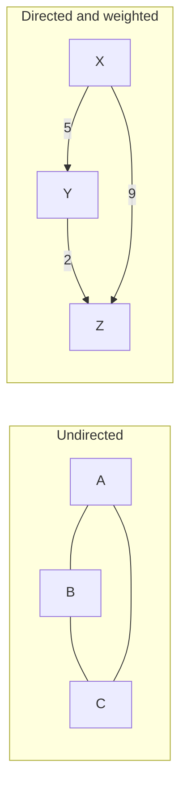
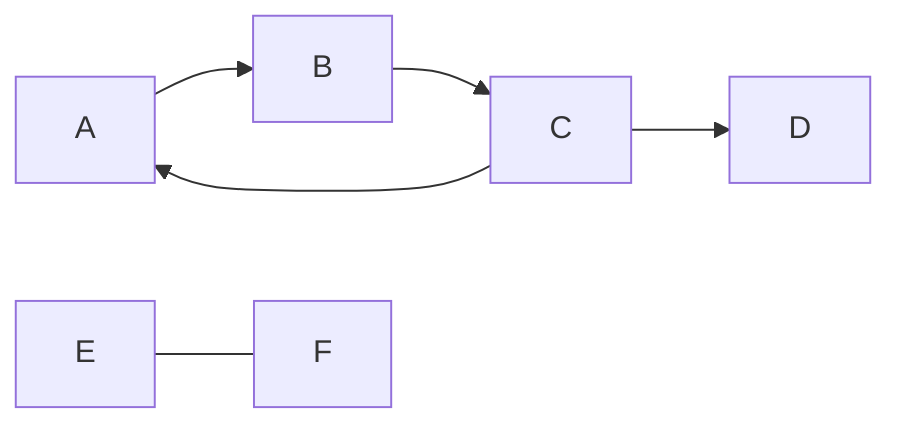
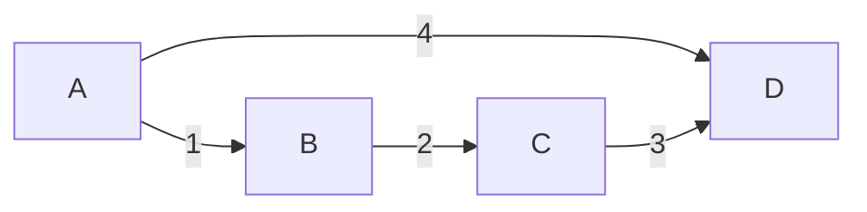

A surprising number of software problems are graph problems wearing a disguise. Package managers
resolving dependencies, maps finding routes, social networks suggesting friends, build tools
deciding what to recompile: all of them are dots connected by lines. This session gives you the
vocabulary to recognise a graph when you see one, which is half of solving it. The algorithms come
later in Module 1.4.

## Vertices, edges, directed and weighted graphs

A **graph** G = (V, E) is a set of **vertices** (also called nodes) and a set of **edges**
connecting pairs of them. Think of a city map: intersections are vertices, streets are edges.

- In an **undirected** graph an edge {u, v} goes both ways, like a two-way street or a Facebook
  friendship.
- In a **directed** graph (a *digraph*) an edge (u, v) has a direction, like a one-way street, a
  Twitter/X follow, or "module A imports module B".
- In a **weighted** graph each edge carries a number: distance, cost, latency, bandwidth.



Some vocabulary you'll see everywhere:

- Two vertices are **adjacent** if an edge joins them; they are **neighbours**.
- The **degree** of a vertex is how many edges touch it. In a digraph you count **in-degree**
  (arrows arriving) and **out-degree** (arrows leaving) separately.
- A **self-loop** is an edge from a vertex to itself; **multi-edges** are several edges between the
  same pair. A **simple graph** has neither.

> [!NOTE]
> The **handshake lemma**: in any undirected graph, the sum of all degrees equals 2|E|, because
> each edge has two ends. A quick corollary: the number of vertices with odd degree is always even.
> It's a neat sanity check when you build graphs from data.

## Paths, cycles and connectivity

A **walk** is a sequence of vertices where each consecutive pair is joined by an edge. A **path**
is a walk that never repeats a vertex. Its **length** is its number of edges (or, in a weighted
graph, the sum of weights). A **cycle** is a path that returns to where it started.

A graph with no cycles is **acyclic**. A **directed acyclic graph** (DAG) is so important in
software that it has its own acronym: dependency graphs, build pipelines, Git's commit history and
spreadsheet formulas are all DAGs. If a cycle sneaks in, things break: `A imports B imports A` is a
circular import, and a spreadsheet reports a circular reference.

An undirected graph is **connected** if there is a path between every pair of vertices. If not, it
splits into **connected components**, islands with no bridges between them. For directed graphs:

- **Strongly connected:** every vertex can reach every other following the arrows.
- **Weakly connected:** connected if you ignore the arrow directions.



Above, A, B and C form a cycle and a strongly connected component; D can be reached from them but
can't get back; E and F form a separate component entirely.

> [!EXAMPLE]
> In a microservices system, draw each service as a vertex and each synchronous call as a directed
> edge. A cycle means a request can loop back to a service that's already waiting, a classic source
> of deadlocks and cascading timeouts. Spotting the cycle on a diagram is often faster than
> spotting it in logs.

## Trees and spanning trees

A **tree** is a connected graph with no cycles. That simple definition implies a lot. In a tree
with n vertices:

- there are exactly n − 1 edges;
- there is exactly **one** path between any two vertices;
- removing any edge disconnects it, and adding any edge creates a cycle.

A **rooted tree** picks one vertex as the root, which gives every other vertex a **parent** and
turns the neighbours further from the root into **children**. File systems, HTML DOMs, org charts
and JSON documents are rooted trees. A **forest** is a graph whose components are all trees.

A **spanning tree** of a connected graph is a subgraph that includes *every* vertex and is a tree:
the skeleton that keeps everything connected with the fewest edges. Picture a network of cities
connected by possible roads; a spanning tree is a set of roads that connects every city with no
redundant loops.

When edges have weights, the **minimum spanning tree** (MST) is the spanning tree with the lowest
total weight. It's the cheapest way to wire up a network, lay pipes, or cluster similar points.
You'll implement Prim's and Kruskal's algorithms for it in Session 1.4.5.



> [!TIP]
> The edge count is a fast check. If someone claims a structure with 10 nodes and 12 links is a
> tree, it isn't: a tree with 10 nodes has exactly 9 edges.

## Graphs in real systems: networks, dependencies, social graphs

Once you know the vocabulary, graphs appear everywhere:

| System | Vertices | Edges | Typical question |
|---|---|---|---|
| Internet routing | routers | links (weighted by latency) | shortest path |
| Package manager | packages | "depends on" (directed) | install order, cycles |
| Social network | people | friendships or follows | mutual friends, communities |
| Web | pages | hyperlinks (directed) | which pages are important |
| Build system | files and targets | "is built from" | what to rebuild after a change |
| Git | commits | "parent of" | merge base of two branches |
| Database query planner | tables | joins | join order |

The trick in practice is choosing the right **modelling**: what are the vertices, what are the
edges, are they directed, are they weighted? A navigation app could model intersections as vertices
and roads as edges, or roads as vertices and turns as edges (useful when some turns are forbidden).
Both are graphs; one makes the question easier.

> [!NOTE]
> The [MIT 6.042J](https://ocw.mit.edu/courses/6-042j-mathematics-for-computer-science-spring-2015/)
> course has a whole unit on graph theory, including colouring and matching problems used in
> scheduling. The graph chapter of
> [Discrete Mathematics: An Open Introduction](https://discrete.openmathbooks.org/dmoi3.html) is a
> gentler read.

## Practice: model your project's module dependencies as a graph

Budget about 45 minutes. Use any Python project you have (or this platform's `apps/api`).

### Step 1: Extract the edges

Each module is a vertex; "A imports B" is a directed edge A → B. For a small project you can collect
them with a short script:

```python
import ast
from pathlib import Path

root = Path("app")
edges = set()
for path in root.rglob("*.py"):
    mod = ".".join(path.with_suffix("").parts)
    for node in ast.walk(ast.parse(path.read_text())):
        if isinstance(node, ast.ImportFrom) and node.module and node.module.startswith("app"):
            edges.add((mod, node.module))
print(len(edges), "internal import edges")
```

### Step 2: Draw it

Turn the edges into a Mermaid diagram (`flowchart LR` with one `A --> B` line per edge) and paste it
into a Markdown file. Keep it to internal modules only, or it becomes unreadable.

### Step 3: Read the graph

Answer in writing:

1. Which module has the highest **in-degree**? It's what everything depends on, so changes to it
   are risky.
2. Which has the highest **out-degree**? It knows about many things and may be doing too much.
3. Are there any **cycles**? If so, which import would you remove to break one?
4. Is the graph weakly connected, or are there isolated modules?

### Step 4: Reflect

Write two sentences on whether the structure matches how you *think* about the project. Differences
between the picture in your head and the real graph are usually where design problems live.

```quiz
{"questions": [
  {"question": "Which kind of graph best models 'service A calls service B, with an average latency of 30 ms'?", "options": ["Undirected, unweighted", "Directed, weighted", "Undirected, weighted", "A tree"], "answer": 1, "explanation": "A call has a direction (A → B) and a numeric cost (latency), so the edge is directed and weighted."},
  {"question": "A package manager finds a cycle in the dependency graph. Why is that a problem?", "options": ["Cycles make the graph disconnected", "Cycles double the number of packages", "With a cycle there is no valid order in which every package comes after its dependencies", "Cycles are only a problem in undirected graphs"], "answer": 2, "explanation": "An install or build order requires a DAG; a cycle means each package waits on another in the loop."},
  {"question": "A connected graph has 25 vertices and 30 edges. What can you conclude?", "options": ["It contains at least one cycle", "It is a tree", "It is disconnected", "Every vertex has degree 2"], "answer": 0, "explanation": "A tree on 25 vertices has exactly 24 edges. More edges in a connected graph means at least one cycle."},
  {"question": "What does a spanning tree of a connected network give you?", "options": ["The shortest path between every pair of nodes", "All the cycles in the network", "The node with highest degree", "A minimal set of edges that keeps every node connected"], "answer": 3, "explanation": "It includes every vertex with no redundant edges. Note that it doesn't guarantee shortest paths between pairs."},
  {"question": "In a module import graph, a module has a very high in-degree. What does that suggest?", "options": ["It should be deleted", "Many modules depend on it, so changes to it have a wide blast radius", "It imports too many things", "It is part of a cycle"], "answer": 1, "explanation": "In-degree counts incoming edges: everything that imports it. High out-degree would mean it imports many things."}
]}
```
