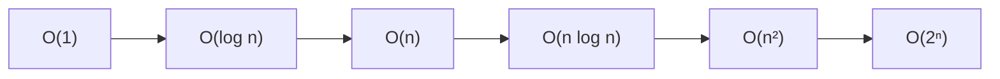
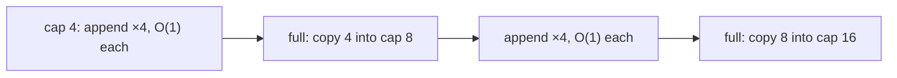

"Is this code fast?" is the wrong question. The right one is "how does its cost *grow* as the
input grows?". A function that takes 2 ms on your test data might take 2 seconds or 2 hours in
production, and the difference comes from its growth rate, not from your CPU. **Big-O notation** is
the shared language for that growth, and it comes up in every technical interview and every
serious code review.

## Why measure growth instead of seconds

Imagine two delivery companies. One charges a flat €20 per parcel. The other charges €1 per parcel
plus €1 for every parcel you've already sent today. For three parcels the second is cheaper. For
a thousand it's ruinous. What matters for big orders isn't the price of one parcel, it's how the
total *scales*.

Timing code in seconds has the same problem. The result depends on:

- the machine, the language, the interpreter version and what else is running;
- the specific input you happened to test with;
- caches, JIT warm-up and garbage collection.

Instead, we count the number of **basic steps** (comparisons, assignments, arithmetic operations)
as a function of the input size *n*, and we care about what dominates when *n* is large. That
makes analysis independent of hardware and lets you compare *algorithms* rather than
implementations.

```python
def has_duplicate_slow(xs):          # compares every pair
    for i in range(len(xs)):
        for j in range(i + 1, len(xs)):
            if xs[i] == xs[j]:
                return True
    return False

def has_duplicate_fast(xs):          # remembers what it has seen
    seen = set()
    for x in xs:
        if x in seen:
            return True
        seen.add(x)
    return False
```

For 10 items, both are instant. For 1,000,000 items the first does about 5 × 10¹¹ comparisons in
the worst case; the second does about 10⁶ set operations. No hardware upgrade closes that gap.

> [!NOTE]
> Growth analysis doesn't replace measurement: it tells you *which* algorithm to pick and what to
> expect at scale. Profiling tells you where the actual time goes in a real program. Senior
> engineers use both.

## Big-O, Big-Θ and Big-Ω

These three notations describe bounds on a function's growth, ignoring constant factors and
lower-order terms.

- **Big-O, f(n) = O(g(n)):** an *upper bound*. Beyond some point, f grows no faster than a constant
  times g. Formally, there exist c > 0 and n₀ such that f(n) ≤ c·g(n) for all n ≥ n₀.
- **Big-Ω, f(n) = Ω(g(n)):** a *lower bound*. f grows at least as fast as a constant times g.
- **Big-Θ, f(n) = Θ(g(n)):** a *tight bound*. Both O and Ω hold, so f grows exactly like g, up to
  constants.

The analogy: "this trip takes **at most** two hours" (O), "**at least** one hour" (Ω), "**about**
ninety minutes" (Θ).

> [!EXAMPLE]
> f(n) = 3n² + 10n + 7. For large n, 3n² dominates, and constants don't matter, so f(n) = Θ(n²).
> It's also technically O(n³) (a looser upper bound is still an upper bound), but saying so is
> unhelpful.

In everyday engineering, people write "O" when they mean "Θ", meaning "this is how it grows". That's
fine in conversation; just know the difference when reading textbooks such as
[Jeff Erickson's Algorithms](https://jeffe.cs.illinois.edu/teaching/algorithms/).

Separately from the notation, you can analyse different **cases**:

- **Worst case:** the input that makes the algorithm slowest. The usual default, since it's a
  guarantee.
- **Best case:** rarely useful (any search is fast if the item is first).
- **Average case:** expected cost over some distribution of inputs.

> [!WARNING]
> "Worst case" and "Big-O" are different axes. Quicksort's worst case is Θ(n²) and its average case
> is Θ(n log n). Both are statements you can make with any of O, Ω or Θ.

Rules of thumb for reading code:

- Sequential steps **add**: O(n) then O(n²) is O(n²) (keep the biggest term).
- Nested loops **multiply**: a loop of n inside a loop of n is O(n²).
- A loop that halves the problem each time is O(log n).
- A **hidden loop** still counts: `x in some_list`, `list.index`, `sorted()` and string
  concatenation in a loop all do work proportional to their input.

## Common classes: O(1), O(log n), O(n), O(n log n), O(n²), O(2ⁿ)

| Class | Name | Typical example | n = 1,000,000 |
|---|---|---|---|
| O(1) | constant | list index, dict lookup (average) | 1 step |
| O(log n) | logarithmic | binary search | ~20 steps |
| O(n) | linear | scanning a list, summing | 10⁶ steps |
| O(n log n) | linearithmic | good sorting (merge sort, Timsort) | ~2 × 10⁷ steps |
| O(n²) | quadratic | comparing all pairs | 10¹² steps |
| O(2ⁿ) | exponential | trying every subset | hopeless beyond n ≈ 40 |



A useful mental model: O(log n) is "phone book lookup", O(n) is "read every page", O(n log n) is
"sort the phone book", O(n²) is "compare every name with every other name", and O(2ⁿ) is "try
every possible guest list".

The [Big-O Cheat Sheet](https://www.bigocheatsheet.com/) collects the complexity of common data
structure operations and sorting algorithms on one page; keep it bookmarked while you work through
Module 1.3.

> [!TIP]
> When a job has to process millions of records, anything worse than O(n log n) per batch should
> make you pause. When n is tiny (say, under 50), the simplest code usually wins regardless of class.

## Space complexity and trade-offs

**Space complexity** measures the extra memory an algorithm needs as n grows, using the same
notation. Usually we count **auxiliary space**: memory beyond the input itself.

- Summing a list: O(1) extra space (one accumulator).
- `has_duplicate_fast` above: O(n) extra space for the set.
- Building a new sorted copy with `sorted(xs)`: O(n). Sorting in place with `xs.sort()`: the list
  itself isn't copied, though Timsort may use up to O(n) temporary memory.
- A recursive function uses stack space proportional to its maximum depth.

The duplicate example shows the most common trade-off in practice: **spend memory to save time**.
The set costs O(n) memory and buys you O(n) time instead of O(n²). Caches, indexes, memoisation and
lookup tables are all variations of this trade.

> [!EXAMPLE]
> A database index on `email` is extra storage (space) that turns `WHERE email = ?` from a full
> table scan, O(n), into a tree lookup, O(log n). The price is also paid on writes, which must
> update the index too.

## Amortised analysis (dynamic arrays)

Sometimes an operation is usually cheap but occasionally expensive. **Amortised analysis** averages
the cost over a long *sequence* of operations, giving a guarantee about the total rather than about
each single call.

Python's `list.append` is the classic example. A list stores items in a fixed-size block of memory
with some spare room. Appending into spare room is O(1). When it's full, Python allocates a bigger
block and copies every item across: O(n) for that one append.

Why is append still called O(1)? Because the block grows by a **multiplicative factor**, not by a
fixed amount. Think of a savings jar: each cheap append drops a coin in, and when a resize comes the
jar already holds enough to pay for the copy.

With doubling, filling a list to n items costs at most n (the appends) plus 1 + 2 + 4 + … + n
(the copies), and that geometric sum is less than 2n. So n appends cost O(n) in total, or **O(1)
amortised** per append.



> [!WARNING]
> Amortised O(1) is not the same as "always O(1)". A single append can still pause for O(n). In
> latency-sensitive code (a game loop, a real-time audio buffer) preallocate instead. Also note
> that growing by a *constant* (say, 10 slots at a time) gives O(n²) total, which is why real
> implementations grow by a factor.

## Practice: annotate the complexity of ten code snippets

Budget about 45 minutes. For each snippet, write the time and extra-space complexity in Big-O, and
one sentence justifying it. Then check your answers with a timing experiment.

### Step 1: Annotate

```python
# 1
def first(xs): return xs[0]
# 2
def total(xs): return sum(xs)
# 3
def contains(xs, t): return t in xs           # xs is a list
# 4
def contains_set(s, t): return t in s          # s is a set
# 5
def pairs(xs): return [(a, b) for a in xs for b in xs]
# 6
def halve(n):
    steps = 0
    while n > 1:
        n //= 2; steps += 1
    return steps
# 7
def sort_then_last(xs): return sorted(xs)[-1]
# 8
def join_slow(words):
    s = ""
    for w in words:
        s = s + w
    return s
# 9
def subsets(xs):
    if not xs: return [[]]
    rest = subsets(xs[1:])
    return rest + [[xs[0]] + r for r in rest]
# 10
def dedupe(xs): return list(dict.fromkeys(xs))
```

> [!TIP]
> Watch for hidden loops in #3, #7 and #8, and for slicing (`xs[1:]` copies) in #9. For #8,
> CPython sometimes optimises string `+=` in place, but you shouldn't rely on it; `"".join(words)`
> is the reliably linear version.

### Step 2: Measure two of them

Pick #3 and #4 and time them for n = 10⁴, 10⁵ and 10⁶ with `timeit`. Searching for a value that
isn't there gives the worst case. Linear code should take about 10× longer each time n grows 10×;
constant-time code should barely change.

```python
import timeit
for n in (10_000, 100_000, 1_000_000):
    xs = list(range(n)); s = set(xs)
    print(n, timeit.timeit(lambda: -1 in xs, number=100), timeit.timeit(lambda: -1 in s, number=100))
```

### Step 3: Improve one

Rewrite one snippet to a better complexity class and annotate the trade-off you made.

```quiz
{"questions": [
  {"question": "A function runs in 3n² + 200n + 50 steps. What is its tight bound?", "options": ["Θ(n)", "Θ(n²)", "Θ(n³)", "Θ(200n)"], "answer": 1, "explanation": "The n² term dominates for large n, and constant factors are dropped."},
  {"question": "Inside a loop over n items you call `x in other_list`, where other_list also has n items. What is the overall time complexity?", "options": ["O(n²), because `in` on a list is itself a linear scan", "O(n), because `in` is a single operation", "O(log n)", "O(1)"], "answer": 0, "explanation": "Membership on a list scans it. A hidden O(n) inside an O(n) loop multiplies to O(n²). Use a set for O(1) average lookups."},
  {"question": "Why is `list.append` described as O(1) amortised rather than O(1)?", "options": ["Because it uses a hash table", "Because Python caches appends", "Because occasional resizes cost O(n), but their total cost spread over all appends is constant per append", "Because append is O(log n) in practice"], "answer": 2, "explanation": "Geometric growth makes the total copy cost proportional to n, so the average per append is constant even though one append can be slow."},
  {"question": "You replace a nested-loop duplicate check with a set-based one. What did you trade?", "options": ["Nothing; it's strictly better in every way", "Correctness for speed", "Readability for memory", "O(n) extra memory for O(n) instead of O(n²) time"], "answer": 3, "explanation": "The set stores seen items (more space) to avoid comparing every pair (less time). It's the most common time–space trade-off."},
  {"question": "Quicksort is 'O(n²) in the worst case and O(n log n) on average'. What does that sentence combine?", "options": ["Two different cases (worst and average), each with its own growth bound", "Big-O and Big-Ω for the same case", "Time and space complexity", "Two different algorithms"], "answer": 0, "explanation": "Case analysis (which input) and asymptotic notation (how it grows) are independent dimensions."}
]}
```
