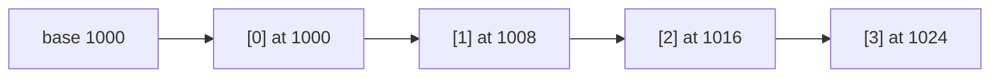
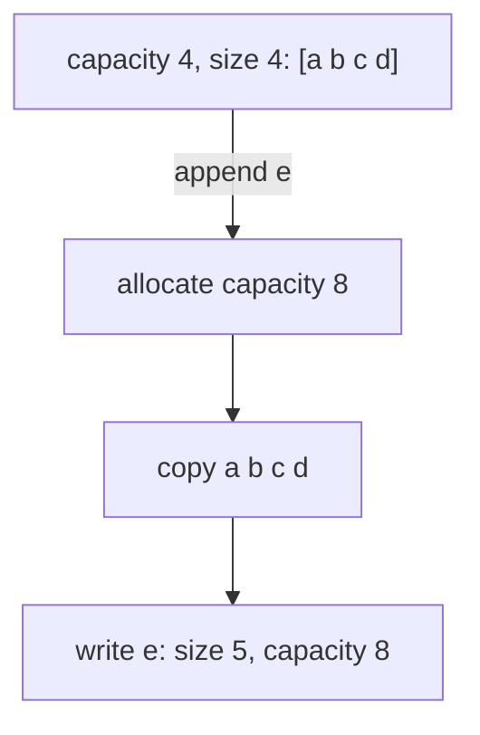

The array is the oldest and humblest data structure, and still the fastest for a huge range of
jobs. Python's `list`, JavaScript's arrays, Go's slices, Java's `ArrayList` and the rows of a NumPy
matrix are all arrays underneath. Understanding how they sit in memory explains why some
operations are instant and others quietly cost you O(n), and it's the foundation for every other
structure in this module.

## Contiguous memory and indexing in O(1)

Picture a street of identical houses with consecutive numbers. If you know where house 0 is and
every house is the same width, you can walk straight to house 437 without visiting the others:
address = start + 437 × width.

An **array** works exactly like that. It's a single **contiguous** block of memory holding elements
of the same size, one after the other. To read element *i* the computer computes

address(i) = base address + i × element size

which is one multiplication and one addition, no matter how big the array is. That's why **random
access** by index is **O(1)**.



Contiguity has a second, less obvious benefit: **cache locality**. CPUs don't fetch single bytes
from RAM; they fetch whole cache lines (commonly 64 bytes) and prefetch the next ones when you read
sequentially. Walking through an array therefore runs much faster in practice than following
pointers scattered around memory, even when both are O(n) on paper.

The price of contiguity shows up when the *middle* of the array changes:

| Operation | Cost | Why |
|---|---|---|
| Read/write `a[i]` | O(1) | address arithmetic |
| Append at the end (spare room) | O(1) | write into the next slot |
| Insert or delete at position i | O(n − i) | every later element shifts by one |
| Insert or delete at the front | O(n) | everything shifts |
| Search for a value (unsorted) | O(n) | must check each slot |

> [!NOTE]
> "Index" and "offset" are the same thing here, which is the most convincing explanation for why
> most languages count from 0: element 0 is at offset 0 from the base address.

## Static vs dynamic arrays and resizing

A **static array** has a fixed capacity chosen when it's created. C arrays and Java's `int[]` work
this way: ask for ten slots, get exactly ten. It's simple and fast, but you need to know the size
up front.

A **dynamic array** hides that limitation. It keeps two numbers:

- **size** (or length): how many elements are actually stored;
- **capacity**: how many fit in the current memory block.

While size < capacity, appending just writes into the next free slot. When it's full, the dynamic
array allocates a **larger block**, copies every element across, frees the old block and carries on.



As you saw in Session 1.2.1, the growth must be **multiplicative** (×2, ×1.5, …) so that the total
copying over n appends stays O(n), giving **amortised O(1)** appends. Growing by a fixed number of
slots would make n appends cost O(n²).

Shrinking works similarly in reverse. Many implementations halve the capacity when the array is
only a quarter full. They wait until a quarter rather than half, so that alternating append/pop at
the boundary doesn't trigger a resize every time (a problem called **thrashing**).

> [!TIP]
> If you know roughly how many items you'll store, preallocating avoids repeated copies. In Python
> a list comprehension or `[None] * n` sizes the list once; in Java, `new ArrayList<>(n)` does the
> same.

The [Open Data Structures](https://opendatastructures.org/) book has a clear chapter on
array-backed lists, including the amortised analysis of resizing, and
[VisuAlgo](https://visualgo.net/en) animates array and list operations step by step.

## Python lists under the hood

In CPython, a `list` is a dynamic array, but with one twist: the array doesn't hold your objects
directly. It holds **pointers** (references) to objects that live elsewhere on the heap. Every slot
is the same size (one pointer), so indexing is still O(1), and a single list can mix ints, strings
and dicts.

```python
import sys

xs = []
last = sys.getsizeof(xs)
for i in range(20):
    xs.append(i)
    size = sys.getsizeof(xs)
    if size != last:
        print(f"len={len(xs):2}  bytes={size}")
        last = size
```

Running this shows the list's memory jumping in steps rather than growing on every append: those
jumps are the reallocations. CPython over-allocates by a modest factor (roughly an eighth extra plus
a small constant) rather than doubling, trading slightly more frequent copies for less wasted
memory. It's still geometric growth, so the amortised cost stays O(1).

Consequences worth knowing:

- `xs.append(x)` and `xs.pop()` are amortised O(1). `xs.insert(0, x)` and `xs.pop(0)` are O(n).
  If you need fast operations at both ends, use `collections.deque` (next session).
- `x in xs`, `xs.index(x)` and `xs.remove(x)` are O(n) scans.
- `xs[a:b]` creates a **new list** and copies b − a pointers: O(b − a).
- Because the list stores references, `[[]] * 3` creates three references to the *same* inner list.

> [!WARNING]
> ```python
> grid = [[0] * 3] * 3
> grid[0][0] = 1
> print(grid)   # [[1, 0, 0], [1, 0, 0], [1, 0, 0]]
> ```
> All three rows are the same object. Use `[[0] * 3 for _ in range(3)]` to create separate rows.

For large numeric data, the pointer-per-element design costs memory and speed. The `array` module
and NumPy store raw numbers contiguously instead, which is a big part of why NumPy is fast.

## Strings as arrays

A string is, conceptually, an array of characters, so `s[i]` is O(1) and `len(s)` is O(1). Two
details matter in practice.

**Strings are immutable in Python** (and in Java, JavaScript and Go). You can't change a character
in place; every "modification" builds a new string. That's why building a string with `+=` in a
loop can be O(n²): each step may copy everything built so far. The idiomatic fix is to collect
pieces in a list and join once:

```python
parts = []
for row in rows:
    parts.append(f"{row.id},{row.name}\n")
csv = "".join(parts)   # one pass, O(total length)
```

**Characters aren't all the same size in every encoding.** In UTF-8, an ASCII letter takes one byte
but an emoji takes four. Python 3 sidesteps this for indexing by storing each string with a fixed
width per character (1, 2 or 4 bytes, chosen by the widest character it contains), so indexing
stays O(1). Encoded `bytes` are a different story: `"é".encode()` has length 2.

> [!EXAMPLE]
> Reversing a string, checking a palindrome or counting characters are all array algorithms. A
> palindrome check with two indexes moving inwards (`s[i] == s[len(s) - 1 - i]`) uses O(1) extra
> space, whereas `s == s[::-1]` builds a reversed copy, O(n) space. Both are O(n) time.

## Practice: implement a dynamic array class with tests

Budget about 60 minutes. You'll build a minimal dynamic array on top of a fixed-size storage block,
so you can see resizing happen.

### Step 1: The class skeleton

Use a Python list only as a fixed-size block (never call `append` on it):

```python
class DynamicArray:
    def __init__(self):
        self._size = 0
        self._capacity = 1
        self._data = [None] * self._capacity
        self.copies = 0          # count element copies, for the experiment

    def __len__(self):
        return self._size

    def __getitem__(self, i):
        if not 0 <= i < self._size:
            raise IndexError(i)
        return self._data[i]

    def _resize(self, new_capacity):
        new = [None] * new_capacity
        for i in range(self._size):
            new[i] = self._data[i]
            self.copies += 1
        self._data, self._capacity = new, new_capacity

    def append(self, x):
        if self._size == self._capacity:
            self._resize(2 * self._capacity)
        self._data[self._size] = x
        self._size += 1
```

### Step 2: Add the remaining operations

Implement `pop()` (remove and return the last item; shrink to half when size falls to a quarter of
capacity), `insert(i, x)` (shift elements right) and `__setitem__`. Raise `IndexError` for invalid
positions.

### Step 3: Write tests

```python
import pytest

def test_append_and_index():
    a = DynamicArray()
    for i in range(100):
        a.append(i)
    assert len(a) == 100 and a[0] == 0 and a[99] == 99

def test_out_of_range():
    with pytest.raises(IndexError):
        DynamicArray()[0]

def test_amortised_copies():
    a = DynamicArray()
    n = 10_000
    for i in range(n):
        a.append(i)
    assert a.copies < 2 * n     # geometric growth keeps total copying linear
```

Add tests for `pop`, `insert` at the front, middle and end, and for shrinking.

### Step 4: Experiment

Change the growth rule to `self._capacity + 10` and rerun `test_amortised_copies`. Record how many
copies happen for n = 1,000 and n = 10,000 under each rule, and explain the difference in two
sentences.

```quiz
{"questions": [
  {"question": "Why is reading `a[i]` from an array O(1) regardless of the array's length?", "options": ["The array keeps a hash of every index", "Elements are contiguous and equally sized, so the address is base + i × size", "The CPU scans the array very quickly", "Arrays are always small"], "answer": 1, "explanation": "Indexing is a single arithmetic computation, not a search."},
  {"question": "You call `queue.pop(0)` on a Python list with a million items inside a loop. What is the problem?", "options": ["Each pop(0) shifts every remaining element, so it's O(n) per call", "pop(0) raises an error on large lists", "It leaks memory", "Nothing; pop is always O(1)"], "answer": 0, "explanation": "Removing from the front of an array moves everything left. Use collections.deque for O(1) pops at both ends."},
  {"question": "Why do dynamic arrays grow by a multiplicative factor instead of a fixed number of slots?", "options": ["To use less memory", "Because the OS requires it", "So that total copying over n appends is O(n), keeping appends amortised O(1)", "So that indexing stays O(1)"], "answer": 2, "explanation": "With fixed-size growth, the copies sum to O(n²) over n appends."},
  {"question": "What does `grid = [[0] * 3] * 3` create?", "options": ["A 3×3 grid of independent rows", "A 9-element flat list", "An error", "Three references to the same inner list"], "answer": 3, "explanation": "Multiplying a list copies its references, not the objects they point to."},
  {"question": "Why is building a long string with `s += piece` in a loop risky, and what's the idiomatic alternative?", "options": ["Strings are immutable, so each step may copy everything so far; collect pieces in a list and use ''.join", "`+=` is not allowed on strings", "It changes the string's encoding; use bytes", "It's fine; strings are linked lists"], "answer": 0, "explanation": "Repeated copying can make it O(n²); join builds the result in one pass."}
]}
```
