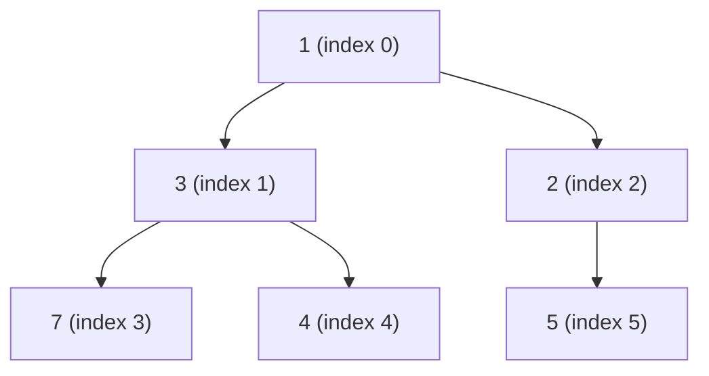
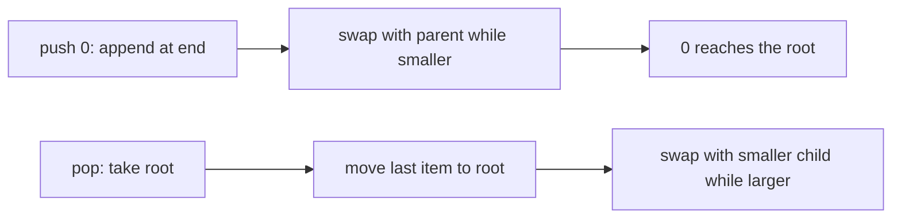
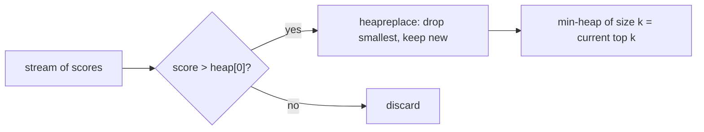

Some problems don't need everything sorted; they only need the *most important thing next*. An
emergency room treats the most urgent patient, not the one who arrived first. A scheduler runs the
job whose deadline is closest. A leaderboard shows the top ten, not all million players in order.
The **priority queue** is the abstraction for this, and the **binary heap** is the clever, compact
structure that implements it.

## Binary heap property and array representation

A **priority queue** supports two main operations: insert an item with a priority, and remove the
item with the highest priority (or lowest, depending on convention). Sorting everything after each
insert would work but wastes effort; we only ever need the top.

A **binary heap** is a binary tree with two rules:

1. **Shape:** it's a **complete** binary tree. Every level is full except possibly the last, which
   fills from left to right. No gaps.
2. **Heap property:** in a **min-heap**, every node's key is less than or equal to its children's
   keys. (In a **max-heap**, greater than or equal.)

The heap property only relates parents to children. It says nothing about left vs right siblings,
so a heap is much "looser" than a sorted list or a BST, and that looseness is what makes it cheap
to maintain. The one thing it guarantees is that the **minimum is always at the root**.

Think of a company where every manager is more senior than their direct reports. You know the CEO
is the most senior person, but two people on different teams can be in any order.



Because the tree is complete, it can be stored in a plain **array** with no pointers at all:
reading the tree level by level, left to right, gives `[1, 3, 2, 7, 4, 5]`. For the node at index
i (0-based):

- its **left child** is at 2i + 1;
- its **right child** is at 2i + 2;
- its **parent** is at (i − 1) // 2.

> [!NOTE]
> This array layout is why heaps are so practical: no node objects, no pointers, excellent cache
> locality, and the tree's height is always ⌊log₂ n⌋ because completeness forbids lopsided shapes.

## Push, pop and heapify

Both core operations follow the same pattern: make a change that keeps the *shape* valid, then
repair the *heap property* along a single root-to-leaf path.

**Push (insert).** Append the new item at the end of the array (the next free spot in the bottom
level). It may be smaller than its parent, so **sift up**: swap it with its parent while it's
smaller. At most one swap per level: **O(log n)**.

**Pop (remove the minimum).** The minimum is at index 0. Move the *last* element into the root
(keeping the shape complete), then **sift down**: swap it with its smaller child while it's larger
than that child. Again at most one swap per level: **O(log n)**.



> [!EXAMPLE]
> Pop from `[1, 3, 2, 7, 4, 5]`: take 1, move 5 to the root giving `[5, 3, 2, 7, 4]`. Its children
> are 3 and 2; the smaller is 2, so swap: `[2, 3, 5, 7, 4]`. 5 now sits at index 2 with no children,
> so we stop. The new minimum, 2, is at the root.

**Peek** at the minimum is just `heap[0]`: **O(1)**.

**Heapify** turns an arbitrary array into a heap. Pushing items one by one costs O(n log n), but
there's a faster way: sift down every non-leaf node, starting from the last one and moving towards
the root. The surprising result is that this is **O(n)**. Intuitively, half the nodes are leaves and
need no work, a quarter can sift down at most one level, an eighth at most two, and so on; that sum
stays proportional to n.

| Operation | Cost |
|---|---|
| peek min | O(1) |
| push | O(log n) |
| pop min | O(log n) |
| heapify n items | O(n) |
| search for an arbitrary item | O(n) |

> [!WARNING]
> A heap is not a sorted list. Iterating over the array does *not* give items in priority order,
> and finding an arbitrary item is O(n). If you need both fast min and fast lookup by key, combine a
> heap with a dict, or use a balanced tree.

The [Open Data Structures](https://opendatastructures.org/) book has a short, clear chapter on
binary heaps if you want the full proof of the O(n) heapify bound.

## Python heapq

Python's [heapq module](https://docs.python.org/3/library/heapq.html) implements a binary
**min-heap** on top of an ordinary list. There's no heap class; you call functions on a list you
own:

```python
import heapq

tasks = []
heapq.heappush(tasks, (2, "write tests"))
heapq.heappush(tasks, (1, "fix prod bug"))
heapq.heappush(tasks, (3, "refactor"))
heapq.heappop(tasks)     # (1, 'fix prod bug')
tasks[0]                 # peek: (2, 'write tests')

data = [9, 4, 7, 1]
heapq.heapify(data)      # in place, linear time
```

The functions you'll use most:

- `heappush`, `heappop`, `heapify`;
- `heappushpop(heap, x)`: push then pop, faster than calling both;
- `heapreplace(heap, x)`: pop then push;
- `nlargest(k, iterable, key=...)` and `nsmallest(k, iterable, key=...)`;
- `merge(*sorted_iterables)`: lazily merge already-sorted inputs.

> [!TIP]
> **Tuples as priorities.** Python compares tuples element by element, so `(priority, item)` works
> naturally. If two priorities tie, Python compares the items next, which fails for objects that
> can't be compared (like dicts). Add a counter as a tie-breaker: `(priority, next(counter), item)`.
> It also keeps equal-priority items in insertion order.

**Max-heaps.** Historically, the trick was to negate numeric priorities: push `-score` and negate
again when you pop. Python 3.14 added max-heap counterparts such as `heapq.heappush_max` and
`heapq.heappop_max`; on older versions, negation is still the way.

## Use cases: schedulers, top-k, median streams

**Schedulers and timers.** Store jobs keyed by their next run time; the earliest is always at the
root. Event loops and job schedulers use exactly this pattern to know how long to sleep until the
next timer fires.

**Top-k.** To find the k largest of n items, keep a **min-heap of size k**. For each new item, if
it's bigger than the heap's smallest (`heap[0]`), replace it. The heap always holds the k largest
seen so far, and its root is the cut-off. Cost: O(n log k) time and O(k) memory, which beats
sorting everything (O(n log n), O(n) memory) when k is small, and works on a stream you can't hold
in memory.



**Running median.** Keep two heaps: a max-heap for the lower half of the numbers and a min-heap for
the upper half, balanced so their sizes differ by at most one. The median is at one or both roots.
Each new number costs O(log n), so you can report the median of a live stream of latencies at any
moment.

**Graph algorithms.** Dijkstra's shortest paths and Prim's minimum spanning tree (Session 1.4.5)
both repeatedly ask "which unexplored vertex is closest?", which is a priority-queue question.

**Merging sorted streams.** `heapq.merge` combines k sorted log files into one sorted stream,
keeping only one item per file in a heap of size k.

## Practice: top-k frequent words with a heap

Budget about 45 minutes. Goal: given a text, return the k most frequent words, ties broken
alphabetically.

### Step 1: Count

```python
import re
from collections import Counter

def words(text):
    return re.findall(r"[a-z']+", text.lower())

counts = Counter(words(open("book.txt").read()))
```

Any long public-domain text works as `book.txt`.

### Step 2: Keep a heap of size k

```python
import heapq

def top_k(counts, k):
    heap = []   # min-heap of (count, reversed-priority word)
    for word, c in counts.items():
        item = (c, Neg(word))
        if len(heap) < k:
            heapq.heappush(heap, item)
        elif item > heap[0]:
            heapq.heapreplace(heap, item)
    return [n.w for _, n in sorted(heap, reverse=True)]
```

You need a tiny `Neg` wrapper so that, among equal counts, the alphabetically *first* word counts
as "larger" and survives. Write it as a class with `__init__` storing `w`, plus `__lt__` and `__eq__`
that compare `w` in reverse.

### Step 3: Test against a simple reference

```python
def reference(counts, k):
    return [w for w, _ in sorted(counts.items(), key=lambda p: (-p[1], p[0]))[:k]]

def test_top_k_matches_reference():
    c = Counter("b a c a b a d d d d".split())
    assert top_k(c, 2) == reference(c, 2) == ["d", "a"]
```

Add a test with ties and one with k larger than the number of distinct words.

### Step 4: Compare

Time `top_k` vs `reference` vs `Counter.most_common(k)` on your book for k = 10. Then read the
complexity of each aloud: O(n log k), O(n log n), and whatever `most_common` uses for small k
(hint: look at its source; it calls `heapq.nlargest`).

```quiz
{"questions": [
  {"question": "In a binary min-heap stored in an array, where are the children of the node at index 4?", "options": ["Indexes 5 and 6", "Indexes 8 and 9", "Indexes 9 and 10", "Indexes 2 and 3"], "answer": 2, "explanation": "Children are at 2i + 1 and 2i + 2, so 9 and 10."},
  {"question": "Why is popping the minimum from a heap O(log n) rather than O(n)?", "options": ["After moving the last item to the root, it only sifts down one path whose length is the tree's height", "Because the heap is fully sorted", "Because Python caches the second smallest item", "Because heaps use hashing"], "answer": 0, "explanation": "A complete binary tree has height about log₂ n, and sift-down does at most one swap per level."},
  {"question": "You need the 10 highest scores from a stream of 100 million. What's the best approach?", "options": ["Sort all scores and take the last 10", "Use a max-heap of all 100 million scores", "A binary search tree of all scores", "Keep a min-heap of size 10 and replace its root when a bigger score arrives"], "answer": 3, "explanation": "O(n log k) time and O(k) memory; the root is the smallest of the current top 10."},
  {"question": "You push `(priority, task_dict)` tuples into heapq and get a TypeError when two priorities are equal. Why?", "options": ["heapq doesn't support tuples", "On a tie Python compares the next tuple element, and dicts can't be ordered", "Priorities must be strings", "The heap is full"], "answer": 1, "explanation": "Add a tie-breaking counter: (priority, count, task)."},
  {"question": "Which statement about binary heaps is true?", "options": ["Iterating over the heap's list gives items in sorted order", "Searching for an arbitrary value takes O(log n)", "Building a heap from n items with heapify takes O(n)", "The largest item in a min-heap is always the last element"], "answer": 2, "explanation": "Bottom-up heapify is linear. A heap is only partially ordered, so iteration order and arbitrary search are not efficient."}
]}
```
