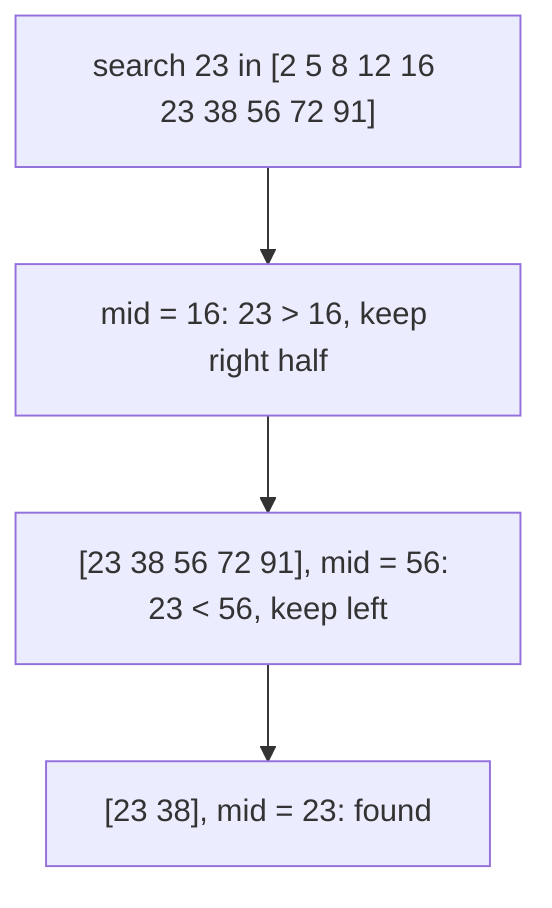

Binary search is famous for being easy to explain and hard to get right. The idea fits in a
sentence; the bugs hide in a `<` that should be `<=` or a `mid + 1` that should be `mid`. This
session teaches you a reliable way to write it (by thinking in **invariants**) and then shows the
technique's real superpower: searching not just a sorted list, but the space of possible *answers*
to a problem.

## Linear vs binary search

**Linear search** checks items one by one until it finds the target or runs out. It works on any
list, sorted or not, and costs O(n). For small lists, or a single lookup in unsorted data, it's the
right tool; Python's `in`, `list.index` and `next(x for x in xs if …)` are all linear searches.

**Binary search** needs the data to be **sorted**, and in exchange costs O(log n). It's how you find
a word in a paper dictionary: open in the middle, see whether your word comes before or after, and
throw away the half that can't contain it. Each step halves the remaining range, so a million items
need about 20 steps and a billion about 30.



| | Linear search | Binary search |
|---|---|---|
| Requires sorted data | No | Yes |
| Time | O(n) | O(log n) |
| Works on linked lists | Yes | Not efficiently (no O(1) indexing) |
| Best when | data is small, unsorted, or searched once | data is sorted and searched many times |

> [!TIP]
> Sorting costs O(n log n). If you'll search an unsorted list only once, sorting first is slower
> than a linear scan. If you'll search it many times, sort once and binary search, or build a set
> for exact-match lookups.

Python's standard library has binary search built in: the `bisect` module. `bisect_left(xs, x)`
returns the first index where x could be inserted while keeping `xs` sorted, and `bisect_right`
the last. Both are O(log n), and both accept a `key=` argument since Python 3.10.

## Binary search invariants and off-by-one errors

Most binary-search bugs come from writing the loop by feel. The cure is to decide on an
**invariant**, a statement that's true before and after every iteration, and let it dictate every
detail.

A robust template is the **half-open interval** `[lo, hi)`: the answer, if it exists, is at an
index i with lo ≤ i < hi.

```python
def binary_search(xs, target):
    lo, hi = 0, len(xs)                 # invariant: target, if present, is in xs[lo:hi]
    while lo < hi:                      # the interval is non-empty
        mid = (lo + hi) // 2
        if xs[mid] < target:
            lo = mid + 1                # xs[mid] is too small, so exclude it
        elif xs[mid] > target:
            hi = mid                    # hi is exclusive, so this excludes mid
        else:
            return mid
    return -1                           # interval is empty: not present
```

Every line follows from the invariant. `hi = len(xs)`, not `len(xs) - 1`, because hi is exclusive.
The loop runs `while lo < hi` because an interval [lo, hi) is empty when lo == hi. When `xs[mid]` is
too small, the answer is strictly to its right, so `lo = mid + 1`; when it's too big, `hi = mid`
already excludes mid.

> [!WARNING]
> The two classic bugs are **infinite loops** and **skipping the answer**. An infinite loop happens
> when an update doesn't shrink the interval, for example `lo = mid` when `mid == lo`. Skipping
> happens when you exclude an index that might be the answer. If each branch strictly shrinks
> [lo, hi) and only discards indexes proven wrong, neither can happen.

A more powerful variant finds a **boundary** instead of an exact match. Suppose a predicate `ok(i)`
is False for small i and True from some point on: `F F F F T T T`. "Find the first True" is a
binary search too, and it covers "first index with value ≥ x" (that's `bisect_left`), "first bad
commit" and much more:

```python
def first_true(lo, hi, ok):
    """Smallest i in [lo, hi) with ok(i) True, or hi if none. ok must be monotonic."""
    while lo < hi:
        mid = (lo + hi) // 2
        if ok(mid):
            hi = mid          # mid might be the answer; keep it
        else:
            lo = mid + 1      # mid is not; discard it
    return lo
```

> [!NOTE]
> In languages with fixed-size integers, `(lo + hi) / 2` can overflow when both are large; the
> safe form is `lo + (hi - lo) / 2`. Python's integers don't overflow, but you'll see the safe form
> in Java, C++ and Go code, and interviewers like to ask about it.

`git bisect` is this exact algorithm applied to history: commits are ordered, "is this commit bad?"
flips from False to True once, and Git finds the first bad commit in about log₂(number of commits)
tests.

## Binary search on the answer space

Here's the leap. Binary search doesn't need an array. It needs an **ordered range of candidates**
and a **monotonic yes/no question**: once the answer is "yes" for some value, it stays "yes" for
every larger value (or the reverse).

Many optimisation problems have that shape. Instead of computing the best value directly, you ask
"is value v good enough?" and binary search on v.

> [!EXAMPLE]
> **Shipping capacity.** Packages with weights `[3, 2, 2, 4, 1, 4]` must ship in order within 3
> days. What's the smallest truck capacity that works?
>
> - The answer lies between max(weights) = 4 (you must fit the heaviest package) and sum(weights)
>   = 16 (everything in one day).
> - `can_ship(cap)`: greedily fill each day up to cap, count the days, check ≤ 3. That's O(n).
> - It's monotonic: if capacity 6 works, 7 works too.
> - So `first_true(4, 17, can_ship)` finds the minimum, 6, in about log₂ 13 ≈ 4 checks.


The pattern shows up everywhere once you know it:

- **Minimum resources:** smallest number of servers that keeps latency under a target, given a
  simulation you can run.
- **Square roots and other inverses:** the largest integer r with r² ≤ n.
- **Rate limits and timeouts:** the largest batch size that doesn't hit a memory limit, found by
  trial with a monotonic pass/fail.
- **Interview classics:** "Koko eating bananas", "split array largest sum", "minimum days to make
  bouquets", which you'll find in the binary search section of the
  [NeetCode Roadmap](https://neetcode.io/roadmap).

> [!TIP]
> The recipe: (1) find a lower and an upper bound for the answer; (2) write a feasibility check
> `ok(v)`; (3) convince yourself it's monotonic; (4) call `first_true`. Total cost is
> O(cost of ok × log(range)).

For a rigorous treatment of binary search and its correctness proof, see the lecture notes of
[MIT 6.006](https://ocw.mit.edu/courses/6-006-introduction-to-algorithms-spring-2020/).

## Practice: five binary search problems

Budget about 75 minutes. Solve each with the `[lo, hi)` template or `first_true`. Before coding,
write the invariant (or the predicate and why it's monotonic) as a comment.

### Problem 1: Classic search

Implement `binary_search(xs, target)` from memory and test it on: an empty list, one element
(present and absent), the target at the first and last index, and a target smaller or larger than
everything.

### Problem 2: First and last position

Given a sorted list with duplicates, return the first and last index of the target, or (−1, −1).
Use two boundary searches. Compare your results with `bisect_left` and `bisect_right`.

### Problem 3: Integer square root

Return the largest integer r with r·r ≤ n, for n up to 10¹⁸, without `math.isqrt` or floats.
Check against `math.isqrt` for a thousand random values.

### Problem 4: Search a rotated sorted array

`[15, 18, 2, 3, 6, 12]` is a sorted list rotated at some point. Find a target in O(log n). Hint: at
every step, one half of `[lo, hi)` is sorted; decide whether the target lies in it.

### Problem 5: Shipping capacity

Implement the shipping example above as `min_capacity(weights, days)`. Test it with the example,
with `days = len(weights)` (answer: max weight) and with `days = 1` (answer: sum).

```python
import math, random

def test_isqrt():
    for _ in range(1000):
        n = random.randrange(10**18)
        assert my_isqrt(n) == math.isqrt(n)

def test_min_capacity():
    assert min_capacity([3, 2, 2, 4, 1, 4], 3) == 6
```

### Reflect

For each problem, note which bug you hit (if any): infinite loop, off-by-one, or a non-monotonic
predicate. Those notes are your personal checklist for the next binary search.

```quiz
{"questions": [
  {"question": "With the half-open invariant `[lo, hi)`, why is the update `hi = mid` (not `hi = mid - 1`) when `xs[mid] > target`?", "options": ["Because hi is exclusive, so setting it to mid already excludes mid", "Because mid might be the answer", "To avoid integer overflow", "It's arbitrary; both are equivalent"], "answer": 0, "explanation": "The interval excludes hi. Using mid − 1 would also wrongly exclude the index mid − 1."},
  {"question": "What does binary search on the answer space require?", "options": ["The input array to be sorted", "A monotonic yes/no check over an ordered range of candidate answers", "A hash table", "That the answer is a power of two"], "answer": 1, "explanation": "If 'v works' implies 'every larger v works', you can binary search for the boundary."},
  {"question": "You'll look up a single value once in an unsorted list of 10 million items. What's the fastest approach?", "options": ["Sort it, then binary search", "Build a BST, then search", "A linear scan", "Build a trie"], "answer": 2, "explanation": "Sorting costs O(n log n), more than the O(n) scan. Sorting pays off only for repeated searches."},
  {"question": "A binary search loop sometimes never terminates. Which update is the most likely culprit?", "options": ["lo = mid + 1", "hi = mid with a half-open interval", "return mid", "lo = mid, when mid can equal lo"], "answer": 3, "explanation": "If mid == lo, setting lo = mid leaves the interval unchanged and the loop repeats forever."},
  {"question": "Roughly how many tests does `git bisect` need to find the first bad commit among 1,000 commits?", "options": ["About 10", "About 100", "About 500", "1,000"], "answer": 0, "explanation": "Each test halves the range: log₂ 1000 ≈ 10."}
]}
```
