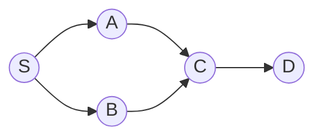
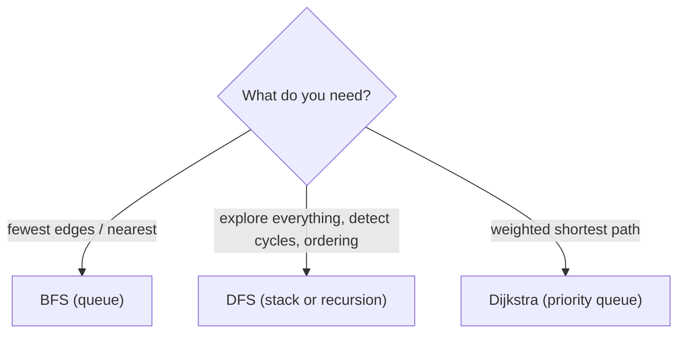
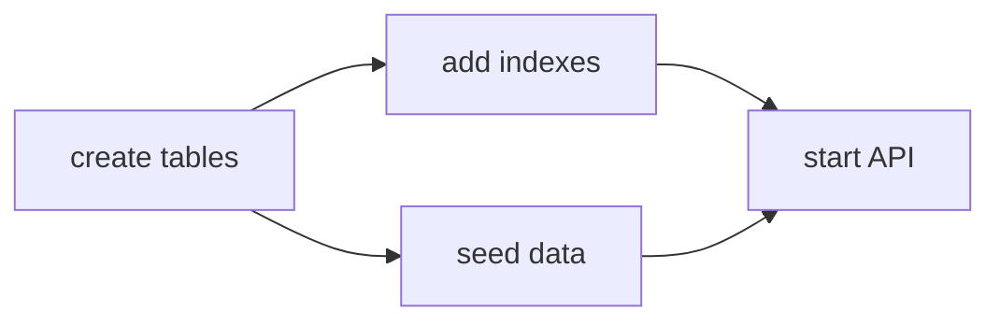

You can now store a graph (Session 1.3.6). This session teaches you to *explore* one. Two
algorithms, breadth-first search and depth-first search, are the foundation of nearly every graph
algorithm you'll meet: shortest routes in a maze, crawling a website, finding circular imports,
deciding the order to run database migrations or build steps. Both visit every reachable vertex in
O(V + E); they differ only in the *order* they visit them, and that order is what makes each one
useful.

## Breadth-first search and shortest paths in unweighted graphs

**Breadth-first search** (BFS) explores a graph in **layers**: first the start vertex, then all its
neighbours, then all *their* unvisited neighbours, and so on. Picture a stone dropped in a pond:
the ripple reaches everything at distance 1, then distance 2, then 3.

The tool that produces this order is a **queue** (Session 1.3.2): vertices are processed in the
order they were discovered.

```python
from collections import deque

def bfs(graph, start):
    dist = {start: 0}
    parent = {start: None}
    q = deque([start])
    while q:
        u = q.popleft()
        for v in graph[u]:
            if v not in dist:           # first time we see v
                dist[v] = dist[u] + 1
                parent[v] = u
                q.append(v)
    return dist, parent
```



From S: layer 0 is {S}, layer 1 is {A, B}, layer 2 is {C}, layer 3 is {D}.

Because BFS reaches every vertex for the first time along a path with the fewest edges, `dist[v]`
is the **shortest path length** from the start in an **unweighted** graph. Following `parent`
pointers back from any vertex reconstructs that path.

> [!WARNING]
> Mark a vertex as visited when you **enqueue** it, not when you dequeue it. Otherwise the same
> vertex can be added to the queue many times, which wastes work and can blow up memory on dense
> graphs.

Each vertex is enqueued once and each edge examined once (twice in an undirected graph), so BFS
runs in **O(V + E)** time and O(V) extra space.

Typical uses: fewest moves in a puzzle or maze (an implicit graph), "degrees of separation" in a
social network, a web crawler limited to depth 3, and finding the nearest of something (the closest
free parking space, the nearest server).

> [!NOTE]
> BFS gives shortest paths only when every edge has the same cost. With different weights (road
> lengths, latencies) you need Dijkstra's algorithm, which is BFS with a priority queue instead of a
> plain queue. That's Session 1.4.5.

## Depth-first search, recursion and iterative stacks

**Depth-first search** (DFS) goes as deep as it can along one path before backing up. It's how you'd
explore a maze with a ball of string: follow a corridor until you hit a dead end, then backtrack to
the last junction with an unexplored corridor.

The natural implementation is recursive. The call stack (Session 1.3.2) remembers the junctions for
you:

```python
def dfs(graph, u, visited=None):
    if visited is None:
        visited = set()
    visited.add(u)
    for v in graph[u]:
        if v not in visited:
            dfs(graph, v, visited)
    return visited
```

Like BFS, DFS is **O(V + E)**. Unlike BFS, it does *not* find shortest paths. What it gives you
instead is structure: the moment each vertex is first entered and the moment it is **finished**
(all its descendants explored). Those finish times are the key to cycle detection and topological
sorting below.

Recursive DFS can exceed Python's recursion limit on long paths (thousands of vertices in a chain).
The fix is to manage the stack yourself:

```python
def dfs_iterative(graph, start):
    visited, stack = set(), [start]
    while stack:
        u = stack.pop()
        if u in visited:
            continue
        visited.add(u)
        for v in reversed(graph[u]):   # reversed: visit neighbours in listed order
            if v not in visited:
                stack.append(v)
    return visited
```

> [!TIP]
> Swap the stack for a queue (and mark on enqueue) and the same loop becomes BFS. The only
> difference between the two searches is the order in which discovered vertices are processed:
> last-in-first-out goes deep, first-in-first-out goes wide.



## Cycle detection and topological sort

In a **directed** graph, a cycle means something like "A needs B, B needs C, C needs A", which is
impossible to satisfy. DFS detects it by tracking three states per vertex, often described as
colours:

- **white**: not visited yet;
- **grey**: currently on the recursion stack (we entered it and haven't finished it);
- **black**: finished.

If DFS ever follows an edge to a **grey** vertex, it has found a path back to an ancestor that's
still in progress: a **cycle**. An edge to a black vertex is fine; that part is already fully
explored.

> [!NOTE]
> For **undirected** graphs the rule is simpler: a cycle exists if DFS reaches an already visited
> vertex that isn't the one it just came from. Union–find (Session 1.3.6) is another way.

A **topological sort** orders the vertices of a DAG so that every edge goes from earlier to later:
each task comes after everything it depends on. It's what `pip` and `npm` do to decide installation
order, what build tools do before compiling, and what a migration tool does before applying
migrations.

There are two standard algorithms:

1. **DFS-based:** run DFS and record each vertex when it **finishes**. Reversing that list gives a
   topological order (a vertex finishes only after everything reachable from it has finished).
2. **Kahn's algorithm:** repeatedly take a vertex with **in-degree 0** (nothing left that it
   depends on), output it and remove its outgoing edges, which may free up new vertices. If vertices
   remain but none has in-degree 0, there's a cycle.



One valid order: create tables, add indexes, seed data, start API. "Seed data" before "add indexes"
is equally valid: topological orders are usually not unique.

> [!EXAMPLE]
> Python ships Kahn-style topological sorting in the standard library:
> ```python
> from graphlib import TopologicalSorter
> deps = {"api": {"indexes", "seed"}, "indexes": {"tables"}, "seed": {"tables"}}
> print(list(TopologicalSorter(deps).static_order()))
> # e.g. ['tables', 'indexes', 'seed', 'api']
> ```
> It raises `graphlib.CycleError` if the dependencies contain a cycle.

## Connected components

A **connected component** of an undirected graph is a maximal group of vertices that can all reach
each other (Session 1.1.5). To find all of them, loop over every vertex; whenever you meet one that
hasn't been visited, start a BFS or DFS from it. Everything that search reaches is one component.

```python
def components(graph):
    seen, result = set(), []
    for start in graph:
        if start in seen:
            continue
        group, stack = [], [start]
        seen.add(start)
        while stack:
            u = stack.pop()
            group.append(u)
            for v in graph[u]:
                if v not in seen:
                    seen.add(v)
                    stack.append(v)
        result.append(group)
    return result
```

The whole thing is still O(V + E): every vertex and edge is handled once across all searches.

Real uses: counting islands in a grid map (cells are vertices, adjacent land cells are edges),
grouping accounts that share an email or phone number, finding isolated clusters in a network, and
spotting modules in a codebase that nothing else uses.

For **directed** graphs the analogue is **strongly connected components** (every vertex reaches
every other following the arrows), found with Tarjan's or Kosaraju's algorithm, both built on DFS.
The graph chapters of [Jeff Erickson's Algorithms](https://jeffe.cs.illinois.edu/teaching/algorithms/)
cover them, and [MIT 6.006](https://ocw.mit.edu/courses/6-006-introduction-to-algorithms-spring-2020/)
has lectures on BFS and DFS with worked examples.

## Practice: a dependency resolver using topological sort

Budget about 75 minutes. You'll build a miniature package manager's resolver.

### Step 1: The input

Packages and their direct dependencies:

```python
PACKAGES = {
    "web":      ["api", "ui-kit"],
    "api":      ["db", "auth", "logging"],
    "auth":     ["crypto", "logging"],
    "ui-kit":   ["logging"],
    "db":       ["logging"],
    "crypto":   [],
    "logging":  [],
}
```

### Step 2: Kahn's algorithm

Write `install_order(packages) -> list[str]` that returns an order in which every package appears
after all of its dependencies. Compute in-degrees (counting, for each package, how many
dependencies it has), start a queue with the packages that have none, and process it.

### Step 3: Only what's needed

Write `install_order_for(packages, target)` that returns the order for just `target` and its
transitive dependencies. Hint: first collect the reachable set with a DFS from `target`, then sort
only those.

### Step 4: Detect cycles with a useful message

If there's a cycle, raise an error that names the packages involved, for example
`CycleError: auth -> crypto -> auth`. The grey/black DFS is the easiest way to recover the actual
cycle path.

### Step 5: Tests

```python
def is_valid_order(order, packages):
    pos = {p: i for i, p in enumerate(order)}
    return all(pos[d] < pos[p] for p in order for d in packages[p] if d in pos)

def test_full_order():
    order = install_order(PACKAGES)
    assert sorted(order) == sorted(PACKAGES) and is_valid_order(order, PACKAGES)

def test_subset():
    assert set(install_order_for(PACKAGES, "auth")) == {"auth", "crypto", "logging"}

def test_cycle():
    import pytest
    with pytest.raises(Exception, match="auth"):
        install_order({**PACKAGES, "crypto": ["auth"]})
```

Finally, compare your output with `graphlib.TopologicalSorter` on the same input. They may give
different orders; explain why both are correct.

```quiz
{"questions": [
  {"question": "You need the minimum number of moves for a knight to reach a square on a chessboard. Which algorithm fits?", "options": ["DFS, because it explores deeply", "BFS, because every move costs the same and BFS finds fewest-edge paths", "Topological sort", "Kahn's algorithm"], "answer": 1, "explanation": "Board squares are vertices and knight moves are unweighted edges, so BFS layers give the minimum moves."},
  {"question": "During DFS on a directed graph you follow an edge to a vertex that is grey (entered but not finished). What does that mean?", "options": ["The graph is disconnected", "The vertex was visited in another component", "There is a cycle", "The DFS must restart"], "answer": 2, "explanation": "A grey vertex is an ancestor on the current path; reaching it again closes a loop."},
  {"question": "In Kahn's algorithm, what does it mean if vertices remain but none has in-degree 0?", "options": ["The remaining vertices contain a cycle", "The graph is a tree", "The order is complete", "The graph is undirected"], "answer": 0, "explanation": "Every remaining vertex still waits on another remaining vertex, which can only happen with a cycle."},
  {"question": "Why should BFS mark a vertex as visited when enqueuing it rather than when dequeuing it?", "options": ["To get a different order", "Because dequeuing is O(n)", "It's required for DFS compatibility", "So the same vertex isn't enqueued multiple times by different neighbours"], "answer": 3, "explanation": "Marking late lets several neighbours enqueue the same vertex, wasting time and memory."},
  {"question": "What is the time complexity of finding all connected components with repeated BFS/DFS?", "options": ["O(V + E), since each vertex and edge is processed once overall", "O(V²)", "O(V × E)", "O(E log V)"], "answer": 0, "explanation": "Searches never revisit vertices already assigned to a component, so the total work is linear."}
]}
```
