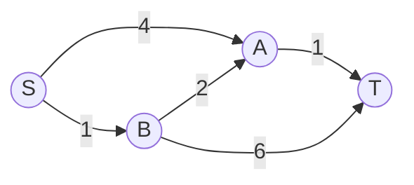
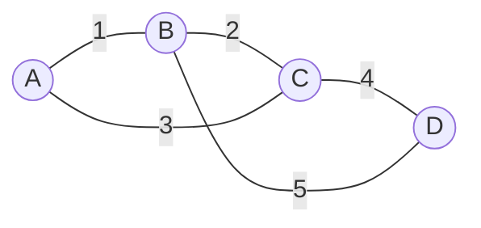

BFS finds the route with the fewest hops, but real networks have costs: kilometres, milliseconds,
euros. This session covers the algorithms that handle **weighted** graphs. Dijkstra's algorithm
powers route planners and network routing protocols; Bellman–Ford handles the awkward case of
negative weights; Prim's and Kruskal's algorithms find the cheapest way to connect everything. All
four are short, elegant, and built from pieces you already have: priority queues, union–find and
graph traversal.

## Dijkstra's algorithm

Imagine pouring water into a network of pipes at the source. It reaches the nearest junctions
first, then spreads outwards, always arriving at the next-closest junction before farther ones.
**Dijkstra's algorithm** simulates that: it settles vertices in order of their distance from the
source.

It keeps a tentative distance for every vertex (∞ at first, 0 for the source) and a **priority
queue** of vertices to process, keyed by distance:

1. Pop the vertex u with the smallest tentative distance. Its distance is now **final**.
2. For each edge u → v with weight w, try to **relax** it: if `dist[u] + w < dist[v]`, you've found
   a shorter way to v, so update `dist[v]`, record `parent[v] = u` and push v with its new distance.
3. Repeat until the queue is empty (or until you pop the target, if you only need one route).

```python
import heapq

def dijkstra(graph, source):
    dist = {source: 0}
    parent = {source: None}
    pq = [(0, source)]
    while pq:
        d, u = heapq.heappop(pq)
        if d > dist[u]:
            continue                      # stale entry: we already found better
        for v, w in graph[u].items():
            nd = d + w
            if nd < dist.get(v, float("inf")):
                dist[v], parent[v] = nd, u
                heapq.heappush(pq, (nd, v))
    return dist, parent
```



From S: B is settled at 1; through B, A improves from 4 to 3; A is settled at 3; T becomes 4 via A,
beating 7 via B directly. The cheapest route S → B → A → T has more hops than S → B → T but costs
less, which is exactly what BFS would get wrong.

With a binary heap, Dijkstra runs in **O((V + E) log V)**. The `if d > dist[u]: continue` line is
the "lazy deletion" trick: instead of updating priorities inside the heap (which `heapq` can't do),
push duplicates and skip the outdated ones when they surface.

> [!WARNING]
> Dijkstra assumes **non-negative** weights. Its key step, "the smallest tentative distance is
> final", relies on the fact that adding more edges can never make a path shorter. One negative edge
> breaks that promise, and the algorithm can return wrong answers without any error.

> [!TIP]
> Route planners on real road networks add heuristics on top. **A*** search adds an estimate of
> the remaining distance (such as the straight-line distance) to each priority, so the search heads
> towards the target instead of spreading evenly in all directions.

## Bellman–Ford and negative weights

Negative weights do occur: a currency exchange where some conversions gain value (as log-ratios),
a cost model with rebates, or "edges" that represent credits. **Bellman–Ford** handles them with a
blunter approach: relax **every edge**, **V − 1 times**.

```python
def bellman_ford(vertices, edges, source):
    dist = {v: float("inf") for v in vertices}
    dist[source] = 0
    for _ in range(len(vertices) - 1):
        changed = False
        for u, v, w in edges:
            if dist[u] + w < dist[v]:
                dist[v] = dist[u] + w
                changed = True
        if not changed:
            break                       # early exit: already stable
    for u, v, w in edges:
        if dist[u] + w < dist[v]:
            raise ValueError("negative cycle reachable from source")
    return dist
```

Why V − 1 rounds? A shortest path without cycles has at most V − 1 edges, and after round k every
shortest path using at most k edges is correct. It's an induction argument (Session 1.1.3), with
the round number as k.

The final loop is the bonus: if any edge can *still* be relaxed after V − 1 rounds, there's a
**negative cycle**, a loop whose total weight is negative. Going around it forever makes the "cost"
fall without limit, so shortest paths aren't defined. In a currency graph, a negative cycle is an
arbitrage opportunity.

| | Dijkstra | Bellman–Ford |
|---|---|---|
| Negative weights | No | Yes |
| Detects negative cycles | No | Yes |
| Time | O((V + E) log V) | O(V · E) |
| Typical use | maps, network routing | finance, constraint systems, some routing protocols |

> [!NOTE]
> Bellman–Ford's "each node only needs its neighbours' current estimates" structure is why it was
> used in distance-vector routing protocols such as RIP: routers repeatedly share their distance
> tables with neighbours until everything converges.

## Minimum spanning trees: Prim and Kruskal

A different question: not "how do I get from A to B cheaply?" but "what's the cheapest set of
edges that connects **everything**?" That's a **minimum spanning tree** (Session 1.1.5): V − 1
edges, no cycles, smallest total weight. Think of laying fibre between offices: every office must
be reachable from every other, and cable is expensive.

Both classic algorithms are **greedy** (Session 1.4.6): they repeatedly add the cheapest edge that's
"safe", and it can be proved that this never has to be undone.

**Kruskal's algorithm** works globally, edge by edge:

1. Sort all edges by weight.
2. For each edge (u, v), cheapest first: if u and v are in different components, add the edge and
   merge the components. Otherwise skip it (it would create a cycle).
3. Stop after V − 1 edges.

"Are u and v already connected?" is exactly what **union–find** (Session 1.3.6) answers in nearly
O(1), so Kruskal costs **O(E log E)**, dominated by sorting.

```python
def kruskal(vertices, edges):
    uf = UnionFind(vertices)              # from Session 1.3.6
    tree = []
    for w, u, v in sorted(edges):
        if uf.union(u, v):                # True when they were in different components
            tree.append((u, v, w))
    return tree
```

**Prim's algorithm** grows a single tree from a start vertex, like Dijkstra:

1. Start with any vertex in the tree.
2. Repeatedly add the cheapest edge that connects a vertex **in** the tree to one **outside** it.
3. Stop when every vertex is in.

With a priority queue of candidate edges, Prim runs in **O(E log V)**.



Kruskal on this graph: take A–B (1), take B–C (2), skip A–C (3: A and C are already connected),
take C–D (4), done. Total weight 7. Prim from A picks the same edges in the same order here.

> [!WARNING]
> An MST does **not** give shortest paths between pairs of vertices. In the tree above, getting
> from B to D costs 2 + 4 = 6 (via C), while the direct edge B–D costs 5. MSTs minimise the
> *total* wiring, not individual trips.

Kruskal fits naturally when edges arrive as a list or the graph is sparse; Prim fits dense graphs
stored as adjacency structures. [VisuAlgo](https://visualgo.net/en) animates both, along with
Dijkstra and Bellman–Ford, and the
[MIT 6.006](https://ocw.mit.edu/courses/6-006-introduction-to-algorithms-spring-2020/) lectures
prove why the greedy choices are safe.

## Practice: route planner on a small city map

Budget about 75 minutes. You'll build a tiny route planner and a cheapest cable layout for the same
map.

### Step 1: The map

```python
CITY = {
    "Station":  {"Market": 4, "Museum": 2},
    "Market":   {"Station": 4, "Museum": 1, "Harbour": 5},
    "Museum":   {"Station": 2, "Market": 1, "Park": 8, "Harbour": 10},
    "Park":     {"Museum": 8, "Harbour": 2, "Stadium": 6},
    "Harbour":  {"Market": 5, "Museum": 10, "Park": 2, "Stadium": 3},
    "Stadium":  {"Park": 6, "Harbour": 3},
}
```

Weights are minutes of walking; roads are two-way.

### Step 2: Shortest routes

Use `dijkstra` above and write `route(graph, a, b) -> (minutes, [stops])` by following `parent`
from b back to a. Check by hand that Station → Stadium is Station, Museum, Market, Harbour,
Stadium in 2 + 1 + 5 + 3 = 11 minutes.

### Step 3: Closures and one-way streets

Add `closed: set[tuple[str, str]]` to `route` so some roads can be skipped. Then make Market →
Harbour one-way and confirm that Harbour → Station now takes a different route.

### Step 4: The cable layout

Build the edge list from `CITY` (each road once) and run `kruskal`. Print the chosen roads and the
total. Then compare: is the tree path from Station to Stadium the same length as the shortest
route? Write one sentence explaining the difference.

### Step 5: Tests

```python
def test_station_to_stadium():
    minutes, stops = route(CITY, "Station", "Stadium")
    assert minutes == 11 and stops[0] == "Station" and stops[-1] == "Stadium"

def test_mst_has_v_minus_1_edges():
    edges = {(min(a, b), max(a, b), w) for a in CITY for b, w in CITY[a].items()}
    tree = kruskal(CITY.keys(), [(w, a, b) for a, b, w in edges])
    assert len(tree) == len(CITY) - 1
```

```quiz
{"questions": [
  {"question": "Why does Dijkstra's algorithm fail with negative edge weights?", "options": ["Priority queues can't store negative numbers", "It assumes a settled vertex's distance is final, but a later negative edge could make it shorter", "It only works on trees", "Negative weights create too many edges"], "answer": 1, "explanation": "The greedy 'smallest tentative distance is final' step relies on paths never getting cheaper as they get longer."},
  {"question": "After running V − 1 rounds, Bellman–Ford finds an edge that can still be relaxed. What does that indicate?", "options": ["A negative cycle reachable from the source", "The graph is disconnected", "The algorithm needs one more round", "All weights are positive"], "answer": 0, "explanation": "Shortest simple paths have at most V − 1 edges; further improvement means a loop with negative total weight."},
  {"question": "In Kruskal's algorithm, why is an edge skipped when both endpoints are already in the same component?", "options": ["It is too expensive", "It would disconnect the tree", "It would create a cycle", "Kruskal never skips edges"], "answer": 2, "explanation": "The endpoints are already connected through tree edges, so adding this one closes a loop."},
  {"question": "Which data structure makes Kruskal's connectivity check nearly constant time?", "options": ["A trie", "A stack", "A max-heap", "Union–find"], "answer": 3, "explanation": "find(u) == find(v) answers 'same component?', and union merges components after adding an edge."},
  {"question": "A company wants the cheapest fibre layout connecting 30 offices. Which algorithm answers that directly?", "options": ["A minimum spanning tree algorithm (Prim or Kruskal)", "Dijkstra from the headquarters", "BFS", "Topological sort"], "answer": 0, "explanation": "The goal is minimum total cost to connect everything, which is the MST problem, not a shortest-path problem."}
]}
```
