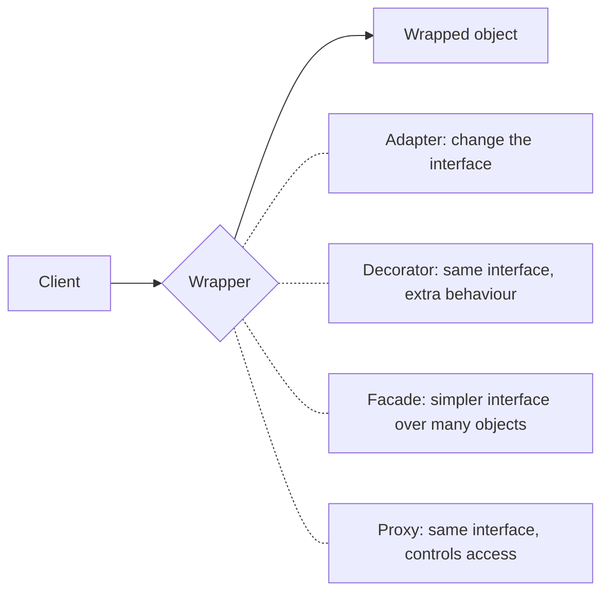

Design patterns are named, reusable solutions to problems that keep recurring in object-oriented
design. Knowing them gives you two things: a toolbox of proven shapes, and a shared vocabulary. Saying
"wrap it in an adapter" in a code review communicates a whole design in three words. This session
covers the most useful **creational** patterns (how objects get made) and **structural** patterns
(how objects are put together), plus the judgement to know when *not* to reach for them.

## What patterns are (and when not to use them)

A **design pattern** is a description of a problem, a general solution, and its trade-offs. It's
not a library you import or code you paste. The idea comes from architecture: Christopher
Alexander catalogued recurring solutions in buildings, like "a window seat where light falls". In
1994, the book *Design Patterns* by Gamma, Helm, Johnson and Vlissides (the "Gang of Four")
catalogued 23 patterns for object-oriented software, grouped into three families:

| Family | Question it answers | Examples in this module |
|---|---|---|
| Creational | How do objects get created? | factory, builder, singleton |
| Structural | How are objects composed into bigger structures? | adapter, decorator, facade, proxy |
| Behavioural | How do objects communicate and share responsibilities? | strategy, observer, command (Session 1.5.5) |

[Refactoring.Guru](https://refactoring.guru/design-patterns) has a clear, illustrated page for each
of them, with the problem each one solves and code in several languages including Python.

> [!WARNING]
> Patterns are a solution looking for a problem when applied up front. An `AbstractNotificationFactoryProvider`
> for a project with one notification type is pure cost: more files, more indirection, nothing
> gained. Reach for a pattern when you **feel the pain it solves**, such as duplicated construction
> logic or two incompatible interfaces, not because the code "should look professional".

> [!NOTE]
> Many classic patterns exist to work around limits of languages like Java and C++ in the 1990s.
> Python has first-class functions, modules, duck typing and decorators built in, so several
> patterns shrink to a few lines or disappear entirely. Learn the *intent* of each pattern; the
> Python implementation is often simpler than the textbook diagram.

## Factory, builder and singleton (and its pitfalls)

**Factory.** A factory centralises the decision of *which* class to instantiate. Callers ask for "a
payment provider for Italy" and get an object implementing the right interface, without knowing
the concrete class. It's like ordering "a coffee" at a bar: the barista decides which machine and
beans to use.

```python
def make_storage(url: str) -> Storage:
    if url.startswith("s3://"):
        return S3Storage(url)
    if url.startswith("file://"):
        return LocalStorage(url.removeprefix("file://"))
    raise ValueError(f"unsupported storage: {url}")
```

The `if` chain now lives in exactly one place (Session 1.5.3's open/closed principle, applied
pragmatically). In Python a plain function or a `@classmethod` like `Config.from_env()` is usually
all the "factory" you need; the GoF *Factory Method* and *Abstract Factory* class hierarchies are
rarely necessary.

**Builder.** A builder constructs a complex object step by step, so you don't need a constructor
with fifteen parameters. Think of ordering a custom sandwich one choice at a time.

```python
query = (QueryBuilder("orders")
         .where("status = 'paid'")
         .order_by("created_at", desc=True)
         .limit(20)
         .build())
```

SQL query builders, HTTP request builders and test-data builders are common uses. In Python,
keyword arguments with defaults and `dataclasses` cover many cases where Java would need a builder;
use one when construction has *steps* or *validation across fields*.

**Singleton.** A singleton guarantees a class has exactly one instance and gives global access to
it. It's the most famous pattern and the most criticised:

- it's **global state** in disguise, so any code anywhere can change it;
- it hides dependencies: a function that uses `Config.instance()` doesn't say so in its signature;
- it makes **testing** hard, since tests share the instance and can't easily swap in a fake.

> [!TIP]
> In Python, a **module** is already a singleton: it's imported once and cached. If you need one
> shared object (a settings object, a connection pool), create it at module level, or once at
> start-up, and **pass it in** where needed (dependency injection, Session 1.5.3). This platform's
> API creates its one `settings` object at module level in `app/config.py`. For cached constructors,
> `functools.cache` on a factory function gives "create once" without a special class.

## Adapter, decorator, facade and proxy

These four structural patterns all **wrap** an object, and they're easy to confuse. The difference
is *why* they wrap it.



**Adapter** converts one interface into another that the client expects. It's a travel plug
adapter: your laptop charger and the foreign socket both stay as they are, and the adapter makes
them fit. Use it to integrate a third-party library or legacy code without letting its API spread
through your codebase.

```python
class LegacyMailerAdapter:                        # implements our Mailer protocol
    def __init__(self, legacy):
        self._legacy = legacy

    def send(self, to: str, body: str) -> None:
        self._legacy.dispatch_message({"recipient": to, "text": body, "priority": 3})
```

**Decorator** wraps an object with the **same interface** and adds behaviour before or after
delegating: logging, caching, retries, metrics. Decorators stack, like layers of clothing.

```python
class RetryingMailer:
    def __init__(self, inner: Mailer, attempts: int = 3):
        self._inner, self._attempts = inner, attempts

    def send(self, to, body):
        for i in range(self._attempts):
            try:
                return self._inner.send(to, body)
            except ConnectionError:
                if i == self._attempts - 1:
                    raise
```

> [!NOTE]
> Python's `@decorator` syntax applies the same idea to **functions**: `@functools.cache` wraps a
> function with caching, keeping its signature. The design pattern and the language feature share a
> name for good reason.

**Facade** provides one simple interface over a complicated subsystem. A hotel concierge is a
facade: you say "book me dinner and a taxi", and they deal with the restaurant, the taxi company
and the payment. A `checkout(cart, card)` function that coordinates inventory, pricing, payment and
email is a facade over four services.

**Proxy** has the same interface as the real object and **controls access** to it: lazy loading (an
ORM relation that queries the database only when touched), access control, rate limiting, or
standing in for a remote object (an RPC client stub). A credit card is a proxy for your bank
account.

| Pattern | Interface seen by the client | Purpose |
|---|---|---|
| Adapter | different from the wrapped object's | make incompatible things fit |
| Decorator | same | add behaviour, stackable |
| Facade | new and simpler | hide a complex subsystem |
| Proxy | same | control access, laziness, remoteness |

## Practice: add an adapter to switch between two LLM providers

Budget about 75 minutes. Two imaginary AI vendors offer SDKs with different shapes; your app should
use either one through a single interface, chosen by configuration.

### Step 1: The two "vendor SDKs"

Treat these as third-party code you can't change:

```python
class AcmeClient:
    def complete(self, prompt: str, max_tokens: int = 256) -> dict:
        return {"choices": [{"text": f"acme says: {prompt[-20:]}"}]}

class BoltClient:
    def generate(self, *, messages: list[dict], system: str = "") -> str:
        return f"bolt says: {messages[-1]['content'][-20:]}"
```

### Step 2: Your interface

```python
from typing import Protocol

class ChatProvider(Protocol):
    name: str
    def chat(self, system: str, messages: list[dict]) -> str: ...
```

### Step 3: Two adapters

Write `AcmeAdapter` (flatten `system` and `messages` into one prompt, pull out
`["choices"][0]["text"]`) and `BoltAdapter` (pass the arguments through by keyword). Each takes its
vendor client in the constructor, so tests can pass a fake.

### Step 4: A factory

Write `get_provider(name: str) -> ChatProvider` that returns the right adapter, raising
`ValueError` for an unknown name. Read the name from an environment variable in your app's entry
point, not inside the factory.

### Step 5: A decorator, for free

Write `LoggingProvider(inner: ChatProvider)` that logs the provider name and response length and
delegates. Because it implements `ChatProvider`, it can wrap either adapter.

### Step 6: Tests

```python
import pytest

@pytest.mark.parametrize("name", ["acme", "bolt"])
def test_same_interface(name):
    p = get_provider(name)
    out = p.chat("be brief", [{"role": "user", "content": "hello there"}])
    assert isinstance(out, str) and "hello there" in out

def test_unknown_provider():
    with pytest.raises(ValueError):
        get_provider("nope")
```

### Step 7: Compare with real code

Open `apps/api/app/llm.py` in this platform. It defines an `LLMProvider` Protocol with Ollama,
Anthropic and fake implementations, and a `get_llm()` function that picks one from settings. Write
down which parts are adapters, which part is a factory, and one thing you'd do differently.

```quiz
{"questions": [
  {"question": "You wrap a third-party payment SDK so the rest of your code calls `charge(amount, card)` instead of the SDK's own method names. Which pattern is this?", "options": ["Decorator", "Adapter", "Singleton", "Builder"], "answer": 1, "explanation": "An adapter translates one interface into the one your code expects."},
  {"question": "What distinguishes a decorator from an adapter?", "options": ["A decorator keeps the same interface and adds behaviour; an adapter changes the interface", "A decorator changes the interface; an adapter keeps it", "Decorators only work on functions", "There is no difference"], "answer": 0, "explanation": "Decorators are stackable wrappers with an identical interface, e.g. retry or logging around a client."},
  {"question": "Why is the singleton pattern often discouraged?", "options": ["It uses too much memory", "Python doesn't support it", "It introduces hidden global state and makes dependencies hard to replace in tests", "It's slower than a factory"], "answer": 2, "explanation": "Code reaches the instance globally rather than receiving it, which hides dependencies and couples tests together."},
  {"question": "An ORM object loads its related rows from the database only the first time you access them. Which pattern does that use?", "options": ["Facade", "Builder", "Adapter", "Proxy"], "answer": 3, "explanation": "A proxy has the real object's interface but controls when and how it's accessed, here lazily."},
  {"question": "When is introducing a design pattern most clearly a mistake?", "options": ["When it adds indirection to solve a problem the code doesn't actually have yet", "When the codebase is written in Python", "When the pattern is from the Gang of Four book", "When there are tests"], "answer": 0, "explanation": "Patterns earn their cost by solving real pain; applied speculatively they only add complexity."}
]}
```
