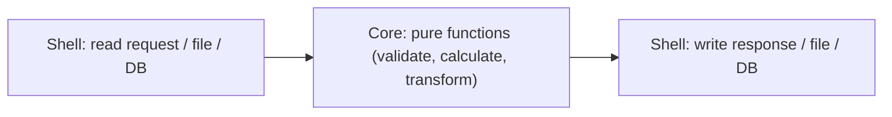
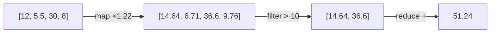

Object-oriented design organises code around objects that hold and change state. **Functional
programming** (FP) takes the opposite emphasis: build programs from functions that take inputs and
return outputs, and keep changing state to a minimum. You don't need a "functional language" to
benefit. Python supports the core ideas well, and using them where they fit makes code easier to
test, easier to reason about, and much safer when things run concurrently.

## Pure functions and side effects

A **pure function** has two properties:

1. Its output depends **only on its inputs**: same arguments, same result, every time.
2. It has **no side effects**: it doesn't modify its arguments, global variables, files, databases,
   or the screen.

A calculator's square-root button is pure: √16 is always 4, and pressing it doesn't change anything
else in the world. A function that reads the clock, the network or a global counter is not.

```python
# Impure: reads and changes state outside itself
total = 0
def add_to_total(x):
    global total
    total += x
    return total

# Pure: everything it needs comes in, everything it produces goes out
def add(total, x):
    return total + x
```

A **side effect** is any observable change outside the function's return value: writing a file,
sending an email, logging, mutating a list that was passed in, printing. Programs *need* side
effects; a program with none does nothing visible. The functional approach is to **push them to the
edges**: a thin outer layer reads input and writes output, and the core logic in between is pure.
This is often called "functional core, imperative shell".



Why it pays off:

- **Testing** pure functions needs no mocks, fixtures or databases: call with inputs, assert on the
  output.
- **Reasoning** is local: you can understand a pure function by reading only that function.
- **Caching** is safe: `functools.cache` (Session 1.4.7) is only correct on pure functions.
- **Concurrency** is easier: pure functions can run in parallel without locks, since they share no
  mutable state.

> [!WARNING]
> A sneaky impurity in Python is **mutating an argument**. `def add_tag(tags, t): tags.append(t);
> return tags` changes the caller's list. Return a new value instead: `return [*tags, t]`.
> Relatedly, never use a mutable default argument (`def f(xs=[])`): the same list is reused across
> calls.

## Immutability

An **immutable** value can't be changed after it's created. To "modify" it, you create a new value.
That sounds wasteful, but it removes a whole category of bugs: if nothing can change a value, you
never have to wonder *who* changed it.

The analogy is a signed contract versus a shared whiteboard. Anyone walking past can rewrite the
whiteboard, so you can never be sure it says what you left there. A contract is fixed; an amendment
is a new document.

Python has immutable versions of most built-in types:

| Mutable | Immutable counterpart |
|---|---|
| `list` | `tuple` |
| `set` | `frozenset` |
| `dict` | `types.MappingProxyType` (a read-only view) |
| regular class | `@dataclass(frozen=True)` |
| `bytearray` | `bytes` |

Strings and numbers are already immutable.

```python
from dataclasses import dataclass, replace

@dataclass(frozen=True)
class Order:
    id: int
    status: str
    total: float

o1 = Order(1, "new", 30.0)
o2 = replace(o1, status="paid")   # a new object; o1 is untouched
# o1.status = "paid"              # FrozenInstanceError
```

Immutable objects are also **hashable** (as long as their contents are), so they can be dict keys
and set members, and they can be shared freely between threads and functions.

> [!NOTE]
> Immutability in Python is "shallow": a tuple containing a list can't be reassigned, but the list
> inside it can still be mutated. For true immutability, make the contents immutable too
> (tuples of tuples, frozen dataclasses of frozen dataclasses).

> [!TIP]
> You don't need everything immutable. A good default: make **values** that get passed around
> (configuration, domain records, messages, events) immutable, and keep mutation local inside a
> function where it's easy to see.

## Map, filter, reduce and comprehensions

Three classic higher-order functions (functions that take functions) describe most collection
processing:

- **map** applies a function to each item: `map(str.upper, names)`.
- **filter** keeps items that satisfy a predicate: `filter(is_valid, orders)`.
- **reduce** combines items into one value with a binary function: summing, multiplying, merging.

```python
from functools import reduce
import operator

prices = [12.0, 5.5, 30.0, 8.0]
with_vat = map(lambda p: p * 1.22, prices)
expensive = filter(lambda p: p > 10, with_vat)
total = reduce(operator.add, expensive, 0.0)
```



In idiomatic Python, **comprehensions** and **generator expressions** usually replace map and
filter, and built-ins like `sum`, `min`, `max`, `any` and `all` replace most uses of reduce:

```python
total = sum(p * 1.22 for p in prices if p * 1.22 > 10)
```

The [Python Functional Programming HOWTO](https://docs.python.org/3/howto/functional.html)
recommends exactly this, and it moved `reduce` into `functools` in Python 3 because explicit loops
or built-ins are usually clearer.

Some guidance:

- Use a **list comprehension** when you need a list; a **generator expression** (round brackets)
  when you just iterate once, since it's lazy and uses O(1) memory.
- `map(f, xs)` reads well when `f` already has a name: `map(int, lines)`.
- Reach for `reduce` only when no built-in fits, such as merging a list of dicts.
- The `itertools` and `operator` modules supply ready-made building blocks: `chain`, `groupby`,
  `islice`, `accumulate`, `itemgetter`, `attrgetter`.

> [!WARNING]
> `map` and `filter` return **lazy iterators** in Python 3. They're consumed once: iterating twice
> gives nothing the second time. Wrap with `list(...)` if you need to reuse the result.

## Closures and partial application

A **closure** is a function that remembers variables from the scope where it was created, even after
that scope has finished. It's like a backpack: the inner function carries the values it needs from
home.

```python
def make_multiplier(factor):
    def multiply(x):
        return x * factor          # 'factor' is captured from the enclosing scope
    return multiply

double = make_multiplier(2)
triple = make_multiplier(3)
double(10), triple(10)             # (20, 30)
```

Closures are how you build functions with configuration baked in, and they're what Python's
`@decorator` functions (Session 1.5.4) return. They can replace small classes: an object with one
method and some fixed data is often just a closure.

> [!WARNING]
> Closures capture **variables**, not values. In
> `fs = [lambda: i for i in range(3)]`, every lambda sees the *final* `i`, so all return 2. Bind the
> current value with a default argument (`lambda i=i: i`) or use `functools.partial`.

**Partial application** means fixing some arguments of a function to produce a new function with
fewer arguments. `functools.partial` does it without writing a wrapper:

```python
from functools import partial

def send(channel, recipient, message): ...

send_sms = partial(send, "sms")
send_sms("+39 333 1234567", "Your code is 4821")

int_from_binary = partial(int, base=2)
int_from_binary("1011")            # 11
```

Partial application is a lightweight way to adapt a general function to the shape a caller expects,
such as a callback that only receives one argument, or a strategy (Session 1.5.5) with its
configuration pre-filled.

## Practice: rewrite a data pipeline in functional style

Budget about 75 minutes. You'll take an imperative script and refactor it into small pure functions
plus a thin shell, keeping behaviour identical.

### Step 1: The starting code

```python
import csv

def report(path):
    rows = list(csv.DictReader(open(path)))
    totals = {}
    for r in rows:
        if r["status"] != "paid":
            continue
        r["amount"] = float(r["amount"])          # mutates the row
        if r["amount"] <= 0:
            continue
        c = r["country"].strip().upper()
        totals[c] = totals.get(c, 0) + r["amount"]
    for c in sorted(totals, key=totals.get, reverse=True)[:3]:
        print(f"{c}: {totals[c]:.2f}")
```

Create a small `orders.csv` with columns `id,status,amount,country` and about ten rows, including a
refunded order, a zero amount and a country with stray spaces.

### Step 2: Pin the behaviour

Capture the printed output with pytest's `capsys` fixture for your CSV and keep it as the expected
result.

### Step 3: Extract pure functions

Write each as a pure function with its own small test:

- `parse(row: dict) -> Order` returning a frozen dataclass;
- `is_countable(order) -> bool`;
- `totals_by_country(orders) -> dict[str, float]` (a comprehension, `reduce`, or a loop over local
  state; all are fine as long as nothing outside changes);
- `top(totals, n) -> list[tuple[str, float]]`;
- `format_lines(pairs) -> list[str]`.

### Step 4: Compose them in a thin shell

```python
def report(path, n=3):
    with open(path) as f:
        orders = map(parse, csv.DictReader(f))
        lines = format_lines(top(totals_by_country(filter(is_countable, orders)), n))
    print("\n".join(lines))
```

The only impure lines are opening the file and printing. Run the Step 2 test: it must still pass.

### Step 5: Reflect

Use `partial` to create `top3 = partial(top, n=3)`. Then write two sentences: which version is
easier to test, and is there any part where the functional style made the code *harder* to read?
Functional style is a tool, not a religion.

```quiz
{"questions": [
  {"question": "Which function is pure?", "options": ["One that appends to a list passed in and returns it", "One that returns the current time formatted as a string", "One that returns a new sorted list built from its argument, without changing the argument", "One that logs its input and returns it"], "answer": 2, "explanation": "Pure means output depends only on inputs and there are no side effects. Mutating arguments, reading the clock and logging are all effects."},
  {"question": "Why is it only safe to apply `functools.cache` to pure functions?", "options": ["Cache returns stored results, which is only correct if the same inputs always produce the same output with no needed side effects", "Impure functions can't be decorated", "Cache makes functions pure automatically", "Cached functions run in parallel"], "answer": 0, "explanation": "An impure function's result can change, or its effects would be skipped on cache hits."},
  {"question": "`fs = [lambda: i for i in range(3)]`; what does `[f() for f in fs]` return?", "options": ["[0, 1, 2]", "[0, 0, 0]", "An error", "[2, 2, 2]"], "answer": 3, "explanation": "Closures capture the variable i, not its value at creation; by the time they run, i is 2."},
  {"question": "You call `list(result)` twice on `result = map(int, lines)`. Why is the second list empty?", "options": ["map caches nothing", "map returns a one-shot lazy iterator that's exhausted after the first pass", "int fails silently", "Lists can't be built from map"], "answer": 1, "explanation": "In Python 3, map and filter return iterators. Materialise once with list() if you need to reuse the values."},
  {"question": "What does 'functional core, imperative shell' mean?", "options": ["Keep business logic in pure functions and push I/O and other side effects to a thin outer layer", "Write the core in a functional language and the shell in Python", "Avoid all side effects everywhere", "Use only lambdas in the core"], "answer": 0, "explanation": "Programs need effects, but isolating them at the edges keeps the logic easy to test and reason about."}
]}
```
