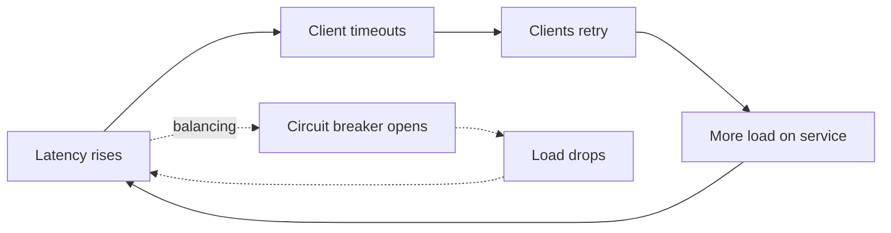
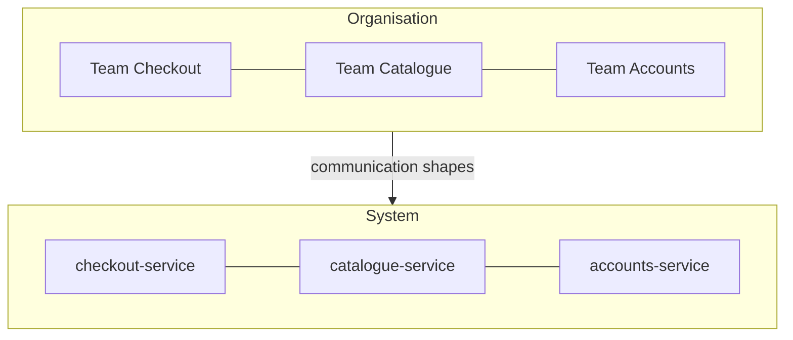
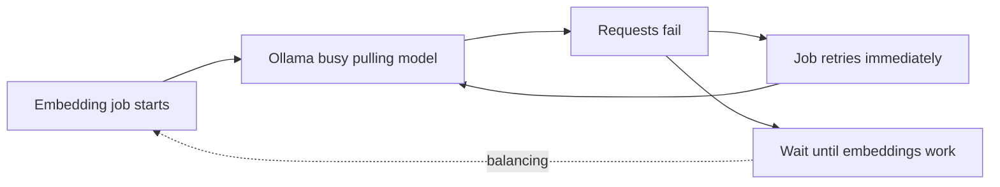

A junior engineer fixes the bug in front of them. A senior engineer asks why the bug happened, what
else that cause is producing, and what the fix will change downstream. That habit has a name:
**systems thinking**. It treats software, the people who build it and the organisation around them
as one connected system, where causes loop back on themselves and today's fix can become next
quarter's incident. This session gives you the vocabulary (stocks, flows, feedback loops,
second-order effects, Conway's law) and then you apply it to a real incident.

## Stocks, flows and feedback loops

Picture a bathtub. The water in the tub is a **stock**: something that accumulates and that you can
measure at a point in time. The tap is an **inflow**, the drain an **outflow**. The level only
changes through flows, and it changes slowly even if you turn the tap fully: stocks give systems
memory and inertia.

Engineering is full of bathtubs:

| Stock | Inflow | Outflow |
| --- | --- | --- |
| Open bugs | Bugs reported | Bugs fixed |
| Messages in a queue | Messages produced | Messages consumed |
| Technical debt | Shortcuts taken | Refactoring done |
| Team knowledge | Learning, onboarding | People leaving, docs going stale |
| On-call fatigue | Pages per week | Rest, fixed alerts |

A **feedback loop** is when the level of a stock changes one of its own flows.

- A **reinforcing loop** amplifies change. More users bring more word of mouth, which brings more
  users. In incidents it shows up as a **retry storm**: a slow service causes client timeouts,
  clients retry, the extra load makes the service slower, which causes more timeouts.
- A **balancing loop** pushes towards a target. An autoscaler adds instances when CPU is high and
  removes them when it is low. A thermostat, a rate limiter and a circuit breaker are all
  balancing loops.

Loops usually have **delays**, and delays cause oscillation. If an autoscaler takes five minutes
to see the effect of new instances, it keeps adding more in the meantime, overshoots, then scales
down too far. Humans do the same: a team that is told it ships too slowly adds process, sees no
change for a month, adds more, and ends up slower.

The solid loop reinforces; the dotted one balances. The
[Google SRE Book](https://sre.google/sre-book/table-of-contents/) chapters on handling overload and
addressing cascading failures are, in effect, a catalogue of reinforcing loops and the balancing
mechanisms (load shedding, retry budgets with backoff and jitter, graceful degradation) that stop
them.

> [!NOTE]
> A **leverage point** is a place in the system where a small change has a big effect. Adding
> jitter to retries is tiny code but breaks a reinforcing loop. Changing what a team is measured on
> is one sentence in a doc but redirects every flow. Seniors look for leverage points instead of
> pushing harder on the obvious lever.

## Second-order effects and unintended consequences

A **first-order effect** is what you intended. A **second-order effect** is what happens because of
that, often later and somewhere else. The question to train yourself to ask is "and then what?"

> [!EXAMPLE]
> **Decision:** add a mandatory second reviewer to every pull request, to catch more bugs.
>
> - First order: more eyes on each change, some bugs caught earlier.
> - Second order: PRs wait longer, so people batch more work into each one to amortise the wait.
> - Third order: bigger PRs get shallower reviews, so more bugs slip through, and merge conflicts
>   increase.
>
> The rule meant to improve quality can lower it. A smaller change (a second reviewer only for
> risky areas, or a review-time SLO) might reach the goal without the loop.

Some patterns are common enough to recognise on sight:

- **Goodhart's law**: when a measure becomes a target, it stops being a good measure. Reward
  closed tickets and tickets get split; reward test coverage and you get tests without assertions.
- **Shifting the burden**: a quick fix relieves the symptom so the real cause never gets
  addressed. Restarting a pod nightly "fixes" a memory leak and hides it for a year.
- **Fixes that fail**: the fix works now and makes the problem worse later. Raising a timeout stops
  errors today and lets slow requests pile up into a bigger outage tomorrow.
- **Tragedy of the commons**: a shared resource (a CI cluster, a shared database) degrades because
  each team gains from using more and nobody pays for overuse.

> [!TIP]
> Before you ship a policy or an architectural rule, write down two plausible second-order effects
> and how you would notice them (a metric, a complaint, a time-to-merge graph). It takes five
> minutes and turns a guess into an experiment.

## Conway's law and socio-technical systems

In 1967 Melvin Conway observed that organisations design systems whose structure copies the
organisation's communication structure. As
[Martin Fowler explains](https://martinfowler.com/bliki/ConwaysLaw.html), this isn't a
management fad; it follows from how design happens. Two modules can only have a tightly integrated
interface if the people building them talk to each other a lot. Where people rarely talk, you get a
thin, formal interface, or a mismatch.

Concretely:

- Three teams asked to build a compiler tend to produce a three-pass compiler.
- A front-end team and a back-end team produce a front end and a back end with a negotiated API
  between them, and features that need both move slowly.
- A "platform team" that every product team must queue for becomes a bottleneck in the
  architecture, not just on the org chart.

Fowler also describes the **Inverse Conway Maneuver**: if you want a particular architecture,
shape the teams first so that the communication structure you get produces it. Want independent,
deployable services around business capabilities? Give each capability a team that owns it end to
end.

This is what **socio-technical system** means: the code, the infrastructure, the teams, the on-call
rota and the incentives are one system. You can't fix a deployment bottleneck with Kubernetes if
the real cause is that every release needs sign-off from a team in another timezone. Will Larson's
writing on [lethain.com](https://lethain.com/) about organisational design and team sizing comes
back to this again and again: technical problems are often team-shape problems in disguise.

> [!WARNING]
> Don't over-apply Conway's law. It describes a pull, not a physical law. A well-run team can
> build a clean modular monolith; a reorg alone won't fix bad interfaces. Use it as a diagnostic:
> when the architecture keeps fighting you, check whether it is fighting the org chart.

## Practice: map the feedback loops of an incident

You'll take one real incident and turn its timeline into a causal loop diagram. Allow about 90
minutes.

### Step 1: Pick an incident

Use an incident you lived through at work, a public postmortem (many companies publish them), or a
YouCanDoIt event, for example the API failing to start because `ROADMAP.md` didn't validate, or
the background indexing job hammering Ollama while it was still pulling models.

### Step 2: Write the timeline

List what happened in order, with times if you have them: trigger, first symptom, detection,
actions taken, recovery. Stick to facts; the [SRE Book](https://sre.google/sre-book/table-of-contents/)
chapter on postmortem culture stresses that the goal is understanding the system, not blaming
people.

### Step 3: Find the stocks

Circle the things that accumulated: queue depth, open connections, retries in flight, error
budget, engineer stress, the number of people in the incident channel. Each one is a bathtub.

### Step 4: Draw the loops

For every arrow "A increased B", ask: did B then feed back into A? Mark each loop **R**
(reinforcing) or **B** (balancing) and note any delay. A Mermaid sketch is enough:

### Step 5: Look for second-order effects and leverage

For each action taken during the incident, write what it caused afterwards. Then mark one or two
leverage points: where a small change (backoff, a queue limit, an alert on a stock instead of a
symptom, a clearer ownership boundary) would have broken a reinforcing loop.

### Step 6: Check the Conway angle

Which teams or people were involved, and did the incident cross an ownership boundary? If the fix
needed three teams to coordinate, note it: that is an architecture finding too.

> [!TIP]
> Keep the diagram. When you write the postmortem (session 10.3.3), the loops become the
> "contributing factors" section, and the leverage points become action items.
