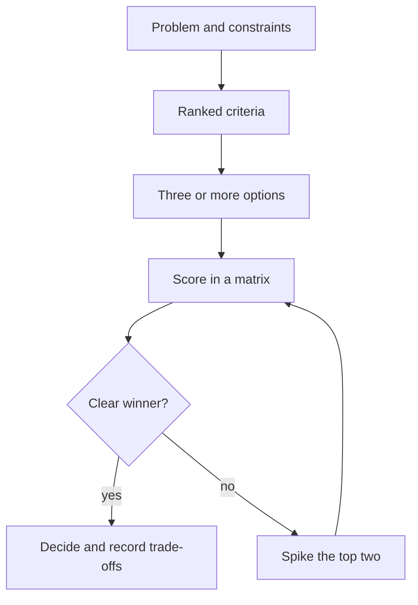

Every architecture choice gives you something and costs you something. Postgres or DynamoDB,
monolith or services, build the search or pay for one: there is rarely a right answer, only a
trade-off that fits your context better. What makes an engineer senior is not always picking the
best option; it is making the trade-off **explicit**, matching the effort of the decision to its
stakes, and leaving a written record so others understand why. This session covers how to size a
decision, how to compare options honestly, the build-vs-buy question, and then you write an
Architecture Decision Record.

## Reversible vs irreversible decisions

Think of doors. Some decisions are **two-way doors**: you walk through, look around, and walk
back if you don't like it. Others are **one-way doors**: once through, coming back is expensive or
impossible. (The metaphor is commonly attributed to Amazon's Jeff Bezos.) The point is that the two
kinds deserve very different processes.

| | Two-way door (reversible) | One-way door (hard to reverse) |
| --- | --- | --- |
| Examples | A library for date formatting, an internal API shape behind a feature flag, a CI tool | Public API contracts, primary database, data model of stored data, programming language of a large codebase, a vendor with years of lock-in |
| Right speed | Fast. Decide with ~70% of the information. | Slow. Prototype, consult, write it down. |
| Who decides | The person or team doing the work | Wider review, often with an RFC |
| Cost of being wrong | Small rework | Migration projects, data loss risk |

Two common failure modes:

- **Treating two-way doors as one-way.** Weeks of debate over a logging library. The team loses
  momentum and learns nothing, when trying one for a sprint would have answered the question.
- **Treating one-way doors as two-way.** Picking a database because someone liked it at a
  hackathon. Three years later, the migration is a quarter-long project.

> [!TIP]
> You can often **turn a one-way door into a two-way door**. Put the vendor behind an interface
> you own (an adapter), ship behind a feature flag, version the public API from day one, run the
> new and old systems in parallel. The cost of reversibility is usually much smaller than the cost
> of being locked in.

Also ask about **time**: some choices are reversible today and become irreversible as data and
callers accumulate. A data format with zero records is a two-way door; with ten million records
and five consumers it isn't.

## Trade-off analysis and decision matrices

Martin Fowler's [Software Architecture Guide](https://martinfowler.com/architecture/) describes
architecture as "the important stuff, whatever that is", and the decisions that are hard to
change. To decide well you need to say what matters before you look at options, otherwise you'll
pick the option you already liked and justify it afterwards.

A practical process:

1. **State the problem and constraints.** What must be true? (Budget, deadline, compliance, team
   skills.)
2. **Name the quality attributes that matter here**, and rank them. Latency, cost, operability,
   time to market, security, consistency. You can't maximise all of them.
3. **List at least three options**, including "do nothing" or "the boring option". Two options
   tend to become a fight; three become a comparison.
4. **Score each option** against the criteria.
5. **Write down what you are giving up.** The losing criteria are the trade-off.

A **decision matrix** makes step 4 visible. Weight each criterion (1 to 5), score each option (1
to 5), multiply and sum.

> [!EXAMPLE]
> YouCanDoIt needs full-text search over lessons.
>
> | Criterion (weight) | Postgres full-text (existing DB) | Meilisearch (new service) | Hosted search SaaS |
> | --- | --- | --- | --- |
> | Operational simplicity (5) | 5 → 25 | 3 → 15 | 4 → 20 |
> | Search quality (3) | 3 → 9 | 5 → 15 | 5 → 15 |
> | Cost (3) | 5 → 15 | 4 → 12 | 2 → 6 |
> | Time to ship (2) | 4 → 8 | 3 → 6 | 4 → 8 |
> | **Total** | **57** | **48** | **49** |
>
> Postgres wins for a personal project because operability and cost are weighted highest. Trade-off
> accepted: weaker typo tolerance and ranking. A product with millions of users would weight
> differently and might get a different answer.



> [!WARNING]
> The matrix is a thinking tool, not an oracle. If the numbers say Option B and your gut screams
> Option A, don't overrule either: find the criterion you forgot. The conversation about weights
> is usually more valuable than the total.

## Build vs buy

"Should we build this ourselves or use an existing product, library or service?" comes up
constantly: authentication, search, feature flags, payments, observability, job queues.

**Buy (or adopt)** when the capability is not what makes your product special. Someone else has
spent years on edge cases you haven't thought of yet (auth is the classic example: password
reset, MFA, account recovery, session revocation). You get speed and maturity; you pay in money,
lock-in, less control and dependency on another company's roadmap.

**Build** when the capability is your **differentiator**, when nothing on the market fits your
constraints, or when the integration cost of a product is close to the cost of building the
simple version you actually need.

Questions that cut through the debate:

- Is this core to what our users pay for? If not, lean buy.
- What is the **total cost of ownership** of building? Not the first version: the on-call, the
  security patches, the upgrades and the person who leaves with the knowledge.
- What does exit look like if the vendor raises prices, gets acquired or shuts down? Can we put
  them behind our own interface?
- Does it pass our security and data-residency requirements?
- Is there a middle path: an open-source library we run ourselves?

> [!NOTE]
> Engineers systematically underestimate the maintenance cost of what they build and overestimate
> the integration cost of what they buy, because building is more fun. Knowing that bias is half
> the battle. The writing collected on [StaffEng](https://staffeng.com/guides/) returns often to
> the idea that senior engineers spend their effort where it matters most to the business, not
> where it is most interesting.

## Practice: an ADR for a real trade-off you faced

An **Architecture Decision Record** is a short document that captures one significant decision,
its context and its consequences. [adr.github.io](https://adr.github.io/) collects templates and
tooling; the most widely used is Michael Nygard's format. ADRs live in the repository next to the
code (for example `docs/adr/0007-use-postgres-full-text-search.md`), are numbered, and are never
edited after acceptance: if you change your mind, you write a new ADR that **supersedes** the old
one. Allow about an hour.

### Step 1: Choose a decision

Pick one you actually made or are making. In YouCanDoIt there are good candidates: deriving XP
and badges from completions instead of storing them, using `ROADMAP.md` as the single source of
truth, pgvector instead of a dedicated vector database, Ollama with an Anthropic fallback.

### Step 2: Write the ADR

```md
# 7. Use Postgres full-text search for lesson search

Date: 2026-10-20

## Status

Accepted

## Context

Learners want to search lesson text. We already run Postgres 16 with pgvector.
The project has one maintainer; every extra service adds upgrades and on-call.
Expected scale: hundreds of lessons, one to a few users.

## Options considered

1. Postgres full-text search (tsvector + GIN index)
2. Meilisearch as a new container
3. Hosted search SaaS

## Decision

We will use Postgres full-text search, behind a `search_lessons()` function.

## Consequences

- No new service to run; search is transactional with lesson data.
- Weaker typo tolerance and relevance tuning than a dedicated engine.
- If search quality becomes a complaint, we can swap the implementation
  behind `search_lessons()` (two-way door); revisit if lessons exceed ~10k.
```

### Step 3: Size it

Add one line saying whether this was a one-way or two-way door, and what you did (if anything) to
make it more reversible.

### Step 4: Get it read

Ask one person (a colleague, a friend, or the YouCanDoIt tutor) to read it and tell you what is
unclear. A good ADR lets someone who joins in a year understand why without asking you.

> [!TIP]
> Write ADRs for decisions that would make a new teammate say "why on earth did they do it this
> way?". Not for every library bump. Five good ADRs beat fifty empty ones.
