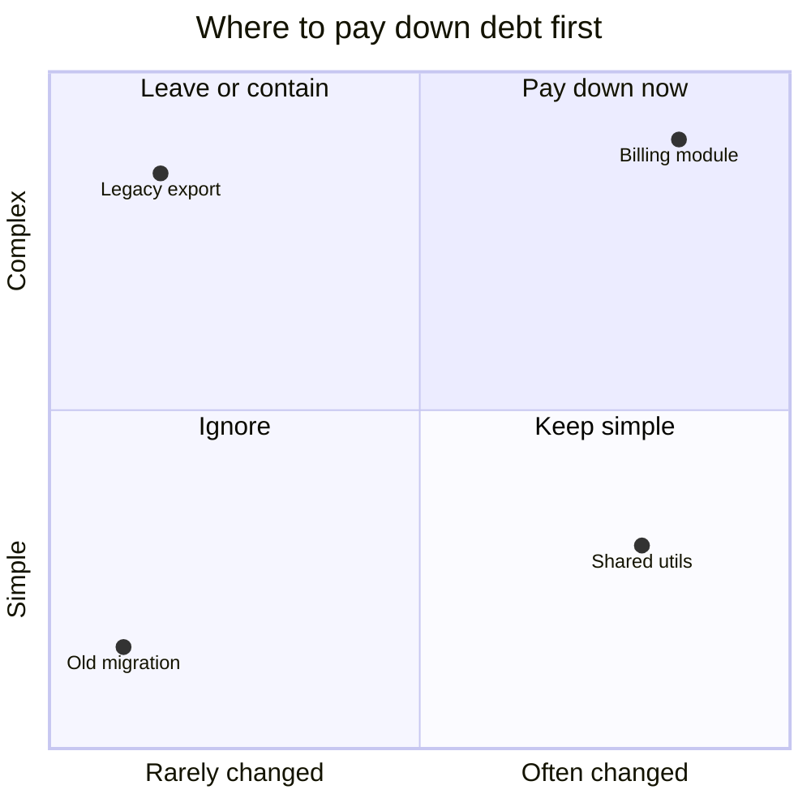
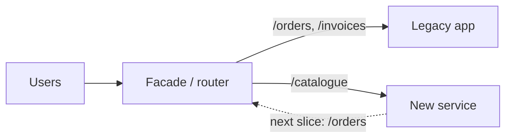

Every codebase you'll work on has parts everyone avoids: the module nobody dares touch, the
script only one person understands, the dependency three major versions behind. Juniors complain
about it; seniors manage it. That means knowing which mess actually costs you, explaining that
cost in terms the business cares about, and paying it down in small steps while features keep
shipping. This session covers the kinds of technical debt, how to measure and talk about it, the
strangler fig approach to modernisation, and then you build a debt register.

## Kinds of technical debt

Ward Cunningham coined the metaphor in 1992. As
[Martin Fowler puts it](https://martinfowler.com/bliki/TechnicalDebt.html), technical debt is the
**cruft** that builds up in a system: deficiencies in internal quality that make it harder than it
should be to modify and extend. The metaphor maps neatly onto money:

- **Principal** is the cost of removing the cruft (say, five days to restructure a module).
- **Interest** is the extra effort every change pays because the cruft is there (a feature takes
  six days instead of four).

Fowler's key insight: interest is only charged **when you work in that area**. Messy code you
never touch costs nothing. Messy code you change every week costs you every week. So "is this
ugly?" is the wrong question; "how often do we pay interest on it?" is the right one.

Fowler also sorts debt by two questions: was it taken on **deliberately** or **inadvertently**, and
was that **prudent** or **reckless**? That gives four kinds:

| | Reckless | Prudent |
| --- | --- | --- |
| **Deliberate** | "We don't have time for design." | "We must ship now and will deal with the consequences." |
| **Inadvertent** | "What's layering?" | "Now we know how we should have done it." |

The bottom-right box is unavoidable and healthy: you learn the right design by building the wrong
one first. The top-left box is the one to push back on.

Beyond that, it helps to name **where** the debt lives, because each kind is paid down differently:

- **Code debt**: duplication, giant functions, missing abstractions, dead code.
- **Architecture debt**: wrong boundaries, a shared database between services, a synchronous call
  chain that should be a queue.
- **Test debt**: missing or flaky tests, so every change is scary.
- **Dependency debt**: outdated frameworks and libraries, unpatched CVEs, end-of-life runtimes.
- **Infrastructure and operations debt**: manual deployments, snowflake servers, no alerts.
- **Documentation and knowledge debt**: one person knows how billing works.

> [!NOTE]
> Not all debt is bad. Taking a deliberate, prudent shortcut to hit a launch date is a normal
> business decision, like a mortgage. The problem is debt nobody knows about, and debt that is
> never repaid.

## Measuring and communicating debt

You'll never get budget to fix "the code is messy". You will get it for "checkout changes take
three times longer than they should and caused two incidents this quarter". Measure in terms of
**interest paid**.

Signals worth collecting:

- **Change frequency × complexity ("hotspots").** Files that change often and are complex are
  where interest is highest. `git log` gives you change frequency in one command:

```sh
git log --since="6 months ago" --name-only --format="" | sort | uniq -c | sort -rn | head -20
```

- **Lead time for changes** in a given area, compared with other areas.
- **Incidents and bugs** traced back to a component.
- **Onboarding time**: how long before a new person can change this module safely.
- **Dependency age**: how far behind latest, and whether versions are out of support.
- **Developer pain**: ask the team. A quarterly "which part of the code slows you down most?"
  survey is cheap and surprisingly accurate.



When you communicate it, translate into the listener's currency:

- To a **product manager**: "Every feature in onboarding costs about two extra days. Three days of
  cleanup pays back after two features, and we have five planned."
- To an **engineering manager**: "Billing caused 3 of our last 5 incidents; the on-call load is
  burning people out."
- To **leadership**: risk and speed. "We're on a framework version that stops getting security
  patches in June."

> [!TIP]
> Don't ask for a "tech debt sprint". Ask for a fixed slice of capacity (often 10 to 20%) spent on
> the highest-interest items, and attach debt work to the features that touch the same code. "We'll
> clean up the module while building the feature that lives there" is the easiest yes you'll get.

## Incremental modernisation (strangler fig)

The tempting answer to a crufty system is the **big rewrite**: freeze the old one, build a shiny
new one, switch over. It is also one of the riskiest projects in software. The old system keeps
changing, the new one has to replicate years of undocumented behaviour, and nothing ships until
the end.

Fowler's alternative is the
[Strangler Fig Application](https://martinfowler.com/bliki/StranglerFigApplication.html). A
strangler fig is a vine that grows around a host tree, gradually taking its shape, until the
original tree dies and the fig stands on its own. In software: build the new system **around the
edges** of the old one, move behaviour piece by piece, and let the old system shrink until it can
be switched off.

The mechanics:

1. **Put a facade in front** of the old system: a proxy, an API gateway, or a routing layer in
   the code. All traffic goes through it.
2. **Pick one slice** (an endpoint, a feature, a report) and build it in the new system.
3. **Route that slice** to the new implementation. Often behind a flag, sometimes by sending a
   copy of traffic to both and comparing results first.
4. **Repeat** until nothing routes to the old system, then delete it.



Why it works: value ships early, risk is spread across many small cut-overs, and you can stop at
any point with a working system. The same idea scales down to a single module: introduce an
interface, implement it fresh, migrate callers one by one, delete the old implementation.

> [!WARNING]
> Strangler migrations fail when the last 20% never gets done, and you end up running two systems
> forever. Track the remaining slices visibly, and budget the deletion of the old system as part
> of the project, not as a nice-to-have.

## Practice: a technical debt register for a project

A **debt register** is a living list of known debt with enough information to prioritise it. Use
YouCanDoIt or a work project. Allow about 90 minutes.

### Step 1: Collect candidates

Combine three sources: the hotspot command above, `TODO`/`FIXME` comments
(`grep -rn "TODO\|FIXME" apps/`), and your own memory of "the bit I dread changing". In YouCanDoIt,
look at things like `toDo.md`, outdated dependencies (`npm outdated`, `pip list --outdated`) and any
area with no tests.

### Step 2: Record each item

Create `docs/tech-debt.md` (or a board with the same columns):

| ID | Item | Kind | Interest (what it costs us) | Principal (effort) | Risk | Priority |
| --- | --- | --- | --- | --- | --- | --- |
| TD-1 | No tests for news refresh job | Test | Every change is checked by hand; one silent failure last month | 1 day | Medium | High |
| TD-2 | Next.js minor versions behind | Dependency | Security patches delayed | 0.5 day | Medium | Medium |
| TD-3 | Duplicated date formatting in web | Code | Small, rarely touched | 2 hours | Low | Low |

### Step 3: Prioritise

Score interest (how often, how painful) against principal. High interest and low principal goes
first. Large, high-interest items get a strangler-style plan in small slices rather than one ticket.

### Step 4: Decide what you will not fix

Mark some items **accepted**: debt you consciously keep because the interest is low. That is a
decision too, and writing it down stops the same discussion happening every month.

### Step 5: Schedule the top item

Pair the highest-priority item with a feature that touches the same code, or reserve time for it
this week. Then set a reminder to review the register monthly.
